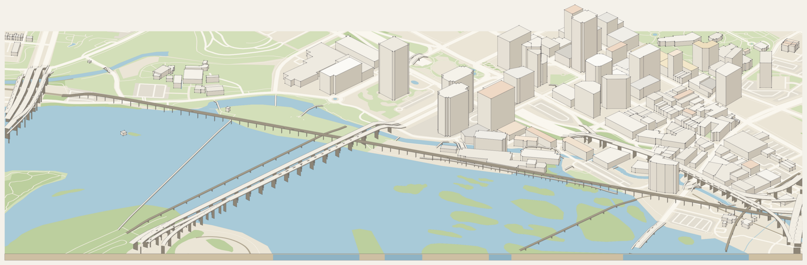

# isoscape

Isometric dot-and-line views of real places, built from open map data.

A sibling of [dotscene](https://github.com/busse/dotscene): the same visual language (inked
edges, a dot on every corner, flat fills), but driven by geography instead of hand-placed
points. Where dotscene is for authoring a scene, isoscape is for *surveying* one. You give it a
frame on the world, and it fetches OpenStreetMap, extrudes every building, raises the bridges,
sorts it all back to front and writes an SVG and a pan-and-zoom page.

The first region is downtown Richmond, VA, from Tredegar to the Mayo Bridge.



```sh
node bin/isoscape.js fetch richmond-downtown   # OSM → data/richmond-downtown/osm.json
node bin/isoscape.js build richmond-downtown   # → out/richmond-downtown.{svg,html}
node bin/isoscape.js build richmond-downtown --palette night --png
```

Node 22.18 or newer. No runtime dependencies and no build step: Node strips the TypeScript
types itself. `--png` shells out to `rsvg-convert` (`brew install librsvg`).

## Commands

| | |
|---|---|
| `isoscape regions` | list the region configs in `regions/` |
| `isoscape query <region>` | print the Overpass query a fetch would send |
| `isoscape fetch <region>` | download OSM data into `data/<region>/osm.json`, retrying across mirrors |
| `isoscape info <region>` | the chosen bearing, feature counts, and where building heights came from |
| `isoscape build <region>` | write `out/<region>.svg` and `out/<region>.html` |

`build` flags: `--palette <paper\|night>`, `--png`, `--width <px>` (PNG width), `--out <dir>`.

Overpass is often at capacity. `fetch` retries across four mirrors with backoff. If it still
fails, run `isoscape query <region>`, paste the query into
[overpass-turbo](https://overpass-turbo.eu), export the raw JSON, and save it as
`data/<region>/osm.json`.

## How it works

```
regions/<name>.json ─► fetch ─► data/<name>/osm.json
                                     │
                    parseOsm (osm.ts): polygons, multipolygons, lines, in lon/lat
                                     │
         chooseBearing (scene.ts): snap the camera so the street grid sits on the diagonals
                                     │
     buildScene: ground polygons · road/rail ribbons · extruded buildings · bridge spans
                                     │
              paintOrder (order.ts): pairwise occlusion → topological sort
                                     │
                     renderSvg (render.ts) ─► out/<name>.svg, .html, .png
```

**The camera** (`view.ts`) is orthographic, tilted down, and always looks along +N′ ("view
north"). Ground across the frame is drawn at full `scale`. Ground into the frame is
foreshortened by `squash`, the sine of the tilt (0.5 is a 30° tilt). Height is drawn at the
cosine of the tilt. The frame is a rectangle in view metres, so it lands on screen as a plain
rectangle, which suits a panorama.

**Snap.** A camera facing due north sees most street grids at an odd angle. With `snap`, the
dominant orientation of the building edges is measured (length-weighted, folded mod 90°), and
the camera turns by up to 45° so that grid runs along the isometric diagonals. Downtown
Richmond snaps to a bearing of −8.7°.

**Buildings** (`extrude` in `scene.ts`) are prisms: a wall on every footprint edge that faces
the camera, painted far to near, then the roof. Courtyards (inner rings) work. Wall tone
follows the wall's normal, with light from the left. Heights come from OSM `height`, then
`building:levels`, then a guess from the building's type and size; `isoscape info` reports the
mix. OSM Simple 3D Buildings parts (`building:part`) replace their outline when present.

**Bridges.** OSM splits a bridge into many ways, so connected bridge ways (same layer and
kind) are chained first. Only ends that touch no other bridge way ramp down to the ground.
Deck height comes from a per-region rule matched on the name, else `bridgeDeck × layer`.
Each chain is cut into ~22 m spans so it can interleave with buildings in the paint order.
Piers drop every 38 m.

**Paint order** (`order.ts`). A single depth key is wrong as soon as a long warehouse sits
beside a small house. So order is decided pairwise, only between items whose screen boxes
overlap. If the footprints are separable, the one on the camera's side of the separating
line is in front. If they overlap, a part entirely above the other is in front. Otherwise
centroid depth decides. A topological sort turns those facts into one order, and the rare
cycle is broken by depth.

**Ground** paints in fixed layers: the slab and its cut face, water, then parks, parking,
roads and rail. Those land layers are masked so they never paint on open water. Islands
are holes in the river or `place=island` polygons.

## Region config

```jsonc
{
  "title": "Richmond, VA — Tredegar to the Mayo Bridge",
  "center": [-77.4400, 37.5338],  // lon, lat
  "width": 1700,                  // metres across the frame
  "depth": 950,                   // metres into the frame
  "bearing": 0,                   // direction the camera faces; 0 = north is up
  "snap": true,                   // turn ≤45° to put the street grid on the diagonals
  "scale": 2.4,                   // px per metre across the frame
  "squash": 0.5,                  // sine of the tilt
  "exaggeration": 1.0,            // vertical exaggeration
  "slab": 16,                     // ground slab thickness, metres
  "palette": "paper",             // paper | night
  "bridgeDeck": 7,                // default deck height per OSM layer
  "bridges": [{ "match": "Manchester", "deck": 24 }],
  "minBuildingArea": 12,          // m²
  "dots": "all"                   // all | roof | none
}
```

The fetch covers the frame's circumscribed circle, so a snapped camera never looks past the
data.

## Roadmap

1. **Lidar heights.** About 40% of downtown heights are guesses. Join Virginia's statewide
   lidar (USGS 3DEP): surface model minus ground model, sampled per footprint.
2. **Terrain.** Sample a DEM for each building's base and give the ground plate relief.
   Church Hill, Libby Hill and the Oregon Hill bluffs are what make Richmond look like
   Richmond.
3. **Corridors.** A region shaped by a GeoJSON polygon instead of a rectangle: the river plus
   a ~300 m buffer on its north bank, clipped to the city line. That is the full
   west-to-east Richmond strip. It may also mean "unrolling" the river so distance along the
   centreline becomes screen x.
4. **Tiles.** Build once, then crop viewBoxes into tiles and rasterise a zoom pyramid for a
   web map. There are no seams to hide: one projection, one paint order.
5. **Levels of detail.** Drop dots and minor edges at low zoom.
6. **Hand-drawn landmarks.** Override the Belle Isle footbridge under the Lee Bridge, the
   Potterfield bridge and the Triple Crossing with authored figures.
7. **Trees.** Scatter crowns over wooded areas and cemeteries.

## Data

Map data © [OpenStreetMap](https://www.openstreetmap.org/copyright) contributors, available
under the Open Database License. The cached `data/*/osm.json` files carry that licence, and
every rendered SVG and page carries the attribution.
