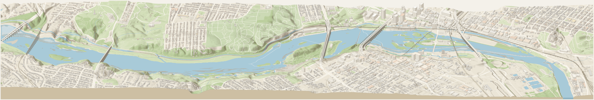

# isoscape

Isometric dot-and-line views of real places, built from open map data.

See the maps at [busse.github.io/isoscape](https://busse.github.io/isoscape/) · Prints at
[chrisbusse.com](https://chrisbusse.com/), which support the work.

A sibling of [dotscene](https://github.com/busse/dotscene): the same visual language (inked
edges, a dot on every corner, flat fills), but driven by geography instead of hand-placed
points. Where dotscene is for authoring a scene, isoscape is for *surveying* one. You give it a
frame on the world, and it fetches OpenStreetMap, extrudes every building, raises the bridges,
sorts it all back to front and writes an SVG and a pan-and-zoom page.

The first region is downtown Richmond, VA, from Tredegar to the Mayo Bridge, in two
versions: a flat plate, and one shaped by real elevation. Richmond sits on the Fall Line,
where the James drops off the Piedmont onto the coastal plain. Through this slice the river
falls about 10 m through boulder fields and rapids to the head of tide at the Mayo Bridge,
under bluffs that rise 50 m to downtown, Oregon Hill and Church Hill.


The widest view, `richmond-i195-rocketts`, follows the James for 7.85 km, from I-195 to
Rocketts Landing. Every mapped building is drawn (about 6,750), as are all bridges, rapids
and the bluffs on both banks. It is a 36 MB SVG, and `--png` renders it at 18,840 px wide.



`gwynns-island` is tidewater: Gwynn's Island and Mathews County, from the Route 3 bridge over
the Piankatank to Milford Haven, with Deltaville and Stingray Point across the river. Here the
water comes from OSM's coastline. OSM maps few buildings and little land cover here, so
footprints come from Microsoft's model and woods and fields from NLCD (see
[Extra sources](#extra-sources)).


```sh
node bin/isoscape.js fetch richmond-downtown        # OSM + elevation → data/richmond-downtown/
node bin/isoscape.js build richmond-downtown-topo   # → out/richmond-downtown-topo.{svg,html}
node bin/isoscape.js build richmond-downtown        # the flat version
node bin/isoscape.js build richmond-downtown-topo --palette night --png
```

Then open `out/index.html`, the explorer.

## Make your own

isoscape is free and open source. Open a chat with Claude (we used Claude Opus 5.5) and say:

> Use the GitHub repo busse/isoscape to make an isometric map of *your place*.

Claude clones the repo, writes a region file for your place (`regions/<name>.json`: a center,
a width and depth in meters, see [Region config](#region-config)), fetches OpenStreetMap and
elevation, and builds the SVG and the pan-and-zoom page. It takes a few minutes. Terrain works
anywhere: USGS 3DEP in the US, IGN in France, swisstopo in Switzerland, GSI in Japan, and
Copernicus's 30 m model for the rest of the world (see [Elevation sources](#elevation-sources)). Your map is yours to print and share; credit OpenStreetMap (see
[LICENSE-maps.md](LICENSE-maps.md)).

**How isoscape was made.** isoscape was built, and the holiday shop is run, in chats with
Claude, Anthropic's AI, using Claude Opus 5.5, directed and reviewed by Chris Busse. Claude wrote
the code, traced the historic buildings, laid out the prints, and set up the shop. The maps are
drawn by software from open data, not by hand; the historic years are machine-traced sketches.

Prints of the maps on the isoscape site (Richmond through time, Gwynn's Island, fifty American
landmarks, and [five landmarks around the world](pages/world-landmarks.md)) are in a holiday shop at [chrisbusse.com](https://chrisbusse.com) through
December 31, 2026. The tool stays here for good.

## The explorer

Every `build` is archived under `out/builds/<timestamp>-<name>/`: the SVG, a thumbnail, and
a `meta.json` holding the commit (and whether the source had uncommitted changes), the
region's settings, the timings, and every number the build measured. Each build then
rewrites `out/index.html`, a single local page over all of them:

- **Left column:** builds grouped by region, newest first, each with its thumbnail, palette,
  age, note and commit. Type to filter.
- **Middle:** the selected build. Drag to pan, scroll to zoom, double-click to fit. Stepping
  between builds of the same frame keeps the view, so you can flick back and forth.
- **Bottom:** when and from what it was built, its measures, and its settings.
- **Compare** (`C`, or ⌥-click a second build): B is laid over A in the same scene
  coordinates, with a divider to drag. The info panel shows the change in every measure and
  every setting that differs.
- **How this view was made** (`M`, a tab in the info panel): the selected build explained in
  sentences, written from its `meta.json`: the frame and camera, which data went in, the
  elevation range, where the building heights came from, bridge rules, rapids, the commit.
  Each part links to the matching section of the site's pages. Measures an older build did
  not record are marked as unknown. When comparing, A and B are shown side by side.
- **Pages** (top of the left column): longer reading, such as *How it's made* (the whole
  pipeline, and what is measured, inferred or guessed) and *About, credits and licenses*.

Keys: `↑`/`↓` step through builds, `F` fits, `1` shows actual size, `C` compares, `I`
toggles the info panel, `M` switches to "How this view was made", `/` filters, `Esc` leaves a
page for the viewer. The URL hash holds the selection: `#<id>`, `#<idA>..<idB>` to compare,
`/made` on either for the tab, `#/<page>` or `#/<page>/<section>` for a page. A reload (after
the next build) keeps your place, and Back and Forward move between pages and the viewer.

### Link previews

Chat apps and social sites ignore the `#…` part of a link and run no script, so each build
also gets a share page, `out/s/<id>.html` (and each page `out/s/page-<slug>.html`), with its
own title, description and a 1200×630 preview image, `out/builds/<id>/social.png` (the picture
cropped to fit; `rsvg-convert` or Chrome renders it, else the thumbnail stands in). A share
page forwards to the explorer and keeps the fragment, so the **Link** button (`L`) copies
`s/<id>.html#<the exact view>`. `isoscape explorer` makes any missing images and pages.
Previews need absolute URLs: before publishing, give the public address of `out/` in
`isoscape.config.json` (`{ "siteUrl": "https://example.org/isoscape/" }`), in
`ISOSCAPE_SITE_URL`, or as `--site-url` on `build`, `series` or `explorer`, and rebuild the
page. `"flagship": "<region>"` there picks the site's own preview image (default: the newest build), which content
pages share unless their front matter names their own (`social:`, below).

The same file can give the explorer a front page. `"home"` has a `title`, an `intro`, `heroes`
(featured views, each a `region`, optional `year` in a dated series, `title`, `blurb`, and
`shop` link with optional `shopLabel`), `sections` (each a `title`, the region-name `prefixes` it holds, and optionally
`homeTitle`, `blurb`, `order` (region names to show first), `collapsed`, `shop` and `shopLabel`), and `links` shown at the bottom.
The page then opens on the front page (`#home`). The build list is grouped by the same
sections, with featured regions first and folded sections closed. `"shop"` (`label`, `url`,
`cta`, and `links` keyed by region prefix) adds the shop button and a "Buy a print" button on
matching views. See this repo's own `isoscape.config.json`.

### Static pages and search

The explorer is one page that routes with the URL fragment, so a search engine sees a single
address, and the share pages forward into it at once. So `isoscape explorer` (and every build)
also writes a plain HTML page for everything worth finding, beside `index.html`:

- `p/<slug>.html`: every content page, its whole text in the document, with GitHub-style
  anchors, links between pages as files, its images copied into `p/`, and "Open this in the
  explorer". Where the page's maps (or the section that tells its story) have a shop link,
  "Prints of this map" goes to it.
- `m/<region>.html`: every region's newest build, with its picture, "How this view was made"
  (the same text as the explorer's tab, from `src/story.ts`), "Explore this map" (the lasting
  route `#<region>` or `#<region>:<year>`) and "Buy a print" (the explorer's shop rule). A dated
  series of more than one year gets a series page there instead, with every year, and
  `m/<region>-<year>.html` for each year, linked to each other.
- `sitemap.xml`: `index.html` and every one of those pages, with the date of the build or of
  the page's last commit. Written only when the site URL is known (sitemaps need absolute URLs).

Each page has its own title, description, canonical URL, link-preview tags, JSON-LD
(`Article` for content pages, `VisualArtwork` for maps, by Chris Busse), the explorer's colors
and type, and the site's Google Analytics when `analytics.ga` is set. Shop links carry the
campaign tags the explorer adds when they are clicked, written in at build time:
`utm_source=isoscape-explorer&utm_medium=referral&utm_campaign=<page slug or region>`.

Map pages are named by region, not by build id, so a rebuild keeps their address; build ids
change with every build. The share pages in `s/` keep their addresses and their forwarding
(links already shared still open the explorer at the exact view), name the matching static
page as canonical, and link to it. `index.html` lists every static page in a folded
"Every map and page as a plain web page" at the foot of the front page, and without script shows
only that. Pages of regions or content pages that are gone are removed from `m/` and `p/`.

**Submitting the sitemap.** A GitHub Pages project site lives under a path
(`https://busse.github.io/isoscape/`) and cannot serve the host's root `robots.txt`, so no
`robots.txt` can point to the sitemap. Every page names it in its head
(`<link rel="sitemap" href="sitemap.xml">`), but search engines do not rely on that: the site's
owner must submit `https://busse.github.io/isoscape/sitemap.xml` once in
[Google Search Console](https://search.google.com/search-console) (add the URL-prefix property
`https://busse.github.io/isoscape/`, verify it with the HTML-file or meta-tag method, then
Sitemaps → Add), and in Bing Webmaster Tools if wanted. After that, each publish updates it.

### Adding a page

Pages are Markdown files in `pages/`, compiled into `out/index.html` whenever it is
written (after every build, or with `isoscape explorer`). To add one, create
`pages/<slug>.md`:

```markdown
---
title: Reading the contours
order: 30
summary: One line, shown as the nav link's tooltip.
---

# Reading the contours

Text, **emphasis**, `code`, lists, tables, fenced code and block quotes.
Link a section of this page as [rapids](#rapids), another page as [About](about.md),
or a section of it as [data](about.md#data). Images beside the page are inlined:

```

- `social` (optional) names a 1200×630 PNG or JPEG beside the page for its link preview; it
  is copied to `out/s/page-<slug>.jpg` (or `.png`). Without it, a page previews with the
  site's flagship view. `world-landmarks-social.jpg` is one, made from the five maps.
- `title` is the nav label (default: the first `#` heading). `order` sorts the nav, lowest
  first (default 100); the shipped pages use 10 and 90. `slug` overrides the file name.
- Section ids follow GitHub's rule (lower case, punctuation dropped, spaces to hyphens), and
  links are written as they would be for GitHub, so the files read the same on GitHub as in
  the explorer.
- Images must be `.svg`, `.png`, `.jpg` or `.webp` files in `pages/` itself, and are
  embedded as data URIs so the explorer stays one file. An SVG can follow light and dark
  mode with a `prefers-color-scheme` media query, as `pipeline.svg` does.
- The converter (`src/markdown.ts`) escapes all text and drops raw HTML and unsafe link
  schemes. Files starting with `_` (drafts) and `README.md` are skipped.
- `npm test` checks that every in-page link in `pages/` lands on a real section, and that the
  sections the "How this view was made" tab links to exist in `how-its-made.md`. If you
  rename a heading there, update `makeStory` in `src/story.ts` too.

```sh
node bin/isoscape.js build richmond-downtown-topo --note "lighter foam"   # say what you tried
node bin/isoscape.js build richmond-downtown --no-archive                 # a throwaway build
node bin/isoscape.js backfill 2b8f86d richmond-downtown                   # an older commit's output
node bin/isoscape.js explorer                                             # just rewrite the page
```

`backfill` exports the commit's tree to a temporary directory, gives it this checkout's
cached data, runs its own CLI, and archives the result dated to the commit. That puts
outputs from before the archive existed in the explorer alongside new ones. Thumbnails use
`rsvg-convert` if installed, else ImageMagick, else a color swatch. `out/` is git-ignored:
the archive is local.

## Requirements

Node 22.18 or newer. No runtime dependencies and no build step: Node strips the TypeScript
types itself. `--png` shells out to `rsvg-convert` (`brew install librsvg`).

## Commands

| | |
|---|---|
| `isoscape regions` | list the region configs in `regions/` |
| `isoscape query <region>` | print the Overpass query a fetch would send |
| `isoscape fetch <region>` | download OSM data (`osm.json`) and elevation (`dem.bin.gz`) into `data/<region>/`; `--osm-only`, `--dem-only` |
| `isoscape info <region>` | the chosen bearing, feature counts, and where building heights came from |
| `isoscape locate <region> <lon,lat>...` | where places fall in the built picture, in SVG units (`--year` for a dated scene); the print tools use it to place markers and crops |
| `isoscape build <region>` | write `out/<region>.svg` and `out/<region>.html`, archive the build, refresh the explorer; `--year <yyyy>` for one scene of a dated region |
| `isoscape series <region>` | build every year of a dated region, each as `<region>-<year>` |
| `isoscape explorer` | rewrite `out/index.html` from the archive |
| `isoscape backfill <commit> <region>` | build a region with an earlier commit's code and archive it |

`build` flags: `--palette <paper\|night>`, `--note "<text>"`, `--no-archive`, `--png`,
`--width <px>` (PNG width), `--out <dir>`.

Big regions are fetched in tiles. OSM comes in tiles of at most 1.6 km a side and elevation
in tiles of at most 1,500 px, because both services refuse or time out on large requests.
Every finished tile is cached under `data/<region>/osm-tiles/` or `dem-tiles/`, so an
interrupted `fetch` resumes where it stopped. `--budget <seconds>` stops it starting new
tiles after that long. A tile cache is named by its bounds, so a changed frame never reuses
the wrong tile. Overpass is often at capacity. `fetch` retries across four mirrors with
backoff, and checks that every answer parses (a timed-out transfer can arrive as HTTP 200
with a truncated body). If it still fails, run `isoscape query <region>`, paste the query into
[overpass-turbo](https://overpass-turbo.eu), export the raw JSON, and save it as
`data/<region>/osm.json`.

## How it works

```
regions/<name>.json ─► fetch ─► data/<name>/osm.json
                                     │
                    parseOsm (osm.ts): polygons, multipolygons, lines, in lon/lat
                                     │
         chooseBearing (scene.ts): snap the camera so the street grid sits on the diagonals
                                     │
     buildScene: ground polygons · road/rail ribbons · extruded buildings · bridge spans
                                     │
              paintOrder (order.ts): pairwise occlusion → topological sort
                                     │
                     renderSvg (render.ts) ─► out/<name>.svg, .html, .png
```

**The camera** (`view.ts`) is orthographic, tilted down, and always looks along +N′ ("view
north"). Ground across the frame is drawn at full `scale`. Ground into the frame is
foreshortened by `squash`, the sine of the tilt (0.5 is a 30° tilt). Height is drawn at the
cosine of the tilt. The frame is a rectangle in view meters, so it lands on screen as a plain
rectangle, which suits a panorama.

**Snap.** A camera facing due north sees most street grids at an odd angle. With `snap`, the
dominant orientation of the building edges is measured (length-weighted, folded mod 90°), and
the camera turns by up to 45° so that grid runs along the isometric diagonals. Downtown
Richmond snaps to a bearing of −8.7°.

**Buildings** (`extrude` in `scene.ts`) are prisms: a wall on every footprint edge that faces
the camera, painted far to near, then the roof. Courtyards (inner rings) work. Wall tone
follows the wall's normal, with light from the left. Heights come from OSM `height`, then
`building:levels`, then a guess from the building's type and size; `isoscape info` reports the
mix. OSM Simple 3D Buildings parts (`building:part`) replace their outline when present.

**Bridges.** OSM splits a bridge into many ways, so connected bridge ways (same layer and
kind) are chained first. Only ends that touch no other bridge way ramp down to the ground.
Deck height comes from a per-region rule matched on the name, else `bridgeDeck × layer`.
Each chain is cut into ~22 m spans so it can interleave with buildings in the paint order.
Piers drop every 38 m.

**Paint order** (`order.ts`). A single depth key is wrong as soon as a long warehouse sits
beside a small house. So order is decided pairwise, only between items whose screen boxes
overlap. If the footprints are separable, the one on the camera's side of the separating
line is in front. If they overlap, a part entirely above the other is in front. Otherwise
centroid depth decides. A topological sort turns those facts into one order, and the rare
cycle is broken by depth.

**Terrain** (`dem.ts`, `dem-sources.ts`, `rasters.ts`, `terrain.ts`). In the US, elevation
comes from USGS 3DEP, the National Map's seamless bare-earth model, which is 1 m lidar across
Richmond; elsewhere from the source the region names (see [Elevation sources](#elevation-sources)). `fetch` asks its
`exportImage` service for an uncompressed float GeoTIFF over the region. A minimal reader
parses it, and it is stored as gzipped int16 centimeters (about 4 MB for this slice). The
build resamples it onto a 5 m grid in view meters and blurs it lightly to lose the lidar
grit. Elevation above the frame's lowest point, times `terrain.exaggeration`, becomes scene
height. Buildings and bridge clearances add true meters on top, so the hills are
exaggerated but the towers are not.

**Elevation voids.** 3DEP sometimes fills a void with a large negative value: one patch near
Shockoe Bottom read −88 m. Samples below −5 m, plus a few pixels around them, are treated as
missing and filled from their neighbors.

**The river.** Lidar over mapped water is not the water: rocks, ledges and overlapped banks
stand above it. The surface at each water node is taken as a low percentile of the wet ground
within 30 m, then smoothed along the water. Anything a meter or more above that surface is
drawn as exposed rock, which gives the boulder fields. The water drapes on the surface, so
it lies level across the river and falls along it. **Rapids** are drawn where that surface
falls faster than `terrain.rapids` (m/m) measured over 40 m: white strokes across the
current, with froth where it drops hardest. OSM weirs are drawn as white crests. Rocks and
rapids are only read at least two cells (10 m) from shore. **The shoreline follows the
lidar, not OSM's outline:** near-shore "water" standing more than a meter above the river is
given back to the land at its own height. The water's edge is then traced through the
corrected water grid (marching squares over a lightly smoothed mask) and drawn at the
river's surface. Where an outline overlaps a steep bank, this gives a bank sloping into the
water rather than water climbing the bank. Flat scenes still use OSM's outline.

**Ground with relief paints in strips.** A height field hides itself: a bank falling away from
the camera covers the water behind it. So the ground is painted in 10 m strips across the
frame, far to near. Each strip drapes everything on it over the terrain: bare ground, parks,
water, islands, roads, rail, hillshade (lit from the left and slightly toward the camera),
contours (2 m, heavier every 10 m) and rapids. Each building or bridge paints straight after
the strip holding its near edge, so a hill in front of it covers it and ground behind it
does not. Buildings sit on the lowest ground under their footprint, so on a slope the
downhill wall shows full height. Bridge decks are a taut line over whatever they cross:
the upper hull of the ground plus clearance, ramping down only at ends that meet the ground.
Piers drop to the real ground or water. The slab's front face is a true cross-section of
the valley, with water where the cut crosses the river. A region without `terrain` gets the
same pipeline on a flat plate.

## Region config

```jsonc
{
  "title": "Richmond, VA — Tredegar to the Mayo Bridge",
  "center": [-77.4400, 37.5338],  // lon, lat
  "width": 1700,                  // meters across the frame
  "depth": 950,                   // meters into the frame
  "bearing": 0,                   // direction the camera faces; 0 = north is up
  "snap": true,                   // turn ≤45° to put the street grid on the diagonals
  "scale": 2.4,                   // px per meter across the frame
  "squash": 0.5,                  // sine of the tilt
  "exaggeration": 1.0,            // vertical exaggeration
  "slab": 16,                     // ground slab thickness, meters
  "palette": "paper",             // paper | night
  "bridgeDeck": 7,                // default deck height per OSM layer
  "bridges": [{ "match": "Manchester", "deck": 24 }],  // + "pierSpacing": meters (default 38; long for suspension bridges)
  "minBuildingArea": 12,          // m²
  "dots": "all",                  // all | roof | none
  "data": "richmond-downtown",    // optional: share another region's cached data
  "terrain": {                    // optional: relief from data/<region>/dem.bin.gz
    "exaggeration": 2.5,          // vertical exaggeration of the ground only
    "cell": 5,                    // grid spacing, meters
    "contour": 2,                 // contour interval, meters (0 for none)
    "majorEvery": 5,              // every 5th contour heavier
    "rapids": 0.035,              // water-surface fall (m/m over 40 m) that reads as rapids
    "demResolution": 1,           // meters per pixel to fetch (default 1, or the source's own spacing)
    "source": "3dep",             // where the heights come from; see Elevation sources
    "fillFrom": "copernicus"      // optional: a second source for gaps (a national model stops at the border)
  }
}
```

The fetch covers the frame's circumscribed circle, so a snapped camera never looks past the
data.

## Elevation sources

`terrain.source` picks where the heights come from. Every source ends as the same cached grid,
so nothing after `fetch` changes. `isoscape sources` prints them all, with credits and
licenses; the maps, the explorer and the prints credit whichever one a region used.

| `source` | Covers | Data | Detail |
|---|---|---|---|
| `3dep` (default) | United States | USGS 3D Elevation Program, bare earth | 1 m lidar where flown |
| `ign` | France | IGN RGE ALTI®, bare earth | 1 m |
| `swisstopo` | Switzerland, Liechtenstein | swissALTI3D, bare earth (1 km squares, Swiss grid) | 2 m |
| `gsi` | Japan | GSI elevation tiles, bare earth | 5 m lidar, else 10 m |
| `copernicus` | The whole world | Copernicus DEM GLO-30, a *surface* model (trees and roofs included) | 30 m |
| `terrain-tiles` | The whole world | Mapzen/Tilezen Terrain Tiles on AWS, a mosaic of open models | 1–30 m, by country |

All of them allow commercial use with credit. [Landmarks around the
world](pages/world-landmarks.md) has one map for each, and explains how they are read.

## Extra sources

OSM and 3DEP are always used. A region can ask for more where OSM is thin, which is usually
in the countryside:

```jsonc
"sources": { "buildings": ["osm", "microsoft"], "landcover": "nlcd" }
```

- `"microsoft"` adds [Microsoft's Global ML Building
  Footprints](https://github.com/microsoft/GlobalMLBuildingFootprints) (ODbL) where OSM has no
  building, with the model's height where it gave one.
- `"nlcd"` draws woods, wetlands, fields and crops from the [National Land Cover
  Database](https://www.mrlc.gov/) (NLCD 2021, 30 m, public domain), under OSM's own land use.

`fetch` gets them along with everything else; `fetch <region> --extras-only` gets just these.
For tidal water, set `terrain.rocks: false` and `terrain.rapids: 0`: river logic has nothing to
find there.

## Time

A region with a `time` section is drawn as a series of years:

```jsonc
"time": {
  "history": "history/richmond-downtown.json",
  "yearBuilt": { "url": "https://…/Year_of_Construction/FeatureServer/0", "field": "Year_Built" }
}
```

`fetch <region> --extras-only` pages the assessor's year-built parcels into
`data/<region>/yearbuilt.json`. The history file lists the series' `epochs` (year, title,
note), its curated `features` (a filled basin, a burned district, lost landmarks, a buried
creek, the town plan), the era `rules` that date roads, rail and water, and curated `dates`
for particular buildings. Every item cites its sources. `isoscape series richmond-downtown-time`
builds all ten scenes from 1737 to today. In the explorer, a series reads in year order: the
year chips above the picture and the `[` `]` keys step through it, and Compare defaults to the
year before. The method and its limits are in the *How it's made* page, under "Time".

**Traced buildings.** `tools/sanborn/` turns Sanborn fire-insurance map sheets into dated
footprints of buildings since lost. It downloads the sheets from the Library of Congress,
fits each sheet to the ground from two or three street corners read off it, traces the
colored fills, and follows each building until a later map, a newer building or a highway
shows it gone. The steps are in *How it's made*, under "Time". The 1886, 1895, 1905, 1924–25 and
1950–52 editions are traced into `history/sanborn/`. The results are sketches: outlines and
heights are approximate, and some buildings are missing, misplaced or merged.

`regions/richmond-downtown-time.json` reuses the I-195 to Rocketts cache (`"data"`) for OSM
and elevation and keeps only its year-built parcels in its own `data/` folder. A build looks for
`yearbuilt.json` in the region's own folder first, then in the shared one, and stops with an
error if neither has it: without it nearly every building would be undated.

## Cutaways

A region with a `cutaway` section opens a modeled building along a vertical plane: the half on
one side is lifted away, its ground floor left as a plan, and every cut is drawn solid in ink.

```jsonc
"cutaway": {
  "through": [-77.4658172, 37.5611118],  // a point on the plane
  "bearing": 40.8,                        // the compass direction it runs
  "remove": "right",                      // the side lifted away; stand the camera there
  "floor": 67.4, "keep": 1.5,             // on that side keep what stands up to 1.5 m over this floor (m above sea level)
  "parts": "bss-",                        // only modeled parts with this id prefix are cut
  "lift": ["^history:bss-canopy-2-south-cut:\\d+$"],  // items lifted away on the removed side though not cut
  "outline": { "parts": ["bss-c-floor-"], "offset": 1.5 },  // dash the removed footprint
  "section": { "from": -62, "to": 104, "beyond": 35, "other": 3, "scale": 10, "earth": 5,
               "route": [[-60, 64.7], [50.5, 68.3]] }    // the flat section and the traveler's path
}
```

The parts come from a history file (see "Time"): a part drawn only in whole views carries
`"only": "whole"` (a building's massing), one drawn only in cutaways `"only": "cutaway"` (its
walls, floors and rooms). A part may stand at an `elevation` and reach `upTo` another, revolve
(`"shape": "revolve"` with `levels`, for a dome or a shell), rise as a `stair`, and says how it
is known: `"confidence": "drawn"`, `"written"` or `"approximate"` (the default). Cut parts must
have convex footprints; a part that does not is cut on its convex hull.

`build` writes the cutaway, its flat section (`<name>-section.svg`) and, for each, where every
part is drawn (`*.anchors.json`). `tools/cutaway/sheet.py cutaways/<name>.json` lays them out
on a 32 x 24 in sheet with numbered callouts, the confidence key, sources and credits. How it
works, and what is approximate, is in *How it's made*, under "Cutaways".

```sh
node bin/isoscape.js build broad-street-station-cutaway --year 1943 --png
python3 tools/cutaway/sheet.py cutaways/broad-street-1943.json   # out/cutaways/
```

## Making a set

A **set** is one big map framed by numbered boxes, each a close view of a place (or of the same
place in another year) with a title, a subtitle and a short sourced note, laid out like a menu.
One description makes every product: the framed set (32×24 in), the map alone (36×24), one
print per box (24×18), framed-canvas files for each, and a page in the explorer.
`sets/streetcars-1925.json` is the worked example: Richmond's streetcar lines in 1925 and
fourteen places they ran to.

1. **The map.** A region with a `time` section (see Time), its history file holding what the
   set is about: curated features, era rules, the series' epochs. Build it and look at it.
2. **The boxes.** A JSON list, inline or in a file, up to fourteen, numbered clockwise from the
   top left:
   ```jsonc
   { "n": 5, "id": "highland-park", "title": "Highland Park",
     "subtitle": "Highland Park line, over the Fifth Street viaduct",   // or "line"
     "at": [-77.42, 37.5765],      // lon, lat the box is centered on
     "year": 1925,                 // optional: draw this box from another year of the series
     "ground": 1800,               // optional: meters across (menu 1,800, single print 2,100)
     "note": "About 50 words, written from the sources…",
     "sources": ["https://…", "https://…"] }
   ```
   Write each note from its sources, in the set's voice: the streetcar set invites you to ride
   ("Over the Fifth Street viaduct and round the loop…") and then says what became of the place.
   American spelling. A box with no source does not go in.
3. **The set file**, `sets/<name>.json`: `slug` (the print files' prefix), `title`, `subtitle`,
   `note` (what is approximate), `credit`, `map` (`region`, `year`), `boxes`, an optional
   `key` (up to sixteen names in the title band, from a list in a JSON file), optional `fine`
   (extra `build` flags for the single prints, e.g. `["--streetcar-scale", "1.5"]`), and `page`
   (`slug`, `title`, `summary`, `intro`, `how`, `noun`, an optional `table`, and `shop` once
   the prints are for sale).
4. **Scenes**, where the region's data is cached: `python3 tools/sets/set.py <name> prepare`
   builds each year's SVG into `out/sets/<name>/scenes/` and writes `points.json`.
5. **Prints**, anywhere with `rsvg-convert`: `set.py <name> menu`, `map`, `boxes`, `canvas`
   (300 dpi into `out/sets/<name>/print/`; `--dpi 40` for a quick proof). Look at every one.
6. **The page**: `set.py <name> page` writes `pages/<page.slug>.md` and its two images from the
   menu print. Link it from a section of `isoscape.config.json` (`page`, `pageLabel`) and, once
   the prints sell, point `shop.links` at the collection for the region.

## Roadmap

1. **Lidar heights.** About 40% of downtown heights are guesses. 3DEP's bare-earth model is
   in place; the first-return surface model minus it, sampled per footprint, gives real
   heights.
2. **Corridors.** A region shaped by a GeoJSON polygon instead of a rectangle: the river plus
   a ~300 m buffer on its north bank, clipped to the city line. That is the full
   west-to-east Richmond strip. It may also mean "unrolling" the river so distance along the
   centerline becomes screen x.
3. **Tiles.** Build once, then crop viewBoxes into tiles and rasterize a zoom pyramid for a
   web map. There are no seams to hide: one projection, one paint order.
4. **Levels of detail.** Drop dots and minor edges at low zoom.
5. **Authored landmark figures.** Override the Belle Isle footbridge under the Lee Bridge, the
   Potterfield bridge and the Triple Crossing with authored figures.
6. **Trees.** Scatter crowns over wooded areas and cemeteries.

## Data

Map data © [OpenStreetMap](https://www.openstreetmap.org/copyright) contributors, available
under the Open Database License. The cached `data/*/osm.json` files carry that license, and
every rendered SVG and page carries the attribution. Elevation is from the
[USGS 3D Elevation Program](https://www.usgs.gov/3d-elevation-program), public domain, or,
outside the US, from the source each region names (see [Elevation sources](#elevation-sources));
`data/*/dem.bin.gz` is a resampled copy.

## Inspiration

Inspired by [Isometric SF](https://isometricsf.com), Justin Chavez's isometric pixel-art map
of San Francisco, and his write-up of
[how it was made](https://www.justinchavez.com/blog/isometric-sf-how/).

## Contact

isoscape is by Chris Busse: [fullbacklog.com](https://fullbacklog.com) (Substack),
[LinkedIn](https://linkedin.com/in/chrisbusse), and @busse on
[Threads](https://www.threads.net/@busse) and [Instagram](https://www.instagram.com/busse).

## Visual check

A change to shared drawing code can change every map. The visual check shows what it changed
before anything is published. `tools/check/views.json` lists the views it watches (the
regions behind the sold prints, with the year where a view is dated), the width to render each
at (about 300 dpi on its largest print, capped at 12,000 px) and two to four crops of each,
placed on steep terrain, open ground, dense buildings, bridges, the modeled landmarks and the
title lettering. Each crop says in its `why` what it watches.

- `python3 tools/check/visual.py approve [view...]`: build each view, render its crops and
  store them as the baseline in `tools/check/baseline/<view>/`, with `baseline.json` (the
  commit, the SVG's SHA-256, the build's warnings, the cached data files it read, the width
  and the boxes). The crops are 256-color PNGs, about 5 MB in all, and are committed.
- `npm run check:visual` (or `visual.py check [view...]`): build and render the same way and
  compare each crop with its baseline. It writes `out/check/index.html`, with baseline, new
  and a difference image for every crop, worst first, prints one line per view, and exits 1
  if any crop is out of tolerance. A view whose SVG is byte for byte the baseline's is
  "identical" and is not rendered; `--render` renders and compares it anyway (after updating
  `rsvg-convert` or Pillow). A view whose cached data is missing is skipped, not failed.

A pixel counts as changed when, after a 3×3 blur of both crops, a channel differs by more
than 8 levels, so lone antialiased pixels do not count. A crop passes with at most 0.02% of
its pixels changed and a mean blurred difference of at most 0.5 levels. In the difference
image, red is changed and amber differs by less than the threshold. A full check of the seven
views takes about 30 s when nothing changed and under 2 minutes when every view must be
rendered.

Run it before publishing any change to shared drawing code. Approve again only after a person
has looked at the report and accepted every change in it, and commit the new baseline with the
change. If the check reports that cached data or build warnings differ from the baseline's,
the pictures differ for that reason, not the code. Builds are deterministic, so the same
commit and data give the same SVG. The check needs Python 3 with Pillow and numpy, and
`rsvg-convert`. Its comparison has unit tests: `cd tools/check && python3 -m unittest`.

## Release records

Every design for sale has a record in `releases/<design>/v<N>.json`, so it can always be
revisited, remade, or changed with confidence. A record pins the isoscape commit, the recipe
(tool and arguments), every input by SHA-256 (regions, histories, traced Sanborn files, the set
or print spec, and each cached data file, with a frozen copy in `data/_releases/` that `fetch`
never overwrites), every scene SVG the print was cut from (frozen by hash: builds are
deterministic, so the same commit and data give the same bytes), every output with its
Printful file ID, and the Shopify products, mockups and explorer view. `releases/index.json`
lists them.

- `python3 tools/release/record.py <store-dir> [design...] --release`: write the record when a
  design is published or redrawn (a redrawn design is a new version: see `pages/changes.md`).
- `python3 tools/release/check.py <store-dir> [--rebuild]`: verify every pinned file, and
  rebuild every scene from its commit and frozen data, byte for byte.
- `python3 tools/release/remake.py <design> [--compose <store-dir>]`: put a design's frozen
  scenes back where its recipe reads them, and remake the print.

Designs published before records existed (November 15, 2026) were recorded afterwards: their
prints and scenes are frozen as sold, the landmarks' framing is recovered as an explicit window
(`tools/print/lm_params.json`, by `tools/release/landmark_params.py`, checked by eye), and
`check.py --rebuild` reports which of their scenes the current code still draws identically.
Frozen data and scenes are large and stay out of git; keep them backed up with the print files.

## Plates

Every design has a plate: a permanent catalog number, kept in `catalog/plates.json` with the
taxonomy it sits in (isoscape › collection › set › piece). A plate is the set's three-letter
code and the piece's number in the set (`RVA-01`, `STC-02`; `00` is a set's framed sheet of
boxes and `M` its map), printed with a middle dot (RVA·01). Numbers follow the order of first
release and are never reused; a redraw changes a design's version, never its plate.

Every print carries a title block (`tools/print/titleblock.py`): the cube and maker, the
collection › set › piece, the plate, the version, the year drawn, the point the view was drawn
around (decimal degrees) and the direction it faces. It sits in the bottom-right corner,
right-aligned with the art, or in the header of a set sheet whose foot is full.

- `python3 tools/release/plates.py check <store-dir>`: every plate unique and well formed, and
  every design in the store has one. `plates.py next <SET>` gives a new design its number.
- `python3 tools/release/plates.py list [--csv]`: the catalog as a text reference list.
- `python3 tools/release/stamp.py <store-dir> <design>...`: stamp the block onto a design's
  print and canvas files as its next version (logged in the store's `state/stamps.json`;
  `record.py` records it as kind `stamp`, and `check.py --rebuild` stamps it again byte for byte).

