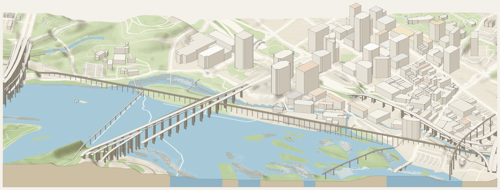
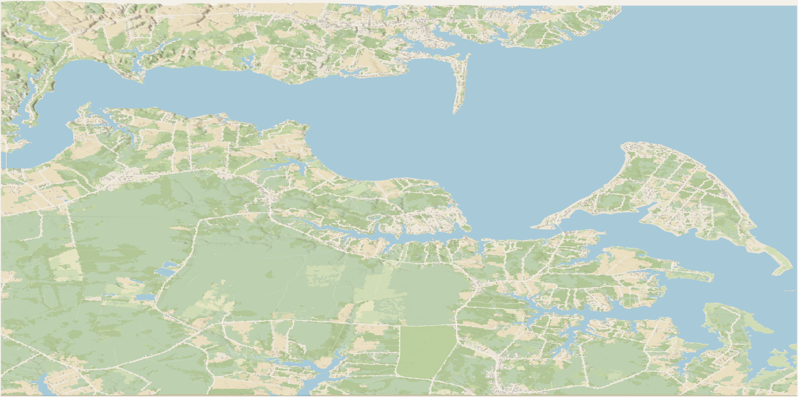

# isoscape

Isometric dot-and-line views of real places, built from open map data.

A sibling of [dotscene](https://github.com/busse/dotscene): the same visual language (inked
edges, a dot on every corner, flat fills), but driven by geography instead of hand-placed
points. Where dotscene is for authoring a scene, isoscape is for *surveying* one. You give it a
frame on the world, and it fetches OpenStreetMap, extrudes every building, raises the bridges,
sorts it all back to front and writes an SVG and a pan-and-zoom page.

The first region is downtown Richmond, VA, from Tredegar to the Mayo Bridge, in two
versions: a flat plate, and one shaped by real elevation. Richmond sits on the Fall Line,
where the James drops off the Piedmont onto the coastal plain. Through this slice the river
falls about 10 m through boulder fields and rapids to the head of tide at the Mayo Bridge,
under bluffs that rise 50 m to downtown, Oregon Hill and Church Hill.



The widest view, `richmond-i195-rocketts`, follows the James for 7.85 km, from I-195 to
Rocketts Landing. Every mapped building is drawn (about 6,750), as are all bridges, rapids
and the bluffs on both banks. It is a 25 MB SVG, and `--png` renders it at 18,840 px wide.


`gwynns-island` is tidewater: Gwynn's Island and Mathews County, from the Route 3 bridge over
the Piankatank to Milford Haven, with Deltaville and Stingray Point across the river. Here the
water comes from OSM's coastline. OSM maps few buildings and little land cover here, so
footprints come from Microsoft's model and woods and fields from NLCD (see
[Extra sources](#extra-sources)).



```sh
node bin/isoscape.js fetch richmond-downtown        # OSM + elevation → data/richmond-downtown/
node bin/isoscape.js build richmond-downtown-topo   # → out/richmond-downtown-topo.{svg,html}
node bin/isoscape.js build richmond-downtown        # the flat version
node bin/isoscape.js build richmond-downtown-topo --palette night --png
```

Then open `out/index.html`, the explorer.

## Make your own

isoscape is free and open source. Open a chat with Claude (we used Claude Opus 5.5) and say:

> Use the GitHub repo busse/isoscape to make an isometric map of *your place*.

Claude clones the repo, writes a region file for your place (`regions/<name>.json`: a centre,
a width and depth in metres, see [Region config](#region-config)), fetches OpenStreetMap and
elevation, and builds the SVG and the pan-and-zoom page. It takes a few minutes. Elevation
comes from USGS 3DEP, so terrain works best for places in the US; elsewhere, leave `terrain`
out for a flat map. Your map is yours to print and share; credit OpenStreetMap (see
[LICENSE-maps.md](LICENSE-maps.md)).

**How isoscape was made.** isoscape was built, and the holiday shop is run, in chats with
Claude, Anthropic's AI, using Claude Opus 5.5, directed and reviewed by Chris Busse. Claude wrote
the code, traced the historic buildings, laid out the prints, and set up the shop. The maps are
drawn by software from open data, not by hand; the historic years are machine-traced sketches.

Prints of the maps on the isoscape site (Richmond through time, Gwynn's Island, and fifty
American landmarks) are in a holiday shop at [chrisbusse.com](https://chrisbusse.com) through
December 31, 2026. The tool stays here for good.

## The explorer

Every `build` is archived under `out/builds/<timestamp>-<name>/`: the SVG, a thumbnail, and
a `meta.json` holding the commit (and whether the source had uncommitted changes), the
region's settings, the timings, and every number the build measured. Each build then
rewrites `out/index.html`, a single local page over all of them:

- **Left column:** builds grouped by region, newest first, each with its thumbnail, palette,
  age, note and commit. Type to filter.
- **Middle:** the selected build. Drag to pan, scroll to zoom, double-click to fit. Stepping
  between builds of the same frame keeps the view, so you can flick back and forth.
- **Bottom:** when and from what it was built, its measures, and its settings.
- **Compare** (`C`, or ⌥-click a second build): B is laid over A in the same scene
  coordinates, with a divider to drag. The info panel shows the change in every measure and
  every setting that differs.
- **How this view was made** (`M`, a tab in the info panel): the selected build explained in
  sentences, written from its `meta.json`: the frame and camera, which data went in, the
  elevation range, where the building heights came from, bridge rules, rapids, the commit.
  Each part links to the matching section of the site's pages. Measures an older build did
  not record are marked as unknown. When comparing, A and B are shown side by side.
- **Pages** (top of the left column): longer reading, such as *How it's made* (the whole
  pipeline, and what is measured, inferred or guessed) and *About, credits and licences*.

Keys: `↑`/`↓` step through builds, `F` fits, `1` shows actual size, `C` compares, `I`
toggles the info panel, `M` switches to "How this view was made", `/` filters, `Esc` leaves a
page for the viewer. The URL hash holds the selection: `#<id>`, `#<idA>..<idB>` to compare,
`/made` on either for the tab, `#/<page>` or `#/<page>/<section>` for a page. A reload (after
the next build) keeps your place, and Back and Forward move between pages and the viewer.

### Link previews

Chat apps and social sites ignore the `#…` part of a link and run no script, so each build
also gets a share page, `out/s/<id>.html` (and each page `out/s/page-<slug>.html`), with its
own title, description and a 1200×630 preview image, `out/builds/<id>/social.png` (the picture
cropped to fit; `rsvg-convert` or Chrome renders it, else the thumbnail stands in). A share
page forwards to the explorer and keeps the fragment, so the **Link** button (`L`) copies
`s/<id>.html#<the exact view>`. `isoscape explorer` makes any missing images and pages.
Previews need absolute URLs: before publishing, give the public address of `out/` in
`isoscape.config.json` (`{ "siteUrl": "https://example.org/isoscape/" }`), in
`ISOSCAPE_SITE_URL`, or as `--site-url` on `build`, `series` or `explorer`, and rebuild the
page. `"flagship": "<region>"` there picks the site's own preview image (default: the newest build).

The same file can give the explorer a front page. `"home"` has a `title`, an `intro`, `heroes`
(featured views, each a `region`, optional `year` in a dated series, `title`, `blurb` and
`shop` link), `sections` (each a `title`, the region-name `prefixes` it holds, and optionally
`homeTitle`, `blurb`, `order` (region names to show first), `collapsed`, `shop` and `shopLabel`), and `links` shown at the bottom.
The page then opens on the front page (`#home`). The build list is grouped by the same
sections, with featured regions first and folded sections closed. `"shop"` (`label`, `url`,
`cta`, and `links` keyed by region prefix) adds the shop button and a "Buy a print" button on
matching views. See this repo's own `isoscape.config.json`.

### Adding a page

Pages are Markdown files in `pages/`, compiled into `out/index.html` whenever it is
written (after every build, or with `isoscape explorer`). To add one, create
`pages/<slug>.md`:

```markdown
---
title: Reading the contours
order: 30
summary: One line, shown as the nav link's tooltip.
---

# Reading the contours

Text, **emphasis**, `code`, lists, tables, fenced code and block quotes.
Link a section of this page as [rapids](#rapids), another page as [About](about.md),
or a section of it as [data](about.md#data). Images beside the page are inlined:

```

- `title` is the nav label (default: the first `#` heading). `order` sorts the nav, lowest
  first (default 100); the shipped pages use 10 and 90. `slug` overrides the file name.
- Section ids follow GitHub's rule (lower case, punctuation dropped, spaces to hyphens), and
  links are written as they would be for GitHub, so the files read the same on GitHub as in
  the explorer.
- Images must be `.svg`, `.png`, `.jpg` or `.webp` files in `pages/` itself, and are
  embedded as data URIs so the explorer stays one file. An SVG can follow light and dark
  mode with a `prefers-color-scheme` media query, as `pipeline.svg` does.
- The converter (`src/markdown.ts`) escapes all text and drops raw HTML and unsafe link
  schemes. Files starting with `_` (drafts) and `README.md` are skipped.
- `npm test` checks that every in-page link in `pages/` lands on a real section, and that the
  sections the "How this view was made" tab links to exist in `how-its-made.md`. If you
  rename a heading there, update `story` in `src/explorer.ts` too.

```sh
node bin/isoscape.js build richmond-downtown-topo --note "lighter foam"   # say what you tried
node bin/isoscape.js build richmond-downtown --no-archive                 # a throwaway build
node bin/isoscape.js backfill 2b8f86d richmond-downtown                   # an older commit's output
node bin/isoscape.js explorer                                             # just rewrite the page
```

`backfill` exports the commit's tree to a temporary directory, gives it this checkout's
cached data, runs its own CLI, and archives the result dated to the commit. That puts
outputs from before the archive existed in the explorer alongside new ones. Thumbnails use
`rsvg-convert` if installed, else ImageMagick, else a colour swatch. `out/` is git-ignored:
the archive is local.

## Requirements

Node 22.18 or newer. No runtime dependencies and no build step: Node strips the TypeScript
types itself. `--png` shells out to `rsvg-convert` (`brew install librsvg`).

## Commands

| | |
|---|---|
| `isoscape regions` | list the region configs in `regions/` |
| `isoscape query <region>` | print the Overpass query a fetch would send |
| `isoscape fetch <region>` | download OSM data (`osm.json`) and elevation (`dem.bin.gz`) into `data/<region>/`; `--osm-only`, `--dem-only` |
| `isoscape info <region>` | the chosen bearing, feature counts, and where building heights came from |
| `isoscape build <region>` | write `out/<region>.svg` and `out/<region>.html`, archive the build, refresh the explorer; `--year <yyyy>` for one scene of a dated region |
| `isoscape series <region>` | build every year of a dated region, each as `<region>-<year>` |
| `isoscape explorer` | rewrite `out/index.html` from the archive |
| `isoscape backfill <commit> <region>` | build a region with an earlier commit's code and archive it |

`build` flags: `--palette <paper\|night>`, `--note "<text>"`, `--no-archive`, `--png`,
`--width <px>` (PNG width), `--out <dir>`.

Big regions are fetched in tiles. OSM comes in tiles of at most 1.6 km a side and elevation
in tiles of at most 1,500 px, because both services refuse or time out on large requests.
Every finished tile is cached under `data/<region>/osm-tiles/` or `dem-tiles/`, so an
interrupted `fetch` resumes where it stopped. `--budget <seconds>` stops it starting new
tiles after that long. A tile cache is named by its bounds, so a changed frame never reuses
the wrong tile. Overpass is often at capacity. `fetch` retries across four mirrors with
backoff, and checks that every answer parses (a timed-out transfer can arrive as HTTP 200
with a truncated body). If it still fails, run `isoscape query <region>`, paste the query into
[overpass-turbo](https://overpass-turbo.eu), export the raw JSON, and save it as
`data/<region>/osm.json`.

## How it works

```
regions/<name>.json ─► fetch ─► data/<name>/osm.json
                                     │
                    parseOsm (osm.ts): polygons, multipolygons, lines, in lon/lat
                                     │
         chooseBearing (scene.ts): snap the camera so the street grid sits on the diagonals
                                     │
     buildScene: ground polygons · road/rail ribbons · extruded buildings · bridge spans
                                     │
              paintOrder (order.ts): pairwise occlusion → topological sort
                                     │
                     renderSvg (render.ts) ─► out/<name>.svg, .html, .png
```

**The camera** (`view.ts`) is orthographic, tilted down, and always looks along +N′ ("view
north"). Ground across the frame is drawn at full `scale`. Ground into the frame is
foreshortened by `squash`, the sine of the tilt (0.5 is a 30° tilt). Height is drawn at the
cosine of the tilt. The frame is a rectangle in view metres, so it lands on screen as a plain
rectangle, which suits a panorama.

**Snap.** A camera facing due north sees most street grids at an odd angle. With `snap`, the
dominant orientation of the building edges is measured (length-weighted, folded mod 90°), and
the camera turns by up to 45° so that grid runs along the isometric diagonals. Downtown
Richmond snaps to a bearing of −8.7°.

**Buildings** (`extrude` in `scene.ts`) are prisms: a wall on every footprint edge that faces
the camera, painted far to near, then the roof. Courtyards (inner rings) work. Wall tone
follows the wall's normal, with light from the left. Heights come from OSM `height`, then
`building:levels`, then a guess from the building's type and size; `isoscape info` reports the
mix. OSM Simple 3D Buildings parts (`building:part`) replace their outline when present.

**Bridges.** OSM splits a bridge into many ways, so connected bridge ways (same layer and
kind) are chained first. Only ends that touch no other bridge way ramp down to the ground.
Deck height comes from a per-region rule matched on the name, else `bridgeDeck × layer`.
Each chain is cut into ~22 m spans so it can interleave with buildings in the paint order.
Piers drop every 38 m.

**Paint order** (`order.ts`). A single depth key is wrong as soon as a long warehouse sits
beside a small house. So order is decided pairwise, only between items whose screen boxes
overlap. If the footprints are separable, the one on the camera's side of the separating
line is in front. If they overlap, a part entirely above the other is in front. Otherwise
centroid depth decides. A topological sort turns those facts into one order, and the rare
cycle is broken by depth.

**Terrain** (`dem.ts`, `terrain.ts`). Elevation comes from USGS 3DEP, the National Map's
seamless bare-earth model, which is 1 m lidar across Richmond. `fetch` asks its
`exportImage` service for an uncompressed float GeoTIFF over the region. A minimal reader
parses it, and it is stored as gzipped int16 centimetres (about 4 MB for this slice). The
build resamples it onto a 5 m grid in view metres and blurs it lightly to lose the lidar
grit. Elevation above the frame's lowest point, times `terrain.exaggeration`, becomes scene
height. Buildings and bridge clearances add true metres on top, so the hills are
exaggerated but the towers are not.

**Elevation voids.** 3DEP sometimes fills a void with a large negative value: one patch near
Shockoe Bottom read −88 m. Samples below −5 m, plus a few pixels around them, are treated as
missing and filled from their neighbours.

**The river.** Lidar over mapped water is not the water: rocks, ledges and overlapped banks
stand above it. The surface at each water node is taken as a low percentile of the wet ground
within 30 m, then smoothed along the water. Anything a metre or more above that surface is
drawn as exposed rock, which gives the boulder fields. The water drapes on the surface, so
it lies level across the river and falls along it. **Rapids** are drawn where that surface
falls faster than `terrain.rapids` (m/m) measured over 40 m: white strokes across the
current, with froth where it drops hardest. OSM weirs are drawn as white crests. Rocks and
rapids are only read at least two cells (10 m) from shore. **The shoreline follows the
lidar, not OSM's outline:** near-shore "water" standing more than a metre above the river is
given back to the land at its own height. The water's edge is then traced through the
corrected water grid (marching squares over a lightly smoothed mask) and drawn at the
river's surface. Where an outline overlaps a steep bank, this gives a bank sloping into the
water rather than water climbing the bank. Flat scenes still use OSM's outline.

**Ground with relief paints in strips.** A height field hides itself: a bank falling away from
the camera covers the water behind it. So the ground is painted in 10 m strips across the
frame, far to near. Each strip drapes everything on it over the terrain: bare ground, parks,
water, islands, roads, rail, hillshade (lit from the left and slightly toward the camera),
contours (2 m, heavier every 10 m) and rapids. Each building or bridge paints straight after
the strip holding its near edge, so a hill in front of it covers it and ground behind it
does not. Buildings sit on the lowest ground under their footprint, so on a slope the
downhill wall shows full height. Bridge decks are a taut line over whatever they cross:
the upper hull of the ground plus clearance, ramping down only at ends that meet the ground.
Piers drop to the real ground or water. The slab's front face is a true cross-section of
the valley, with water where the cut crosses the river. A region without `terrain` gets the
same pipeline on a flat plate.

## Region config

```jsonc
{
  "title": "Richmond, VA — Tredegar to the Mayo Bridge",
  "center": [-77.4400, 37.5338],  // lon, lat
  "width": 1700,                  // metres across the frame
  "depth": 950,                   // metres into the frame
  "bearing": 0,                   // direction the camera faces; 0 = north is up
  "snap": true,                   // turn ≤45° to put the street grid on the diagonals
  "scale": 2.4,                   // px per metre across the frame
  "squash": 0.5,                  // sine of the tilt
  "exaggeration": 1.0,            // vertical exaggeration
  "slab": 16,                     // ground slab thickness, metres
  "palette": "paper",             // paper | night
  "bridgeDeck": 7,                // default deck height per OSM layer
  "bridges": [{ "match": "Manchester", "deck": 24 }],  // + "pierSpacing": metres (default 38; long for suspension bridges)
  "minBuildingArea": 12,          // m²
  "dots": "all",                  // all | roof | none
  "data": "richmond-downtown",    // optional: share another region's cached data
  "terrain": {                    // optional: relief from data/<region>/dem.bin.gz
    "exaggeration": 2.5,          // vertical exaggeration of the ground only
    "cell": 5,                    // grid spacing, metres
    "contour": 2,                 // contour interval, metres (0 for none)
    "majorEvery": 5,              // every 5th contour heavier
    "rapids": 0.035               // water-surface fall (m/m over 40 m) that reads as rapids
  }
}
```

The fetch covers the frame's circumscribed circle, so a snapped camera never looks past the
data.

## Extra sources

OSM and 3DEP are always used. A region can ask for more where OSM is thin, which is usually
in the countryside:

```jsonc
"sources": { "buildings": ["osm", "microsoft"], "landcover": "nlcd" }
```

- `"microsoft"` adds [Microsoft's Global ML Building
  Footprints](https://github.com/microsoft/GlobalMLBuildingFootprints) (ODbL) where OSM has no
  building, with the model's height where it gave one.
- `"nlcd"` draws woods, wetlands, fields and crops from the [National Land Cover
  Database](https://www.mrlc.gov/) (NLCD 2021, 30 m, public domain), under OSM's own land use.

`fetch` gets them along with everything else; `fetch <region> --extras-only` gets just these.
For tidal water, set `terrain.rocks: false` and `terrain.rapids: 0`: river logic has nothing to
find there.

## Time

A region with a `time` section is drawn as a series of years:

```jsonc
"time": {
  "history": "history/richmond-downtown.json",
  "yearBuilt": { "url": "https://…/Year_of_Construction/FeatureServer/0", "field": "Year_Built" }
}
```

`fetch <region> --extras-only` pages the assessor's year-built parcels into
`data/<region>/yearbuilt.json`. The history file lists the series' `epochs` (year, title,
note), its curated `features` (a filled basin, a burned district, lost landmarks, a buried
creek, the town plan), the era `rules` that date roads, rail and water, and curated `dates`
for particular buildings. Every item cites its sources. `isoscape series richmond-downtown-time`
builds all ten scenes from 1737 to today. In the explorer, a series reads in year order: the
year chips above the picture and the `[` `]` keys step through it, and Compare defaults to the
year before. The method and its limits are in the *How it's made* page, under "Time".

**Traced buildings.** `tools/sanborn/` turns Sanborn fire-insurance map sheets into dated
footprints of buildings since lost. It downloads the sheets from the Library of Congress,
fits each sheet to the ground from two or three street corners read off it, traces the
coloured fills, and follows each building until a later map, a newer building or a highway
shows it gone. The steps are in *How it's made*, under "Time". The 1886, 1895, 1905, 1924–25 and
1950–52 editions are traced into `history/sanborn/`. The results are sketches: outlines and
heights are approximate, and some buildings are missing, misplaced or merged.

`regions/richmond-downtown-time.json` reuses the I-195 to Rocketts cache (`"data"`) for OSM
and elevation and keeps only its year-built parcels in its own `data/` folder.

## Roadmap

1. **Lidar heights.** About 40% of downtown heights are guesses. 3DEP's bare-earth model is
   in place; the first-return surface model minus it, sampled per footprint, gives real
   heights.
2. **Corridors.** A region shaped by a GeoJSON polygon instead of a rectangle: the river plus
   a ~300 m buffer on its north bank, clipped to the city line. That is the full
   west-to-east Richmond strip. It may also mean "unrolling" the river so distance along the
   centreline becomes screen x.
3. **Tiles.** Build once, then crop viewBoxes into tiles and rasterise a zoom pyramid for a
   web map. There are no seams to hide: one projection, one paint order.
4. **Levels of detail.** Drop dots and minor edges at low zoom.
5. **Hand-drawn landmarks.** Override the Belle Isle footbridge under the Lee Bridge, the
   Potterfield bridge and the Triple Crossing with authored figures.
6. **Trees.** Scatter crowns over wooded areas and cemeteries.

## Data

Map data © [OpenStreetMap](https://www.openstreetmap.org/copyright) contributors, available
under the Open Database License. The cached `data/*/osm.json` files carry that licence, and
every rendered SVG and page carries the attribution. Elevation is from the
[USGS 3D Elevation Program](https://www.usgs.gov/3d-elevation-program), public domain;
`data/*/dem.bin.gz` is a resampled copy.

## Inspiration

Inspired by [Isometric SF](https://isometricsf.com), Justin Chavez's isometric pixel-art map
of San Francisco, and his write-up of
[how it was made](https://www.justinchavez.com/blog/isometric-sf-how/).

## Contact

isoscape is by Chris Busse: [fullbacklog.com](https://fullbacklog.com) (Substack),
[LinkedIn](https://linkedin.com/in/chrisbusse), and @busse on
[Threads](https://www.threads.net/@busse) and [Instagram](https://www.instagram.com/busse).
