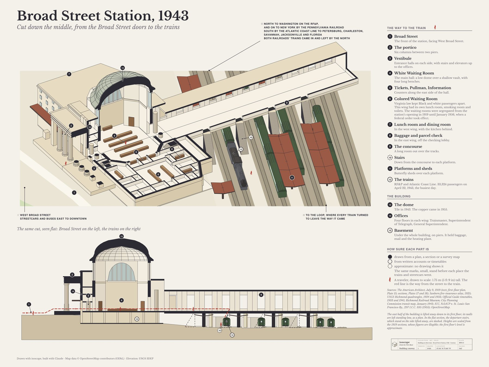

# Broad Street Station, 1943: the cutaway

*Building cutaway · Plate BSS·15*

Broad Street Station opened in January 1919 for the RF&P and the Atlantic Coast Line. This drawing cuts it down the middle, from the Broad Street doors through the portico, the White Waiting Room under the dome and the concourse out over the tracks, as it stood in 1943. The east half is lifted away down to its first floor, so its rooms read as a plan, and beneath it the same cut is drawn flat, with the traveler's way from the street to the train dashed in red. It belongs to the [Broad Street Station, 1943](broad-street.md) set.

## The way to the train

### 1. Broad Street

The front of the station, facing West Broad Street.

*How sure: drawn from a plan, a section or a survey map.*

### 2. The portico

Six columns between two piers.

*How sure: drawn from a plan, a section or a survey map.*

### 3. Vestibule

Entrance halls on each side, with stairs and elevators up to the offices.

*How sure: drawn from a plan, a section or a survey map.*

### 4. White Waiting Room

The main hall: a low dome over a shallow vault, with four long benches.

*How sure: drawn from a plan, a section or a survey map.*

### 5. Tickets, Pullman, Information

Counters along the east side of the hall.

*How sure: drawn from a plan, a section or a survey map.*

### 6. Colored Waiting Room

Virginia law kept Black and white passengers apart. This wing had its own lunch room, smoking room and toilets. The waiting rooms were segregated from the station’s opening in 1919 until January 1956, when a federal order took effect.

*How sure: drawn from a plan, a section or a survey map.*

### 7. Lunch room and dining room

In the west wing, with the kitchen behind.

*How sure: drawn from a plan, a section or a survey map.*

### 8. Baggage and parcel check

In the east wing, off the checking lobby.

*How sure: drawn from a plan, a section or a survey map.*

### 9. The concourse

A long room out over the tracks.

*How sure: drawn from a plan, a section or a survey map.*

### 10. Stairs

Down from the concourse to each platform.

*How sure: approximate; no drawing shows it.*

### 11. Platforms and sheds

Butterfly sheds over each platform.

*How sure: drawn from a plan, a section or a survey map.*

### 12. The trains

RF&P and Atlantic Coast Line. 33,324 passengers on April 22, 1943, the busiest day.

*How sure: from written accounts or timetables.*

## The building

### 13. The dome

Tile in 1943. The copper came in 1955.

*How sure: drawn from a plan, a section or a survey map.*

### 14. Offices

Four floors in each wing: Trainmaster, Superintendent of Telegraph, General Superintendent.

*How sure: drawn from a plan, a section or a survey map.*

### 15. Basement

Under the whole building, on piers. It held baggage, mail and the heating plant.

*How sure: from written accounts or timetables.*

## How sure each part is

Every part of the drawing says how it is known, and each numbered badge shows it:

- **Solid:** drawn from a plan, a section or a survey map.
- **Ring:** from written accounts or timetables.
- **Dashed ring:** approximate; no drawing shows it.

The same marks, small, stand before each place the trains and streetcars went.

The small red figures are travelers drawn to scale, 1.75 m (5 ft 9 in) tall; their height is a convention, not a claim from a source. The red line is the way from the street to the train.

## Where the trains and streetcars went

- North to Washington on the RF&P, and on to New York by the Pennsylvania Railroad; south by the Atlantic Coast Line to Petersburg, Charleston, Savannah, Jacksonville and Florida. Both railroads’ trains came in and left by the north. *(From written accounts or timetables. Sources: Official Guide schedules of 1933 and June 1941 (Havana Special, Tamiami Champion), as transcribed by streamlinerschedules.com; chicagorailfan.com (ACL route); Richmond Railroad Museum, railroad history.)*
- To the loop, where every train turned to leave the way it came. *(From written accounts or timetables. Sources: Richmond Railroad Museum, railroad history; The American Architect, July 9, 1919 (track lay-out); USGS Richmond quadrangles, 1934 and 1956.)*
- West Broad Street: streetcars and buses east to downtown. *(Approximate; no drawing shows it. Sources: Transit Routes Direct to Downtown District, City Planning Commission, January 31, 1943 (Library of Virginia); routes on West Broad read from the map image, approximate.)*

## Sources

The American Architect, July 9, 1919 (text; first-floor plan, Plate 15; sections, Plates 17 and 18); Sanborn fire-insurance atlas, 1925; USGS Richmond quadrangles, 1934 and 1956; Official Guide timetables, 1933 and 1941; Richmond Railroad Museum; City Planning Commission transit map, January 1943; ICC, NAACP v. St. Louis-San Francisco Ry., 297 I.C.C. 335 (1955); OpenStreetMap.

The east half of the building is lifted away down to its first floor; its walls are left standing low, as a plan. In the flat section, the departure stairs, which stand on the side lifted away, are dashed. Heights are scaled from the 1919 sections, whose figures are illegible; the first floor’s level is approximate.

## How it was drawn

The station is a model made of parts: the rooms of the first floor, the hall's octagon, its benches and counters, the portico and the concourse are traced from the first-floor plan published in The American Architect in 1919 (Plate 15), fitted by the 240-foot frontage; the levels, the dome and the basement are scaled from the sections (Plates 17 and 18), whose figures are illegible. The model is cut along one vertical plane down the station's axis. Every face the cut opens is drawn solid in ink; on the side lifted away, everything up to 1.5 m above the first floor stays, so the ground floor reads as a plan. The flat section below is the same plane seen square and level, with the building drawn 35 m deep behind it. Chris Busse drew it with isoscape, the open-source tool he built with Claude.

More in [How it's made](how-its-made.md#cutaways).

---

*This page was drafted with Claude, Anthropic's AI (Claude Opus 5.5), and reviewed by Chris Busse. More on how we work in the [artist statement](artist-statement.md).*
