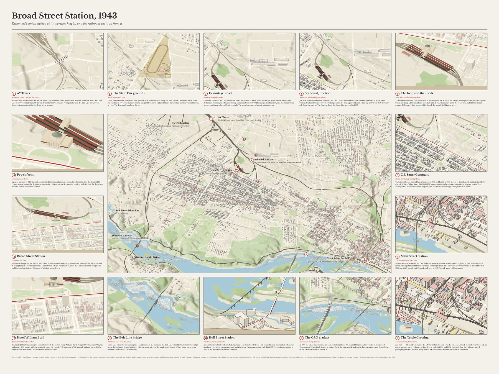

# Broad Street Station, 1943

John Russell Pope's Broad Street Station opened in January 1919 for the RF&P and the Atlantic Coast Line, and was never busier than in the Second World War: in 1943 it averaged 57 trains a day. This map draws Richmond's railroads as they ran that year, with the station's loop of tracks and its umbrella sheds, and frames it with fourteen places along the lines, from the wye at AY Tower to the Triple Crossing.

[Open the map](https://busse.github.io/isoscape/#broad-street-lines:1943) to pan and zoom, or jump to a place below. Prints of the whole set, the map alone and each place are in the [shop](https://chrisbusse.com/collections/broad-street-station-1943).

## The places

### 1. AY Tower

*Where the Coast Line met the RF&P*

About a mile northwest of the station, the RF&P main line from Washington met the Atlantic Coast Line's Belt Line at a wye worked from AY Tower. Trains for the Coast Line swung south onto the Belt Line here; Broad Street trains took the third leg down to the station.

[See it on the map](https://busse.github.io/isoscape/#broad-street-lines:1943@-494,-979,6) · Sources: [1](https://chicagorailfan.com/stbrric.html) [2](https://en.wikipedia.org/wiki/Richmond_and_Petersburg_Railroad) [3](https://www.richmondrailroadmuseum.com/railroad-history)

### 2. The State Fair grounds

*North Boulevard, 1940*

From 1906 the State Fair filled these grounds north of the tracks every fall, and Parker Field went up on them for baseball in 1934. The fair association bought Strawberry Hill in 1941 and held its first fair there after the war, in 1946. The Diamond stands on the site.

[See it on the map](https://busse.github.io/isoscape/#broad-street-lines:1940@-73,-724,6) · Sources: [1](https://richmondmagazine.com/news/news/a-fair-history/) [2](https://co-opliving.com/coopliving/issues/2009/September%202009/cover.htm) [3](https://urbanscalerichmondvirginia.blogspot.com/2014/12/a-brief-history-of-sports-complex-in.html)

### 3. Hermitage Road

*Industry along the tracks*

Once the Seaboard Air Line joined the RF&P here in 1900, firms lined Hermitage Road for the sidings: the Richmond Foundry and Manufacturing Company built at 2300 Hermitage Road in 1906, and the Putney shoe works bought part of the old fair grounds. The warehouses are a historic district today.

[See it on the map](https://busse.github.io/isoscape/#broad-street-lines:1943@83,-517,6) · Sources: [1](https://dhr.virginia.gov/?p=28752) [2](https://richmondmagazine.com/arts-entertainment/whole-foods-richmond/)

### 4. Seaboard Junction

*Where the Seaboard left the RF&P*

Just north of the station the Seaboard Air Line's main line left the RF&P and ran southeast to Main Street Station. Seaboard trains between Washington and the South passed Broad Street by; only from 1959 did they call there, backing in. The Seaboard and the Coast Line merged in 1967.

[See it on the map](https://busse.github.io/isoscape/#broad-street-lines:1943@26,-448,6) · Sources: [1](https://chicagorailfan.com/stbrric.html) [2](https://www.richmondrailroadmuseum.com/railroad-history)

### 5. The loop and the sheds

*Nine tracks under butterfly sheds*

Trains ran in off the RF&P at one end of the loop and out at the other. Seven passenger tracks and two express tracks lay along 1,200 feet of cast-iron butterfly sheds, with ramps up to the concourse. In 1943 the station averaged 57 trains a day; on April 22 it handled a record 33,324 passengers.

[See it on the map](https://busse.github.io/isoscape/#broad-street-station-loop:1943@427,154,6) · Sources: [1](https://scholarscompass.vcu.edu/postcard/190) [2](https://www.dhr.virginia.gov/historic-registers/127-0226/) [3](https://www.chicagorailfan.com/stbcric.html) [4](https://www.hmdb.org/m.asp?m=9209)

### 6. C.F. Sauer Company

*Broad Street at Hermitage Road*

The extract house Conrad Sauer founded at 17th and Broad in 1887 moved to Broad and Hermitage in 1911, by the rail sidings. When Sauer died in 1927 it was the country's largest producer of extracts and spices. The headquarters is on the National Register, and the Sauer's Vanilla sign still lights Broad Street.

[See it on the map](https://busse.github.io/isoscape/#broad-street-lines:1943@110,-185,6) · Sources: [1](https://en.wikipedia.org/wiki/Sauer_Brands) [2](https://rictoday.6amcity.com/business/history-sauer-company-richmond-va) [3](https://www.dhr.virginia.gov/?p=16671)

### 7. Main Street Station

*The Seaboard and the C&O*

Downtown, the Seaboard Air Line and the C&O shared Main Street Station, opened in 1901 under its clock tower, with a gable-roofed train shed 530 feet long behind. The Seaboard moved its trains to Broad Street in 1959; the C&O stayed until Amtrak took over in 1971. Amtrak trains call here again.

[See it on the map](https://busse.github.io/isoscape/#broad-street-lines:1943@1524,848,6) · Sources: [1](https://www.dhr.virginia.gov/?p=15225) [2](https://www.greatamericanstations.com/stations/RVM) [3](https://en.wikipedia.org/wiki/Richmond_Main_Street_Station)

### 8. The Triple Crossing

*Three railroads, three levels*

Just east of 14th and Dock streets the C&O's viaduct crossed over the Seaboard, which crossed over the Southern on the ground: three railroads at three levels, built in 1900 and 1901. Now and then the railroads staged photographs with a train on every level. CSX and Norfolk Southern trains still cross here.

[See it on the map](https://busse.github.io/isoscape/#broad-street-lines:1943@1478,816,6) · Sources: [1](https://www.richmondrailroadmuseum.com/railroad-history) [2](https://www.virginiaplaces.org/rail/seaboardairline.html) [3](https://en.wikipedia.org/wiki/Triple_Crossing)

### 9. The C&O viaduct

*Three miles along the river*

In 1901 the C&O raised its line on a viaduct along the north bank of the James, three miles of trestle past Tredegar and down Dock Street, so trains of coal for Newport News bypassed the crowded route through the city. CSX coal trains still run on it.

[See it on the map](https://busse.github.io/isoscape/#broad-street-lines:1943@730,759,6) · Sources: [1](https://www.virginiaplaces.org/rail/cando.html) [2](https://www.railpictures.net/photoexif/391125) [3](https://industrialscenery.blogspot.com/2021/11/csxc-james-river-viaduct-and-tredegar.html)

### 10. Hull Street Station

*The Southern in Manchester*

Across the river, the Southern Railway's trains for Danville left from Hull Street Station, built in 1915 when the Southern gave up its passenger depot on 14th Street. Passenger service ended in 1957. The station reopened in 2011 as the Richmond Railroad Museum.

[See it on the map](https://busse.github.io/isoscape/#broad-street-lines:1943@1168,1051,6) · Sources: [1](https://www.american-rails.com/varrms.html) [2](https://en.wikipedia.org/wiki/Southern_Railway_Depot_(Richmond,_Virginia)) [3](https://en.wikipedia.org/wiki/Hull_Street_Station)

### 11. The Belt Line bridge

*The Coast Line over the James*

Coast Line trains for Petersburg and Florida crossed the James on the Belt Line's double-track concrete bridge, opened with Broad Street Station in 1919; the stone piers of the single-track bridge of 1891 stood in the river beside it. It carries CSX trains today.

[See it on the map](https://busse.github.io/isoscape/#broad-street-lines:1943@-1445,653,6) · Sources: [1](https://virginiaplaces.org/rail/atlanticcoastline.html) [2](https://en.wikipedia.org/wiki/CSX_A-Line_Bridge) [3](https://www.richmondrailroadmuseum.com/railroad-history)

### 12. Hotel William Byrd

*Across Broad from the station*

Built in 1925 for the passengers across the street, the eleven-story William Byrd, designed by Marcellus Wright, had nearly 200 rooms; with the station it made the traveler's first picture of Richmond. It closed in the 1980s and has been apartments for older residents since 1996.

[See it on the map](https://busse.github.io/isoscape/#broad-street-station:1943@52,189,6) · Sources: [1](https://www.dhr.virginia.gov/?p=15215) [2](https://richmondbizsense.com/2017/03/23/5m-renovation-wraps-up-at-william-byrd/)

### 13. Broad Street Station

*From over the Fan*

John Russell Pope set the station back from Broad Street on a built-up mound that screened the tracks behind it, facing the Fan's rowhouse blocks. The last train left on November 15, 1975; the Commonwealth bought the building, and the Science Museum of Virginia opened in it.

[See it on the map](https://busse.github.io/isoscape/#broad-street-station:1943@49,-122,6) · Sources: [1](https://sah-archipedia.org/node/20518) [2](https://www.hmdb.org/m.asp?m=9209) [3](https://www.dhr.virginia.gov/historic-registers/127-0226/)

### 14. Pope's front

*Colonnade and dome*

Opened January 6, 1919, the station was faced in Indiana limestone behind a colonnade after the Doric of St. Peter's Square, under the first dome on a major railroad station, its rotunda 100 feet high. In 1943 the dome was still tile; copper replaced it in 1955.

[See it on the map](https://busse.github.io/isoscape/#broad-street-station-front:1943@70,-10,6) · Sources: [1](https://sah-archipedia.org/node/20518) [2](https://www.dhr.virginia.gov/historic-registers/127-0226/) [3](https://rvanews.com/?p=17011)

## How it was drawn

The station is modeled from its 1919 plan, period postcards and the 1925 Sanborn fire-insurance sheet, its heights scaled from photographs and approximate. Its loop of tracks, long since taken up, is traced from the USGS Richmond quadrangles of 1934 and 1956 and fitted to the platforms that survive. The rest of the track is today's, as era rules date it. Buildings are those standing today that the city assessor dates to 1943 or before, with those traced from Sanborn maps around the station and downtown. On the big map the track is drawn four times its width; on the prints of single places, at its own.

More in [How it's made](how-its-made.md#time).
