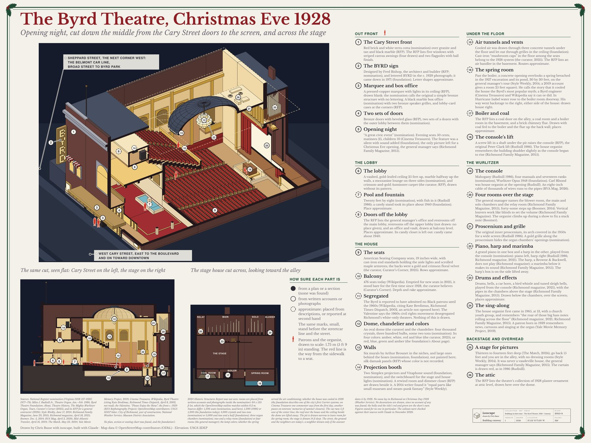

# The Byrd Theatre, Christmas Eve 1928: the cutaway

*Building cutaway · Plate BYRD·01*

This drawing cuts the Byrd Theatre open as it stood on its opening night, Christmas Eve 1928. The cut runs down the middle from the Cary Street doors to the screen, and the roof over the house is lifted away, so the lobby, the seats, the balcony and the oval dome with its chandelier show from above. Beneath it, the same cut is drawn flat, with Cary Street on the left and the stage on the right. A second flat section crosses the stage house looking toward the alley, through the organ's rooms above the stage and the boiler and spring room below it. The holly border and the title's red and green are the sheet's own decoration.

## Out front

### 1. The Cary Street front

Red brick and white terra cotta (nomination) over granite and tan and black marble (RFP). The RFP lists five windows with striped canvas awnings (four drawn) and two flagpoles with ball finials.

*How sure: from written accounts or photographs.*

### 2. The BYRD sign

Designed by Fred Bishop, the architect and builder (RFP; nomination), and lettered BYRD in the c. 1929 photograph; it came down in 1971 (foundation). Letter shapes approximate.

*How sure: from written accounts or photographs.*

### 3. Marquee and box office

A pressed-copper marquee with lights in its ceiling (RFP), drawn blank: the nomination calls the original a simple bronze structure with no lettering. A black marble box office (nomination) with two bronze speaker grilles, and lobby-card cases at the corners (RFP).

*How sure: from written accounts or photographs.*

### 4. Two sets of doors

Bronze doors with beveled glass (RFP), two sets of a dozen with the outer lobby between them (nomination).

*How sure: from written accounts or photographs.*

### 5. Opening night

“A great civic event” (nomination). Evening seats 50 cents, matinees 25, children 10 (Cinema Treasures). The feature was a silent with sound added (foundation), the only picture left for a Christmas Eve opening, the general manager says (Richmond Family Magazine, 2015).

*How sure: from written accounts or photographs.*

## The lobby

### 6. The lobby

A vaulted, gold-leafed ceiling 25 feet up, marble halfway up the walls, a mezzanine lounge on three sides (nomination), and crimson-and-gold Axminster carpet (the curator; RFP), drawn without its pattern.

*How sure: from written accounts or photographs.*

### 7. Pool and fountain

Twenty feet by eight (nomination), with fish in it (Rudisill 1986); a candy stand took its place about 1940 (foundation). Place approximate.

*How sure: approximate; placed from descriptions, or reported at second hand.*

### 8. Doors off the lobby

The RFP lists the general manager’s office and restrooms off the main lobby, restrooms off the upper lobby (not drawn: no place given), and an office and vault, drawn at balcony level. Places approximate. Its candy closet is left out: candy came about 1940.

*How sure: approximate; placed from descriptions, or reported at second hand.*

## The house

### 9. The seats

American Seating Company seats, 19 inches wide, with cast-iron end standards holding the aisle lights and scrolled maple armrests; the backs were a gold and crimson floral velvet (the curator, Curator’s Corner, 2025). Rows approximate.

*How sure: from written accounts or photographs.*

### 10. Balcony

476 seats today (Wikipedia). Emptied for new seats in 2025, it stood bare for the first time since 1928, the curator believes (Curator’s Corner). Depth and rake approximate.

*How sure: approximate; placed from descriptions, or reported at second hand.*

### 11. Segregated

The Byrd is reported to have admitted no Black patrons until the 1960s (Wikipedia, citing Kate Bredimus, Richmond Times-Dispatch, 2002, an article not opened here). The Valentine says the 1960s civil rights movement desegregated Richmond’s white-only theaters. Nothing of this is drawn.

*How sure: approximate; placed from descriptions, or reported at second hand.*

### 12. Dome, chandelier and colors

An oval dome (the curator) and the chandelier: four thousand crystals, three hundred bulbs, some two tons (nomination). Its four colors: amber, white, red and blue (the curator, 2025), or red, blue, green and amber (the foundation’s About page).

*How sure: from written accounts or photographs.*

### 13. Walls

Six murals by Arthur Brounet in the niches, and large ones behind the boxes (nomination; foundation), not painted here; silk damask panels (RFP) whose color is not recorded.

*How sure: from written accounts or photographs.*

### 14. Projection booth

Two Simplex projectors and Vitaphone sound (foundation; nomination), and the switchboard for the stage and house lights (nomination). A rewind room and dimmer closet (RFP) are drawn beside it. A 2014 writer found it “equal parts like small museum and steam-punk fantasy” (Style Weekly).

*How sure: approximate; placed from descriptions, or reported at second hand.*

## Under the floor

### 15. Air tunnels and vents

Cooled air was drawn through three concrete tunnels under the floor and let out through grilles in the ceiling (foundation). Cast-iron “mushroom caps” in the floor among the seats belong to the 1928 system (the curator, 2025). The RFP lists an air handler in the basement. Routes approximate.

*How sure: approximate; placed from descriptions, or reported at second hand.*

### 16. The spring room

Past the boiler, a concrete opening overlooks a spring breached in the 1927 excavation and its pond, 30 by 30 feet, on the general manager’s tour (Style Weekly, 2014; a 2019 account gives a room 25 feet square). He calls the story that it cooled the house the Byrd’s most popular myth; a Byrd engineer (Cinema Treasures) and Wikipedia say it can or did. In Hurricane Isabel water rose to the boiler room doorway. His way went backstage to the right, either side of the house: drawn house right.

*How sure: approximate; placed from descriptions, or reported at second hand.*

### 17. Boiler and coal

The RFP lists a coal door on the alley, a coal room and a boiler room in the basement, and a brick chimney flue. Drawn with coal fed to the boiler and the flue up the back wall; places approximate.

*How sure: approximate; placed from descriptions, or reported at second hand.*

### 18. The console’s lift

A screw lift in a shaft under the pit raises the console (RFP), the original Peter Clark lift (Rudisill 1986). The house organist remembers the building shudder slightly as the console began to rise (Richmond Family Magazine, 2015).

*How sure: from written accounts or photographs.*

## The Wurlitzer

### 19. The console

Mahogany (Rudisill 1986), four manuals and seventeen ranks (nomination), Wurlitzer Opus 1948 (foundation). Carl Rhond was house organist at the opening (Rudisill). An eight-inch cable of thousands of wires runs to the pipes (RVA Mag, 2026).

*How sure: from written accounts or photographs.*

### 20. Four rooms over the stage

The general manager names the blower room, the main and solo chambers and the relay room (Richmond Family Magazine, 2015), forty-some steps up (Boomer, 2014). Vertical louvers work like blinds to set the volume (Richmond Family Magazine). The organist climbs up during a show to fix a stuck note (Boomer).

*How sure: approximate; placed from descriptions, or reported at second hand.*

### 21. Proscenium and grille

The original inner proscenium, its arch covered in the 1950s for a wide screen (Rudisill 1986). A gold grille along the proscenium hides the organ chambers’ openings (nomination).

*How sure: from written accounts or photographs.*

### 22. Piano, harp and marimba

A grand piano in one box and a harp in the other, played from the console (nomination): piano left, harp right (Rudisill 1986; Richmond magazine, 2021). The harp, a Browne & Buckwell, does not play (Richmond magazine); a marimba below it makes its sound (Richmond Family Magazine, 2015). The harp’s box is on the side lifted away.

*How sure: approximate; placed from descriptions, or reported at second hand.*

### 23. Drums and effects

Drums, bells, a car horn, a bird whistle and tuned sleigh bells, played from the console (Richmond magazine, 2021), with the pipes in the chambers above the stage (Richmond Family Magazine, 2015). Drawn below the chambers, over the screen; places approximate.

*How sure: approximate; placed from descriptions, or reported at second hand.*

### 24. The sing-along

The house organist first came in 1965, at 13, with a church youth group, and remembers “the roar of those big bass notes rolling across the floor” (Richmond magazine, 2021; Richmond Family Magazine, 2015). A patron born in 1939 remembers news, cartoons and singing at the organ (Yale Movie Memory Project, 2019).

*How sure: from written accounts or photographs.*

## Backstage and overhead

### 25. A stage for pictures

Thirteen to fourteen feet deep (The Match, 2024); go back 15 feet and you are in the alley, with no dressing rooms (Style Weekly, 2014). It was never a vaudeville house, the general manager says (Richmond Family Magazine, 2015). The curtain is drawn red, as in 1986 (Rudisill).

*How sure: from written accounts or photographs.*

### 26. The attic

The RFP lists the theatre’s collection of 1928 plaster ornament at attic level, drawn here over the dome.

*How sure: from written accounts or photographs.*

## How sure each part is

Every part of the drawing says how it is known, and each numbered badge shows it:

- **Solid:** from a plan or a section (none was found).
- **Ring:** from written accounts or photographs.
- **Dashed ring:** approximate; placed from descriptions, or reported at second hand.

The same marks, small, stand before the streetcar line and the street.

Patrons and the organist, drawn to scale: 1.75 m (5 ft 9 in) standing. The red line is the way from the sidewalk to a seat.

## The street and the streetcar

- Sheppard Street, the next corner west: the Belmont car line, north to Broad Street and south toward Byrd Park. *(From written accounts or photographs. Sources: Museum District Association, history of the Museum District (the Belmont line ran north and south from Broad and Sheppard streets to the Byrd Park area); history/richmond-streetcars.json: the Belmont line, 1895–1949, after the Library of Virginia's 1925 transit plate.)*
- West Cary Street, east to the Boulevard and on toward downtown. *(Approximate; placed from descriptions, or reported at second hand. Sources: USGS 7.5-minute quadrangle, Richmond, 1964, as reproduced in the National Register nomination (read from the map image, approximate).)*

## Sources

National Register nomination (Virginia DHR 127-0287, 1977–79); Miles J. Rudisill Jr., Theatre Organ, Jan.–Feb. 1986; Byrd Theatre Foundation: About, Theatre History, The Mighty Wurlitzer Organ, Tours, Curator’s Corner (2025), and its RFP for a general contractor (2026); Style Weekly, June 17, 2014; Richmond Family Magazine, June 29, 2015; Richmond magazine, April 18, 2021; Boomer, Dec. 5, 2014; RVA Mag, April 2, 2026; Mid-Atlantic Traveler, April 16, 2019; The Match, May 23, 2024; Yale Movie Memory Project, 2019; Cinema Treasures; Wikipedia, Byrd Theatre (citing Kate Bredimus, Richmond Times-Dispatch, April 8, 2002, not read); the Valentine, “Please Enjoy the Show”; the front c. 1929 (RVA Rephotography Project); OpenStreetMap contributors; USGS 3DEP lidar; City of Richmond, year of construction; National Weather Service; Museum District Association.

No plan, section or seating chart was found, and the foundation’s 2024 Historic Structures Report was not seen: rooms are placed from written accounts and photographs inside the nomination’s 84 x 135 ft lot, which the OpenStreetMap outline matches within 0.2 m. Sources differ: 1,396 seats (nomination, used here), 1,390 (1986) or 1,200 (the foundation today); 4,000 crystals and two tons (nomination) or 5,000 and two and a half (foundation); three organ chambers (nomination), two and a relay room (foundation) or four rooms (the general manager); the lamp colors; whether the spring served the air conditioning; whether the house was cooled in 1928 (the foundation describes one of the city’s first Carrier systems; on Cinema Treasures one commenter says from the first day, another passes on veterans’ memories of summer closures). The cut runs 5 ft east of the center line; the roof over the house and the ceiling beside the dome are lifted away. The pit is drawn narrow to leave room for the spring room; the stage is drawn 14 ft deep. The street, the ground and the neighbors are today’s, a neighbor drawn only if the assessor dates it by 1928. No snow lay in Richmond on Christmas Day 1928 (Weather Service). No decorations are drawn, since no account of any was found; the holly and the title’s red and green are the sheet’s own. Figures stand for no one in particular. The callouts were checked against their sources with Claude in November 2026.

## How it was drawn

The theatre is a model made of parts. No plan, section or seating chart was found, so its rooms are placed from written descriptions (the National Register nomination; Theatre Organ, 1986; the Byrd Theatre Foundation) and photographs (the 1928 interior views in Theatre Organ and the front about 1929), inside the city lot the nomination gives, about 84 by 135 ft. Every part names its sources and how it is known. West Cary Street, the neighbors and the ground are today's, from OpenStreetMap and the USGS 3DEP lidar, and a neighbor stands in 1928 only where the city assessor's year built puts it up by then. The model is cut along one vertical plane 5 ft east of the center line, from the Cary Street doors to the screen. The side toward the viewer is taken away down to 1.5 m above the ground floor, and the roof over the house and the ceiling beside the dome are lifted away. The two flat sections are vertical cuts drawn square and level, one along the same plane and one across the stage house. Chris Busse drew it with isoscape, the open-source tool he built with Claude.

More in [How it's made](how-its-made.md#cutaways).

---

*This page was drafted with Claude, Anthropic's AI (Claude Opus 5.5), from the sheet and its sources. More on how we work in the [artist statement](artist-statement.md).*
