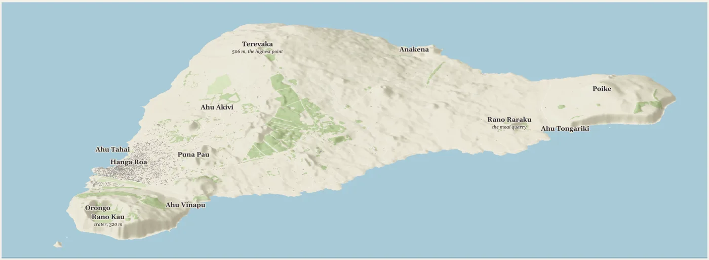
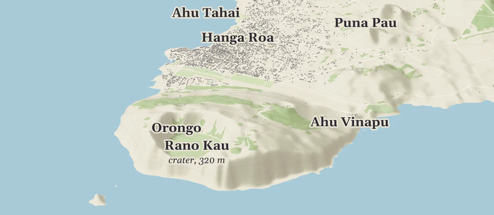
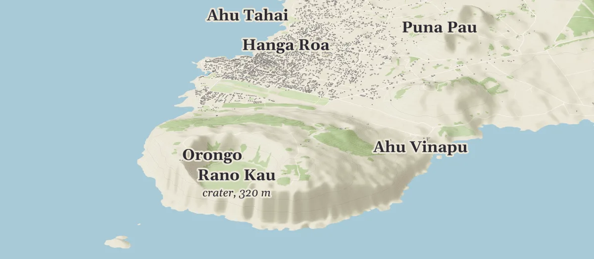
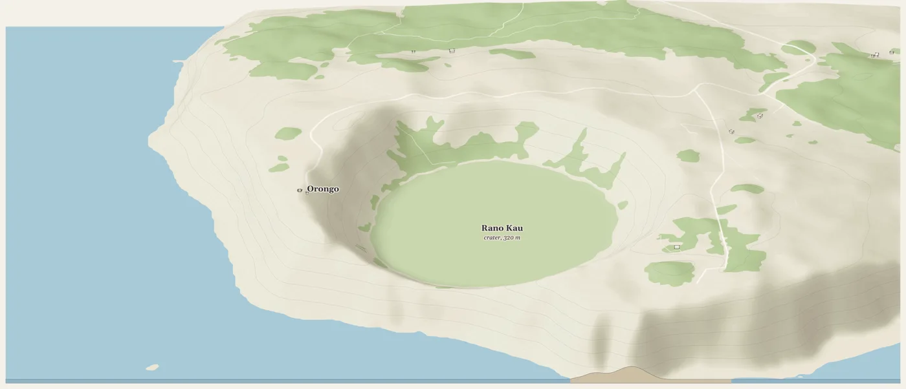
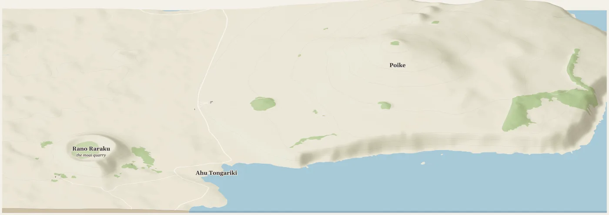
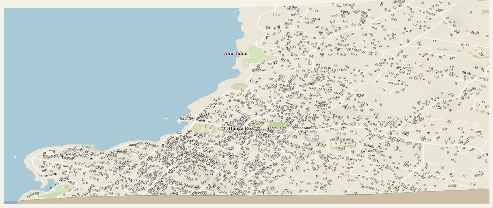

# Tutorial: map any place from open data with an AI chat, using Rapa Nui (Easter Island)

*Tutorial 1. Drafted with Claude; see the [artist statement](artist-statement.md).*

**isoscape** draws isometric maps of real places from open data: buildings and roads from
OpenStreetMap, and the shape of the ground from public elevation models. It is free and open
source. You choose a frame on the world, and the data decides the rest. The
[reference site](https://isoscape.chrisbusse.com/) has every published map.

This tutorial teaches a way to use isoscape with an AI chat to explore any place on Earth. You
ask questions in plain words. The chat finds the open data for the place, checks what it is
and what it allows, draws the place, and looks at the result with you. You need no GIS
software and no programming.

The worked example is Rapa Nui (Easter Island), a place with no public lidar, drawn from open
data alone:

::: figure wide

The whole island, about 23 km across, drawn with isoscape from open data: OpenStreetMap for
roads, buildings and land cover, and the Copernicus 30 m elevation model for the ground,
raised 2× so its relief shows at this size. [Open it in the viewer](https://isoscape.chrisbusse.com/#rapa-nui:2026).
Working draft.
:::

## What your chat needs

The chat has to be able to do three things:

- **run code**, so it can measure data instead of guessing about it;
- **fetch public data from the web**, so it can download elevation models and map data;
- **read and write files in a folder**, so the data, the scripts and the pictures it makes are
  kept and can be opened again.

This example was made in the Claude desktop app with Claude (Opus 5.5), with a folder on the
computer connected to the chat. Nothing here needs a terminal: you ask in plain words, and
the chat runs the commands and shows you the results.

> **Using Claude Code instead?** Everything below works the same from a terminal. Clone
> [isoscape](https://github.com/busse/isoscape), start Claude Code in that folder, and give it
> the same prompts.

If your chat cannot run code or fetch files, ask it for the exact commands, run them yourself,
and paste the output back. It is slower, but the checking still works.

## The method: ask, then check

A chat will answer a question about data from memory if you let it, and memory is where it
goes wrong: a survey that was flown is not always one you can download, and a license read
two years ago may have changed. So ask it to check. For each dataset it finds, have it answer these questions,
and to open the source when it does:

1. **Does it exist and can I get it?** A download link, an API, or only a paper that used it.
2. **Who made it, and how?** Lidar from a plane, radar from orbit, photographs from a drone.
3. **What does it cover, and how fine is it?** The area, and the size of one cell.
4. **What license?** Whether you may share pictures made from it, and whether you may sell them.
5. **What can it not show?** A 30 m cell cannot hold a 5 m platform.

Then have it fetch the data, measure it, draw it, and **look at the picture**. Numbers can
look fine on a map that is visibly wrong. Every fault found in this example was found by
looking.

## The worked example

These are the prompts used, lightly trimmed, and what came back.

### 1. What could be drawn?

> Here's a new challenge: Easter Island. Do an analysis of what you should be able to render.
> All island, the well-known landmarks, and then maximum zoom levels with LiDAR terrain
> preserved.

The chat searched for elevation data, read the sources, counted what OpenStreetMap holds for
the island, and reported back. The first finding was that the best data is out of reach. An
airborne lidar survey of the island was flown in April and May 2016, paid for by its heritage
office, the Secretaría Técnica de Patrimonio Rapa Nui, and a 2026 study of sea-level rise used
it [[Sci. Rep. 2026](#sources)], but we found no public download. The findings, checked again
for this page:

| Data | Detail | Open? |
|---|---|---|
| Airborne lidar, 2016, for the Secretaría Técnica de Patrimonio Rapa Nui | not published | no public download found |
| Copernicus DEM GLO-30 | 30 m, a *surface* model from radar, worldwide | yes, free with credit |
| Terrain Tiles (SRTM here) | 30 m, a worldwide mosaic | yes, free with credit |
| NOAA NCEI Easter Island model | 3 arc-seconds (about 90 m), land and sea floor, 2017 | yes, US public domain [[NOAA](#sources)] |
| Drone model of the Rano Raraku quarry, 2025 | a 3D mesh of the quarry only | yes, with limits ([see below](#a-dataset-with-strings-attached)) |
| OpenStreetMap | roads, about 4,100 buildings (most in Hanga Roa), land cover, named places | yes, ODbL |

The answer to "how close can it go" came from the cell size: the whole island prints crisply,
district views of a few kilometers soften, and close-ups of single sites need lidar that is
not public.

### 2. Draw it, and compare the sources

The next session started from a handoff note that held the findings above, with this prompt:

> Build the first isoscape Tutorial: how to explore a place with a chat, using Rapa Nui
> (Easter Island) as the worked example. [...] Show me a rough draft of the whole-island map
> and a one-page outline of the tutorial before writing it out, and ask me your open
> questions as multiple choice.

The note asked for both worldwide sources to be fetched and compared by looking.

isoscape takes a region file (a center, a frame size, a view direction and an elevation
source), downloads the data once, and draws from the cached copy. The two worldwide 30 m
sources gave the same island with different faults:

::: compare wide
 Copernicus
 Terrain Tiles

The same frame from the two 30 m sources. Drag the divider, or move it with the arrow keys.
Terrain Tiles (right) shows vertical banding on Rano Kau's sea cliffs and grainier slopes;
Copernicus (left) was used for every view on this page.
:::

### 3. Look, and fix what is wrong

Looking at the first draft turned up a green field floating in the sea off Hanga Roa. The
chat traced it to an OpenStreetMap outline tagged as a nature reserve: the Coral Nui Nui
underwater park, which isoscape had drawn like a park on land. The fix was a small change to
isoscape so that a reserve lying wholly in the sea is not drawn as ground, checked against
every published map to make sure none of them changed. It is the kind of fault no count would
have shown.

The chat put each choice like this one as a multiple-choice question, so steering the work took
a click: skip reserves at sea everywhere, work around this one feature, or leave it and
explain it. The answer was to fix it everywhere.

### 4. Zoom in until the data runs out

The handoff note named the districts to try and asked the chat to say plainly where 30 m
terrain stops being honest. Another multiple-choice question settled how far to go: these three
views, then the quarry model if its files and license allowed.

::: figure wide

Rano Kau and Orongo, about 3.8 km across, at true height. The crater reads well; the sea
cliffs on the near side come out as soft, shaded slopes because 30 m cells round them off.
[Open it](https://isoscape.chrisbusse.com/#rapa-nui-rano-kau:2026).
:::

::: figure wide

Poike, Ahu Tongariki and Rano Raraku, about 6.6 km across. The peninsula's shape is clear;
its cliffs and the small cones on its summit are softened.
[Open it](https://isoscape.chrisbusse.com/#rapa-nui-poike:2026).
:::

::: figure wide

Hanga Roa and Ahu Tahai, about 3 km across. Here the buildings carry the picture: OpenStreetMap
gives most of them a number of floors. The ground under them is nearly flat at this scale.
[Open it](https://isoscape.chrisbusse.com/#rapa-nui-hanga-roa:2026).
:::

At this size a 30 m cell is several millimeters on a print, and that is the limit. A view of
one ahu, a platform a few meters high, would be modeled parts set on ground the data cannot
describe, and it would have to say so.

## A dataset with strings attached

The search also found a 3D model of the Rano Raraku quarry, made from drone photographs for a
2025 study by Lipo, Hunt, Pakarati and others [[PLOS One 2025](#sources)]. It is the one place
on the island where public data is finer than 30 m. Before using it, the chat opened the
dataset's record [[Zenodo](#sources)] and found two things that change the plan:

- **Size and format.** The model is one 12.0 GB file in an Esri scene-package format, plus a
  small layer package. It is a textured 3D mesh, and isoscape reads grids of heights, so it has
  to be converted first.
- **License.** It is published under Creative Commons Attribution NonCommercial 4.0. This
  tutorial is noncommercial, so it may use the model with credit. Anything made from it can
  never be sold.

So the quarry is the next step: convert only the part of the mesh that covers the quarry into
a height grid, add it to isoscape as a source that carries its noncommercial license, and draw
the quarry close up. When you find data like this, ask about its size, its format and its
license before any download. Here the license was fine for teaching, and the 12 GB mesh is a
project of its own.

## Limits and care

- **The top of the surface.** Copernicus measures the top of whatever is there, trees and roofs
  included. Rapa Nui is mostly grass, so it sits close to the ground except in plantations and
  town.
- **What 30 m hides.** Cliffs, small cones and anything built are smoothed away or missing.
  Every view here says what it is drawn from.
- **This is a living place.** Rapa Nui's sites are sacred to its people. About two-fifths of
  the island is Rapa Nui National Park, managed since 2017–18 by the Ma'u Henua Polynesian
  Indigenous Community [[Rapa Nui National Park](#sources)]. The maps name only places that
  open maps already publish, and show no burial sites or caves. This page credits the Rapa
  Nui-led and Rapa Nui-partnered work behind the data and does not speak for any of it. These
  views are for learning; none of them is for sale.

## Make your own

The code and the region files for every view on this page are on
[GitHub](https://github.com/busse/isoscape). To start your own map, open a chat that can run
code and ask it to use the GitHub repo busse/isoscape to make an isometric map of your place.
[How it's made](how-its-made.md) explains each step isoscape takes. Prints of
the published maps are sold at [chrisbusse.com](https://chrisbusse.com/), which supports the
project.

## Sources

- **Sci. Rep. 2026.** "Hydrostatic sea-level rise inundation impacts on ahu and harbors of Rapa
  Nui (Easter Island)", *Scientific Reports* (2026). [link](https://www.nature.com/articles/s41598-026-45195-9)
- **NOAA.** Easter Island, Chile 3 arc-second Digital Elevation Model, NOAA National Centers
  for Environmental Information (2017). [link](https://www.ncei.noaa.gov/access/metadata/landing-page/bin/iso?id=gov.noaa.ngdc.mgg.dem:11502)
- **PLOS One 2025.** Lipo CP, Hunt TL, Pakarati G, et al., "Megalithic statue (moai)
  production on Rapa Nui (Easter Island, Chile)", *PLOS One* 20(11): e0336251.
  [link](https://doi.org/10.1371/journal.pone.0336251)
- **Zenodo.** Lipo C, Hunt T, Pingel T, "Megalithic Statue (Moai) Production on Rapa Nui
  (Easter Island, Chile)", V1.0 (2025), CC BY-NC 4.0. [link](https://doi.org/10.5281/zenodo.17095895)
- **Rapa Nui National Park.** Rapa Nui National Park, who we are. [link](https://rapanuinationalpark.com/en/who-we-are/)
- **Copernicus DEM GLO-30.** Produced using Copernicus WorldDEM-30 © DLR e.V. 2010-2014 and ©
  Airbus Defence and Space GmbH 2014-2018 provided under COPERNICUS by the European Union and
  ESA. [link](https://dataspace.copernicus.eu/explore-data/data-collections/copernicus-contributing-missions/collections-description/COP-DEM)
- **Terrain Tiles.** Mapzen/Tilezen on AWS Open Data; SRTM courtesy of the U.S. Geological
  Survey. [link](https://registry.opendata.aws/terrain-tiles/)
- **OpenStreetMap.** Map data © OpenStreetMap contributors, ODbL. [link](https://www.openstreetmap.org/copyright)
