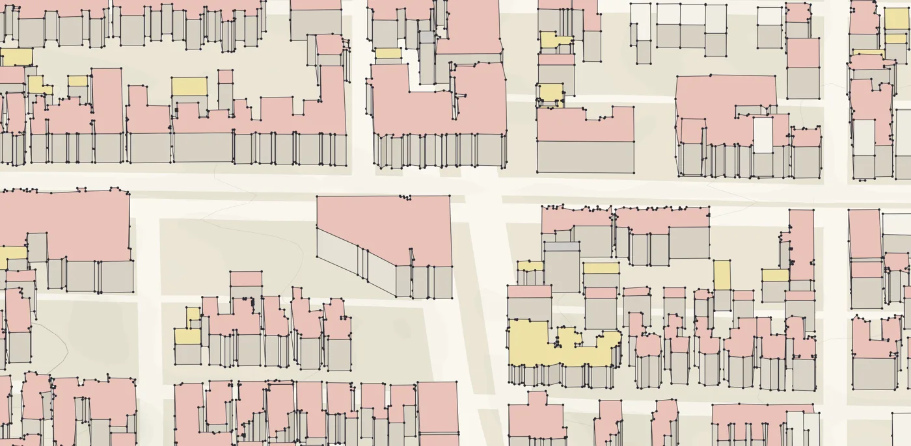
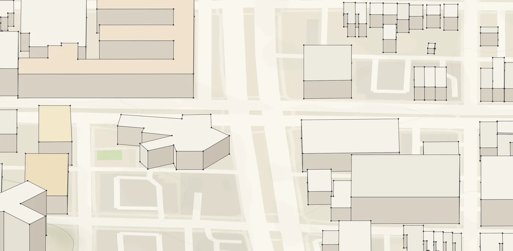
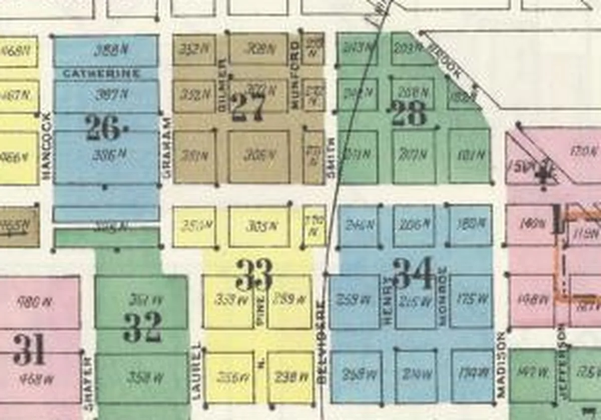
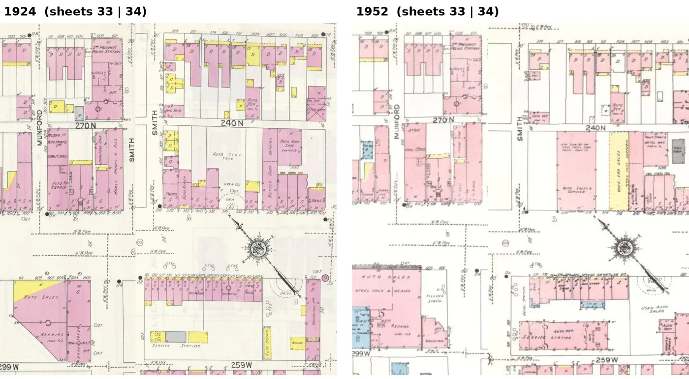
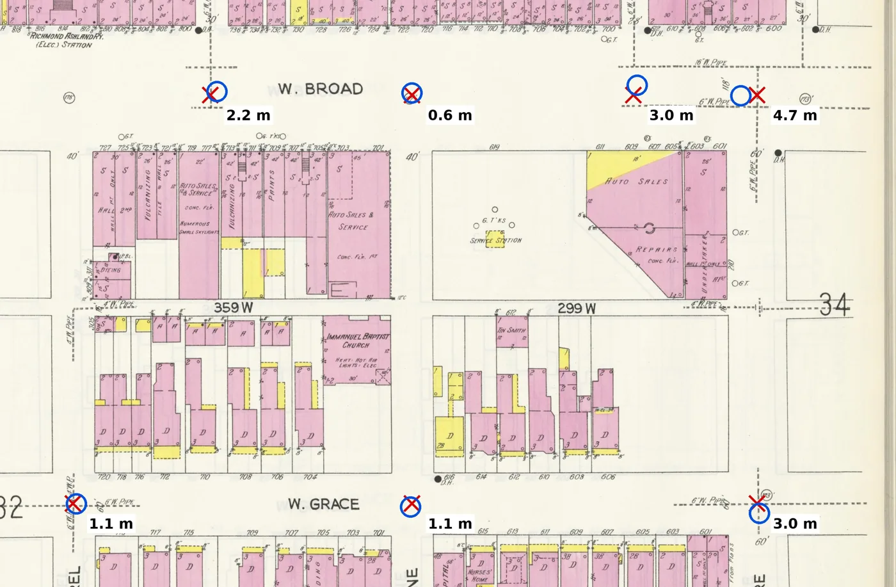
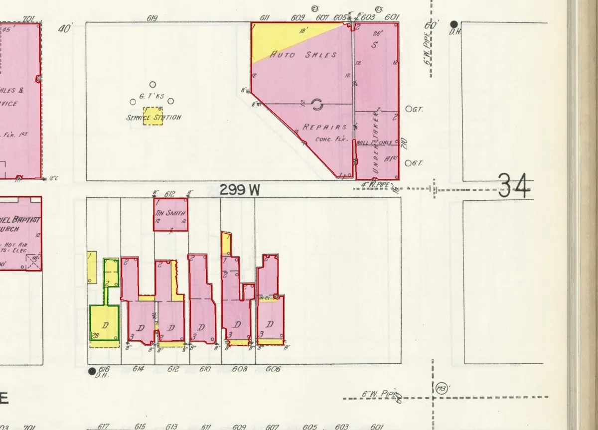
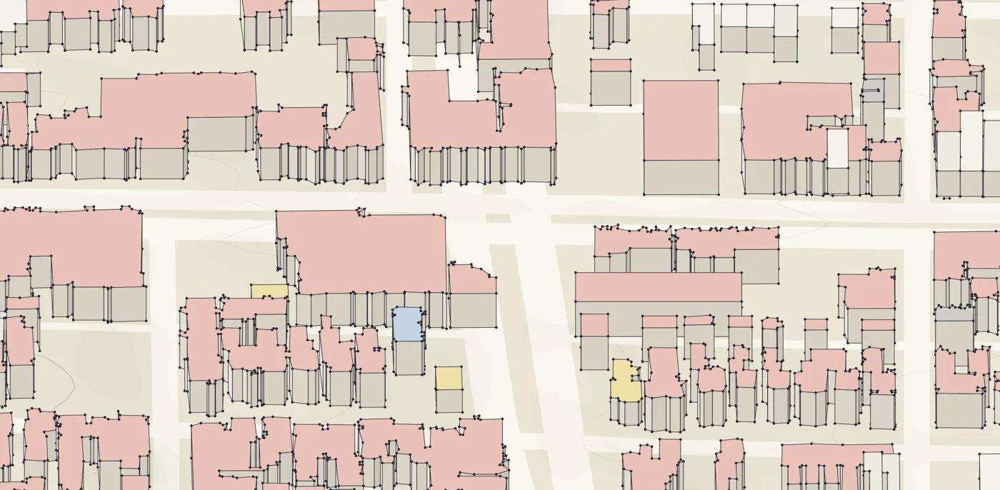
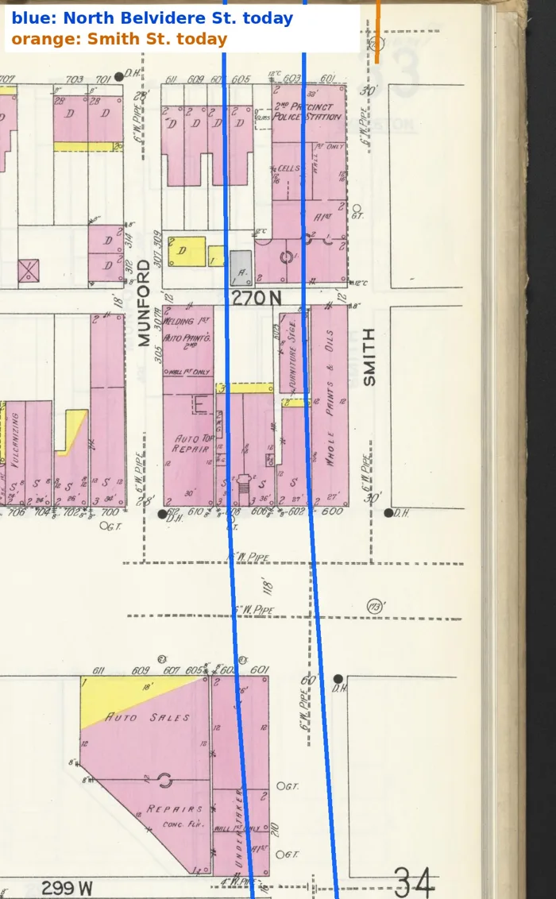

# Tutorial: draw a neighborhood's history from old maps and open data with an AI chat, using Broad and Belvidere in Richmond

*Tutorial 2. Drafted with Claude; see the [artist statement](artist-statement.md).*

**isoscape** draws isometric maps of real places from open data: buildings and roads from
OpenStreetMap, the shape of the ground from public elevation models, and, for the past,
buildings traced from old maps. It is free and open source, and the
[reference site](https://isoscape.chrisbusse.com/) has every published map.

This tutorial shows how to use isoscape with an AI chat to draw how a few blocks changed: find
the old maps that cover them, fit those maps to today's streets, trace the buildings, and check
every claim against the records. The worked example is one intersection in Richmond, Virginia,
the four corners of West Broad and North Belvidere Streets, in 1924, 1952 and today.

::: compare wide
 1924
 Today

The four corners of Broad (left to right) and Belvidere (front to back), seen from the south:
in 1924 from the Sanborn fire-insurance map, and today from OpenStreetMap. Drag the divider.
Working draft; open the views of [1924](https://isoscape.chrisbusse.com/#broad-belvidere:1924), [1952](https://isoscape.chrisbusse.com/#broad-belvidere:1952)
and [today](https://isoscape.chrisbusse.com/#broad-belvidere:2026) in the viewer.
:::

The same method, grown much larger, made two longer pieces on this site:
[Jackson Ward before I-95](#/jackson-ward), drawn block by block from the Sanborn maps of 1925
and 1952, and [Redlining in Richmond, 1937](#/redlining), which draws a federal mortgage map
on the ground it graded. This tutorial starts small on purpose.

## What your chat needs

The chat has to be able to do three things:

- **run code**, so it can measure instead of guessing;
- **fetch public data from the web**, so it can download old maps and today's records;
- **read and write files in a folder**, so the scans, the traces and the pictures are kept.

This example was made in the Claude desktop app with Claude (Opus 5.5), with a folder on the
computer connected to the chat. You ask in plain words; the chat runs the commands and shows
you what came back. If your chat cannot run code, ask it for the commands and run them
yourself. [Tutorial 1](#/explore-with-chat) covers this in more detail, but you don't need it
first.

> **Using Claude Code instead?** Everything here works the same from a terminal, in a clone of
> [isoscape](https://github.com/busse/isoscape).

## 1. Choose a question a map can answer

A good question has an answer that is a place, a count or a change over time. This one asked
*what stood on the four corners of Broad and Belvidere, and what changed?* It is one
intersection, small enough to finish in a morning, and the corners are in the news: Virginia
Commonwealth University (VCU) built its Institute for Contemporary Art on one of them and is
building an arts center on another.

The request that started it, and the one that chose the place:

> Plan a tutorial for how to make something like the two Jackson Ward stories.

> Another Richmond block; present me some that you think would be good, to choose from. VCU is
> always a dynamic, if applicable to this context.

The chat offered four places with what each would teach and what it would cost, as a
multiple-choice question. Asking the chat to put its open questions that way is worth doing:
each decision takes one click, and the record of them is the plan.

## 2. Find the old maps, and check each source

**Sanborn fire-insurance maps** drew every building in a city's business district for
insurers, block by block, with each building colored by what it was built of: pink for brick,
yellow for frame (wood), blue for stone, gray for iron. The Library of Congress has thousands
of them online, and says its online Sanborn collection is in the public domain
[[LoC Sanborn](#sources)].

A city's Sanborn map comes in volumes of numbered sheets, and each volume starts with a key map
that shows which sheet covers which blocks. Ask the chat to read the key map instead of guessing. In
this example, the volume that covers Jackson Ward had no Broad Street in its index, so the
chat opened the downtown volume's key map instead, which put all four corners on **sheets 33
and 34** of volume 1, in 1924 and in its 1952 reissue.

::: figure

The key map of the 1924 volume: sheet 33 holds the two west corners, sheet 34 the two east.
:::

::: figure wide

The corners on sheets 33 and 34, 1924 (left) and the 1952 reissue (right). The sheets are
turned: Broad runs across the middle.
:::

For today's side, the chat used the **City of Richmond's assessor records** (owner, use and
year built for each parcel, as of the July 1, 2026 assessment) and **OpenStreetMap** for
today's buildings and streets.

Ask five questions of every source before you rely on it:

1. Does it exist, and can I get it, or is it only mentioned somewhere?
2. Who made it, and how?
3. What does it cover, and how detailed is it?
4. What does its license allow?
5. What can it not show?

For a Sanborn map the last answer matters most: it shows buildings, materials and uses as
the surveyor recorded them for insurers, and a reissue may repeat an older survey where nobody
redrew it.

## 3. Put the old map on today's ground

A scanned sheet has no coordinates. To place it, the chat reads street corners off the sheet
that still exist today, finds the same corners in OpenStreetMap, and fits the sheet to them
with one turn, one shift and one scale. Then it reports how far each corner misses.

::: figure wide

Sheet 33 fitted to seven of today's street corners. Red cross: the corner as read on the
sheet; blue ring: today's corner after the fit. Broad and Gilmer misses by 2.2 m, Broad and
Pine 0.6 m, Broad and Munford 3.0 m, Broad and Belvidere 4.7 m, Grace and Laurel 1.1 m, Grace
and Pine 1.1 m, Grace and Belvidere 3.0 m (mean 2.3 m). Sheet 34's four corners miss by under
1 m. The 1952 sheets were placed by matching each to the same sheet of 1924.
:::

The first fit missed by up to 8 m on Broad Street. Looking at where the misses were, the chat
found the cause: West Broad is a divided road, and OpenStreetMap draws each direction as its
own line, so a corner taken from one line sits several meters off the street's middle. Taking
the midpoint of both lines brought the misses down to the numbers above. A miss of a few
meters, under a house's width, is good for this kind of map.

## 4. Trace the buildings, then check the trace

The chat traced every colored building on the four sheets in code and drew each trace back
over its scan, so you can see what it caught and what it missed.

::: figure

The trace over the 1924 sheet at the southwest corner. Red: brick; green: frame.
:::

Looking at these overlays found four faults, each fixed before going on:

- **A margin traced as a building.** The yellowed paper at the edge of one scan came back as a
  1,409 m² frame building. The fix: tell the tracer to keep to the map's own frame on each
  sheet.
- **Pale pink missed in 1952.** On the reissue, the paste-over corrections are printed in a
  paler pink, and the tracer skipped them: whole buildings were missing at the corners. A
  looser reading of pale pink took the 1952 count from 138 to 183 buildings.
- **A museum hiding a garage.** isoscape treats a traced building as still standing when a
  building of today covers it, so the 1924 auto sales building on the southwest corner
  vanished under the Institute for Contemporary Art, built in 2016. The fix counts a building
  of today as the old one only if the assessor dates it to that year or earlier.
- **A garage followed into a shed.** A big 1924 building was matched to a small 1952 building
  inside its outline and drawn with the small one's shape. The fix requires the two outlines to
  overlap by half of the larger before calling them the same building.

The last two fixes are options of isoscape's tracing tools now; *How it's made* describes
them under "Time".

## 5. Count with a written rule

Write the rule before you count. Here it was: for each corner, take the half-block from Broad
back to the alley, and measure how much of it is covered by buildings, from the trace for 1924
and 1952 and from OpenStreetMap today. A share of ground is sturdier than a count of
buildings, because the trace joins houses that share a party wall.

| Corner | 1924 | 1952 | Today | What stands there today (assessor, OpenStreetMap) |
|---|---|---|---|---|
| Northwest | 70% | 74% | 0% | North Belvidere Street runs through it (see A below) |
| Southwest | 37% | 56% | 38% | Institute for Contemporary Art, built 2016 |
| Northeast | 44% | 58% | 34% | a drugstore, built 1998; one small building dated 1920 |
| Southeast | 34% | 40% | 55% | CoStar Center, under construction; one building of 1969 |

*Measured:* the shares, from the traced outlines and today's mapped buildings. *Read off the
sheets:* the uses (auto sales, repairs, filling stations, stores). *Unknown:* anything the
sheets left out, such as who owned or worked in the buildings.

## 6. Draw each state and compare

With the traces placed, isoscape draws the corners in any year: the buildings standing today
that the assessor dates to that year or earlier, plus the traced buildings known to stand then.

::: compare wide
 1924
 1952

1924 and 1952: still an auto row, with bigger showrooms.
:::

::: compare wide
 1952
 Today

1952 and today.
:::

The CoStar Center is drawn because OpenStreetMap maps it as a building under construction.
The assessor has no year for it yet, so the drawing dates it 2025, from VCU's report that it
was under construction that September [[VCU News 2025](#sources)]. It is planned to open in
spring 2028 [[VCU, under construction](#sources)].

## 7. When the sources disagree

Making this example turned up three places where published sources, the old maps and today's
records disagreed. Each is a common kind of disagreement, and each was handled differently.

### A. The street that changed course

Both Sanborn editions label the street north of Broad **Smith Street**, about 12 m east of
Belvidere's line south of Broad. Today North Belvidere Street (US 1 and 301) runs straight
across Broad. Drawing today's streets over the fitted 1924 sheet shows what happened:

::: figure

Today's North Belvidere Street (blue) over the 1924 sheet. North of Broad it runs through the
stores at 600–608 West Broad, where Smith Street ran beside them. A short Smith Street (orange)
survives further north.
:::

*How it was handled:* the drawing settles where the road went, which is why the northwest
corner's buildings are gone (0% today in the table). It does not say when: both editions,
through 1952, still show Smith Street. The page says "after 1952" and no more, until a city
record of the work turns up.

### B. "All four corners"

A guest commentary in Richmond BizSense in April 2026 says a VCU purchase on West Broad
"solidifies VCU's essential control of all four corners" of Broad and Belvidere
[[BizSense 2026](#sources)]. The city's July 2026 assessment lists the southwest and southeast
corners under VCU, the northwest under the VCU Real Estate Foundation, a separate owner tied to
the university, and the northeast under a private company.

*How it was handled:* read the claim generously first. "Control" can count a university
foundation, a lease or a sale after July; the purchase the piece names, 409–423 West Broad, is
a block east of the corner. So this page reports what each source says, with its date, and
calls neither wrong without a deed. It also treats the piece as what it is, an argument, and
quotes it as one.

### C. The train station

A 2017 business article says the museum's site "was once the site of a small train station"
[[Virginia Business 2017](#sources)]. The 1924 sheet shows auto businesses on that block, and
the nearest station, the Richmond-Ashland Railway's, two blocks west on the north side of Broad.
That looked like an error, but a claim can be true in a year you haven't looked at. The 1905
Sanborn sheet of the same block shows it:

::: figure

The same block in 1905 (sheet 61): the Richmond, Fredericksburg and Potomac Railroad's Elba
Station and its baggage room, beside the track that curved off Broad Street down Belvidere.
:::

Railroad histories agree: a line ran up Belvidere to the RF&P at Broad Street, where a
junction station named Elba was built [[Richmond Railroad Museum](#sources)]. The claim holds
for 1905, and the 1924 map shows the station gone. *How it was handled:* say both, each with
its year.

### What to do when sources disagree

- Keep a list of every disagreement as you find it, and don't resolve one silently.
- Go to the primary record: the map itself, the assessor's record, the deed, the ordinance.
- Before calling a claim wrong, check timing (another year), definitions ("control", "corner")
  and scale (a block, or the building on it).
- Report each side with its source and date. If it can't be settled, say so on the page.
- If your page has already published something wrong, correct it in public with a dated line.

## 8. Write it so it can be checked

Lead with the answer. Give every fact a source that was opened while writing, and link it.
Add a "How we know" section with the fits, the misses and the rules, a corrections section,
and say who keeps the history: here, the Library of Congress for the maps, the city for the
records, and the institutions and neighbors whose words are quoted. Give the page a title that
describes it fully, because a link preview may be all a reader sees.

## 9. Take care with places people live

Changes like these are lived history: a business that closed, a block that was cleared, a
neighborhood that pushed back. Give each side in its own words, with a source. Here that means
VCU on what it built and why (the museum on the Broad Street corridor that links its two campuses
[[VCU, ICA](#sources)]) and the preservationists' case for reusing buildings instead of
demolishing them [[BizSense 2026](#sources)]. When a story is about displacement, ask people
with standing in it to review it before you publish, or say plainly that no one did. This
tutorial's example is one intersection; the history of the Carver neighborhood just north of
it, which VCU's growth also changed, deserves its own telling and is not summarized here.

## 10. Make your own

Start with one Sanborn sheet, two editions and one block in your own town. A first request
could be:

> Find the Sanborn fire-insurance map sheets at the Library of Congress that cover the corner
> of [your streets] in [your town], in two different years. Read the key map to find them, fit
> each sheet to today's street corners and tell me how far each corner misses, then trace the
> buildings and draw them over the scan so I can check them.

Then ask it to draw the block with isoscape in each year, and look at every picture before you
trust a number. This example took one long session of a few hours; Jackson Ward took many.

The code, the region and the traces for this example are on
[GitHub](https://github.com/busse/isoscape) (`regions/broad-belvidere.json`,
`history/broad-belvidere.json`, `tools/sanborn/bb/`). Prints of the published maps are sold at
[chrisbusse.com](https://chrisbusse.com/), which supports the project; nothing on this page is
for sale.

## How we know

- **The fits.** Sheet 33 (1924) was fitted to seven street corners with a mean miss of 2.3 m and
  a worst of 4.7 m (Broad and Belvidere); sheet
  34 to four corners, all under 1 m. The 1952 sheets were placed by matching features between
  each 1952 sheet and the same 1924 sheet (`tools/sanborn/bb/geo1924.json`, `geo1952.json`).
- **The traces** are sketches: outlines and heights are approximate, houses sharing a wall are
  often joined, and small sheds may be missing. Heights are assumed from the material.
- **Today's buildings** come from OpenStreetMap as fetched on November 25, 2026, and their
  years from the City of Richmond assessor's year-built records.
- **The corner owners** are the assessor's records for the July 1, 2026 assessment.

## Corrections

None yet. Corrections are welcome through the [contact page](#/about/contact).

## Sources

- **LoC Sanborn.** Library of Congress, Sanborn Maps collection, rights statement: "The content
  of the Library of Congress online Sanborn Maps Collection is in the public domain."
  [loc.gov](https://www.loc.gov/collections/sanborn-maps/)
- **Sanborn 1924 vol. 1.** Sanborn Fire Insurance Map from Richmond, Independent Cities,
  Virginia, 1924–1925, vol. 1 (1924), key map and sheets 33–34. Library of Congress.
  [loc.gov](https://www.loc.gov/item/sanborn09064_006/)
- **Sanborn 1952 vol. 1.** The same, vol. 1, 1924, republished 1952, sheets 33–34.
  [loc.gov](https://www.loc.gov/item/sanborn09064_016/)
- **Sanborn 1905.** The same, 1905, sheet 61. [loc.gov](https://www.loc.gov/item/sanborn09064_003/)
- **City of Richmond assessor.** Parcels (owner, use) and Year of Construction, City of
  Richmond GIS, July 1, 2026 assessment.
  [ArcGIS](https://services1.arcgis.com/k3vhq11XkBNeeOfM/ArcGIS/rest/services/Parcels/FeatureServer/0)
- **OpenStreetMap.** Map data © OpenStreetMap contributors, ODbL.
  [openstreetmap.org](https://www.openstreetmap.org/copyright)
- **VCU, ICA.** VCU Facilities Management, "Institute for Contemporary Art".
  [vcu.edu](https://fmd.vcu.edu/departments/construction-management/capital-construction/completed-projects/ica/)
- **VCU News 2025.** "What's being built: a roundup of campus construction projects at VCU",
  September 2025.
  [news.vcu.edu](https://news.vcu.edu/article/2025/09/whats-being-built-a-roundup-of-campus-construction-projects-at-vcu)
- **VCU, under construction.** "What's under construction at VCU".
  [news.vcu.edu](https://news.vcu.edu/article/whats-under-construction-at-vcu)
- **BizSense 2026.** Jennie Dotts and Dixon Kerr, "Guest Commentary: Downtown RVA or Downtown
  VCU?", Richmond BizSense, April 3, 2026.
  [richmondbizsense.com](https://richmondbizsense.com/2026/04/03/guest-commentary-downtown-rva-or-downtown-vcu/)
- **Virginia Business 2017.** "VCU's new Institute for Contemporary Art evokes motion",
  Virginia Business, April 25, 2017.
  [virginiabusiness.com](https://virginiabusiness.com/vcus-new-institute-for-contemporary-art-evokes-motion/)
- **Richmond Railroad Museum.** "Railroad history".
  [richmondrailroadmuseum.com](https://www.richmondrailroadmuseum.com/railroad-history)

## How this page was made

Drafted by Claude for Chris Busse in one session, from sources opened while drafting. The maps
are drawn by Chris with isoscape, the tool he draws with, built with Claude; the fitting,
tracing and measuring were done in code with Claude (see the
[artist statement](artist-statement.md)). Nothing here is for sale.
