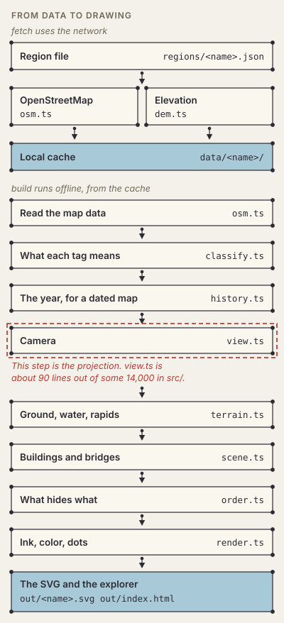

# How it's made

isoscape draws a real place as an isometric dot-and-line picture: inked edges, a dot on every
visible corner, flat fills. Nothing in it is drawn by hand. Every line comes from two open
datasets, OpenStreetMap and the USGS 3D Elevation Program, and the code decides where it
goes.

This page follows the pipeline from the download to the finished SVG. It also says, for every
part of the picture, whether it was **measured**, **inferred** from a measurement, or
**guessed**. They look the same on the page, and they are not.

Each build in the explorer also has its own **How this view was made** tab under the picture.
It gives that view's frame, sources and counts, and links back to the sections here.

Where to start:

- **Lidar and GIS:** [Terrain](#terrain), [Rivers](#rivers), [Rapids](#rapids) and
  [Shoreline](#shoreline).
- **Urban planning:** [Buildings](#buildings), [Bridges](#bridges) and
  [Measured, inferred, guessed](#measured-inferred-guessed).
- **Art and illustration:** [Camera](#camera), [Drawing](#drawing) and
  [Paint order](#paint-order).
- **History:** [Time](#time) covers the dated series: what is measured, what is curated, and
  what a series cannot show.
- **Development:** every section names the file that does the work. The
  [archive and explorer](#archive-and-explorer) section covers the build loop.

## Measured, inferred, guessed

| Part of the picture | Comes from | How sure |
|---|---|---|
| Building footprints, roads, rail, parks, water outlines | OpenStreetMap | Mapped by volunteers, mostly traced from aerial imagery. Usually good, sometimes stale |
| Extra footprints (where a region asks) | Microsoft's ML building footprints | Traced by a model from imagery. Good outlines, sometimes merged or missing |
| Building heights | OSM `height`, else Microsoft's model, else `building:levels`, else a guess | Mixed. In downtown Richmond about 40% are guesses; around Gwynn's Island, a little over half. Each build reports its own split |
| Woods, wetlands, fields, crops (where a region asks) | USGS National Land Cover Database (NLCD 2021) | Classified from satellite imagery at 30 m. Right in the large, coarse at the edges |
| Ground elevation | USGS 3DEP bare-earth model | Measured. 1 m lidar where it has been flown |
| River surface | The lowest lidar returns over mapped water, smoothed | Inferred |
| Exposed rock and rapids | Height above, and fall of, that surface | Inferred |
| Shoreline (with terrain) | Mapped water, corrected against the lidar | Inferred |
| Bridge deck heights | A per-region rule by name, else a default per OSM layer | Rule of thumb |
| Camera bearing | Snapped to the street grid, or set in the region | Chosen |

## Inputs

**OpenStreetMap.** `fetch` asks the Overpass API for everything the renderer can draw:
buildings and building parts, water and waterways, roads, railways, parks, woods and other
land cover, islands, coastline and car parks. Large areas are fetched in tiles of at most
1.6 km a side, because Overpass refuses or times out on big requests. Four public mirrors are
tried in turn. Each tile is cached as it arrives, so an interrupted fetch picks up where it
stopped. The merged answer is saved as `data/<region>/osm.json`.

**Elevation.** The ground comes from the [USGS 3D Elevation Program
(3DEP)](https://www.usgs.gov/3d-elevation-program). Its seamless bare-earth model is served by
the National Map's `exportImage` service, which returns the best data available for each
place: 1 m lidar where it has been flown, coarser models elsewhere. Bare earth means
buildings and trees have been removed. isoscape requests uncompressed 32-bit float GeoTIFFs
in tiles of at most 1,500 pixels a side, at 1 m per pixel unless the region sets
`demResolution`. The tiles are stitched together and stored as `data/<region>/dem.bin.gz`:
gzipped 16-bit integers in centimetres, so heights are kept to the nearest centimetre.

3DEP sometimes fills a gap in its coverage with a large negative number. One patch near
Shockoe Bottom reads −88 m. Any sample below −5 m is treated as missing, along with a
three-pixel rim around it, and filled from its neighbours.

The download covers the frame's circumscribed circle plus a 60 m margin. The camera can turn
after the data arrives (see [Camera](#camera)), and the data still covers the frame. **Builds
never touch the network**, so a build can be repeated exactly.

**Building footprints, beyond OSM.** OSM is thorough in cities and thin in the country.
Around Gwynn's Island it maps 417 buildings, while Microsoft's
[Global ML Building Footprints](https://github.com/microsoft/GlobalMLBuildingFootprints)
find over 6,000. A region can list `"microsoft"` in `sources.buildings`. `fetch` then
downloads the dataset's parts for the region's zoom-9 quadkeys, keeps the footprints whose
centres fall in the region, and stores them in `data/<region>/footprints.json`. The model
estimates a height for many of them, and that height is kept.

**Land cover.** Rural OSM rarely maps woods and fields. A region with `sources.landcover:
"nlcd"` gets the [National Land Cover Database](https://www.mrlc.gov/) (NLCD 2021) through
the MRLC's map service. That's a 30 m classification of the whole country: forest, wetland,
pasture, crops, scrub and so on. The map image comes back with each class in its legend
colour, and each colour is matched back to its class. The result is stored in
`data/<region>/landcover.bin.gz`.

Code: `src/osm.ts`, `src/dem.ts`, `src/footprints.ts`, `src/landcover.ts`.

## Region

A place is one JSON file in `regions/`. It sets the centre (longitude, latitude), the frame's
width and depth in metres, the camera's bearing and whether it may snap, the scale in pixels
per metre, the tilt, the terrain settings, rules for bridge decks, and the palette. The
README's "Region config" section lists every key.

Positions are converted to local metres east and north of the centre. This simple
equirectangular approximation is accurate to a fraction of a metre across a city-sized frame.

Code: `src/region.ts`.

## Camera

The camera is **orthographic**: no perspective, so a building is the same size near and far,
and lengths across the picture can be measured with a ruler. It looks down at a fixed tilt.
The region sets `squash`, the sine of that tilt:

- Ground across the picture is drawn at full scale (`scale` pixels per metre).
- Ground running into the picture is drawn at `squash` of its length. At 0.5 the tilt is 30°,
  the classic 2:1 view of isometric games.
- Heights are drawn at the cosine of the tilt (0.87 at 30°), times any `exaggeration`.

The frame is a rectangle on the ground, square to the camera, so it lands on the screen as a
plain rectangle. That suits a panorama.

**Snap.** Seen from due north, most street grids sit at an awkward angle. With `snap` on,
isoscape measures the dominant direction of every building edge in the frame (weighted by
length, folded so that edges at 0°, 90°, 180° and 270° all count for the same grid). The camera
then turns by up to 45° to put that grid on the picture's diagonals. Downtown Richmond snaps to
a bearing of −8.7°. Set `"snap": false` to keep the bearing you gave.

Code: `src/view.ts`, `chooseBearing` in `src/scene.ts`.

## Ground

Each OSM area is classified by its tags as water, island, park or grass, wood, marsh, sand,
bare rock, parking or cemetery, and drawn as a flat fill in that order. Rivers are drawn from
their mapped area, never from their centre line. Canals, streams and ditches are drawn as
ribbons of a typical width.

**Roads and rail** become ribbons. A road's width comes from its `width` tag if it has one,
otherwise from its class: 14 m for a motorway, 7 m for a residential street, 1.8 m for a
footway. Tunnels are left out. Railways are 3.2 m ribbons with dashed ties. Weirs and dams
are drawn as white crests.

**Land cover from NLCD**, where a region uses it, goes down first, between the bare ground
and OSM's own areas. Each 30 m class is resampled onto the terrain grid and grouped as woods,
evergreen woods, swamp, marsh, field, crop, scrub or barren. Each group's edge is traced
smoothly through the grid, the same way as the shoreline, so the blocks don't show as
squares. OSM's parks, woods and marshes are drawn on top of it, so mapped detail wins.

Code: `src/classify.ts`, `buildScene` in `src/scene.ts`, cover in `paintStrip` in `src/render.ts`.

## Coastline

OSM does not map the sea, or tidal water like the Chesapeake Bay, as water polygons. It maps
the coastline as lines with the land always on their left. isoscape joins those lines into
chains and cuts them where they cross the frame. It closes each piece of land by walking the
frame's edge, and the water is the frame minus the land. The result can be wrong if the
coastline near the frame is broken or mis-tagged.

Code: `src/coast.ts`.

## Terrain

With terrain turned on, the elevation is resampled onto a regular grid in the camera's
coordinates, every 5 m by default (`cell`). A light blur removes the curbs, rubble and noise
that 1 m lidar records and a 5 m grid would turn into speckle.

The scene's height at any point is its elevation above the lowest point in the frame (the
**datum**), times `terrain.exaggeration`. The sample regions draw hills 2.5–4× taller than
life, so the landform reads from a distance. **Buildings and bridges keep their true heights** on top
of the exaggerated ground, so a 2.5× hill does not stretch the towers standing on it.

Shading and contours are computed from the true elevation, not the exaggerated one:

- **Hillshade.** Each cell is lit from the left and a little towards the camera. The result is
  rounded to one of 12 steps lighter or darker, which keeps the SVG small. Very steep ground
  can look stepped.
- **Contours.** Marching squares every 2 m by default (`contour`), with every fifth line
  heavier (`majorEvery`). There are no contours over water.

Code: `src/terrain.ts`, `paintStrip` in `src/render.ts`.

## Rivers

Lidar over a river is not the river. 3DEP's bare-earth surfaces are mostly hydro-flattened,
level across the water and stepping down along it. But OSM's water outline never matches
them to the metre, and rocks, ledges and overlapped banks stand above the water. Draped
naively, the river would climb its own banks.

So the river's surface is **recovered**. At each water point on the grid, it is taken as a
low value (the 15th percentile) of the elevations of all water points within 30 m. It is then
smoothed along the water. The river ends up level across its width and falling along its
course, steeply only where it really drops.

- Water points standing **more than 1 m above that surface**, at least two grid cells (10 m
  at the default 5 m grid) from shore, are drawn as **exposed rock**. These are the boulder fields of the falls.
- Near the shore, mapped "water" standing more than 1 m above the surface is treated as bank.
  It is **given back to the land** at its own height.

Both are inferences: a gravel bar mapped as water or a misplaced outline can produce false
rock. Flat regions skip all of this and draw OSM's outlines as they are.

Code: `settleWater` in `src/terrain.ts`.

## Rapids

A rapid is where the recovered water surface **falls quickly**. At each water point at least
two grid cells from shore, the fall is measured across 40 m in four directions, and the steepest is
kept. Measuring over 40 m means a single noisy cell cannot fake a rapid. Where the fall
exceeds `terrain.rapids` (0.035 by default, 3.5 m per 100 m), the cell reads as a rapid.

Each rapid cell gets one or two short white strokes across the current, plus a wash of froth
where it drops hardest. The strokes are placed by a hash of the cell's position, not at
random, so the same data always draws the same marks. Weirs mapped in OSM are drawn
separately.

Rapids are **inferred, not observed**. They show where the lidar surface is steep, which is
usually where the water is white, but river level on the day of the survey, a misplaced
outline or a dam can all mislead it. The build's tab reports how many cells were read as
rapids.

Code: `riverFall` in `src/terrain.ts`, `paintStrip` in `src/render.ts`.

## Shoreline

With terrain, the water's edge is traced from the lidar-corrected water grid (marching squares
over a lightly smoothed mask), not from OSM's outline, and drawn at the river's surface. Where
the outline overlaps a steep bank, the bank slopes into the water instead of the water
climbing the bank.

Code: `paintStrip` in `src/render.ts`.

## Buildings

Every OSM building that lies **wholly inside the frame** and covers at least
`minBuildingArea` (12 m² by default) becomes a prism. Walls are drawn on the sides facing the
camera, and the roof goes on top. Courtyards work. Wall shading follows which way each wall
faces, with the light from the left. Roof colour follows the building's type: homes,
commerce, industry or civic. Where a building is mapped as Simple 3D Buildings parts
(`building:part`), the parts are drawn instead of the outline. Open canopies
(`building=roof`) are left out.

**Footprints from Microsoft's model** fill in where OSM has none. Wherever an OSM building
and a footprint overlap, OSM wins and the footprint is dropped. A footprint is dropped if its
centre lies in an OSM building, or if it holds an OSM building's centre.

**Heights** are taken from the first of these that the building has:

1. a `height` tag, from a survey or a mapper's estimate;
2. **an estimate from Microsoft's model**, for its own footprints, where it made one;
3. `building:levels`, at 3.4 m a floor, plus half a floor for each roof level;
4. **a guess** from the building's type and size: 3.2 m for a shed or anything under 40 m²,
   8 m for a house, 10 m for a terrace, 16 m for apartments or a hotel, 13 m for an office
   (24 m over 1,500 m²), 11 m for industry, 16 m for a church, and 8–14 m by footprint for
   anything else.

Each build counts how many heights came from each source. A view with many guesses has the
right footprints and plausible but invented skylines. Joining real heights from lidar (the
first-return surface minus bare earth) is the top item on the roadmap.

On a slope, a building stands on the **lowest** ground under it, so its downhill wall shows
its full height. The roof sits at the building's height above the average ground under it.

Code: `buildingHeights` in `src/classify.ts`, `extrude` in `src/scene.ts`.

## Bridges

OSM splits one bridge into many ways, at every change of lanes, name or junction. Ramping
each piece down to the ground would turn a viaduct into a roller coaster. So bridge ways that
share an end, a layer and a kind (road or rail) are joined into chains first. A chain only
ramps down at an end that touches no other bridge.

**Deck height is a rule of thumb.** OSM rarely records it. A region can name a height for a
bridge, for example `{ "match": "Manchester", "deck": 24 }`. Otherwise the deck sits
`bridgeDeck` metres (7 by default) above the ground for each OSM `layer`. The deck is a taut
line over whatever it crosses: never closer to the ground than its clearance, rising in
straight runs, and easing down over at most 70 m at a free end. Piers drop to the real ground
or water every 38 m where the deck is more than 3 m up.

Each bridge is cut into spans of at most 22 m, so a long bridge can pass in front of one
building and behind another. Bridges are cut at the edges of the frame.

Code: `chainBridges` and `bridgePieces` in `src/scene.ts`.

## Paint order

The drawing has no depth buffer. Things are painted back to front, and the order is the hard
part. Sorting by a single depth per object fails as soon as a long warehouse sits beside a
small house. So the order is decided **pairwise**, only between objects whose boxes overlap
on screen:

- If their footprints can be separated by a line, the one on the camera's side of that line
  is in front.
- If the footprints overlap (stacked building parts), the one entirely above is in front.
- Otherwise the nearer centre wins.

A topological sort turns these pairwise results into one order. The rare cycle, from concave
footprints that interlock, is broken by depth.

Code: `src/order.ts`.

## Drawing

**The ground is painted in strips**, two grid rows deep (10 m at the default cell size), from
the back of the frame to the front. A landscape hides parts of itself: a bank that falls away
from the camera hides the water behind it. Each strip drapes everything that lies on it over
the terrain: bare ground, parks, water, roads, rail, hillshade, contours, rocks and rapids.
Each building or bridge is painted straight after the strip that holds its front edge, so a
hill in front of it covers it and the ground behind it does not.

The front of the plate is a **slab**, a true cross-section of the ground along the near edge,
with water where the cut crosses the river.

**The SVG is compact.** Coordinates are rounded to a tenth of a pixel and written relative to
the previous point. Draped edges are simplified to a quarter pixel. Each dot is a zero-length
line with round caps. Even so, a big region can produce a 25 MB file. The `--png` option
renders a raster with `rsvg-convert`. Colours and line weights come from a palette (`paper`
or `night`).

Code: `src/render.ts`, `src/palette.ts`.

## Time

A region with a `time` section is drawn as a **series**: one scene for each year (epoch) in its
history file, built with `isoscape series <region>`. The downtown Richmond series runs from
the 1737 town plan to today. Each scene combines two kinds of evidence, and the explorer says
which is which.

**Measured: buildings standing today, by the year each was built.** A building appears in
every scene from its year on. The year comes from:

1. a curated year, for a few landmarks whose records are known to be wrong or missing (the
   Capitol, St. John's Church, the Old Stone House and so on), each with a source;
2. else OpenStreetMap's `start_date` tag;
3. else the city assessor's *year built* for the parcel under the building's centre.

The assessor records one year per parcel, the year of its main building. Up to four buildings
on a lot (a row split in OSM, a house and its shed) all take that year. With more buildings,
only one clearly larger than the rest takes it. A parcel with eight or more (a campus, Capitol
Square) gives its year to none of them. Buildings with no year appear only in today's scene.

**Curated: what is gone or was different.** A short list per series, each item with its
years and sources: a filled canal basin, a burned district, a buried creek, demolished
landmarks drawn from published dimensions in a red-brown tone (a burned shell in ash grey), and
the town plan, which limits the earliest scene's streets to the original grid. Positions come
from today's street grid. They are not surveyed.

**Traced: buildings from fire-insurance maps.** The Sanborn Map Company drew every building
in a city's business district for insurers, block by block. Each building appears as a
footprint coloured by material: pink brick, yellow frame, blue stone, grey iron. The Library of
Congress has Richmond editions from 1886 to 1925 online. isoscape traces them:

1. **Georeference.** Each sheet is placed on the ground by a rotation and shift: at one scale
   per edition, two or three named street corners read off the sheet are enough. A third
   corner checks the first two. The block outlines from the city's GIS are drawn over each
   sheet to confirm the fit (`tools/sanborn/rigid.py`, `ovmosaic.py`).
2. **Trace.** The coloured fills are separated from the paper and the printed lines, read for
   material, closed over the lettering, and traced as polygons. Near-rectangles are squared
   up, and outlines and thin strips (river banks, rails) are dropped (`extract.py`).
3. **Follow through time.** A traced footprint mostly covered by a building standing today is
   taken to be that building, or its replacement on the same footprint, and today's data
   already draws it. The rest are **lost buildings**. Each is drawn from the first edition
   that shows it, though it may be older. It is drawn until it is known to be gone, in this
   order of preference: a later edition that maps the spot without it; the year the building
   on its site today went up; the opening of an expressway through it. Failing all of those,
   it is *assumed* gone by 1960, when clearing for parking and highways began
   (`lifespans.py`).

Traced buildings keep the maps' colours, so they read apart from today's. Their heights are
guessed from their material (brick and stone three storeys, frame two): the storey counts
printed on the sheets are not read yet; later editions add olive-brown for fire-proof
construction, drawn six storeys. The explorer counts, for each scene, how many traced
buildings stand and how each one's end date was found.

Three editions are traced: **1886**; **1924–25**, whose first volume opens with a single
"congested district" map of the whole business district (fitted with a rubber sheet
through sixteen street corners, each snapped to the city's block outlines); and
**1950–52**, a corrected reprint whose sheets were matched feature by feature to their
1924–25 versions where those were fitted, and read by eye otherwise. Each later edition turns
"assumed" end dates into ones read from a map.

**Era rules** date everything else that OSM maps: the first rule matching a feature's name,
`ref` or tags decides the spans in which it existed. Interstates appear from 1958, the
Downtown Expressway from 1976, the river viaducts from 1901. The James River and Kanawha Canal
appears from 1800 until the railroad took it over, and again from the Canal Walk of 1999.
Features no rule matches are drawn in every year, which suits the street grid. Paths and other
undated features are drawn only today.

In every scene after the first, buildings **new since the previous scene** have gold roofs.

**What the series cannot show:**

- **Survivorship.** Only buildings standing today are measured. Downtown Richmond in 1900 had
  far more buildings than the 1900 scene, because most of them were torn down later. The
  scenes show what survives, plus the few curated losses.
- **Heaped years.** Assessors often round: in this data, many buildings are dated to exactly
  1900 or 1910. Read the decades loosely.
- **Today's ground.** The elevation is today's lidar, so the I-95 cut through Shockoe Valley
  is there in 1737. Curated water is laid flat at the lowest ground beneath it.
- **The jump to today.** Undated buildings appear only in today's scene, so the last step of a
  series adds many more buildings than really went up in that interval.

Code: `src/history.ts`; the history file is `history/<series>.json`; the tracing tools are in
`tools/sanborn/` (Python: NumPy, SciPy, OpenCV, Shapely), and their output is
`history/sanborn/`.

## Archive and explorer

Every build is kept under `out/builds/<timestamp>-<name>/` as the SVG, a thumbnail and a
`meta.json`. The meta file records:

- the region's settings;
- the camera bearing used;
- every count the build measured (features, ground areas, buildings by height source, bridge
  spans, rapid cells, contour segments, strips);
- the build's time and file size;
- the git commit, its subject, and whether `src/` or `regions/` had uncommitted changes;
- an optional `--note` saying what the build was trying;
- for a dated scene, its year, the year before it in the series, and the curated features
  drawn in it, with their sources.

`backfill` builds an older commit's code against today's cached data, so the archive can
include outputs from before it existed.

After every build, `out/index.html` is rewritten: this explorer. It is a single file with the
build list and these pages embedded in it, so it opens from disk with no server. The pages are
Markdown files in `pages/`. To add one, see the README.

Code: `src/archive.ts`, `src/explorer.ts`, `src/pages.ts`.

## Credits

Map data © [OpenStreetMap](https://www.openstreetmap.org/copyright) contributors, available
under the Open Database License. Elevation from the [USGS 3D Elevation
Program](https://www.usgs.gov/3d-elevation-program), public domain. Years built for the
Richmond series from the City of Richmond's open data. Fire-insurance maps from the Library
of Congress Sanborn Maps Collection. See [About](about.md) for what that means when you use
or share a picture.

Inspired by [Isometric SF](https://isometricsf.com), Justin Chavez's isometric pixel-art map
of San Francisco ([how it was made](https://www.justinchavez.com/blog/isometric-sf-how/)).
