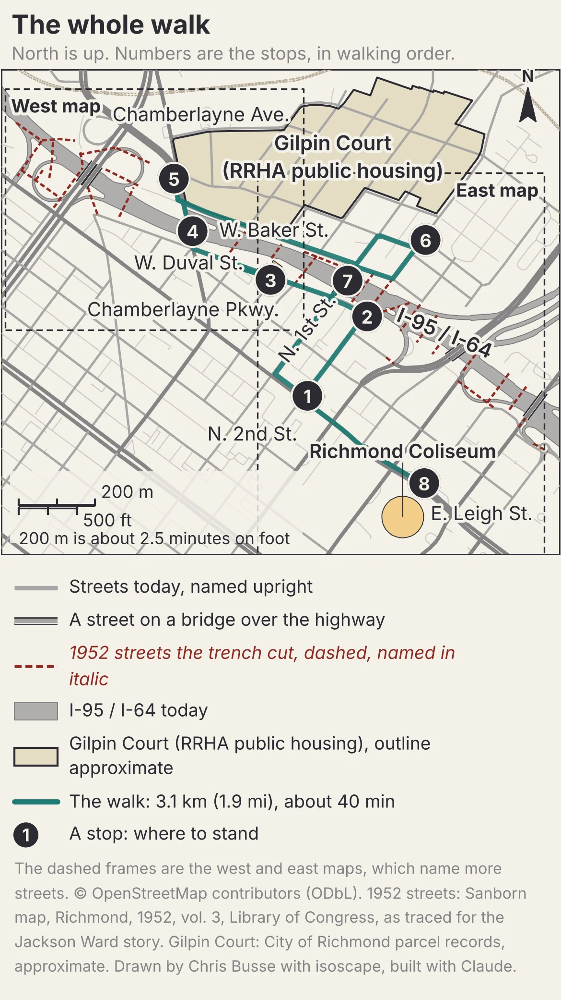
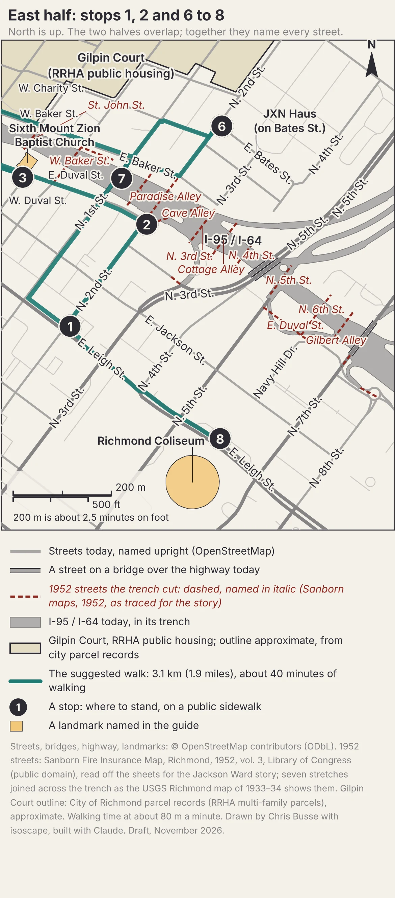
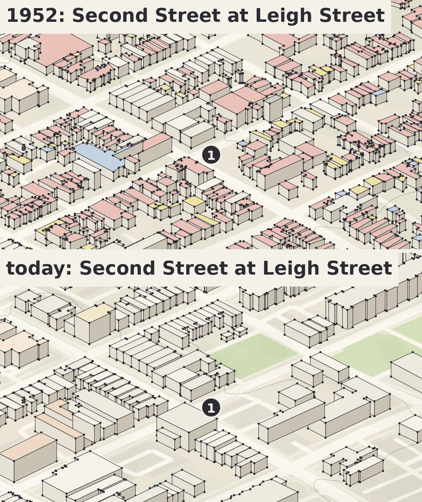
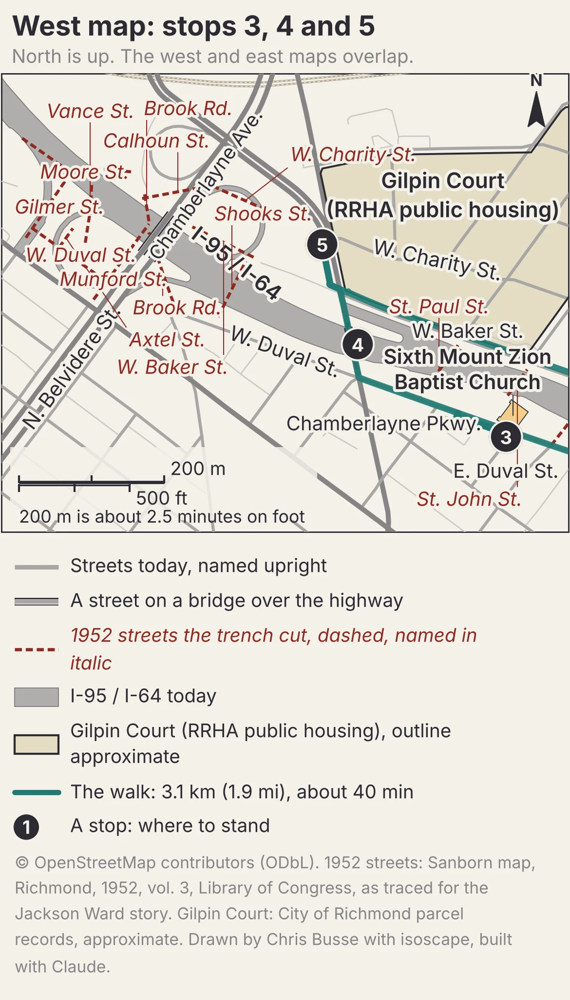
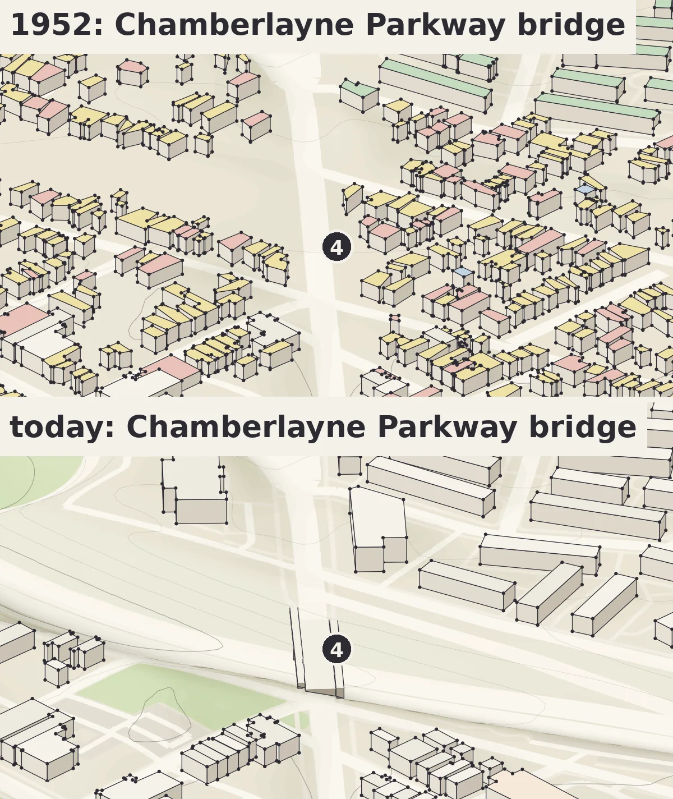
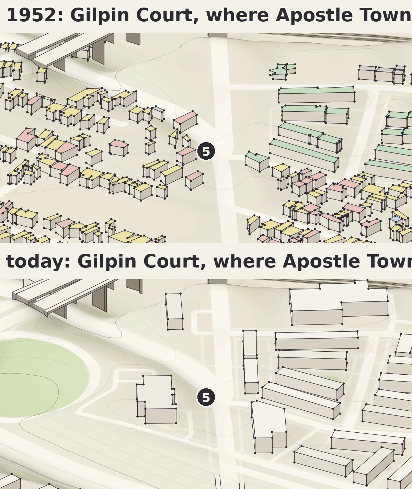

# Seeing the change: a walking guide to Jackson Ward

## How to use this guide

The walk has eight stops and is 3.1 km (1.9 miles), about 40 minutes on foot at
about 80 m a minute, not counting time at the stops. Every stop is on a public sidewalk or
street. It starts at Second and Leigh Streets and ends beside the Coliseum, 390 m
(1300 feet) from where it began.

::: figure

The whole walk, north up. The dashed frames are the west and east maps further down, which name
more streets. *How this was made:* drawn in code from OpenStreetMap, the 1952 street lines the
[story](jackson-ward.md#the-streets-the-highway-cut) read off the Sanborn sheets, and City of
Richmond parcel records for Gilpin Court's outline, which is approximate.
:::

Each stop says which map it is on, where to stand and what you are looking at. Its picture shows
the same few blocks in 1952 and today, seen from the south as if from a low airplane. The numbered
disc in the picture is where you stand. On the maps, dashed streets named in italic are streets of
1952 that the highway's trench cut.

> **About this guide.** Chris Busse, a Richmond artist, made this guide with Claude. Every fact
> in it comes from the page [Jackson Ward, Richmond, VA, before I-95, block by
> block](jackson-ward.md), with that page's sources. The map is drawn from OpenStreetMap, the
> Sanborn fire-insurance maps of 1952 at the Library of Congress, and City of Richmond parcel
> records. Corrections are welcome through the [contact page](#/about/contact).

Stops 1 and 2 are on the east map.

::: figure

The east map: stops 1, 2, 6, 7 and 8.
:::

## 1. Second Street at Leigh Street

*East map.*

::: figure

Second Street at Leigh Street, stop 1: 1952 above, today below, seen from the south. The numbered disc is where you stand. Where the trench is now, the 1952 ground is an estimate, about ±2 m in its middle and 3 to 4 m or more at its ends.
:::

**Stand** at the corner of North 2nd and East Leigh Streets, on the east side of 2nd, by Eggleston Plaza. **Look** south down 2nd Street toward Clay and Broad Streets.

Second Street, "the Deuce," was the ward's main commercial street [[Community Plan
2026](#sources)]. It was known as Black Wall Street by 1903, the National Park Service says
[[NPS, Black Wall Street](#sources)].

The 1925 Sanborn sheet's Miller Hotel stood at the corner of 2nd and Leigh. Neverett A. Eggleston
Sr. leased it in 1939, bought it in 1942 and renamed it the Hotel Eggleston; it was demolished in
2009 after a partial collapse [[UVA, Green Book project](#sources)].

## 2. Where Second Street stops

*East map.*

::: figure

Where Second Street stops, stop 2: 1952 above, today below, seen from the south. The numbered disc is where you stand. Where the trench is now, the 1952 ground is an estimate, about ±2 m in its middle and 3 to 4 m or more at its ends.
:::

**Stand** at the north end of North 2nd Street, where it meets East Duval Street by the highway. **Look** north across I-95 to where 2nd Street starts again.

Seven streets that ran through at street level now end at the highway's trench or cross it on a
bridge, and 2nd Street is one that ends [[the story](jackson-ward.md#the-streets-the-highway-cut)].
The Richmond–Petersburg Turnpike Authority built its toll road through the ward between 1955 and
1958 [[Acts of Assembly 1954](#sources); [Community Plan 2026](#sources), timeline]. The road now
carries I-95 and, through the ward, I-64 as well [[Feasibility Study 2022](#sources), §1.4.3].

Under the highway the U.S. Geological Survey's lidar shows the trench about 80–100 m wide and 3
to 6.5 m deep under the old cross streets [[the story](jackson-ward.md#the-ground-before-the-trench)].

Stops 3, 4 and 5 are on the west map.

::: figure

The west map: stops 3, 4 and 5.
:::

## 3. Sixth Mount Zion Baptist Church

*West map.*

::: figure

Sixth Mount Zion Baptist Church, stop 3: 1952 above, today below, seen from the south. The numbered disc is where you stand. Where the trench is now, the 1952 ground is an estimate, about ±2 m in its middle and 3 to 4 m or more at its ends.
:::

**Stand** on the south sidewalk of West Duval Street, across from the church. **Look** north at Sixth Mount Zion Baptist Church, with the highway behind it.

Sixth Mount Zion was organized by John Jasper in 1867 and was in the ward from 1869
[[Community Plan 2026](#sources); [Feasibility Study 2022](#sources), §1.4]. It stood at the edge
of the highway's path and was spared in 1956. The state's register nomination says it was allowed
to stand because of its historical significance, credits its pastor, Dr. Augustus Walter Brown
Sr., with saving it, and notes that the interstate swings around it [[DHR 127-0472](#sources)].

Wikipedia, citing Benjamin Campbell, says the road was rerouted slightly [[Campbell
2012](#sources), via Wikipedia].

## 4. Chamberlayne Parkway bridge

*West map.*

::: figure

Chamberlayne Parkway bridge, stop 4: 1952 above, today below, seen from the south. The numbered disc is where you stand. Where the trench is now, the 1952 ground is an estimate, about ±2 m in its middle and 3 to 4 m or more at its ends.
:::

**Stand** on the east sidewalk of the Chamberlayne Parkway bridge, halfway across. **Look** east along the trench toward the North 1st Street bridge.

The trench is up to about 8 m deep between Brook Road and Chamberlayne Parkway [[the
story](jackson-ward.md#the-ground-before-the-trench)].

A cap or lid over the highway is being studied. The 2022 feasibility study found it would be
"technically possible" to build a bridge or lid in a study area from the Belvidere Street bridge to the North
1st Street bridge, and found four of its six areas feasible, from Chamberlayne Parkway to North
1st Street [[Feasibility Study 2022](#sources), §3.2.4; [Fact sheet 2023](#sources)]. People in
and around the ward hold a range of views on the cap, as Elizabeth McGowan reported in July 2024
[[VCIJ 2024](#sources)]. This guide takes no position on it.

## 5. Gilpin Court, where Apostle Town stood

*West map.*

::: figure

Gilpin Court, where Apostle Town stood, stop 5: 1952 above, today below, seen from the south. The numbered disc is where you stand. Where the trench is now, the 1952 ground is an estimate, about ±2 m in its middle and 3 to 4 m or more at its ends. In 1952 Gilpin Court is drawn in the sheet's own colors, green and blue, though the sheet labels its buildings brick-faced.
:::

**Stand** on the west sidewalk of Chamberlayne Avenue at West Charity Street. **Look** east across the avenue at Gilpin Court.

On January 16, 1941, City Council passed the ordinance that began clearing Apostle Town, a section
of Jackson Ward [[LVA 2025](#sources)]. The Richmond Housing Authority built Gilpin Court there; it
was dedicated on April 28, 1943, with 301 units [[Feasibility Study 2022](#sources), §1.4.2;
[LVA 2025](#sources)]. Gilpin Court was enlarged in 1957 to house families the Turnpike displaced
[[Encyclopedia Virginia](#sources)].

People live in Gilpin Court today, and this guide describes it as homes. In July 2026 a draft
agreement between the city and the Richmond Redevelopment and Housing Authority called for
one-for-one replacement of all 781 units [[Gilpin Court MOU 2026](#sources)]. This guide takes no
position on the plan.

Stops 6, 7 and 8 are back on the [east map](#how-to-use-this-guide).

## 6. Bates Street and the JXN Haus

*East map.*

::: figure

Bates Street and the JXN Haus, stop 6: 1952 above, today below, seen from the south. The numbered disc is where you stand. Where the trench is now, the 1952 ground is an estimate, about ±2 m in its middle and 3 to 4 m or more at its ends. Hatched blocks are where no building was traced from the 1952 sheets; only buildings standing today are drawn there, so the picture does not show those blocks as they were.
:::

**Stand** at the corner of North 2nd and East Bates Streets. **Look** east along Bates Street.

In 1957 the Turnpike Authority and the city took by eminent domain a cottage built in 1793 by
Abraham Peyton Skipwith, who had bought his freedom. It was sold for about $25 and moved to
Goochland County [[LVA, House to Highway](#sources); [Axios, April 2026](#sources)].

The JXN Project, founded by the sisters Enjoli and Sesha Moon, rebuilt the cottage in Jackson Ward
as a reconstruction of the original. It opened on Bates Street in April 2026 with the JXN Haus,
the project's headquarters [[The Richmonder, April 2026](#sources); [Richmond Magazine, May
2026](#sources)].

## 7. North 1st Street bridge

*East map.*

::: figure

North 1st Street bridge, stop 7: 1952 above, today below, seen from the south. The numbered disc is where you stand. Where the trench is now, the 1952 ground is an estimate, about ±2 m in its middle and 3 to 4 m or more at its ends. Hatched blocks are where no building was traced from the 1952 sheets.
:::

**Stand** on the east sidewalk of the North 1st Street bridge, halfway across. **Look** east along the trench, toward the cut ends of 2nd Street and Navy Hill beyond.

The 1952 Sanborn sheets show 216 buildings inside today's paved roadway and ramps, and
447 in the corridor of that pavement plus 15 m on each side, from the Belvidere Street
ramps to the line of 8th Street. These are outlines on a map; the number does not count homes,
families or people, and it is approximate [[the
story](jackson-ward.md#how-many-buildings-stood-in-the-highways-path)].

East of about 3rd Street, north of Leigh, the corridor runs through Navy Hill [[the
story](jackson-ward.md#how-many-buildings-stood-in-the-highways-path)]. Published counts of what
the road destroyed differ, and the story sets them side by side.

## 8. The Coliseum site

*East map.*

*No 1952-and-today picture for this stop.* The Coliseum stands at the near edge of the story's views, so their picture of today leaves it out (isoscape draws only buildings wholly inside the frame), and the 1952 sheets were not traced for its blocks.

**Stand** on the sidewalk of East Leigh Street beside the Coliseum. **Look** south at the Richmond Coliseum.

Navy Hill had become a majority-Black neighborhood in the early twentieth century, Harry Kollatz
Jr. writes, and the Coliseum was later built on its cleared blocks [[Kollatz 2019](#sources)]. A
photograph shows it under construction on December 30, 1968 [[WVTF 2016](#sources)]. On November
19, 2026, it still stood, and the city was aiming to demolish it by the end of 2027 [[WWBT,
November 2026](#sources)].

## Who keeps the ward's history

As the [story](jackson-ward.md#who-keeps-the-wards-history) has it:

> The ward's history is kept by its own people and institutions, among them the
> [Historic Jackson Ward Association](https://www.hjwa.org/), the [Black History Museum & Cultural
> Center of Virginia](https://blackhistorymuseum.org/), the [JXN Project](https://www.thejxnproject.org/),
> the [Maggie L. Walker National Historic Site](https://www.nps.gov/mawa/), Sixth Mount Zion Baptist
> Church, Ebenezer Baptist Church, the Gilpin Court Tenant Council and Gilpin Informed Residents.
> This page does not draw on their collections, apart from Ebenezer's published church history;
> readers should go to them.

## How the pictures were made

The pictures are drawn by Chris Busse with isoscape, the drawing tool he built with Claude (see
the [artist statement](artist-statement.md)). Each pair is cut from the story's views of 1952 and
today; the views of today are drawn from OpenStreetMap and U.S. Geological Survey lidar, as every
isoscape view is [[the story](jackson-ward.md#jackson-ward-today-and-the-proposed-cap-over-i-95)]. The 1952 buildings are traced from the Sanborn sheets and may sit a few meters from where
they stood. Inside today's trench the 1952 pictures stand on ground rebuilt by estimate, about
±2 m in its middle [[the story](jackson-ward.md#the-ground-before-the-trench)]. The map is drawn
in code from the sources named under it. The text was drafted by Claude for Chris Busse from the
published story.

## Sources

The guide's facts and their sources are the story's; these are the ones it cites, as the story
lists them. The story's [full list](jackson-ward.md#sources) gives the rest.

- **Acts of Assembly 1954**: Virginia Acts of Assembly, 1954, chapter 705, approved April 8, 1954 (Code §§ 33-255.27 to 33-255.42), as transcribed by the University of Virginia's Modeling Jim Crow project. Opened November 18 and 22, 2026. [modelingjimcrow.virginia.edu/node/72717](https://modelingjimcrow.virginia.edu/node/72717)
- **Axios, April 2026**: "Skipwith-Roper Cottage homecoming," Axios Richmond, April 17, 2026. Opened November 22, 2026. [axios.com](https://www.axios.com/local/richmond/2026/04/17/jackson-ward-skipwith-roper-cottage-homecoming)
- **Campbell 2012**: Benjamin Campbell, *Richmond's Unhealed History* (Brandylane, 2012), pp. 152, 154, as cited by Wikipedia, "Jackson Ward." The book has not been seen. [en.wikipedia.org/wiki/Jackson_Ward](https://en.wikipedia.org/wiki/Jackson_Ward)
- **Community Plan 2026**: City of Richmond, Jackson Ward Community Plan, edited July 2026. Opened November 18 and 22, 2026. [rva.gov (PDF)](https://rva.gov/sites/default/files/2026-07/20260716_Jackson%20Ward%20Community%20Plan_editedJuly2026.pdf)
- **DHR 127-0472**: Virginia Department of Historic Resources, Sixth Mount Zion Baptist Church, register page and National Register nomination (1996). Opened November 22, 2026. [dhr.virginia.gov](https://www.dhr.virginia.gov/historic-registers/127-0472/); [nomination (PDF)](https://www.dhr.virginia.gov/wp-content/uploads/2018/04/127-0472_Sixth_Mount_Zion_Church_1996_Final_Nomination.pdf)
- **Encyclopedia Virginia**: LaToya Gray-Sparks, "Urban Renewal in Richmond" (2024, updated 2025). Opened November 18, 2026. [encyclopediavirginia.org](https://encyclopediavirginia.org/entries/urban-renewal-in-richmond/)
- **Fact sheet 2023**: City of Richmond, Reconnect Jackson Ward fact sheet. Opened November 18, 2026. [rva.gov (PDF)](https://rva.gov/sites/default/files/2024-11/RJW-FactSheetv3_12_2023.pdf)
- **Feasibility Study 2022**: OIPI, VDOT and City of Richmond, Reconnect Jackson Ward Feasibility Study, September 2022. Its §1.4.3 cites Harry Kollatz Jr., "The Curve Around the Station," *Richmond Magazine*, 2013, and its §§1.4.1–1.4.2 cite M. E. Taylor, *The African American Community of Richmond, Virginia: 1950–1956* (University of Richmond master's thesis, 1994); neither has been seen. Opened November 18 and 22, 2026. [rva.gov (PDF)](https://www.rva.gov/sites/default/files/2024-11/RJW_FS_Report_2022-09-30v5-FINAL.pdf)
- **Gilpin Court MOU 2026**: City of Richmond and RRHA, Joint Gilpin Transformation Working Group Memorandum of Understanding, draft published July 2026 (unsigned). Opened November 18, 2026. [rva.gov (PDF)](https://rva.gov/sites/default/files/2026-07/Gilpin%20Court%20MOU%20RRHA%20COR_final%20AATF.pdf)
- **Kollatz 2019**: Harry Kollatz Jr., "The Original Navy Hill," *Richmond Magazine*, December 29, 2019. Opened November 22, 2026. [richmondmagazine.com](https://richmondmagazine.com/news/sunday-story/the-original-navy-hill/)
- **LVA 2025**: Ashley Craig, "A Brief History of Public Housing in the City of Richmond," *The UncommonWealth*, November 17, 2025. Opened November 18 and 22, 2026. [uncommonwealth.lva.virginia.gov](https://uncommonwealth.lva.virginia.gov/blog/2025/11/17/a-brief-history-of-public-housing-in-the-city-of-richmond)
- **LVA, House to Highway**: Library of Virginia and the JXN Project, *House to Highway: Reclaiming a Community History*, on view July 14, 2025, to February 28, 2026. Opened November 18 and 22, 2026. [lva.virginia.gov](https://www.lva.virginia.gov/events/exhibitions/house-to-highway)
- **NPS, Black Wall Street**: National Park Service, "Jackson Ward and its Black Wall Street." Opened November 18 and 22, 2026. [nps.gov](https://www.nps.gov/articles/000/jackson-ward-and-its-black-wall-street.htm)
- **Richmond Magazine, May 2026**: Scott Bass, "Nice Shot" photo feature on the JXN Haus and Skipwith-Roper Cottage, *Richmond Magazine*, May 20, 2026. Opened November 22, 2026. [richmondmagazine.com](https://richmondmagazine.com/news/richmond-history/nice-shot-jxn-haus-skipwith-roper-cottage/)
- **The Richmonder, April 2026**: Victoria A. Ifatusin, "JXN Project unveils rebuilt 'founding father' home, highlighting Black history in Richmond," April 19, 2026. Opened November 22, 2026. [richmonder.org](https://www.richmonder.org/jxn-project-unveils-rebuilt-founding-father-home-highlighting-black-history-in-richmond/)
- **UVA, Green Book project**: University of Virginia, "Miller's Hotel / Hotel Eggleston." Opened November 22, 2026. [community.village.virginia.edu](https://community.village.virginia.edu/greenbooks/node/4017)
- **VCIJ 2024**: Elizabeth McGowan, "In Richmond, a struggle over the future of a 'Harlem of the South,'" Virginia Center for Investigative Journalism at WHRO, July 16, 2024. Opened November 18 and 22, 2026. [vcij.org](https://vcij.org/stories/in-richmond-a-struggle-over-the-future-of-a-harlem-of-the-south)
- **WVTF 2016**: Kelley Libby, "When a highway and a coliseum cut through a community," April 14, 2016. Opened November 18, 2026. [wvtf.org](https://www.wvtf.org/post/when-highway-and-coliseum-cut-through-community)
- **WWBT, November 2026**: Madison McNamee, "When will the Richmond Coliseum be demolished?," 12 On Your Side, November 19, 2026. Opened November 22, 2026. [12onyourside.com](https://www.12onyourside.com/2026/11/19/when-will-richmond-coliseum-be-demolished/)
