# Seeing the change: finding your place in Jackson Ward, 1952 and today

## How to use this guide

Find a street you know in the [street index](#street-index) or on the maps. Its grid square, such
as C4, is the same on every map. The drawings show the same blocks in 1952 and today, seen from the
south, with the streets named in both. The ten [places to stand](#places-to-stand) are on public
sidewalks, numbered west to east only so you can find them; go to any of them, in any order.

::: figure wide

Jackson Ward in 1952 and today, with the streets named. Today's names are upright. In 1952 the streets the trench cut are named in italic, dark red, as on the maps; a street of today is named in 1952 only where it ran on the same line then, at the same place as in today's half. Hatched blocks in 1952 are
where no building was traced from the sheets; only buildings standing today are drawn there.
In Navy Hill, north of Leigh Street and east of about 3rd Street, the 1952 streets were not read off the sheets, so the 1952 drawings there show today's street lines, some of them through houses the sheets print; those lines are not named in 1952. A tracing pass for them is planned. Where the trench is now, the 1952 ground is an estimate, about ±2 m in its middle and
3 to 4 m or more at its ends [[the story](jackson-ward.md#the-ground-before-the-trench)].
:::

## The maps

::: figure
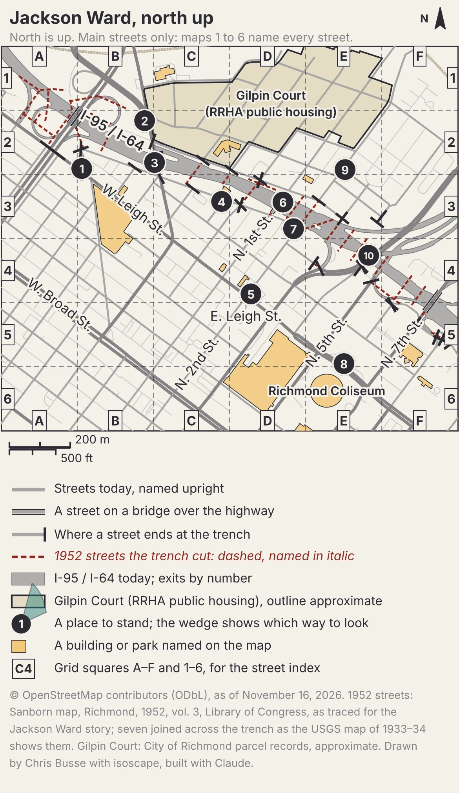

The whole frame, north up, with the key. The six maps after it name every street, each covering
two columns and three rows of the grid. *How this was made:* drawn in code from OpenStreetMap as
of November 16, 2026; the 1952 street lines the [story](jackson-ward.md#the-streets-the-highway-cut) read
off the Sanborn sheets, with seven stretches joined across the trench as the U.S. Geological
Survey's map of 1933–34 shows them; and City of Richmond parcel records for Gilpin Court's
outline, which is approximate.
:::

::: figure
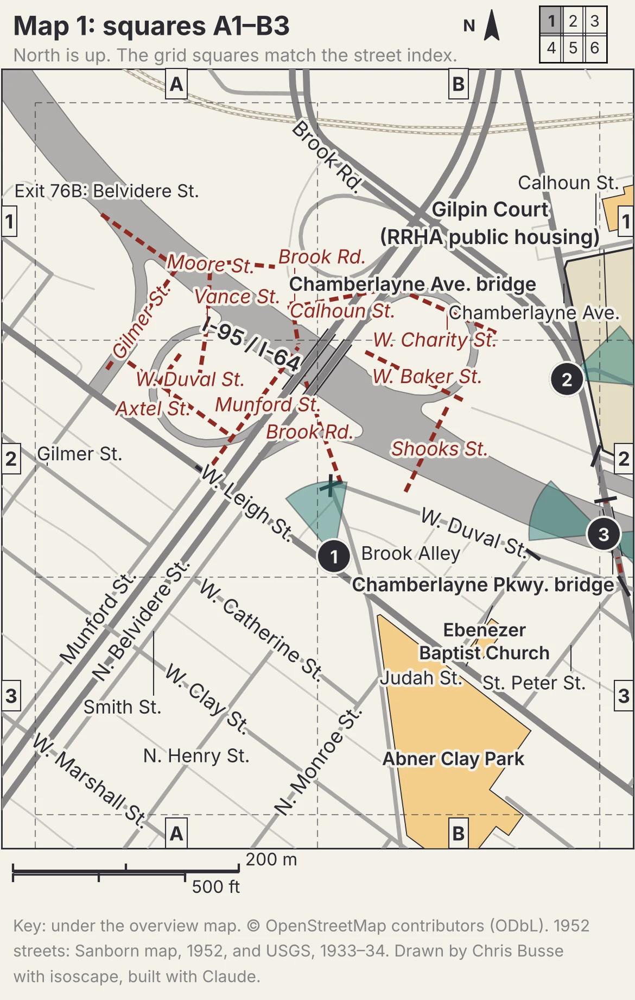

Map 1: squares A1–B3. The small plan at its top right shows where it lies.
:::

::: figure
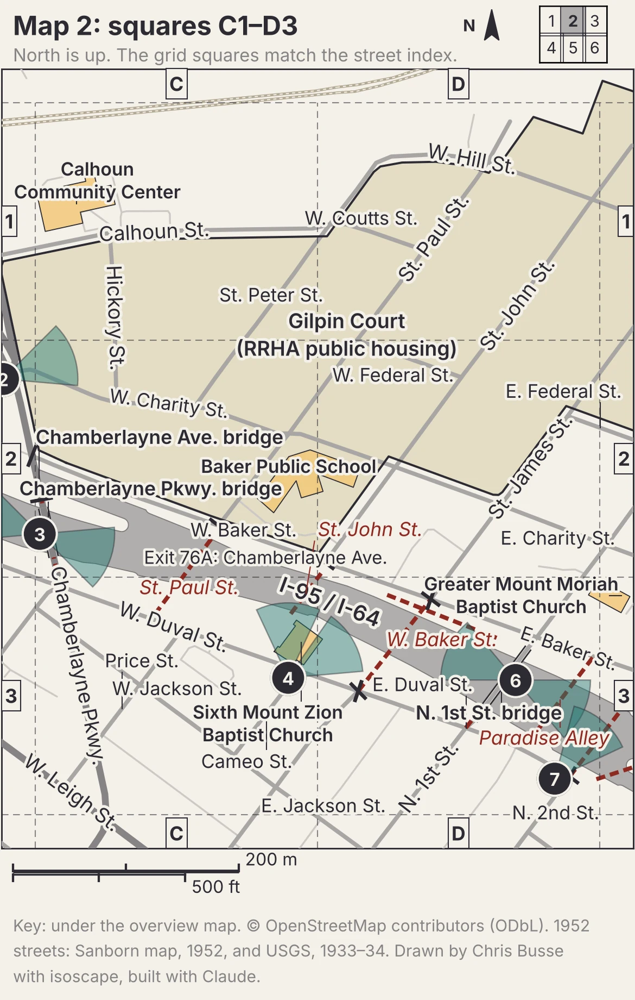

Map 2: squares C1–D3. The small plan at its top right shows where it lies.
:::

::: figure
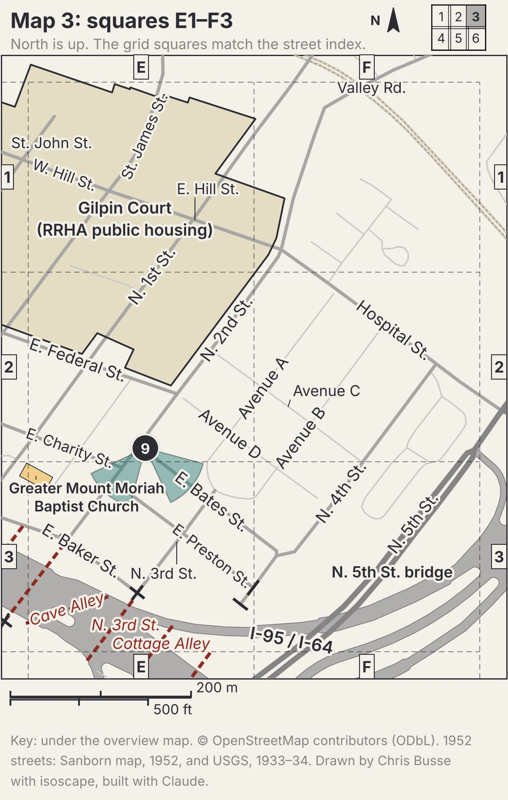

Map 3: squares E1–F3. The small plan at its top right shows where it lies.
:::

::: figure
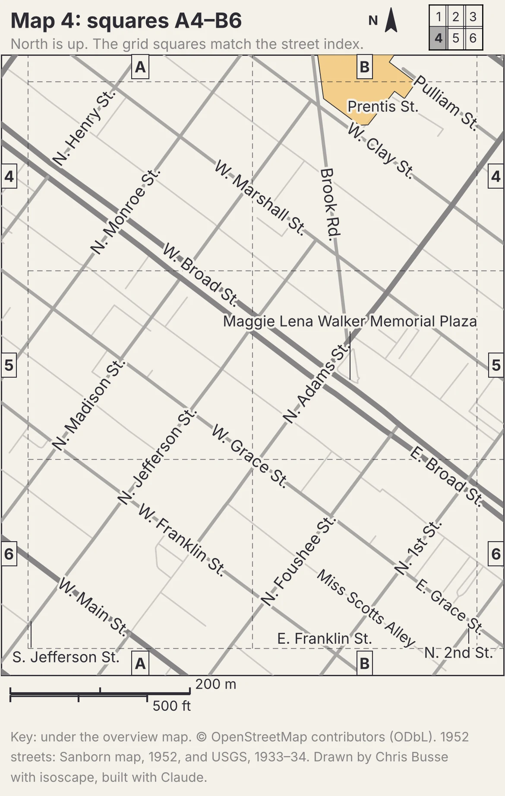

Map 4: squares A4–B6. The small plan at its top right shows where it lies.
:::

::: figure
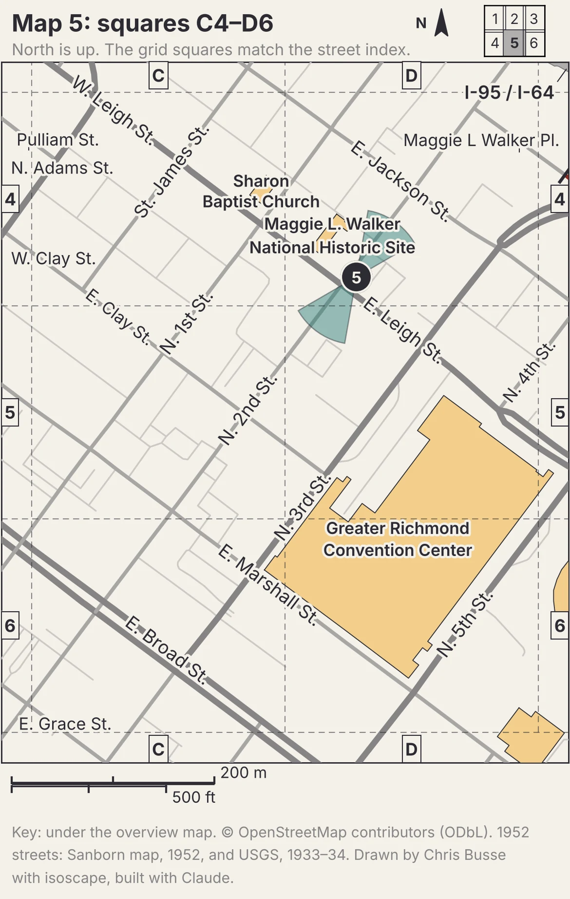

Map 5: squares C4–D6. The small plan at its top right shows where it lies.
:::

::: figure
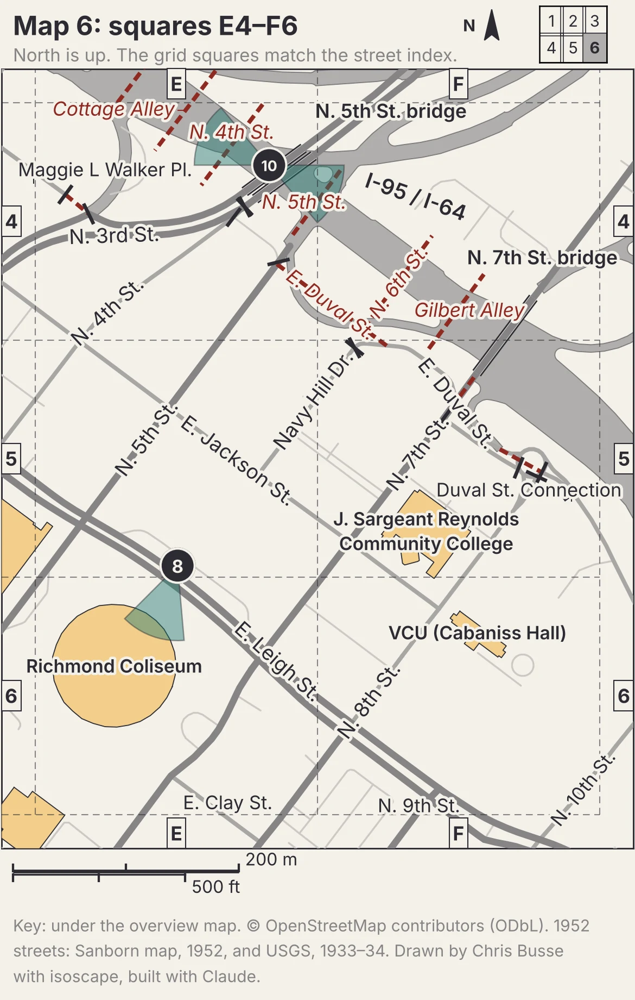

Map 6: squares E4–F6. The small plan at its top right shows where it lies.
:::

## Street index

Every street named on the maps, A to Z by its own name (North 2nd Street under 2, East Leigh
Street under L), with its grid squares. A street that changed is listed for each part: today's
street, whether it crosses the trench on a bridge or ends at it, and the 1952 stretch the trench
cut, from the story's trace. It lists 84 names. Today 5 streets cross the trench on a bridge and 23 end at it; 22 names have a 1952 stretch read off the sheets that the trench cut, and 7 have a stretch under today's highway joined across as the USGS map shows it. 9 names are of 1952 only.

| Street | Squares | What the maps show |
|---|---|---|
| North 1st Street | B6, C4–C6, D2–D4, E1–E2, F1 | Today, crosses the trench on a bridge; 1952, the stretch under today's highway (about 90 m), joined as the USGS map of 1933–34 shows it. |
| North 2nd Street | B6, C5–C6, D3–D5, E2–E3, F1–F2 | Today, ends at the trench (north side and south side); 1952, the stretch under today's highway (about 114 m), joined as the USGS map of 1933–34 shows it. |
| North 3rd Street | C6, D4–D6, E3–E4 | Today, ends at the trench (north side and south side); 1952, cut by the trench: about 87 m, Sanborn sheet 307. |
| North 4th Street | C6, D5, E3–E5, F2–F3 | Today, ends at the trench (north side and south side); 1952, cut by the trench: about 90 m, Sanborn sheet 307. |
| North 5th Street | D6, E4–E6, F2–F4 | Today, crosses the trench on a bridge; today, also ends at the trench (south side); 1952, the stretch under today's highway (about 27 m), joined as the USGS map of 1933–34 shows it; 1952, cut by the trench: about 73 m, Sanborn sheet 310. |
| North 6th Street | F4 | 1952, cut by the trench: about 102 m, Sanborn sheet 310. |
| North 7th Street | E6, F4–F6 | Today, crosses the trench on a bridge; 1952, the stretch under today's highway (about 114 m), joined as the USGS map of 1933–34 shows it. |
| North 8th Street | E6, F5–F6 | Today, ends at the trench (south side). |
| North 9th Street | F6 | Today. |
| North 10th Street | F6 | Today. |
| North Adams Street | A6, B4–B6, C4 | Today. |
| Avenue A | E2–E3, F2 | Today. |
| Avenue B | E3, F2–F3 | Today. |
| Avenue C | E2, F2 | Today. |
| Avenue D | E2, F2–F3 | Today. |
| Axtel Street | A2 | 1952, cut by the trench: about 33 m, Sanborn sheet 304. |
| East Baker Street | D3, E3 | Today, ends at the trench (north side). |
| West Baker Street | B2, C2, D2–D3 | Today, ends at the trench (north side); 1952, cut by the trench: about 97 m, Sanborn sheet 315; 1952, cut by the trench: about 104 m, Sanborn sheet 326. |
| East Bates Street | E2–E3, F3 | Today. |
| North Belvidere Street | A2–A3 | Today. |
| East Broad Street | B5–B6, C6 | Today. |
| West Broad Street | A4–A5, B5 | Today. |
| Brook Alley | B2–B3 | Today. |
| Brook Road | A1–A2, B1–B5 | Today, ends at the trench (south side); 1952, cut by the trench: about 38 m, Sanborn sheet 304; 1952, cut by the trench: about 116 m, Sanborn sheet 315. |
| Calhoun Street | A1, B1, C1, D1 | Today; 1952, cut by the trench: about 99 m, Sanborn sheet 317. |
| Cameo Street | C3 | Today. |
| West Catherine Street | A2–A3, B3 | Today. |
| Cave Alley | D3, E3 | 1952, cut by the trench: about 100 m, Sanborn sheet 307. |
| Chamberlayne Avenue | A2, B1–B2, C2 | Today, crosses the trench on a bridge. |
| Chamberlayne Parkway | C2–C4 | Today, crosses the trench on a bridge; today, also ends at the trench (north side); 1952, the stretch under today's highway (about 66 m), joined as the USGS map of 1933–34 shows it. |
| East Charity Street | D2, E2–E3 | Today. |
| West Charity Street | B1–B2, C2, D2 | Today; 1952, cut by the trench: about 98 m printed "West Charity Street (Tazewell)", Sanborn sheet 317. |
| East Clay Street | C4–C5, D5, E6 | Today. |
| West Clay Street | A2–A3, B3–B4, C4 | Today. |
| Cottage Alley | E3–E4 | 1952, cut by the trench: about 89 m, Sanborn sheet 307. |
| West Coutts Street | D1 | Today. |
| East Duval Street | D3, E4, F4–F5 | Today, ends at the trench (south side); 1952, the stretch under today's highway (about 43 m), joined as the USGS map of 1933–34 shows it; 1952, cut by the trench: about 122 m, Sanborn sheet 310. |
| West Duval Street | A2, B2, C3, D3 | Today, ends at the trench (south side); 1952, cut by the trench: about 126 m, Sanborn sheet 304. |
| Duval Street Connection | F5 | Today, ends at the trench (south side). |
| East Federal Street | D2, E2 | Today. |
| West Federal Street | D1–D2 | Today. |
| North Foushee Street | A6, B5–B6 | Today. |
| East Franklin Street | B6 | Today. |
| West Franklin Street | A5–A6, B6 | Today. |
| Gilbert Alley | F4–F5 | 1952, cut by the trench: about 82 m, Sanborn sheet 310. |
| Gilmer Street | A1–A2 | Today; 1952, cut by the trench: about 112 m, Sanborn sheet 304. |
| East Grace Street | B6, C6 | Today. |
| West Grace Street | A5, B6 | Today. |
| North Henry Street | A3–A4 | Today. |
| Hickory Street | C1–C2 | Today. |
| East Hill Street | E1, F1 | Today. |
| West Hill Street | D1, E1 | Today. |
| Hospital Street | F1–F2 | Today. |
| East Jackson Street | C3, D4, E4–E5, F5–F6 | Today. |
| West Jackson Street | C3 | Today. |
| North Jefferson Street | A5–A6, B4–B5 | Today. |
| South Jefferson Street | A6 | Today. |
| Judah Street | B2–B3 | Today, ends at the trench (south side). |
| East Leigh Street | C4, D4–D5, E5–E6, F6 | Today. |
| West Leigh Street | A2, B2–B3, C3–C4 | Today. |
| North Madison Street | A4–A6, B4 | Today. |
| Maggie L Walker Place | D4, E4 | Today, ends at the trench (north side). |
| Maggie Lena Walker Memorial Plaza | B5 | Today. |
| West Main Street | A6 | Today. |
| East Marshall Street | B5, C5–C6, D6 | Today. |
| West Marshall Street | A3–A4, B4–B5 | Today. |
| Miss Scotts Alley | B6 | Today. |
| North Monroe Street | A3–A5, B3 | Today. |
| Moore Street | A1 | 1952, cut by the trench: about 169 m, Sanborn sheet 304. |
| Munford Street | A2–A3 | Today, ends at the trench (south side); 1952, cut by the trench: about 129 m, Sanborn sheet 304. |
| Navy Hill Drive | E5, F5 | Today, ends at the trench (south side). |
| Paradise Alley | D3 | 1952, cut by the trench: about 95 m, Sanborn sheet 307. |
| Prentis Street | B4 | Today. |
| East Preston Street | E3 | Today, ends at the trench (north side). |
| Price Street | C3 | Today, ends at the trench (south side). |
| Pulliam Street | B3–B4, C4 | Today. |
| Shooks Street | B2 | 1952, cut by the trench: about 86 m, Sanborn sheet 315. |
| Smith Street | A2–A3 | Today, ends at the trench (south side). |
| Saint James Street | C3–C4, D2–D3, E1–E2 | Today, ends at the trench (north side and south side); 1952, the stretch under today's highway (about 104 m), joined as the USGS map of 1933–34 shows it. |
| Saint John Street | C3, D1–D2, E1 | Today, ends at the trench (north side); 1952, cut by the trench: about 45 m, Sanborn sheet 326. |
| Saint Paul Street | C2–C3, D1–D2 | Today, ends at the trench (north side); 1952, cut by the trench: about 87 m, Sanborn sheet 326. |
| Saint Peter Street | B3, C1–C3, D1 | Today, ends at the trench (south side). |
| Valley Road | F1 | Today. |
| Vance Street | A1–A2 | 1952, cut by the trench: about 98 m printed "Vance Street (Walker)", Sanborn sheet 304. |

## Places to stand

Each place is on a public sidewalk that OpenStreetMap maps, joined to the streets around it by
mapped sidewalks and crossings; none needs a highway ramp crossed to reach it, and none is in
Gilpin Court. The wedge on the maps shows which way to look. The numbers run west to east.

- **1**, square B2: [Chamberlayne Avenue's bridges from West Leigh Street](#1-chamberlayne-avenues-bridges-from-west-leigh-street).
- **2**, square B2: [Gilpin Court from Chamberlayne Avenue](#2-gilpin-court-from-chamberlayne-avenue).
- **3**, square C2: [Chamberlayne Parkway bridge](#3-chamberlayne-parkway-bridge).
- **4**, square C3: [Sixth Mount Zion, and where Saint James Street ends](#4-sixth-mount-zion-and-where-saint-james-street-ends).
- **5**, square D4: [Second Street at Leigh Street](#5-second-street-at-leigh-street).
- **6**, square D3: [North 1st Street bridge](#6-north-1st-street-bridge).
- **7**, square D3: [Where Second Street ends, south of the trench](#7-where-second-street-ends-south-of-the-trench).
- **8**, square E5: [The Coliseum site](#8-the-coliseum-site).
- **9**, square E2: [Bates Street, and where Second Street starts again](#9-bates-street-and-where-second-street-starts-again).
- **10**, square E4: [North 5th Street bridge](#10-north-5th-street-bridge).

## 1. Chamberlayne Avenue's bridges from West Leigh Street

**Stand** on the north sidewalk of West Leigh Street just west of Brook Road (square B2). **Look** north and northwest to the two curved bridges that carry Chamberlayne Avenue over Brook Road and the railroad.

::: figure

Chamberlayne Avenue's bridges from West Leigh Street, place 1: 1952 above, today below, seen from the south, with the streets named. The numbered disc is where you stand. Where the trench is now, the 1952 ground is an estimate, about ±2 m in its middle and 3 to 4 m or more at its ends.
:::

In the 1952 picture, Axtel Street, Brook Road, Munford Street, Shooks Street, Vance Street and West Baker Street are named where they ran before the trench.

Chamberlayne Avenue's run from Leigh Street to its two curved bridges over Brook Road
and the railroad is the Belvidere Street extension, whose bridges the National Bridge Inventory
dates to 1958 [[NBI, Belvidere Street](#sources)]; the 1952 sheets show houses and a coal yard
where it runs [[LoC, Sanborn 1952 vol. 3](#sources)]. The story's 1925 and 1952 pictures were
corrected on November 23, 2026, to leave it out [[the
story](jackson-ward.md#corrections-and-changes)].

## 2. Gilpin Court from Chamberlayne Avenue

**Stand** on the west sidewalk of Chamberlayne Avenue at West Charity Street (square B2). **Look** east across the avenue at Gilpin Court.

::: figure
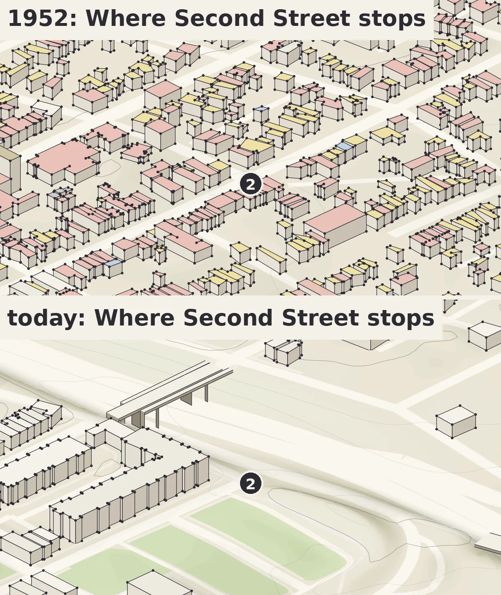

Gilpin Court from Chamberlayne Avenue, place 2: 1952 above, today below, seen from the south, with the streets named. The numbered disc is where you stand. Where the trench is now, the 1952 ground is an estimate, about ±2 m in its middle and 3 to 4 m or more at its ends. In 1952 Gilpin Court is drawn in the sheet's own colors, green and blue, though the sheet labels its buildings brick-faced.
:::

In the 1952 picture, Shooks Street, West Baker Street and West Charity Street are named where they ran before the trench.

On January 16, 1941, City Council passed the ordinance that began clearing Apostle
Town, a section of Jackson Ward [[LVA 2025](#sources)]. The Richmond Housing Authority built Gilpin
Court there; it was dedicated on April 28, 1943, with 301 units [[Feasibility Study 2022](#sources),
§1.4.2; [LVA 2025](#sources)]. Gilpin Court was enlarged in 1957 to house families the Turnpike
displaced [[Encyclopedia Virginia](#sources)].

People live in Gilpin Court today, and this guide describes it as homes. In July 2026 a draft
agreement between the city and the Richmond Redevelopment and Housing Authority (RRHA) called for
one-for-one replacement of all 781 units [[Gilpin Court MOU 2026](#sources)]. This guide takes no
position on the plan.

## 3. Chamberlayne Parkway bridge

**Stand** on the west sidewalk of the Chamberlayne Parkway bridge, about halfway across (square C2). **Look** east along the highway in its trench toward the North 1st Street bridge, then west toward Belvidere Street.

::: figure
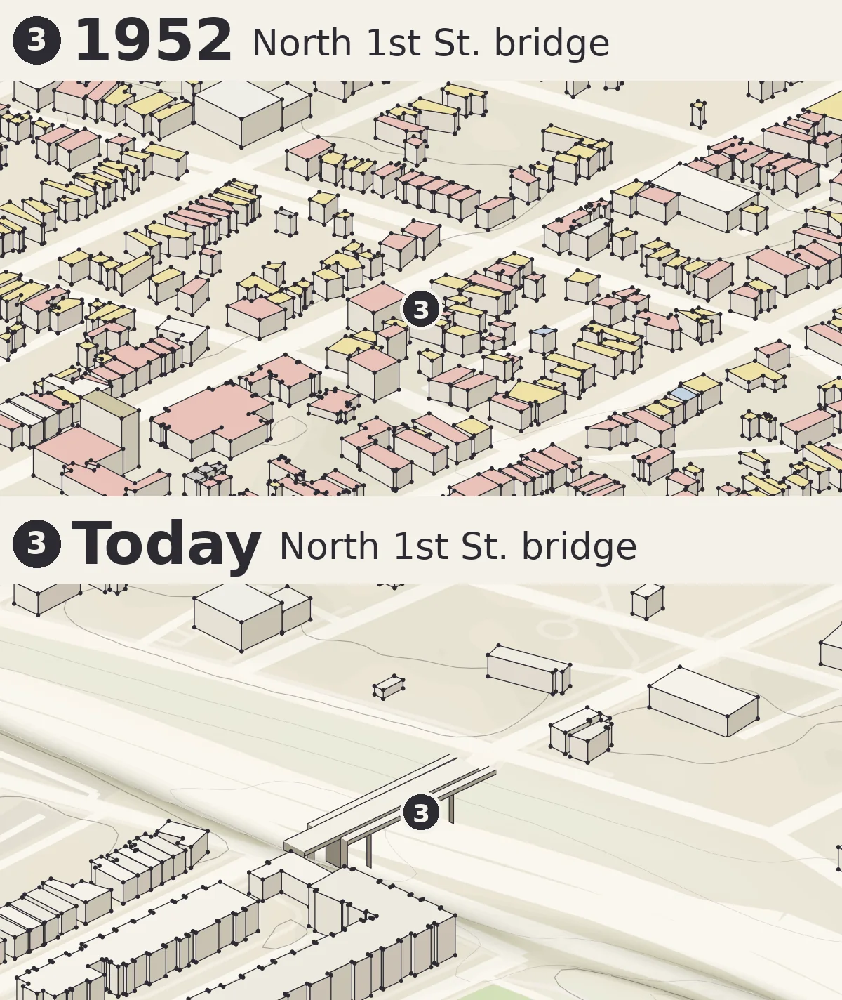

Chamberlayne Parkway bridge, place 3: 1952 above, today below, seen from the south, with the streets named. The numbered disc is where you stand. Where the trench is now, the 1952 ground is an estimate, about ±2 m in its middle and 3 to 4 m or more at its ends.
:::

In the 1952 picture, Shooks Street, Saint Paul Street and West Baker Street are named where they ran before the trench.

Chamberlayne Parkway is one of seven streets that ran through at street level and now
end at the trench or cross it on a bridge [[the story](jackson-ward.md#the-streets-the-highway-cut)].
The trench is up to about 8 m deep between Brook Road and Chamberlayne Parkway [[the
story](jackson-ward.md#the-ground-before-the-trench)].

A cap or lid over the highway is being studied. The 2022 feasibility study found it would be
"technically possible" to build a bridge or lid in a study area from the Belvidere Street bridge
to the North 1st Street bridge, and found four of its six areas feasible, from Chamberlayne
Parkway to North 1st Street [[Feasibility Study 2022](#sources), §3.2.4; [Fact sheet
2023](#sources)]. People in and around the ward hold a range of views on the cap, as Elizabeth
McGowan reported in July 2024 [[VCIJ 2024](#sources)]. This guide takes no position on it.

## 4. Sixth Mount Zion, and where Saint James Street ends

**Stand** on the south sidewalk of West Duval Street, across from the church (square C3). **Look** north at Sixth Mount Zion Baptist Church with the highway behind it, then northeast to the corner of West Duval and Saint James Streets, about 60 m east, where Saint James Street ends at the trench.

::: figure

Sixth Mount Zion, and where Saint James Street ends, place 4: 1952 above, today below, seen from the south, with the streets named. The numbered disc is where you stand. Where the trench is now, the 1952 ground is an estimate, about ±2 m in its middle and 3 to 4 m or more at its ends.
:::

In the 1952 picture, Saint John Street, Saint Paul Street and West Baker Street are named where they ran before the trench.

Sixth Mount Zion was organized by John Jasper in 1867 and was in the ward from 1869
[[Community Plan 2026](#sources); [Feasibility Study 2022](#sources), §1.4]. It stood at the edge
of the highway's path and was spared in 1956. The state's register nomination says it was allowed
to stand because of its historical significance, credits its pastor, Dr. Augustus Walter Brown
Sr., with saving it, and notes that the interstate swings around it [[DHR 127-0472](#sources)].
Wikipedia, citing Benjamin Campbell, says the road was rerouted slightly [[Campbell
2012](#sources), via Wikipedia].

St. James Street is one of the seven streets that ran through at street level and now end at
the trench or cross it on a bridge [[the story](jackson-ward.md#the-streets-the-highway-cut)].
Today's map shows that it ends on each side.

## 5. Second Street at Leigh Street

**Stand** on the northeast corner of North 2nd and East Leigh Streets, across Leigh Street from Eggleston Plaza (square D4). **Look** south down 2nd Street toward Clay and Broad Streets, then north up 2nd Street toward the highway.

::: figure

Second Street at Leigh Street, place 5: 1952 above, today below, seen from the south, with the streets named. The numbered disc is where you stand. Where the trench is now, the 1952 ground is an estimate, about ±2 m in its middle and 3 to 4 m or more at its ends.
:::

Second Street, "the Deuce," was the ward's main commercial street [[Community Plan
2026](#sources)]. It was known as Black Wall Street by 1903, the National Park Service says
[[NPS, Black Wall Street](#sources)].

The 1925 Sanborn sheet's Miller Hotel stood at the corner of 2nd and Leigh. Neverett A. Eggleston
Sr. leased it in 1939, bought it in 1942 and renamed it the Hotel Eggleston; it was demolished in
2009 after a partial collapse [[UVA, Green Book project](#sources)].

## 6. North 1st Street bridge

**Stand** on the east sidewalk of the North 1st Street bridge, about halfway across (square D3). **Look** east along the trench toward where 2nd Street ends on each side, then west toward the Chamberlayne Parkway bridge.

::: figure
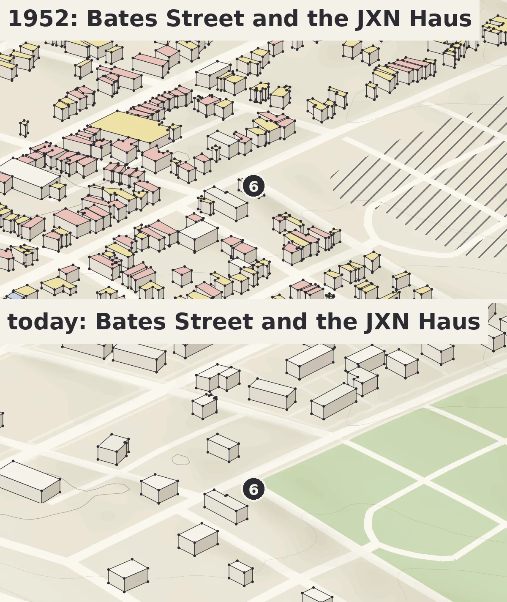

North 1st Street bridge, place 6: 1952 above, today below, seen from the south, with the streets named. The numbered disc is where you stand. Where the trench is now, the 1952 ground is an estimate, about ±2 m in its middle and 3 to 4 m or more at its ends.
:::

In the 1952 picture, Cave Alley, Paradise Alley and West Baker Street are named where they ran before the trench.

The 1952 Sanborn sheets show 216 buildings inside today's paved roadway and ramps,
and 447 in the corridor of that pavement plus 15 m on each side, from the Belvidere Street
ramps to the line of 8th Street. These are outlines on a map; the number does not count homes,
families or people, and it is approximate [[the
story](jackson-ward.md#how-many-buildings-stood-in-the-highways-path)]. Published counts of what
the road destroyed differ, and the story sets them side by side.

## 7. Where Second Street ends, south of the trench

**Stand** on the west sidewalk of North 2nd Street at its north end, where it meets East Duval Street (square D3). **Look** north across the highway to where 2nd Street starts again.

::: figure
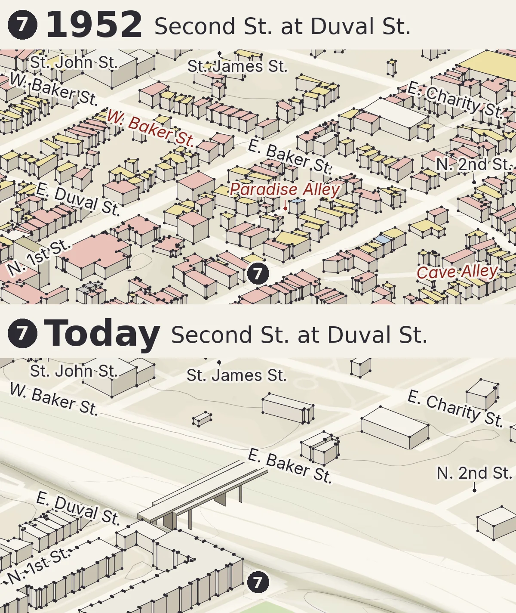

Where Second Street ends, south of the trench, place 7: 1952 above, today below, seen from the south, with the streets named. The numbered disc is where you stand. Where the trench is now, the 1952 ground is an estimate, about ±2 m in its middle and 3 to 4 m or more at its ends.
:::

In the 1952 picture, Cave Alley, Paradise Alley and West Baker Street are named where they ran before the trench.

Seven streets that ran through at street level now end at the trench or cross it on a
bridge [[the story](jackson-ward.md#the-streets-the-highway-cut)]. Today's map shows that 2nd Street
is one of those that end. The Richmond–Petersburg Turnpike Authority built its toll road through
the ward between 1955 and 1958 [[Acts of Assembly 1954](#sources); [Community Plan
2026](#sources), timeline]. The road now carries I-95 and, through the ward, I-64 as well
[[Feasibility Study 2022](#sources), §1.4.3].

Under the highway the U.S. Geological Survey's lidar shows the trench about 80–100 m wide and 3
to 6.5 m deep under the old cross streets [[the story](jackson-ward.md#the-ground-before-the-trench)].

## 8. The Coliseum site

**Stand** on the north sidewalk of East Leigh Street, across the street from the Coliseum (square E5). **Look** south across East Leigh Street at the Richmond Coliseum.

*No 1952-and-today picture for this place.* The Coliseum stands just past the near edge of the story's views, so their picture of today leaves it out (isoscape draws only buildings wholly inside the frame). A view framed further south was tried: the 1952 tracing stops partway across the Coliseum's site, and in Navy Hill the 1952 picture would draw today's streets, some laid out later, so this place has no picture of 1952.

Navy Hill had become a majority-Black neighborhood in the early twentieth century, Harry Kollatz
Jr. writes, and the Coliseum was later built on its cleared blocks [[Kollatz 2019](#sources)]. A
photograph shows it under construction on December 30, 1968 [[WVTF 2016](#sources)]. On November
19, 2026, it still stood, and the city was aiming to demolish it by the end of 2027 [[WWBT,
November 2026](#sources)].

## 9. Bates Street, and where Second Street starts again

**Stand** at the corner of North 2nd and East Bates Streets, on the east side of 2nd (square E2). **Look** southeast along Bates Street, then southwest down 2nd Street to where it ends at the trench.

::: figure
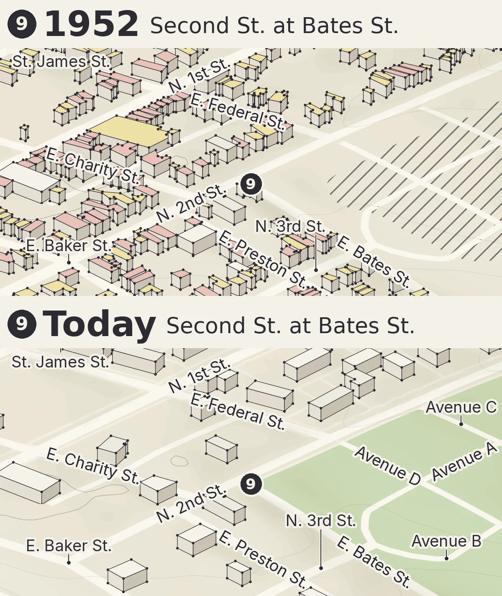

Bates Street, and where Second Street starts again, place 9: 1952 above, today below, seen from the south, with the streets named. The numbered disc is where you stand. Where the trench is now, the 1952 ground is an estimate, about ±2 m in its middle and 3 to 4 m or more at its ends. Hatched blocks are where no building was traced from the 1952 sheets; only buildings standing today are drawn there, so the picture does not show those blocks as they were.
:::

In 1957 the Turnpike Authority and the city took by eminent domain a cottage built in
1793 by Abraham Peyton Skipwith, who had bought his freedom. It was sold for about $25 and moved
to Goochland County [[LVA, House to Highway](#sources); [Axios, April 2026](#sources)].

The JXN Project, founded by the sisters Enjoli and Sesha Moon, rebuilt the cottage in Jackson Ward
as a reconstruction of the original. It opened on Bates Street in April 2026 with the JXN Haus,
the project's headquarters [[The Richmonder, April 2026](#sources); [Richmond Magazine, May
2026](#sources)].

## 10. North 5th Street bridge

**Stand** on the west sidewalk of the North 5th Street bridge, about halfway across (square E4). **Look** east along the trench toward the North 7th Street bridge, then west toward the North 1st Street bridge.

::: figure
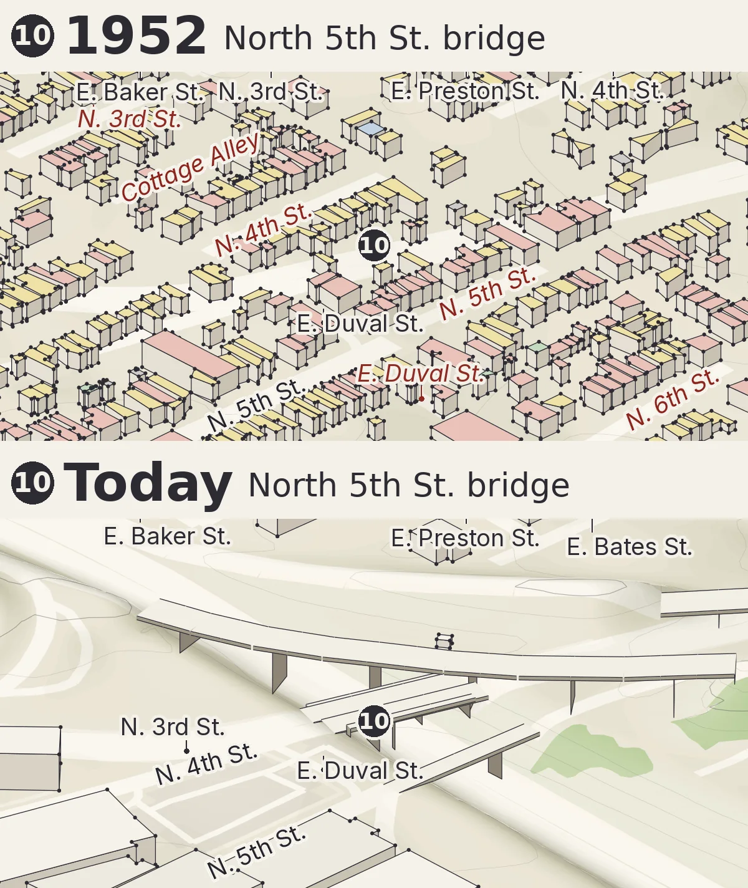

North 5th Street bridge, place 10: 1952 above, today below, seen from the south, with the streets named. The numbered disc is where you stand. Where the trench is now, the 1952 ground is an estimate, about ±2 m in its middle and 3 to 4 m or more at its ends. Hatched blocks are where no building was traced from the 1952 sheets; only buildings standing today are drawn there.
:::

In the 1952 picture, Cottage Alley, East Duval Street, North 3rd Street, North 4th Street, North 5th Street and North 6th Street are named where they ran before the trench.

5th Street keeps its name and crosses the trench on a bridge, and Maggie L. Walker
Place is a separate short street south of the trench [[City of Richmond,
centerlines](#sources)]. East of about 3rd Street, north of Leigh, the highway's corridor runs
through Navy Hill [[the story](jackson-ward.md#how-many-buildings-stood-in-the-highways-path)].

## Who keeps the ward's history

As the [story](jackson-ward.md#who-keeps-the-wards-history) has it:

> The ward's history is kept by its own people and institutions, among them the
> [Historic Jackson Ward Association](https://www.hjwa.org/), the [Black History Museum & Cultural
> Center of Virginia](https://blackhistorymuseum.org/), the [JXN Project](https://www.thejxnproject.org/),
> the [Maggie L. Walker National Historic Site](https://www.nps.gov/mawa/), Sixth Mount Zion Baptist
> Church, Ebenezer Baptist Church, the Gilpin Court Tenant Council and Gilpin Informed Residents.
> This page does not draw on their collections, apart from Ebenezer's published church history;
> readers should go to them.

## About this guide

Chris Busse, a Richmond artist, made this guide with Claude. Its history comes from the page
[Jackson Ward, Richmond, VA, before I-95, block by block](jackson-ward.md) and that page's
sources, which each statement cites.

Today's streets, bridges, exits, landmarks and sidewalks come from OpenStreetMap as of
November 16, 2026. The 1952 streets come from the Sanborn fire-insurance maps of 1952 at the Library of
Congress [[LoC, Sanborn 1952 vol. 3](#sources)], with seven stretches of street joined across the
trench as the U.S. Geological Survey's map of 1933–34 shows them [[USGS 1934](#sources)], as the
story traced them. Gilpin Court's approximate outline is from City of Richmond parcel records.

The maps are drawn in code. The pictures are drawn by Chris Busse with isoscape, the drawing tool
he built with Claude (see the [artist statement](artist-statement.md)); each is cut from the
story's views of 1952 and today, and the street names are placed on them in code from where the
drawing tool puts each street. The views of today are drawn from OpenStreetMap and U.S.
Geological Survey lidar, as every isoscape view is [[the
story](jackson-ward.md#jackson-ward-today-and-the-proposed-cap-over-i-95)]. The 1952 buildings are
traced from the Sanborn sheets, with buildings standing today that the city dates to 1952 or
before; traced ones may sit a few meters from where they stood. The text was drafted by Claude
for Chris Busse from the published story.

Corrections are welcome through the [contact page](#/about/contact).

## Sources

The guide's facts and their sources are the story's; these are the ones it cites, as the story
lists them. The story's [full list](jackson-ward.md#sources) gives the rest.

- **Acts of Assembly 1954**: Virginia Acts of Assembly, 1954, chapter 705, approved April 8, 1954 (Code §§ 33-255.27 to 33-255.42), as transcribed by the University of Virginia's Modeling Jim Crow project. Opened November 18 and 22, 2026. [modelingjimcrow.virginia.edu/node/72717](https://modelingjimcrow.virginia.edu/node/72717)
- **Axios, April 2026**: "Skipwith-Roper Cottage homecoming," Axios Richmond, April 17, 2026. Opened November 22, 2026. [axios.com](https://www.axios.com/local/richmond/2026/04/17/jackson-ward-skipwith-roper-cottage-homecoming)
- **Campbell 2012**: Benjamin Campbell, *Richmond's Unhealed History* (Brandylane, 2012), pp. 152, 154, as cited by Wikipedia, "Jackson Ward." The book has not been seen. [en.wikipedia.org/wiki/Jackson_Ward](https://en.wikipedia.org/wiki/Jackson_Ward)
- **City of Richmond, centerlines**: City of Richmond, street centerlines (GIS layer), the records for N 5th St and Maggie L Walker Pl. Opened November 23, 2026. [services1.arcgis.com](https://services1.arcgis.com/k3vhq11XkBNeeOfM/ArcGIS/rest/services/Centerlines/FeatureServer/32)
- **Community Plan 2026**: City of Richmond, Jackson Ward Community Plan, edited July 2026. Opened November 18 and 22, 2026. [rva.gov (PDF)](https://rva.gov/sites/default/files/2026-07/20260716_Jackson%20Ward%20Community%20Plan_editedJuly2026.pdf)
- **DHR 127-0472**: Virginia Department of Historic Resources, Sixth Mount Zion Baptist Church, register page and National Register nomination (1996). Opened November 22, 2026. [dhr.virginia.gov](https://www.dhr.virginia.gov/historic-registers/127-0472/); [nomination (PDF)](https://www.dhr.virginia.gov/wp-content/uploads/2018/04/127-0472_Sixth_Mount_Zion_Church_1996_Final_Nomination.pdf)
- **Encyclopedia Virginia**: LaToya Gray-Sparks, "Urban Renewal in Richmond" (2024, updated 2025). Opened November 18, 2026. [encyclopediavirginia.org](https://encyclopediavirginia.org/entries/urban-renewal-in-richmond/)
- **Fact sheet 2023**: City of Richmond, Reconnect Jackson Ward fact sheet. Opened November 18, 2026. [rva.gov (PDF)](https://rva.gov/sites/default/files/2024-11/RJW-FactSheetv3_12_2023.pdf)
- **Feasibility Study 2022**: OIPI, VDOT and City of Richmond, Reconnect Jackson Ward Feasibility Study, September 2022. Its §1.4.3 cites Harry Kollatz Jr., "The Curve Around the Station," *Richmond Magazine*, 2013, and its §§1.4.1–1.4.2 cite M. E. Taylor, *The African American Community of Richmond, Virginia: 1950–1956* (University of Richmond master's thesis, 1994); neither has been seen. Opened November 18 and 22, 2026. [rva.gov (PDF)](https://www.rva.gov/sites/default/files/2024-11/RJW_FS_Report_2022-09-30v5-FINAL.pdf)
- **Gilpin Court MOU 2026**: City of Richmond and RRHA, Joint Gilpin Transformation Working Group Memorandum of Understanding, draft published July 2026 (unsigned). Opened November 18, 2026. [rva.gov (PDF)](https://rva.gov/sites/default/files/2026-07/Gilpin%20Court%20MOU%20RRHA%20COR_final%20AATF.pdf)
- **Kollatz 2019**: Harry Kollatz Jr., "The Original Navy Hill," *Richmond Magazine*, December 29, 2019. Opened November 22, 2026. [richmondmagazine.com](https://richmondmagazine.com/news/sunday-story/the-original-navy-hill/)
- **LoC, Sanborn 1952 vol. 3**: Library of Congress, Sanborn Fire Insurance Map from Richmond, vol. 3, 1925, republished 1952; its title page reads "Republished 1952 – revised to date." Opened November 18, 2026 (on November 22 the site returned a bot check). [loc.gov](https://www.loc.gov/item/sanborn09064_018/)
- **LVA 2025**: Ashley Craig, "A Brief History of Public Housing in the City of Richmond," *The UncommonWealth*, November 17, 2025. Opened November 18 and 22, 2026. [uncommonwealth.lva.virginia.gov](https://uncommonwealth.lva.virginia.gov/blog/2025/11/17/a-brief-history-of-public-housing-in-the-city-of-richmond)
- **LVA, House to Highway**: Library of Virginia and the JXN Project, *House to Highway: Reclaiming a Community History*, on view July 14, 2025, to February 28, 2026. Opened November 18 and 22, 2026. [lva.virginia.gov](https://www.lva.virginia.gov/events/exhibitions/house-to-highway)
- **NBI, Belvidere Street**: National Bridge Inventory records, as published by BridgeLookup: Belvidere Street over Interstate-95 (structure 21392) and southbound Belvidere Street over Brook Road and the CSX railway (structure 21386), each built in 1958. Opened November 23, 2026. [bridgelookup.com (21392)](https://bridgelookup.com/bridge/582628), [bridgelookup.com (21386)](https://bridgelookup.com/bridge/582625)
- **NPS, Black Wall Street**: National Park Service, "Jackson Ward and its Black Wall Street." Opened November 18 and 22, 2026. [nps.gov](https://www.nps.gov/articles/000/jackson-ward-and-its-black-wall-street.htm)
- **Richmond Magazine, May 2026**: Scott Bass, "Nice Shot" photo feature on the JXN Haus and Skipwith-Roper Cottage, *Richmond Magazine*, May 20, 2026. Opened November 22, 2026. [richmondmagazine.com](https://richmondmagazine.com/news/richmond-history/nice-shot-jxn-haus-skipwith-roper-cottage/)
- **The Richmonder, April 2026**: Victoria A. Ifatusin, "JXN Project unveils rebuilt 'founding father' home, highlighting Black history in Richmond," April 19, 2026. Opened November 22, 2026. [richmonder.org](https://www.richmonder.org/jxn-project-unveils-rebuilt-founding-father-home-highlighting-black-history-in-richmond/)
- **UVA, Green Book project**: University of Virginia, "Miller's Hotel / Hotel Eggleston." Opened November 22, 2026. [community.village.virginia.edu](https://community.village.virginia.edu/greenbooks/node/4017)
- **VCIJ 2024**: Elizabeth McGowan, "In Richmond, a struggle over the future of a 'Harlem of the South,'" Virginia Center for Investigative Journalism at WHRO, July 16, 2024. Opened November 18 and 22, 2026. [vcij.org](https://vcij.org/stories/in-richmond-a-struggle-over-the-future-of-a-harlem-of-the-south)
- **WVTF 2016**: Kelley Libby, "When a highway and a coliseum cut through a community," April 14, 2016. Opened November 18, 2026. [wvtf.org](https://www.wvtf.org/post/when-highway-and-coliseum-cut-through-community)
- **WWBT, November 2026**: Madison McNamee, "When will the Richmond Coliseum be demolished?," 12 On Your Side, November 19, 2026. Opened November 22, 2026. [12onyourside.com](https://www.12onyourside.com/2026/11/19/when-will-richmond-coliseum-be-demolished/)
- **USGS 1934**: Richmond, Va., 1:24,000, surveyed 1933–34. [prd-tnm.s3.amazonaws.com (GeoTIFF)](https://prd-tnm.s3.amazonaws.com/StagedProducts/Maps/HistoricalTopo/GeoTIFF/VA/VA_Richmond_186500_1934_24000_geo.tif)
