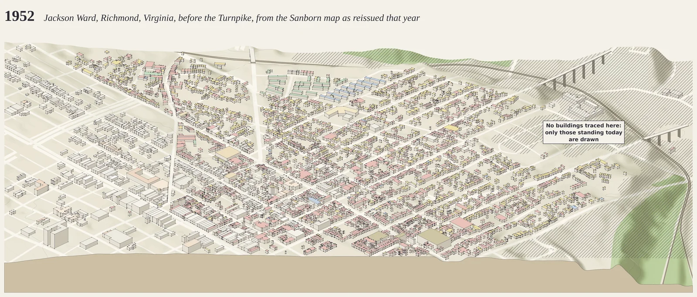
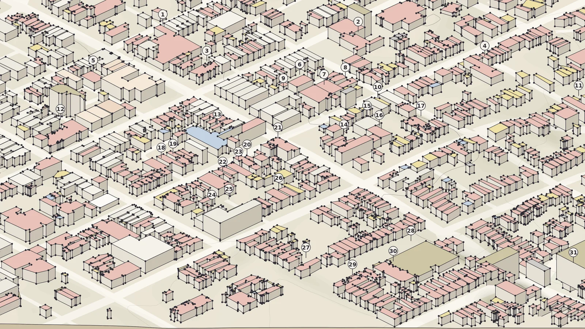
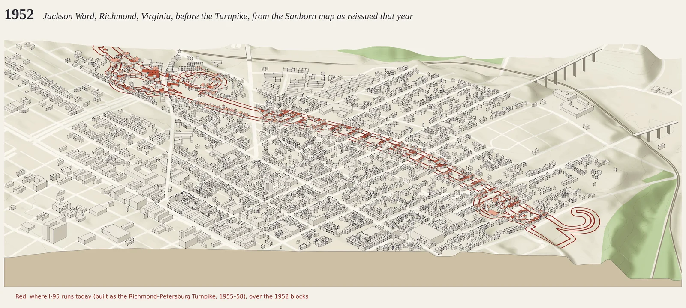
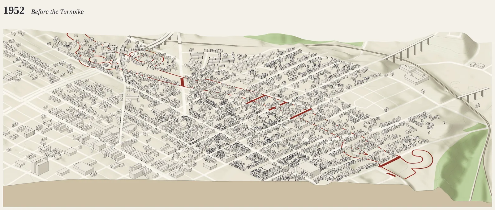
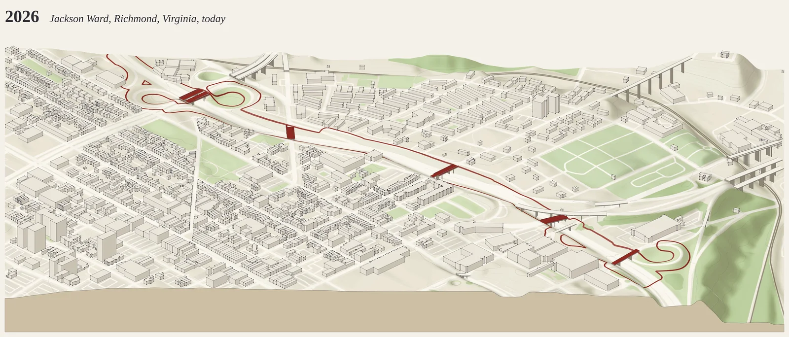
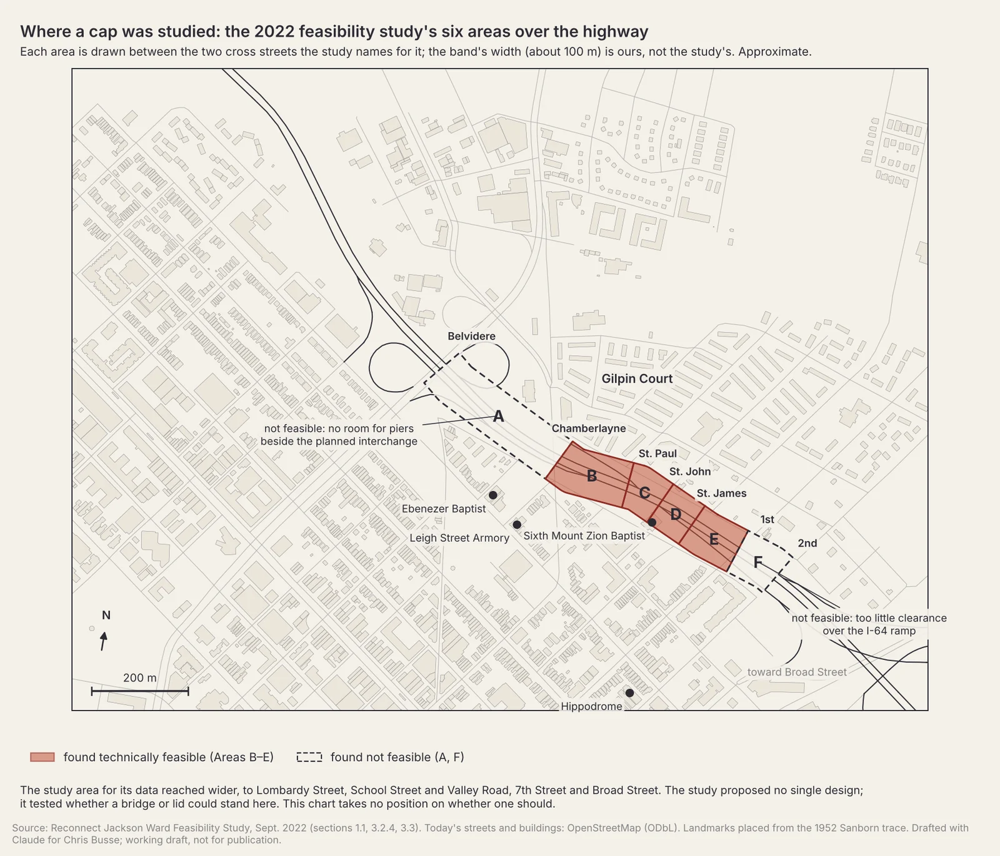
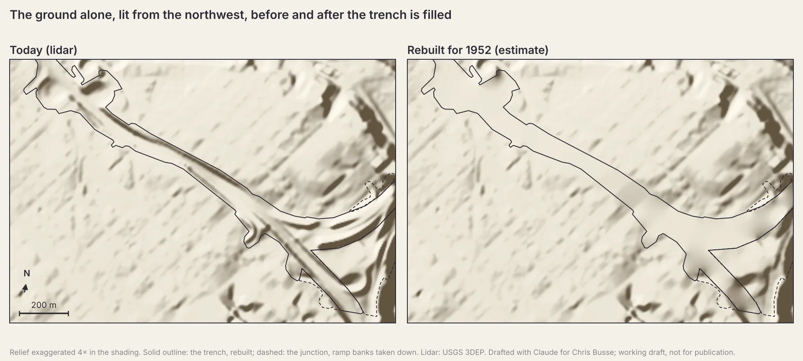
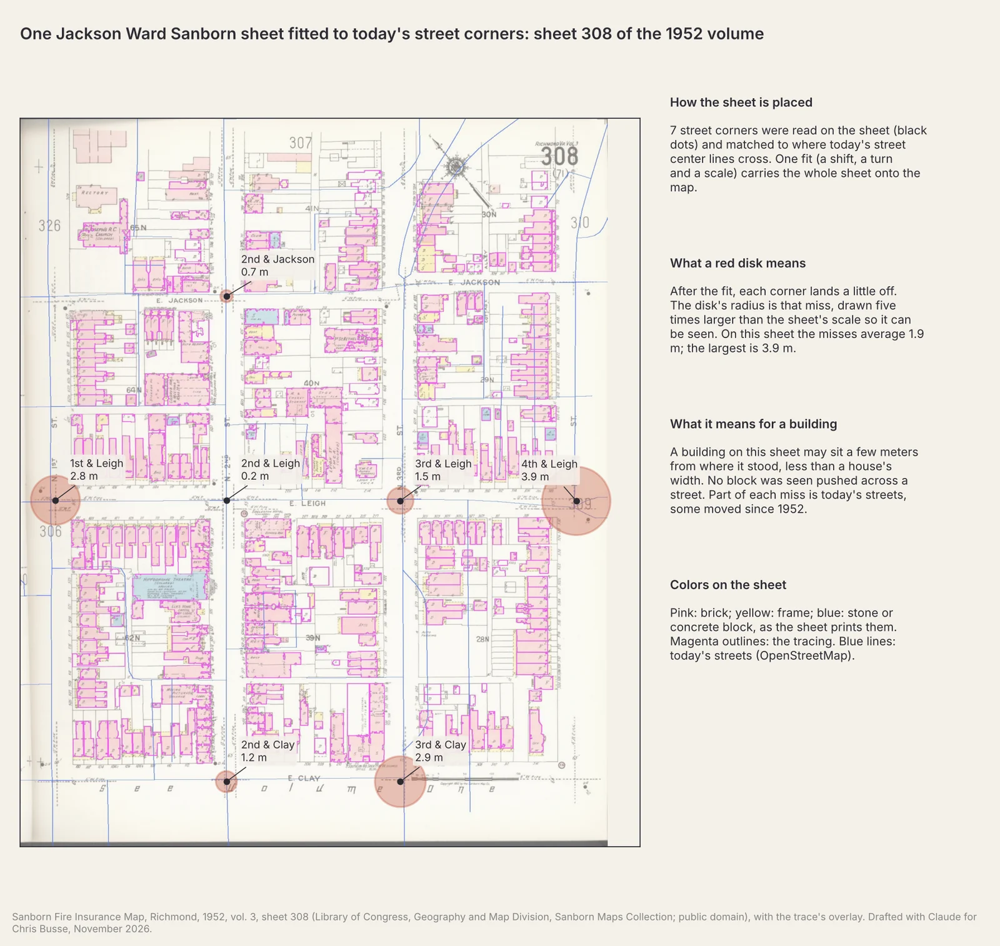

# What stood where the highway runs

> **Unpublished working draft, for review.** Not for circulation. The facts are being checked
> against their sources, and the community reviewers have not yet read it. The numbers,
> pictures and wording may change. Placeholders marked **Slot** wait on work in progress.
> Drafted with Claude for Chris Busse, November 18, 2026.

Between 1955 and 1958 the Richmond–Petersburg Turnpike, now I-95 and I-64, was cut through
Jackson Ward, then the center of Black business, church and civic life in Richmond. The last
Sanborn fire-insurance survey before the road, republished in 1952, shows the blocks it took
building by building. Chris Busse has drawn the blocks from those sheets with isoscape, on the
ground as it stood before the trench, so the same blocks can be seen in 1952, a year after the road opened, and
today. This page goes in order of time, and ends with [how we know](#how-we-know) what each
picture shows, how sure it is, and where it may be wrong.

The pictures are of buildings and ground. They do not show people, and they cannot say who
lived in a house or what it meant to them. That knowledge belongs to the ward's families,
churches and institutions, whose work this rests on (see
[Whose work this rests on](#whose-work-this-rests-on)).

## 1925

> **Slot: the 1925 view** (the same frame as below, from the 1925 Sanborn volume 3; work in
> progress). Image `jackson-ward-state-1925.webp` and its note go here, with the close view of
> Apostle Town before Gilpin Court.

Jackson Ward was made a city ward in 1871. The city's 2026 community plan says its lines were
drawn to dilute Black voting power [[Community Plan 2026](#sources), timeline]. Its institutions
were old by 1925: Ebenezer Baptist (1858 in the community plan; 1855 in the feasibility study),
Sixth Mount Zion, organized by John Jasper in 1867 and in the ward from 1869, John Mitchell
Jr.'s *Richmond Planet* (1884), the True Reformers' savings bank (1888, the first
Black-owned bank chartered in the United States), Mechanics' Bank (1902) and Maggie L.
Walker's St. Luke Penny Savings Bank (1903) [[Community Plan 2026](#sources);
[Feasibility Study 2022](#sources), §1.4]. The Hippodrome on Second Street opened in 1914 (the
plan's text says 1913) [[Community Plan 2026](#sources)].

It was also a neighborhood hemmed in by law. In 1911 the city passed a residential segregation
ordinance, block by block [[Silver 1984](#sources), via a student's notes]. On the
federal "redlining" maps of the 1930s every Black neighborhood in Richmond was marked
undesirable, and its residents were barred from loans for houses and businesses [[Feasibility Study 2022](#sources),
§1.4.2]. By the 1930s more than 8,000 Black Richmonders lived and worked in the ward
[[Community Plan 2026](#sources), citing Taylor 1994].

## 1952: the last survey before the road

*How this was made:* buildings north of Leigh Street from the 1952 Sanborn volume 3, south of
it from the 1924–25 and 1950–52 volume 1 tracings, and buildings standing today that the city
dates to 1952 or before, on ground rebuilt as it was before the trench (an estimate, about
±1.5 m in its middle). See [The ground before the trench](#the-ground-before-the-trench) and
[The tracing](#the-tracing). Rough draft.

The 1952 volume is a full reprint, with "Copyright 1952" on every sheet and a new index dated
September 1951. It draws what was built after 1925, such as Gilpin Court and the Armstrong High
School annex of 1938 [[trace notes](#the-tracing)]. On the 15 sheets traced for this story
there are 3,157 building outlines. The sheets name 122 of them: churches, schools, lodges,
theaters, a Y.M.C.A., ice plants, laundries and warehouses. They print "(Colored)" beside the
names of Black institutions, and this page keeps the sheet's own word where it quotes a name.

The ward in 1952 was segregated and crowded, and its housing had been left to decline
[[Silver 1984](#sources), via a student's notes]. It was also where Black Richmond banked,
worshipped, went to school and to the movies. The map shows both: the dense rows of frame
houses in the north blocks, and the brick churches and halls along Leigh and Second.

## Second Street

*How this was made:* a close crop of the 1952 view, numbered from the trace's list of named
buildings. Names are as the sheets print them. Rough draft; south of Clay Street is not yet
drawn in full. See [The tracing](#the-tracing).

> **Slot: Second Street from Broad to Clay** (volume 1 sheets 2–3, being re-traced). When it is
> done, the crop above extends to Broad Street and the list below gains its buildings.

Second Street, "the Deuce," was the ward's main commercial street. On sheet 308 of the 1952
volume, between Clay and Jackson Streets, the sheet names the Hippodrome Theatre, a second
moving-picture house, the Elks' Capitol City Lodge, the Leigh Street Y.M.C.A., Third Street
Bethel A.M.E. and St. Joseph's churches, a hotel entrance with its dining room, restaurants,
stores, offices, and a "colored hall & meeting rooms" [[trace notes](#the-tracing)]. The
Hippodrome closed in 1967 [[Community Plan 2026](#sources)]. A label for the "Southern Aid
Society of Va." is printed near Nos. 212–216, but which building it names has not been
checked.

## How the route was chosen

Richmond's voters said no to a downtown expressway twice. In the first referendum, on June 13,
1950, only 8 of 55 precincts voted for it. A second, forced in 1951 by a petition of former mayor
J. Fulmer Bright, failed by 6,002 votes, almost 2 to 1 [[Style Weekly 2013](#sources)]. On
August 24, 1953, City Council voted to ask for a turnpike authority instead, which moved the
decision to the General Assembly and avoided another referendum. Officials pointed to the cost
of buying industrial land compared with homes [[Silver 1984](#sources), pp. 192–194, via a
student's notes; the book itself has not been seen]. The General Assembly created the
Richmond–Petersburg Turnpike Authority on April 8, 1954, with the power of eminent domain
[[Style Weekly 2013](#sources); [Encyclopedia Virginia](#sources)]. The Library of Virginia,
Wikipedia and VCU Libraries give 1955 for its creation [[LVA 2024](#sources);
[Wikipedia, Turnpike](#sources); [VCU Libraries](#sources)].

The city's 2022 feasibility study says city officials chose the middle of Jackson Ward as the
best route through downtown [[Feasibility Study 2022](#sources), §1.4.3]. The
consultants' report, as Benjamin Campbell quotes it, found that destroying housing "offers no
serious obstacle to a highway location" [[Campbell 2012](#sources), p. 154, via Wikipedia].
Which other routes were studied is not known to us yet.

The road opened on July 1, 1958: 34.7 miles from Dinwiddie County to Henrico County, built for
$76.7 million with toll revenue bonds [[LVA 2024](#sources)]. In August 1958 it became part of
I-95 [[Wikipedia, Turnpike](#sources)]. It was the only part of Virginia's I-95 not built with
federal money [[Richmond Family Magazine 2022](#sources)]. Tolls ended in 1992
[[Wikipedia, Turnpike](#sources)].

## The count

*How this was made:* the 1952 view, with buildings picked out by the polygons in
[The count's polygon and rule](#the-counts-polygon-and-rule). Rough draft.

How much the road destroyed has been counted many ways, and the counts disagree. They cover
different areas (the ward, the ward and Navy Hill, or the whole 34.7-mile road), and they count
different things (people, families, homes, structures). This page reports them side by side and
does not choose among them.

| Figure | What it covers | Source |
|---|---|---|
| about 7,000 people, about 10% of Black Richmonders | the Turnpike, 1955–57 | [Silver 1984](#sources), via a student's notes |
| more than 1,000 homes and businesses; 7,000 residents; 390 acres | the whole road, citywide | [Feasibility Study 2022](#sources), citing Kollatz 2013 |
| 1,900 Black families, about 10% of the city's Black population, and 300 more facing the loss of their homes | "the turnpike and related construction," by 1957 | *Richmond Times-Dispatch*, 1957, per [Encyclopedia Virginia](#sources) |
| 1,900 families | "for four-lane highway through the neighborhood in 1957" | [LVA Document Bank](#sources) |
| more than 900 families (90% Black); 700 homes and businesses in Jackson Ward; 34 streets rerouted | 1955–57 | [Grant application 2022](#sources) |
| more than 700 homes, churches and businesses | Jackson Ward | [Richmond Family Magazine 2022](#sources) |
| about 1,000 homes; 31 streets blocked | Jackson Ward | [Campbell 2012](#sources), p. 154, via Wikipedia |
| over 1,000 homes | Jackson Ward and Navy Hill | [VCU Libraries](#sources) |
| more than 1,000 residents and business owners | Jackson Ward | [LVA, House to Highway](#sources) |
| over 1,000 families | the Turnpike | [Richmond Free Press 2024](#sources) |
| about 1,000 structures; 7,000 residents | the I-95 clearing | [VCIJ 2024](#sources) |
| thousands of Black residents displaced; hundreds of homes destroyed | 1955–58 | [Community Plan 2026](#sources), timeline |

This story adds one more number, of a different kind: **buildings on the 1952 Sanborn sheets
within this polygon**. There are **238** in the polygon of today's paved roadway and
ramps, and **489** in the corridor of that pavement plus 15 m on each side. These are
outlines on a map. Sheds and porches larger than 6 m² count, and an apartment house counts once.
The number does not count homes, families or people, and it is approximate: the polygon is
today's footprint, standing in for the 1958 right-of-way, which we have not seen. How it was
made is in [The count's polygon and rule](#the-counts-polygon-and-rule).

## The lost streets

*How this was made:* each stretch joins a street's two surviving ends straight across the
trench, as the 1934 USGS survey shows them running through. See
[The ground before the trench](#the-ground-before-the-trench). Rough draft.

Seven streets that ran through at grade now end at the trench or cross it on a bridge:
Chamberlayne Parkway, St. James, 1st, 2nd, Duval, 5th (now Maggie L. Walker Place) and 7th.
Published counts of the streets cut run to 31 [[Campbell 2012](#sources), via Wikipedia] and
34 [[Grant application 2022](#sources)]. Streets that ran wholly inside the corridor are not
drawn yet.

> **Slot: the 1952 street lines inside the corridor** (from the Sanborn sheets; work in
> progress). When they are traced, the pictures above show every lost street, and this
> paragraph gives the number drawn.

## The island

> **Slot: the island.** One image of only what was removed: the 1952 buildings, streets and
> ground inside the highway's boundary, drawn alone, with the boundary as its edge
> (`jackson-ward-island.webp`; work in progress). Its note will give the same two counts as
> [The count](#the-count), read from the same file.

## 1959, about a year after

*How this was made:* the 1952 view, less every traced building whose center falls in the
corridor, on today's ground. **Approximate.** Buildings the road took outside that corridor
still stand here, and later clearances are not yet dated building by building. See
[Measured, inferred, unknown](#measured-inferred-unknown).

The picture is labeled approximate because its edges are. The corridor polygon is today's
footprint plus 15 m, and the 1958 right-of-way has not been seen. In 1957 the Turnpike Authority
took the Skipwith family's cottage by eminent domain, a house built in 1793 by Abraham Peyton
Skipwith, a free Black man; it was sold for about $25 and moved out of the city
[[LVA, House to Highway](#sources); [Axios, April 2026](#sources)]. Gilpin Court was enlarged
in 1957 to house families the Turnpike displaced [[Encyclopedia Virginia](#sources)]. The
Coliseum was built on cleared blocks of the ward in the late 1960s; a photograph of its
construction is dated December 30, 1968 [[WVTF 2016](#sources)].

## Gilpin Court

Gilpin Court came first. On January 16, 1941, City Council passed the ordinance that began
clearing Apostle Town, named for its main streets: St. Stephen, St. James, St. Peter, St. John
and St. Paul [[LVA 2025](#sources); [Encyclopedia Virginia](#sources)]. Charles
Gilpin, the actor the project is named for, had lived at 200 Charity Street; his house was
among those torn down [[LVA 2025](#sources)]. The project was dedicated on April 28, 1943,
with 301 units [[LVA 2025](#sources)]. Encyclopedia Virginia gives 300 units and 250 families
displaced, with less than four months to move; Campbell, via Wikipedia, gives 297 units
replacing 200 houses [[Encyclopedia Virginia](#sources); [Campbell 2012](#sources), p. 152].

Additions in 1957 and 1970 added 482 units, and Fay Towers, finished in 1971, completed the
781-unit project on about 38 acres [[Feasibility Study 2022](#sources), §1.4.4;
[Community Plan 2026](#sources)]. The Turnpike cut Gilpin Court and the rest of North Jackson
Ward off from the south side and from downtown [[Encyclopedia Virginia](#sources)].

People live in Gilpin Court today, and it is drawn here as homes. In July 2026 a draft
agreement between the city and the Richmond Redevelopment and Housing Authority called for
one-for-one replacement of all 781 units over at least ten years; the housing authority had
filed plans for a first building of 56 units, aiming to start it in early 2027
[[Axios, July 2026](#sources)]. Residents' groups, the Gilpin Court Tenant Council and Gilpin
Informed Residents, are named in the city's community plan [[Community Plan 2026](#sources)].
This page takes no position on the plan.

> **Slot: Gilpin Court in 1925, 1952 and today**, from the 1925 tracing (work in progress).
> Sheet 318, which draws Gilpin Court in 1952, rests on one control point; it is to be checked
> against 1950s aerial photographs before its buildings are counted.

## Today, and the cap

*How this was made:* drawn from OpenStreetMap and USGS lidar, as every isoscape view is. See
[How it's made](how-its-made.md).

Jackson Ward was listed on the Virginia Landmarks Register on April 20, 1976 and the National
Register on July 30, 1976, and became a National Historic Landmark on June 2, 1978. The state's
record notes that "redevelopment and expressway construction have reduced its size"
[[DHR 127-0237](#sources)].

*How this was made:* each area is drawn between the cross streets the study names for it; the
widths are ours. Approximate.

A cap or lid over the highway is being studied. The 2022 feasibility study, by the state's
Office of Intermodal Planning and Investment, VDOT and the city, found it would be "technically
possible" to build a bridge or lid between the Belvidere Street and North 1st Street bridges,
and found four of six areas feasible [[Feasibility Study 2022](#sources); [Fact sheet
2023](#sources)]. The U.S. Department of Transportation awarded the city a $1.35 million
planning grant on February 28, 2023 [[City of Richmond](#sources)], and City Council accepted it
in September 2024; the city then aimed to hire a consultant by early 2025
[[VPM 2024](#sources)]. The community plan, edited in July 2026, still lists securing federal funds and "hire a
consultant team" as next steps [[Community Plan 2026](#sources)]. Whether
the grant has been obligated, and whether a consultant was hired, we could not find.

People in and around the ward hold a range of views on the cap. As reported by Elizabeth
McGowan for the Virginia Center for Investigative Journalism in July 2024
[[VCIJ 2024](#sources)]:

- **For it:** business owner David Lambert sees the project as real and hopeful, and as a spur
  to business.
- **For it, with conditions:** VCU urban planner Jim Smither would support a park if paired with
  reparations. City Councilor Ann-Frances Lambert is not opposed but wants the city to address
  reparations first; she told VPM the city "displaced one of the most robust African American
  communities" [[VPM 2024](#sources)].
- **Against or doubtful:** historian Gary Flowers dismissed it as a park for dogs and argued for spending on other revitalization. Benjamin Ross, historian of Sixth Mount Zion Baptist
  Church, asked "reconnect to what?" and worried a cap would hide the church.

This page takes no position on the cap. The study area is outlined; no design is drawn.

## How we know

Every picture above is drawn by Chris Busse with isoscape, the tool he draws with, built with
Claude. The tracing, the ground and the count were done in code, with Claude, under his
direction (see the [artist statement](artist-statement.md)). This section says how each was
made, how far off it may be, and what would make it better.

### The ground before the trench

Today's ground comes from USGS lidar, resampled to a 5 m grid. Under the highway it shows the
trench: about 80–100 m wide and 3 to 6.5 m deep under the old cross streets, and up to about
8 m deep between Brook Road and Chamberlayne Parkway. No survey of the ground inside the trench
before 1955 could be found online, so the 1952 views use an estimate.

The estimate works like a rubber sheet stretched across the trench and pinned to the measured
ground at its edge: each point inside takes the average of its neighbors. The seven streets
that crossed at grade are held straight between their surviving ends; that changes the result
by about 4 cm typically and 50 cm at most, because the ground there is nearly level. East of
3rd Street, where the ramps stand on the edge of the Shockoe Valley, the lidar is kept and only
banks narrower than 50 m are taken down.

The street profiles show the cut under three streets that once crossed: about 5.7 m under St.
Peter Street, 6.2 m under 1st Street and 5.3 m under 5th Street, as this ground is drawn. The
error is put at **about ±1.5 m (95% of points) in the middle of the trench** and **about ±3 m at
its ends**, toward Belvidere Street and toward 7th Street. It is worse near 7th and Duval
Streets, where the 1934 survey shows a small ravine the method cannot rebuild. Relief smaller
than the trench is wide, such as a knoll or a dip, is lost everywhere.

Two checks support those numbers.

**The method tried where the answer is known.** The trench's outline was moved onto undisturbed
ground nearby seven times, and the ground inside rebuilt and compared with the lidar it
replaced. On level plateau like the trench's, 95% of points came within 0.66–2.06 m. Where the
outline crossed the Leigh Street cut or a valley edge, it did worse (2.85 and 4.17 m).

**The 1934 survey.** The USGS Richmond sheet, surveyed in 1933–34 with contours every 10 feet,
shows the streets running through before the road. At the seven points in the trench's middle
where it can be read (P4 to P10), it agrees with the rebuilt ground to within 0.8 m. At P11, near
7th Street, it shows a ravine head and disagrees by at least 3.5 m. At P1–P3 and P12 its levels
could not be read. The sheet is weak evidence on level ground: no contour there says only that
the ground stayed within one 10-foot band.

The three-way view shows why the estimate matters. Drawn on today's ground, the 1952 streets
dip into a trench that did not exist. On the rebuilt ground they cross level.

What would replace the estimate with a survey: the Turnpike Authority's plan-and-profile sheets,
which show the "existing ground" along the road (Library of Virginia, Accession 40941, reading
room only, or VDOT), and a 1922 topographic survey of the city at 1:2,400 by R. H. Randall & Co.
(Library of Virginia, G3884.R5C2 1922 .R53). Neither is online.

### The tracing

The 1952 buildings come from 15 sheets of the Sanborn map of Richmond, volume 3, as republished
in 1952 (sheets 304–312, 315, 317–320 and 326), at the Library of Congress
[[LoC, Sanborn 1952 vol. 3](#sources)]. Each sheet was fitted to today's street corners, and its
building outlines were traced in code, then checked against the sheet.

After the fit, each corner lands a little off. The mean miss per sheet is 1.1–3.6 m, and the
worst single corner is 6.7 m, at St. James and Duval on sheet 326. A building may sit a few
meters from where it stood, less than a house's width; no block was seen pushed across a
street. Sheet 318, which draws Gilpin Court, has only one usable corner and was turned and
shifted to fit the Gilpin Court buildings standing today (8.5 m).

Colors on the sheets give each building's material: pink for brick, yellow for frame. The 1952
printing leaves many frame houses uncolored; those are taken to be frame, an inference checked
on one sheet against the 1925 printing. Stories are printed on every building but were read
only for the named ones; the rest are drawn two stories high.

### The count's polygon and rule

The polygon is built from today's OpenStreetMap ways of the Turnpike and its ramps, each widened
to its lanes at 3.65 m plus 3 m shoulders, with the gaps between carriageways closed. It runs
from the Belvidere Street ramps to the line of 8th Street, and leaves out I-64 east of the
junction, built later. The corridor adds 15 m on each side for the cut slopes and walls. A
building counts when a point inside its outline falls in the polygon. The counts are
238 and 489, from one file, `tools/sanborn/jw/counts.json`.

What the number cannot say: the 1958 right-of-way may differ from today's footprint, the
ramps of 1958 were not today's ramps, and a building torn down between the survey and 1955 may
still be on the sheet. The tracer splits some row houses at every party wall and merges others,
counts sheds over 6 m², and misses some small buildings.

### Measured, inferred, unknown

| | What | How we know it |
|---|---|---|
| **Measured** | Today's ground | USGS lidar, a 5 m grid; a few centimeters on open ground |
| **Measured** | Each 1952 outline, its position and printed color; the 122 names | Read off the sheets; placed to within a few meters (above) |
| **Measured** | The 1934 survey's streets and contours | USGS, 10-foot contours; placed by its own projection and a shift of about 15 m |
| **Inferred** | The ground inside the trench before 1955 | The membrane estimate: about ±1.5 m mid-trench, ±3 m at its ends |
| **Inferred** | The seven lost street stretches | Straight joins between surviving ends, which the 1934 sheet shows running through |
| **Inferred** | Uncolored outlines are frame buildings; heights of unnamed buildings | Checked on one sheet; two stories assumed |
| **Inferred** | Which buildings the road took | A point inside each outline, tested against today's footprint |
| **Unknown** | The 1958 right-of-way | Library of Virginia, Accession 40941, not yet seen |
| **Unknown** | What changed between the survey and 1955; when each later loss happened | Not yet dated building by building |
| **Unknown** | The use of most buildings; streets wholly inside the corridor | Not yet read; in progress |
| **Unknown** | Which routes were studied, 1946–54 | Silver's book and the Authority's papers, not yet seen |

### Sources and rights

| Source | Used for | Rights |
|---|---|---|
| Sanborn Fire Insurance Map, Richmond, 1952, vol. 3, Library of Congress | 1952 buildings | Public domain; credit Library of Congress, Geography and Map Division, Sanborn Maps Collection |
| USGS Richmond, Va., 1:24,000, surveyed 1933–34 | The check on the rebuilt ground | Public domain (federal work) |
| USGS 3D Elevation Program lidar | Today's ground | Public domain |
| OpenStreetMap | Today's streets, buildings and highway | ODbL; © OpenStreetMap contributors |
| City of Richmond, year built (assessor) | Dating buildings standing today | City open data |
| Reconnect Jackson Ward feasibility study, 2022 | The study areas, facts on the cap | Public document; facts cited, no images copied |
| Books, articles and archives listed below | Facts, each cited | Cited and paraphrased; short quotations only |

## Whose work this rests on

This story rests on the work of the ward's people and institutions, and on scholars and
journalists who have written its history: the JXN Project and the Library of Virginia's
*House to Highway*; the Historic Jackson Ward Association; the Black History Museum & Cultural
Center of Virginia; the Maggie L. Walker National Historic Site; Sixth Mount Zion Baptist
Church; the Gilpin Court Tenant Council and Gilpin Informed Residents; and the Library of
Virginia's archivists. Published work drawn on: Christopher Silver, Benjamin Campbell, LaToya
Gray-Sparks, Elizabeth McGowan, Harry Kollatz Jr., Michael Rogers, Kelley Libby and Cara Davis's
StoryMap *Under the Highway* (2023). None of them has reviewed this draft yet.

## Sources

Opened for this draft unless marked.

- **Axios, April 2026**: "Skipwith-Roper Cottage homecoming," Axios Richmond. https://www.axios.com/local/richmond/2026/04/17/jackson-ward-skipwith-roper-cottage-homecoming
- **Axios, July 2026**: "What's happening with Gilpin Court," Axios Richmond. https://www.axios.com/local/richmond/2026/07/09/whats-happening-with-gilpin-court-richmond
- **Campbell 2012**: Benjamin Campbell, *Richmond's Unhealed History* (Brandylane, 2012), pp. 152, 154, as cited by Wikipedia, "Jackson Ward." The book has not been seen. https://en.wikipedia.org/wiki/Jackson_Ward
- **City of Richmond**: Reconnect Jackson Ward page. https://www.rva.gov/planning-development-review/reconnect-jackson-ward
- **Community Plan 2026**: City of Richmond, Jackson Ward Community Plan, edited July 2026. https://rva.gov/sites/default/files/2026-07/20260716_Jackson%20Ward%20Community%20Plan_editedJuly2026.pdf
- **DHR 127-0237**: Virginia Department of Historic Resources, Jackson Ward Historic District. https://www.dhr.virginia.gov/historic-registers/127-0237/
- **Encyclopedia Virginia**: LaToya Gray-Sparks, "Urban Renewal in Richmond" (2024, updated 2025). https://encyclopediavirginia.org/entries/urban-renewal-in-richmond/
- **Fact sheet 2023**: City of Richmond, Reconnect Jackson Ward fact sheet. https://rva.gov/sites/default/files/2024-11/RJW-FactSheetv3_12_2023.pdf
- **Feasibility Study 2022**: OIPI, VDOT and City of Richmond, Reconnect Jackson Ward Feasibility Study, September 2022. https://www.rva.gov/sites/default/files/2024-11/RJW_FS_Report_2022-09-30v5-FINAL.pdf
- **Grant application 2022**: City of Richmond, Reconnecting Communities Pilot grant application, October 2022. https://www.rva.gov/sites/default/files/2024-11/UPC114874_RJW_GrantApplicationCombined_2022-10-27.pdf
- **LoC, Sanborn 1952 vol. 3**: Library of Congress, Sanborn Fire Insurance Map from Richmond, 1952, vol. 3. https://www.loc.gov/item/sanborn09064_018/
- **LVA 2024**: Renee Savits, Richmond–Petersburg Turnpike Authority records, Accession 40941, *The UncommonWealth*, Library of Virginia, October 9, 2024. https://uncommonwealth.lva.virginia.gov/?p=42248
- **LVA 2025**: Ashley Craig, "A Brief History of Public Housing in the City of Richmond," *The UncommonWealth*, November 17, 2025. https://uncommonwealth.lva.virginia.gov/blog/2025/11/17/a-brief-history-of-public-housing-in-the-city-of-richmond
- **LVA Document Bank**: Library of Virginia, "Urban Renewal in Virginia." https://www.lva.virginia.gov/collections/educator-resources/dbva/items/show/300
- **LVA, House to Highway**: Library of Virginia and the JXN Project, *House to Highway*. https://www.lva.virginia.gov/events/exhibitions/house-to-highway
- **Richmond Family Magazine 2022**: "Destroying a community to build a road," March 1, 2022. https://richmondfamilymagazine.com/article/destroying-a-community-to-build-a-road
- **Richmond Free Press 2024**: September 12, 2024. https://m.richmondfreepress.com/news/2024/sep/12/jxn-project-and-library-of-virginia-unveil-jackson-wards-hidden-history
- **Silver 1984**: Christopher Silver, *Twentieth-Century Richmond: Planning, Politics, and Race* (1984), as summarized in student notes posted by *Highways and Hallowed Halls*. The book has not been seen. https://highwaysandhallowedhalls.com/wp-content/uploads/2022/08/twentieth-century-richmond-silver-1984.pdf
- **Style Weekly 2013**: Michael Rogers, "The Voter Detour," *Style Weekly*, December 24, 2013. https://www.styleweekly.com/?p=43492
- **VCIJ 2024**: Elizabeth McGowan, Virginia Center for Investigative Journalism at WHRO, July 16, 2024. https://vcij.org/stories/in-richmond-a-struggle-over-the-future-of-a-harlem-of-the-south
- **VCU Libraries**: "Interstate Highways," MCV aerial photography exhibit. https://gallery.library.vcu.edu/exhibits/show/mcv-aerial-photography/interstate-highways
- **VPM 2024**: Keyris Manzanares, VPM News, September 25, 2024. https://www.vpm.org/news/2024-09-25/richmond-city-council-reconnect-jackson-ward-ann-frances-lambert
- **WVTF 2016**: Kelley Libby, "When a highway and a coliseum cut through a community," April 14, 2016. https://www.wvtf.org/post/when-highway-and-coliseum-cut-through-community
- **Wikipedia, Turnpike**: "Richmond–Petersburg Turnpike." https://en.wikipedia.org/wiki/Richmond%E2%80%93Petersburg_Turnpike
- **USGS 1934**: Richmond, Va., 1:24,000, surveyed 1933–34. https://prd-tnm.s3.amazonaws.com/StagedProducts/Maps/HistoricalTopo/GeoTIFF/VA/VA_Richmond_186500_1934_24000_geo.tif

## How this page was made

The text was drafted by Claude for Chris Busse, from sources opened while drafting, and is being
checked against them. The maps are drawn by Chris with isoscape; the charts are drawn in code
from the same data as the maps (`tools/stories/jackson-ward/`). See the
[artist statement](artist-statement.md) for how Chris works with the tool. Nothing here is for
sale.
