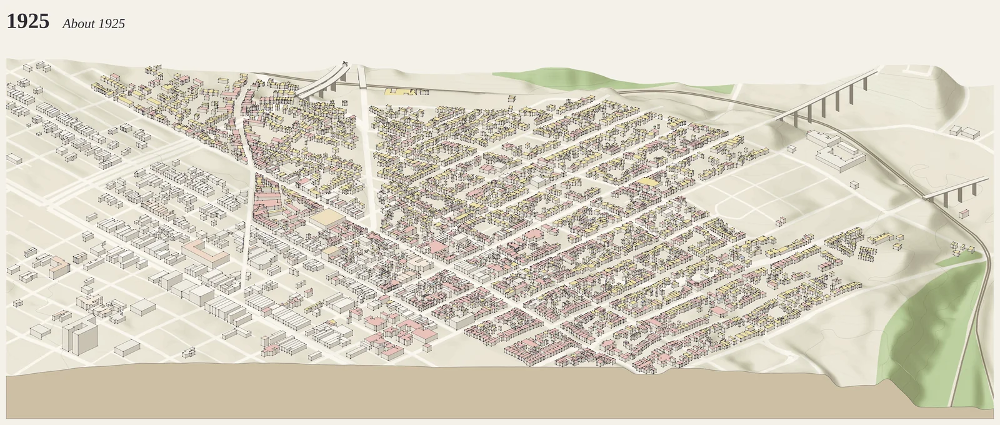
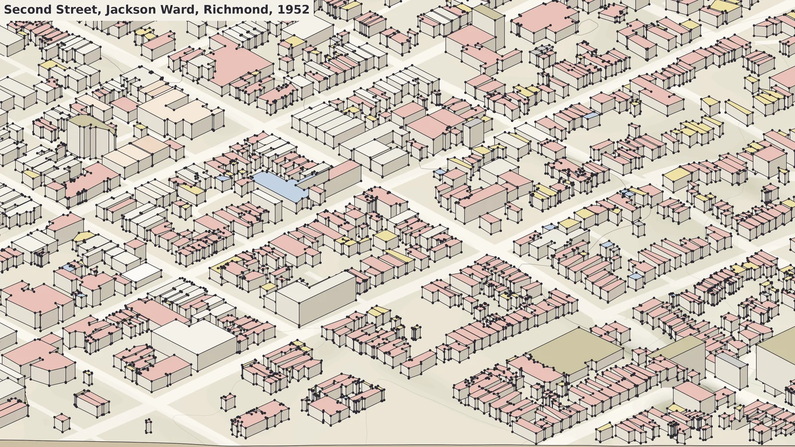
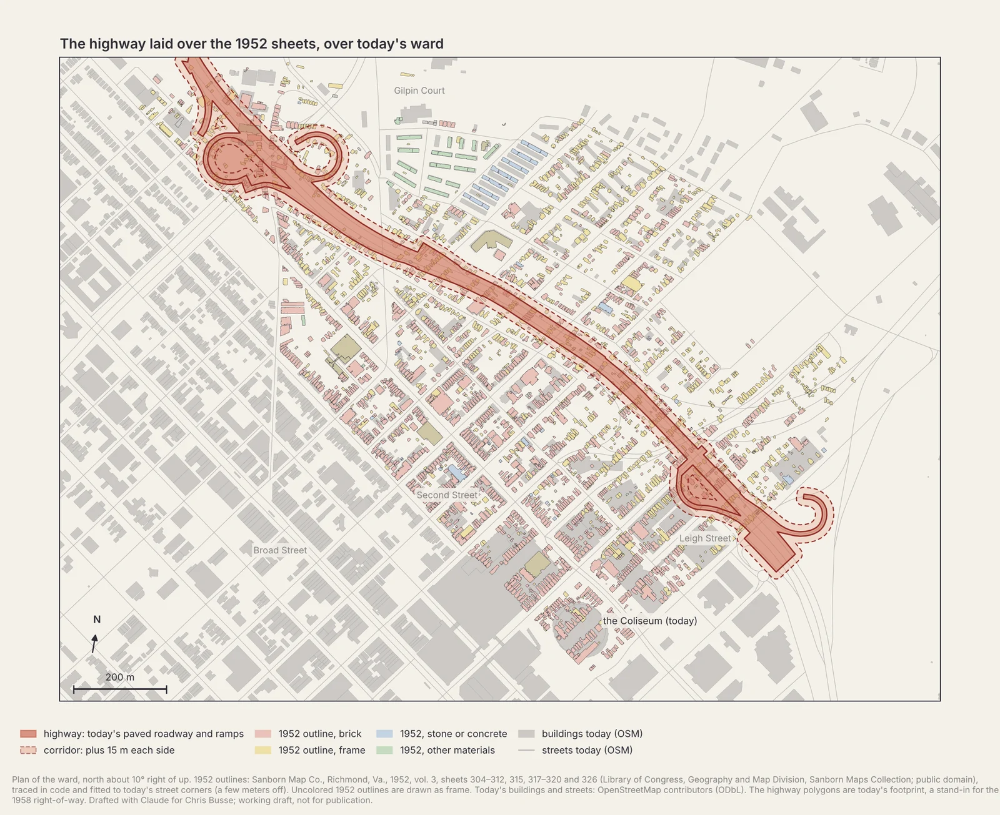
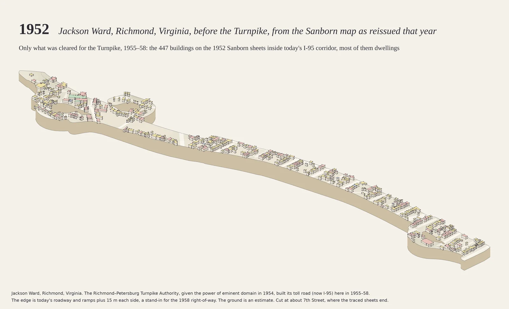
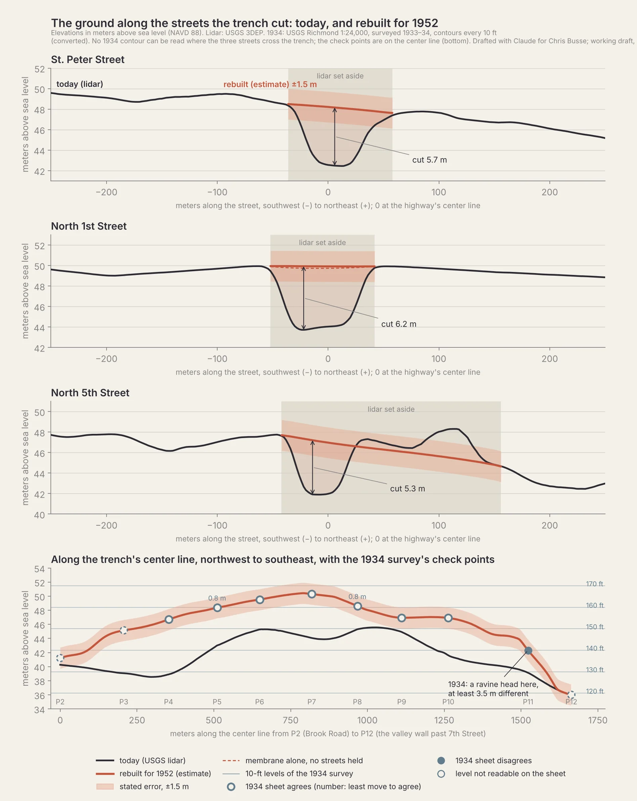
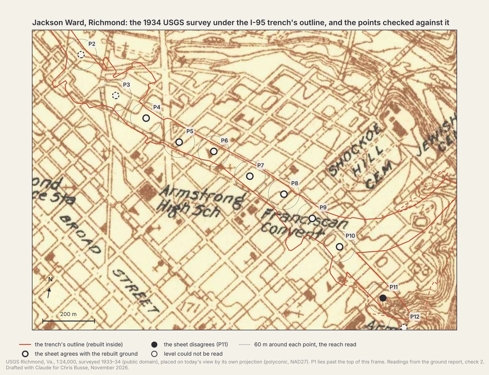
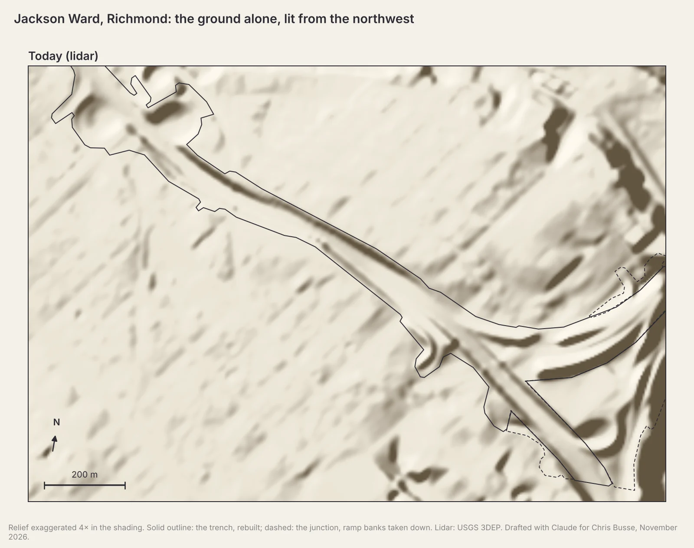
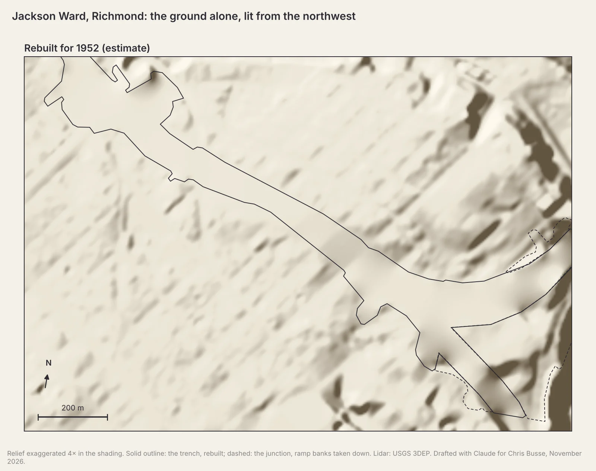
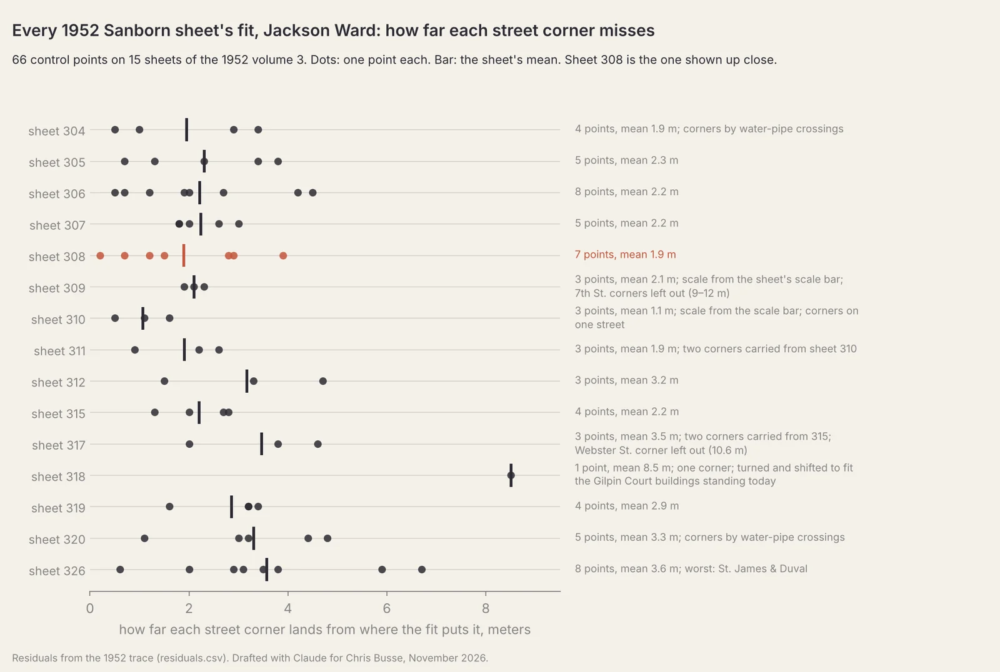
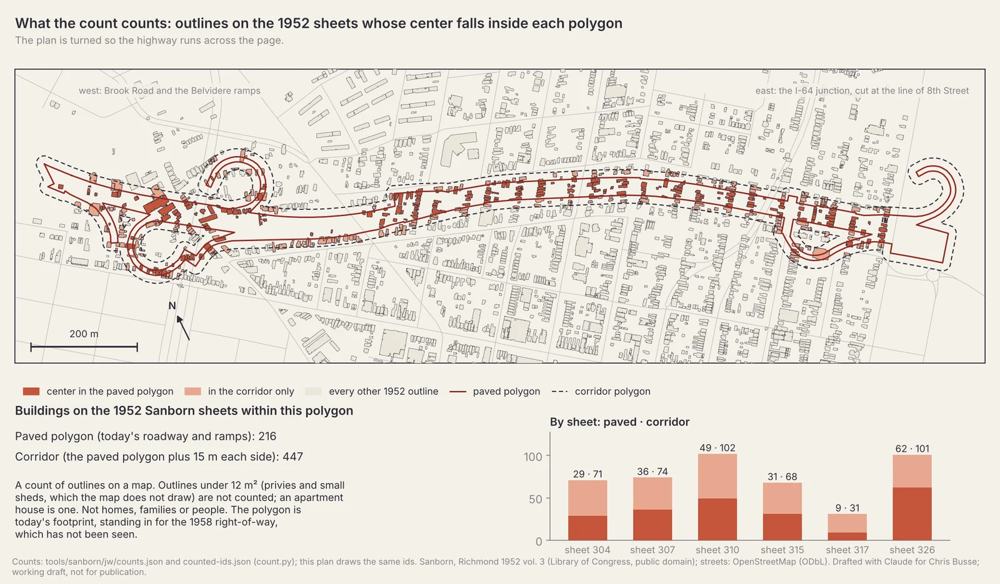

# Jackson Ward before I-95, block by block

> **Unpublished working draft, for review.** Not for circulation. The facts were checked
> against their sources on November 18, 2026. The community reviewers have not yet read it. The numbers,
> pictures and wording may change. Drafted with Claude for Chris Busse, November 18, 2026.

Between 1955 and 1958 the Richmond–Petersburg Turnpike, now I-95 and I-64, was cut through
Jackson Ward, then the center of Black business, church and civic life in Richmond. The last
Sanborn fire-insurance survey before the road, republished in 1952, shows the blocks it took
building by building, and the same company's survey of 1925 shows them a generation earlier.
Chris Busse has drawn the blocks from those sheets with isoscape, on the ground as it stood
before the trench, so the same frame can be seen about 1925, in 1952, about a year after the
road opened, and today. This page goes in order of time, and ends with [how we know](#how-we-know) what each
picture shows, how sure it is, and where it may be wrong.

The pictures are of buildings and ground. They do not show people, and they cannot say who
lived in a house or what it meant to them. That knowledge belongs to the ward's families,
churches and institutions, whose work this rests on (see
[Whose work this rests on](#whose-work-this-rests-on)).

## 1925

::: figure wide

Jackson Ward about 1925, seen from the south, from Belvidere Street to 7th Street and from Broad Street to the railroad. Frame houses are yellow, brick pink. *How this was made:* buildings north of Leigh Street (and between Clay and Leigh from 1st to
7th Streets) from the 15 sheets of the 1925 Sanborn volume 3, registered onto the same sheets of
the 1952 printing and placed by their fits; south of that from the 1924–25 volume 1 tracing;
and buildings standing today that the city dates to 1925 or before. The ground is the same
estimate as in 1952. See [The tracing](#the-tracing). Working draft.
:::

The 1925 volume's sheets carry marks dated early 1925, most of them March, its title page bears the Library of Congress's receipt stamp of May 16, 1925, and its correction table is blank, so it shows the ward as first surveyed for that edition [[LoC, Sanborn 1925 vol. 3](#sources)]. On these sheets most buildings north of Leigh
Street are frame. The tracing found 3,907 outlines, 2,317 of them colored as frame
[[1925 notes](#the-tracing)].

Jackson Ward was made a city ward in 1871. The city's 2026 community plan says its lines were
drawn to dilute Black voting power [[Community Plan 2026](#sources), timeline]. Its institutions were old by 1925: Ebenezer Baptist (the church's own history dates its first steps to 1856 and its first building to 1858 [[Ebenezer Baptist Church](#sources)]; the community plan gives 1858 and the feasibility study 1855),
Sixth Mount Zion, organized by John Jasper in 1867 and in the ward from 1869, John Mitchell
Jr.'s *Richmond Planet* (1884), the True Reformers' savings bank (1888, the first
Black-owned bank chartered in the United States), Mechanics' Bank (1902) and Maggie L.
Walker's St. Luke Penny Savings Bank (1903) [[Community Plan 2026](#sources);
[Feasibility Study 2022](#sources), §1.4]. The Hippodrome on Second Street opened about 1914, the National Park Service says; the community plan gives 1914 in its timeline and 1913 in its text, as the feasibility study does [[NPS, Hippodrome](#sources); [Community Plan 2026](#sources); [Feasibility Study 2022](#sources), §1.4.1].

It was also a neighborhood hemmed in by law. In 1911, according to a student's notes on Christopher Silver's history of the city, City Council passed a residential segregation ordinance drawn block by block [[Silver 1984](#sources), via a student's notes]. On the "redlining" maps of the 1930s every Black neighborhood in Richmond was marked
undesirable, and its residents were barred from loans for houses and businesses [[Feasibility Study 2022](#sources),
§1.4.2]. By the 1930s more than 8,000 Black Richmonders lived and worked in the ward
[[Community Plan 2026](#sources), citing Taylor 1994].

::: figure

Second Street about 1925, from Broad Street at the near edge to past Leigh Street. The 22 numbers are keyed in the table below. *How this was made:* a close crop of the 1925 view, numbered where the 1925 sheets print a name
or use beside a building that is drawn here (`tools/sanborn/jw/named1925.csv`). Numbers run
from the top of the picture down. South of Clay Street the buildings come from the older
volume 1 tracing, which names none. See [The tracing](#the-tracing).

| # | As the sheet prints it | Stories (as printed) | Sheet |
|---|---|---|---|
| 1 | Corby Baking Company, Plant C | 3 | 306 |
| 2 | St. Joseph's R.C. Church (Colored) | not printed | 308 |
| 3 | Rectory | 2 | 308 |
| 4 | Peoples Bible Institute (Colored) | not printed | 307 |
| 5 | Sharon Baptist Church (Colored) | not printed | 306 |
| 6 | Undertaker | 2 | 307 |
| 7 | Leigh St. Holiness Church (Colored) | 1-1/2 | 306 |
| 8 | Booker Washington School (Colored); fireproof part "built in 1923" | 3 | 306 |
| 9 | True Reformers Hall: Colored hall & meeting rooms 2nd & 3rd, printing 1st | 3 | 308 |
| 10 | Bank | not printed | 308 |
| 11 | Hippodrome Theatre (Colored) | 1-2 | 308 |
| 12 | Otira Apartments | 3 | 308 |
| 13 | Undertaking parlors 1st, meeting halls 2nd & 3rd | 3 | 308 |
| 14 | 3rd St. Bethel A.M.E. Church (Colored) | not printed | 308 |
| 15 | Moving Pictures (Colored); lobby | 1-1/2 | 308 |
| 16 | Miller Hotel (Colored): stores, hotel entrance, dining room | 3 | 308 |
| 17 | Y.M.C.A. (Colored) | 2 | 308 |
| 18 | Offices | not printed | 308 |
| 19 | Bank | not printed | 308 |
| 20 | Bank | 3-4 | 308 |
| 21 | Miller & Rhoads Private Garage | not printed | 309 |
| 22 | Leigh St. Memorial M.E. Church | not printed | 309 |
:::

Names are as printed; "(Colored)" is the sheet's own word. The bank at 212–216 East Clay (20) is the building of the Mechanics Savings Bank, built in 1909 and opened in 1910, which failed in 1922; the Southern Aid Society bought it in 1930 [[NPS, 212 East Clay Street](#sources)]. The National Park
Service shows True Reformers Hall (9) as a three-story building on Second Street
[[NPS, Black Wall Street](#sources)]. The sheet does not name the other two banks (10, 19).

## 1952: the last survey before the road

::: figure wide

Jackson Ward in 1952, the same frame: the last survey before the road. *How this was made:* buildings north of Leigh Street from the 1952 Sanborn volume 3, south of
it from the 1924–25 and 1950–52 volume 1 tracings (Second Street from Broad to Clay traced
again for this story), and buildings standing today that the city dates to 1952 or before, on
ground rebuilt as it was before the trench (an estimate, about ±1.5 m in its middle). Streets
that ran where the trench is now are read off the sheets. See
[The ground before the trench](#the-ground-before-the-trench) and [The tracing](#the-tracing).
Working draft.
:::

::: compare wide
 about 1925
 1952

The same frame about 1925 (left of the divider) and in 1952 (right). Drag the divider, or move it with the arrow keys. Most blocks change little; in 1952 Gilpin Court's long brick buildings stand where Apostle Town's frame houses were.
:::

The 1952 volume is a full reprint, with "Copyright 1952" on every sheet and a new index dated
September 1951. It draws what was built after 1925, such as Gilpin Court and the Armstrong High
School annex of 1938 [[trace notes](#the-tracing)]. On the 15 sheets traced for this story
there are 2,875 building outlines of 12 m² or more. The tracing reads 103 names and uses printed beside them: churches, schools, lodges,
theaters, a Y.M.C.A., ice plants, laundries and warehouses. They print "(Colored)" beside the
names of Black institutions, and this page keeps the sheet's own word where it quotes a name.

The ward in 1952 was segregated and crowded, and its housing had been left to decline [[Feasibility Study 2022](#sources), §1.4.2; [Silver 1984](#sources), via a student's notes]. It was also where Black Richmond banked,
worshipped, went to school and to the movies. The map shows both: the dense rows of frame
houses in the north blocks, and the brick churches and halls along Leigh and Second.

## Second Street

::: figure

Second Street in 1952, from Broad Street at the near edge to past Leigh Street. The 31 numbers are keyed in the table below. *How this was made:* a close crop of the 1952 view, numbered where the 1952 sheets print a name
or use beside a building that is drawn here (`tools/sanborn/jw/named.csv`). Numbers run from
the top of the picture down; a marker stands over the top of its roof. South of Clay Street
the buildings come from volume 1 sheets 2 and 3, fitted again and traced for this story, which
were not read for names. See [The tracing](#the-tracing). Working draft.

| # | As the sheet prints it | Stories (as printed) | Sheet |
|---|---|---|---|
| 1 | Furniture storage warehouse; loading shed; furniture repair | not printed | 306 |
| 2 | St. Joseph's R.C. Church (Colored) | not printed | 308 |
| 3 | Sharon Baptist Church (Colored) | 1-2 | 306 |
| 4 | Undertaker | 2 | 307 |
| 5 | Auto repair | not printed | 306 |
| 6 | Storage house (vacant) | 4 | 308 |
| 7 | Colored hall & meeting rooms 2nd & 3rd; club; store | 3 | 308 |
| 8 | Filling station; auto repair | not printed | 308 |
| 9 | Apartments | 2 | 308 |
| 10 | Store; hall 2nd | 2 | 308 |
| 11 | Restaurant; hall 2nd (Colored) | 3 | 307 |
| 12 | Stores; upholstering & repair; tire repair | not printed | 306 |
| 13 | Hippodrome Theatre (Colored), movies | 1-2 | 308 |
| 14 | Leigh St. Y.M.C.A. (Colored) | 3 | 308 |
| 15 | Auto & casket storage | 2 | 308 |
| 16 | Storage | not printed | 308 |
| 17 | Third St. Bethel A.M.E. Church (Colored) | not printed | 308 |
| 18 | Moving pictures (Colored); restaurant; lobby; store | 1-2 | 308 |
| 19 | Restaurant | 2 | 308 |
| 20 | Rest. (restaurant); "Fl. abv. 1st" | 3 | 308 |
| 21 | Stores; hotel entrance; dining room | 3 | 308 |
| 22 | Restaurant; store | not printed | 308 |
| 23 | Restaurant; hotel | 2 | 308 |
| 24 | Offices | 2 | 308 |
| 25 | Stores; office; Southern Aid Society of Va. (Colored), office building; stores; nos. 212-216 E. Clay | 4 | 308 |
| 26 | Apartments | 2 | 308 |
| 27 | Offices | 2 | 308 |
| 28 | Miller & Rhoads furniture warehouse; garage 1st, upholstering 2nd, furniture repair 3rd ("fireproof construction built 1936"; "built 1941") | not printed | 309 |
| 29 | Elks Home, Williams Lodge (Colored) | not printed | 309 |
| 30 | Miller & Rhoads furniture storage | 2 | 309 |
| 31 | Leigh St. M.E. Church | not printed | 309 |
:::

::: compare
 about 1925
 1952

Second Street about 1925 (left of the divider) and in 1952 (right), the same blocks.
:::

Second Street, "the Deuce," was the ward's main commercial street [[Community Plan 2026](#sources)]. On sheet 308 of the 1952
volume, between Clay and Jackson Streets, the sheet names the Hippodrome Theatre, a second
moving-picture house, the Elks' Capitol City Lodge, the Leigh Street Y.M.C.A., Third Street
Bethel A.M.E. and St. Joseph's churches, a hotel entrance with its dining room, restaurants,
stores, offices, and a "colored hall & meeting rooms" [[trace notes](#the-tracing)]. The
Hippodrome closed in 1967 [[Community Plan 2026](#sources)]. The label "Southern Aid Society of
Va." on sheet 308 is printed under the frontage numbers 212, 214 and 216 of one 4-story office
building on East Clay Street (25). The National Park Service says the Society bought the former Mechanics Savings Bank building at 212 East Clay in 1930 and added two wings when it became the Society's headquarters [[NPS, 212 East Clay Street](#sources)]. The building stands today, so it is
drawn from today's map.

## How the route was chosen

A consultants' master plan for the city, made in 1946, proposed expressways through it
[[Style Weekly 2013](#sources); [Feasibility Study 2022](#sources), §1.4.3]. Richmond's voters
said no to a downtown expressway twice. In the first referendum, on June 13, 1950, only 8 of 55
precincts voted for it. A second, forced in 1951 by a petition of former mayor J. Fulmer Bright,
failed by almost 2 to 1; a newspaper headline the article reproduces put the margin at 6,002
votes [[Style Weekly 2013](#sources)]. Notes on Silver's book date a referendum June 13, 1951
[[Silver 1984](#sources), via a student's notes].

On August 24, 1953, according to a student's notes on Silver's book, City Council voted for a
turnpike authority, which moved the decision to the General Assembly and avoided another
referendum, and officials pointed to the cost of buying industrial land compared with homes
[[Silver 1984](#sources), p. 192, via a student's notes; the book itself has not been seen].
The General Assembly created the Richmond–Petersburg Turnpike Authority, with the power of
eminent domain, by an act approved on April 8, 1954 [[Acts of Assembly 1954](#sources);
[Style Weekly 2013](#sources); [Encyclopedia Virginia](#sources)]. The Library of Virginia,
Wikipedia and VCU Libraries give 1955 for its creation [[LVA 2024](#sources);
[Wikipedia, Turnpike](#sources); [VCU Libraries](#sources)].

The city's 2022 feasibility study says city officials chose the middle of Jackson Ward as the
best route through downtown [[Feasibility Study 2022](#sources), §1.4.3]. Wikipedia's article on Jackson Ward, citing Benjamin Campbell, says the consultants' first report held that destroying housing "offers no serious obstacle to a highway location" [[Campbell 2012](#sources), p. 154, via Wikipedia].
Which other routes were studied is not known to us yet.

Clearance and construction ran from 1955 to 1958 [[Community Plan 2026](#sources), timeline],
and the Authority photographed the work every month from 1956 to 1958 [[LVA 2024](#sources)].
The road opened on July 1, 1958: 34.7 miles from Dinwiddie County to Henrico County, built for
$76.7 million with toll revenue bonds [[LVA 2024](#sources)]. In August 1958 it became part of
I-95 [[Wikipedia, Turnpike](#sources)]. It was the only part of Virginia's I-95 not built with
federal money [[Richmond Family Magazine 2022](#sources)]. Tolls ended in 1992
[[Wikipedia, Turnpike](#sources)].

## The count

::: figure wide

The buildings the count counts, picked out in the 1952 view: darker for today's paved roadway and ramps, lighter for the corridor of 15 m either side. *How this was made:* the 1952 view, with exactly the buildings the count counts picked out
(the count's own list of them), by the polygons in
[The count's polygon and rule](#the-counts-polygon-and-rule). Working draft.
:::

::: figure wide

The highway's paved footprint and its corridor (red) over the 1952 outlines in their printed colors, over today's streets and buildings (gray). North is near the top; the round Coliseum is at lower right. *How this was made:* drawn in code from the same files as the maps: the 1952 outlines, today's
OpenStreetMap buildings and streets, and the count's two polygons. Today's buildings show where
the blocks were rebuilt after the road, among them the Coliseum on cleared blocks south of it.
:::

How much the road destroyed has been counted many ways, and the counts disagree. They cover
different areas (the ward, the ward and Navy Hill, or the whole 34.7-mile road), and they count
different things (people, families, homes, structures). This page reports them side by side and
does not choose among them.

| Figure | What it covers | Source |
|---|---|---|
| about 7,000 people, about 10% of Black Richmonders | the Turnpike, 1955–57 | [Silver 1984](#sources), via a student's notes |
| more than 1,000 homes and businesses; 7,000 residents; 390 acres; 10% of Black Richmonders by 1958 | across the city | [Feasibility Study 2022](#sources), citing Kollatz 2013 |
| 1,900 Black families, about 10% of the city's Black population, and 300 more facing the loss of their homes | "Turnpike and related construction," by 1957 | *Richmond Times-Dispatch*, 1957, per [Encyclopedia Virginia](#sources) |
| 1,900 families | "for four-lane highway through the neighborhood in 1957" | [LVA Document Bank](#sources) |
| more than 7,000 people (900 families, 90% of them Black); 700 homes and businesses in Jackson Ward; 34 streets rerouted | 1955–57 | [Grant application 2022](#sources) |
| more than 700 homes, churches and businesses | Jackson Ward | [Richmond Family Magazine 2022](#sources) |
| 1,000 homes; 31 streets blocked | Jackson Ward | [Campbell 2012](#sources), p. 154, via Wikipedia |
| over 1,000 homes | Jackson Ward and Navy Hill | [VCU Libraries](#sources) |
| more than 1,000 residents and business owners | Jackson Ward | [LVA, House to Highway](#sources) |
| over 1,000 families | the Turnpike | [Richmond Free Press 2024](#sources) |
| about 1,000 structures; 7,000 residents | the I-95 clearing | [VCIJ 2024](#sources) |
| thousands of Black residents displaced; hundreds of homes destroyed | 1955–58 | [Community Plan 2026](#sources), timeline |

This story adds one more number, of a different kind: **buildings on the 1952 Sanborn sheets
within this polygon**. There are **216** in the polygon of today's paved roadway and
ramps, and **447** in the corridor of that pavement plus 15 m on each side. These are
outlines on a map. Outlines under 12 m² (privies and the smallest sheds) are not counted, and
an apartment house counts once. The number does not count homes, families or people, and it is approximate: the polygon is
today's footprint, standing in for the 1958 right-of-way, which we have not seen. How it was
made is in [The count's polygon and rule](#the-counts-polygon-and-rule).

## The lost streets

::: figure wide

1952: the 31 stretches of street and alley the trench took (red), with the corridor outlined. *How this was made:* seven stretches join a street's two surviving ends straight across the
trench, as the 1934 USGS survey shows them running through. The other 24 are read off the 1952
sheets: each street's center line, placed by the sheet's fit, kept where no street runs today
and where at least 20 m of it, and at least 40% of that, lies in the corridor. See
[The ground before the trench](#the-ground-before-the-trench) and [The tracing](#the-tracing).
Working draft.
:::

::: figure wide

Today: the same corridor, with the bridges that now carry the surviving streets over the trench (red).
:::

Seven streets that ran through at grade now end at the trench or cross it on a bridge:
Chamberlayne Parkway, St. James, 1st, 2nd, Duval, 5th (now Maggie L. Walker Place) and 7th.
Inside the corridor the 1952 sheets print 24 more stretches of 22 streets and alleys, 2,275 m in
all, where no street runs today: among them Moore, Gilmer, Munford, Shooks, Calhoun and West
Baker Streets, St. Paul and St. John Streets, North 3rd, 4th, 5th and 6th Streets, East and
West Duval Streets, a stretch of Brook Road, and Cave, Paradise, Cottage and Gilbert Alleys
[[LoC, Sanborn 1952 vol. 3](#sources)]. The pictures draw 31 stretches in all. Published counts
of the streets cut run to 31 [[Campbell 2012](#sources), via Wikipedia] and 34
[[Grant application 2022](#sources)]; they count whole streets over other areas, so they and our
31 stretches measure different things.

## The island

::: figure wide

Only what the highway took: the 1952 blocks inside the corridor, drawn alone. *How this was made:* the 1952 view cut to the corridor polygon (today's roadway and ramps plus
15 m each side) and drawn alone, with the ground's cut edge as the slab's sides. It holds the
447 buildings the count counts in the corridor, 216 of them in the paved
polygon, with the streets and the ground as rebuilt before the trench. The edge is today's
footprint, standing in for the 1958 right-of-way. At its east end the island stops where the
traced 1952 sheets stop, at about 8th Street: the ramp loop beyond was not traced, so it is left
off. Working draft.
:::

## 1959, about a year after

::: figure wide

Jackson Ward in 1959, about a year after the road opened. Approximate. *How this was made:* the 1952 view, less every traced building whose center falls in the
corridor, on today's ground. **Approximate.** Buildings the road took outside that corridor
still stand here, and later clearances are not yet dated building by building. See
[Measured, inferred, unknown](#measured-inferred-unknown).
:::

The picture is labeled approximate because its edges are. The corridor polygon is today's
footprint plus 15 m, and the 1958 right-of-way has not been seen. In 1957 the Turnpike Authority and the city took by eminent domain a cottage built in 1793 by Abraham Peyton Skipwith, who had bought his freedom; it was sold for about $25 and moved out of the city
[[LVA, House to Highway](#sources); [Axios, April 2026](#sources)]. Gilpin Court was enlarged
in 1957 to house families the Turnpike displaced [[Encyclopedia Virginia](#sources)]. The Coliseum was later built on cleared blocks of the ward; a photograph shows it under construction on December 30, 1968 [[WVTF 2016](#sources)].

## Gilpin Court

Gilpin Court came first. On January 16, 1941, City Council passed the ordinance that began
clearing Apostle Town, named for its main streets: St. Stephen, St. James, St. Peter, St. John
and St. Paul [[LVA 2025](#sources); [Encyclopedia Virginia](#sources)]. Charles
Gilpin, the actor the project is named for, had lived at 200 Charity Street; his house was
among those torn down [[LVA 2025](#sources)]. The project was dedicated on April 28, 1943,
with 301 units [[LVA 2025](#sources)]. Encyclopedia Virginia gives 300 units and 250 families
displaced, with less than four months to move; Campbell, via Wikipedia, gives 297 units
replacing 200 houses [[Encyclopedia Virginia](#sources); [Campbell 2012](#sources), p. 152].

Additions in 1957 and 1970 added 482 units, and Fay Towers, finished in 1971, completed the
781-unit project on about 38 acres [[Feasibility Study 2022](#sources), §1.4.4;
[Community Plan 2026](#sources)]. The Turnpike left Gilpin Court and the rest of North Jackson Ward cut off from South Jackson Ward and from the rest of the city [[Encyclopedia Virginia](#sources)].

People live in Gilpin Court today, and it is drawn here as homes. In July 2026 a draft
agreement between the city and the Richmond Redevelopment and Housing Authority called for one-for-one replacement of all 781 units and expected the redevelopment to take at least ten years [[Gilpin Court MOU 2026](#sources)]; the housing authority had filed plans for a first building of 56 units, aiming to start it in early 2027 [[Axios, July 2026](#sources)]. Residents' groups, the Gilpin Court Tenant Council and Gilpin
Informed Residents, are named in the city's community plan [[Community Plan 2026](#sources)].
This page takes no position on the plan.

::: figure

Apostle Town about 1925 (top), Gilpin Court in 1952 (middle), and today (bottom). *How this was made:* the same close crop of the 1925, 1952 and today views. In 1925, where
Apostle Town's streets differ from today's, they are drawn as sheet 318 prints them: Cabell and Tyler Streets, and Hickory Street on its old
line, read off the sheet and drawn until 1941; Gilpin Court's own streets and paths are drawn
from 1941 [[LoC, Sanborn 1925 vol. 3](#sources); [LVA 2025](#sources)]. The 1925 buildings on the site that the 1952 sheets no longer show (119 of them) are taken to have gone in 1941, when
the clearance began; whether any went earlier is not known. Sheet 318 rests on one control
point (8.5 m off), so the whole block may sit several meters from where it stood. Working draft.
:::

## Today, and the cap

::: figure wide

Jackson Ward today: the trench crosses the ward, Gilpin Court lies north of it, and bridges carry some of the old streets across. *How this was made:* drawn from OpenStreetMap and USGS lidar, as every isoscape view is. See
[How it's made](how-its-made.md).
:::

::: compare wide
 1952
 today

The same frame in 1952 (left of the divider) and today (right). *How this was made:* the 1952
and today views on this page, drawn in one frame so they line up; the 1952 view stands on ground
rebuilt as it was before the trench. See [The ground before the trench](#the-ground-before-the-trench).
:::

Jackson Ward was listed on the Virginia Landmarks Register on April 20, 1976 and the National
Register on July 30, 1976, and became a National Historic Landmark on June 2, 1978. The state's
record notes that "redevelopment and expressway construction have reduced its size"
[[DHR 127-0237](#sources)].

::: figure

The six areas over I-95 that the 2022 feasibility study tested for a cap: four found feasible, between Chamberlayne Parkway and 1st Street, and two not. *How this was made:* each area is drawn between the cross streets the study names for it; the
widths are ours. Approximate.
:::

A cap or lid over the highway is being studied. The 2022 feasibility study, by the state's
Office of Intermodal Planning and Investment, VDOT and the city, found it would be "technically possible" to build a bridge or lid in a study area that ran from the Belvidere Street bridge to the North 1st Street bridge, and found four of its six areas feasible, from Chamberlayne Parkway to North 1st Street [[Feasibility Study 2022](#sources), §3.2.4; [Fact sheet 2023](#sources)]. On February 28, 2023, the U.S. Department of Transportation announced a $1.35 million planning grant to the city [[City of Richmond](#sources)]. City Council accepted it on September 23, 2024 [[Ord. 2024-206](#sources)], and the city then aimed to hire a consultant by early 2025 [[VPM 2024](#sources)]. Federal records show the whole grant obligated under an agreement signed September 26, 2024, which runs to March 30, 2028 [[USAspending](#sources)]. The community plan, edited in July 2026, still lists securing federal funds and "hire a
consultant team" as next steps [[Community Plan 2026](#sources)]. Whether a consultant has been hired we could not find.

People in and around the ward hold a range of views on the cap. As reported by Elizabeth
McGowan for the Virginia Center for Investigative Journalism in July 2024
[[VCIJ 2024](#sources)]:

- **For it:** business owner David Lambert calls the cap's intent excellent and sees a chance for economic revival, though he asks how it will make money.
- **For it, with conditions:** VCU urban planner Jim Smither sees a park over the highway as an asset if it comes with an acknowledgment of past harms, and says the conversation must start with reparations. City Councilor Ann-Frances Lambert is not opposed but says the city must first address what happened, and supports action on reparations; she told VPM the city "displaced one of the most robust African American
  communities" [[VPM 2024](#sources)].
- **Against or doubtful:** historian Gary Flowers calls it the wrong priority and argues that the city should turn down the grant and spend on Black culture, commerce and education. Benjamin Ross, historian of Sixth Mount Zion Baptist
  Church, asked "reconnect to what?" and worried a cap would hide the church.

This page takes no position on the cap. The study area is outlined; no design is drawn.

## How we know

Every picture above is drawn by Chris Busse with isoscape, the tool he draws with, built with
Claude. The tracing, the ground and the count were done in code, with Claude, under his
direction (see the [artist statement](artist-statement.md)). This section says how each was
made, how far off it may be, and what would make it better.

### The ground before the trench

Today's ground comes from USGS lidar, resampled to a 5 m grid. Under the highway it shows the
trench: about 80–100 m wide and 3 to 6.5 m deep under the old cross streets, and up to about
8 m deep between Brook Road and Chamberlayne Parkway. No survey of the ground inside the trench
before 1955 could be found online, so the 1952 views use an estimate.

::: figure

Where the trench was filled (red, deeper toward dark red) and where ramp banks were taken down (blue), with the outlines of each method and the seven streets held at grade.
:::

The estimate works like a rubber sheet stretched across the trench and pinned to the measured
ground at its edge: each point inside takes the average of its neighbors. The seven streets
that crossed at grade are held straight between their surviving ends; as this ground is drawn, that changes the result by about 6 cm on average (root mean square) and 58 cm at most, because the ground there is nearly level. East of
3rd Street, where the ramps stand on the edge of the Shockoe Valley, the lidar is kept and only
banks narrower than 50 m are taken down. As this ground is drawn, the most put back in the
trench is 7.8 m, between Brook Road and Chamberlayne Parkway, and the most taken away is 10.1 m,
where a ramp's bank stands inside the trench's outline at the junction.

::: figure

St. Peter, North 1st and North 5th Streets across the trench, and the trench's center line with the 1934 survey's check points.
:::

The street profiles show the cut under three streets that once crossed: about 5.7 m under St.
Peter Street, 6.2 m under 1st Street and 5.3 m under 5th Street, as this ground is drawn. The
error is put at **about ±1.5 m (95% of points) in the middle of the trench** and **about ±3 m at
its ends**, toward Belvidere Street and toward 7th Street. It is worse near 7th and Duval
Streets, where the 1934 survey shows a small ravine the method cannot rebuild. Relief smaller
than the trench is wide, such as a knoll or a dip, is lost everywhere.

Two checks support those numbers.

::: figure

Seven trials of the method on undisturbed ground.
:::

**The method tried where the answer is known.** The trench's outline was moved onto undisturbed
ground nearby seven times, and the ground inside rebuilt and compared with the lidar it
replaced. On level plateau like the trench's, 95% of points came within 0.66–2.06 m. Where the
outline crossed the Leigh Street cut or a valley edge, it did worse (2.85 and 4.17 m).

::: figure

The 1934 USGS sheet under the trench's outline, with the check points along its center line (P1 lies beyond the frame).
:::

**The 1934 survey.** The USGS Richmond sheet, surveyed in 1933–34 with contours every 10 feet,
shows the streets running through before the road. At the seven points in the trench's middle
where it can be read (P4 to P10), it agrees with the rebuilt ground to within 0.8 m. At P11, near
7th Street, it shows a ravine head and disagrees by at least 3.5 m. At P1–P3 and P12 its levels
could not be read. The sheet is weak evidence on level ground: no contour there says only that
the ground stayed within one 10-foot band.

::: compare wide
 today (lidar)
 rebuilt (estimate)

The ground alone, lit from the northwest: today with the trench (left of the divider), and rebuilt with the trench filled (right).
:::

::: figure

The same blocks three ways: today; 1952 drawn on today's ground, with the trench showing; 1952 on the rebuilt ground.
:::

The three-way view shows why the estimate matters. Drawn on today's ground, the 1952 streets
dip into a trench that did not exist. On the rebuilt ground they cross level.

What might replace the estimate with a survey: the Turnpike Authority's records at the Library of Virginia (Accession 40941), open to researchers who visit [[LVA 2024](#sources)], if they hold plan-and-profile sheets showing the ground before construction, or VDOT's own plans; and a 1922 survey at 1:2,400 by R. H. Randall & Co., catalogued as "Topography area surrounding city of Richmond" (Library of Virginia, G3884.R5C2 1922 .R53), if it covers the ward [[LVA map guide](#sources)]. None of these has been seen for this story, and we found none online.

### The tracing

The 1952 buildings come from 15 sheets of the Sanborn map of Richmond, volume 3, as republished
in 1952 (sheets 304–312, 315, 317–320 and 326), at the Library of Congress
[[LoC, Sanborn 1952 vol. 3](#sources)]. Each sheet was fitted to today's street corners, and its
building outlines were traced in code, then checked against the sheet.

::: figure

Sheet 308 of the 1952 volume, Second Street from Clay to Jackson, with its seven control points and how far each misses after the fit.
:::

After the fit, each corner lands a little off. On 14 of the 15 sheets the mean miss is 1.1–3.6 m, and the worst single corner is 6.7 m, at St. James and Duval on sheet 326. A building may sit a few
meters from where it stood, less than a house's width; no block was seen pushed across a
street. Sheet 318, which draws Gilpin Court, has only one usable corner and was turned and
shifted to fit the Gilpin Court buildings standing today (8.5 m).

::: figure

Every control point on all 15 sheets, with each sheet's mean.
:::

Colors on the sheets give each building's material: pink for brick, yellow for frame. The 1952
printing leaves many frame houses uncolored; those are taken to be frame, an inference checked
on one sheet against the 1925 printing. Stories and uses were read off the sheets for the
buildings counted in the corridor and those near Second Street, 479 in all (stories for 164 of
them); a building is drawn 3.6 m a story where its stories were read, and two stories high
where they were not. Of the 447 counted in the corridor, the letters read on 403 include 270 dwellings (houses, duplexes and apartment houses), 54 private garages, 29 flats, 28 stores,
6 churches and a school. These are buildings, and a dwelling may hold one household or several.

Second Street from Broad to Clay is on volume 1 of the 1950–52 printing. Its sheets 2 and 3 were
fitted again to street corners read off them (residuals 0.5–2.9 m) and traced, adding 198
outlines the earlier tracing had missed there.

Busy outlines were simplified before drawing: corners closer than 1 m to a straight run were
dropped and near-rectangles squared, with no wall moved more than 1 m. The counts are made from
the outlines as traced.

**1925.** The 15 sheets of the 1925 volume 3 were matched to their 1952 reprints feature by
feature (1,300 to 3,500 matches a sheet; the median mismatch is about 0.1 m on the ground) and
placed by the 1952 fits, so their positions carry the same few meters of error. In 1925 every
building is colored, and the tracer reads the colored fills [[LoC, Sanborn 1925
vol. 3](#sources)]. That tracer splits more porches and frame fronts into outlines of their own
than the 1952 one did, so the two tracings read the sheets differently: by the same rule (a point inside an outline of 12 m² or more), the 1925 tracing finds 244 outlines in the paved polygon and 506 in the corridor, against 216 and 447 in 1952. The difference is not a count of buildings lost between 1925 and 1952, and this page
does not use it as one.

### The count's polygon and rule

::: figure

The count's two polygons along the highway, turned to run across the page, with the 1952 outlines inside each and the count by sheet.
:::

The polygon is built from today's OpenStreetMap ways of the Turnpike and its ramps, each widened
to its lanes at 3.65 m plus 3 m shoulders, with the gaps between carriageways closed. It runs
from the Belvidere Street ramps to the line of 8th Street, and leaves out I-64 east of the
junction, built later. The corridor adds 15 m on each side for the cut slopes and walls. A
building counts when a point inside its outline falls in the polygon. Outlines under 12 m² are
not counted: the map draws nothing that small (12 m² is the smallest building the region draws), and
counting them would give a number the pictures cannot show. They are privies and sheds under
about 3.5 m on a side. One outline on sheet 317, the box of the sheet's correction table, is not
a building and is left out. The counts are 216 and 447, from one file,
`tools/sanborn/jw/counts.json`; the count picture, the plan and the island draw the same
buildings, from the list the count writes.

What the number cannot say: the 1958 right-of-way may differ from today's footprint, the
ramps of 1958 were not today's ramps, and a building torn down between the survey and 1955 may
still be on the sheet. The tracer splits some row houses at every party wall and merges others,
and misses some small buildings.

### Measured, inferred, unknown

| | What | How we know it |
|---|---|---|
| **Measured** | Today's ground | USGS lidar, a 5 m grid; a few centimeters on open ground |
| **Measured** | Each 1952 outline, its position and printed color; the 103 names and uses | Read off the sheets; placed to within a few meters (above) |
| **Measured** | The 1934 survey's streets and contours | USGS, 10-foot contours; placed by its own projection and a shift of about 15 m |
| **Inferred** | The ground inside the trench before 1955 | The membrane estimate: about ±1.5 m mid-trench, ±3 m at its ends |
| **Measured** | 24 stretches of street inside the corridor; Apostle Town's 1925 streets | Read off the 1952 and 1925 sheets and placed by their fits |
| **Measured** | Uses and stories of 479 buildings | Read off the 1952 sheets, as printed |
| **Inferred** | The seven lost street stretches | Straight joins between surviving ends, which the 1934 sheet shows running through |
| **Inferred** | When Apostle Town's buildings went | 1941, when the clearance began, for every one the 1952 sheets no longer show |
| **Inferred** | Uncolored outlines are frame buildings; heights where stories were not read | Checked on one sheet; two stories assumed |
| **Inferred** | Which buildings the road took | A point inside each outline, tested against today's footprint |
| **Unknown** | The 1958 right-of-way | Library of Virginia, Accession 40941, not yet seen |
| **Unknown** | What changed between the survey and 1955; when each later loss happened | Not yet dated building by building |
| **Unknown** | Uses and stories outside the corridor and Second Street; most stories inside it | Not yet read; needs the full-size scans |
| **Unknown** | Which routes were studied, 1946–54 | Silver's book and the Authority's papers, not yet seen |

### Sources and rights

| Source | Used for | Rights |
|---|---|---|
| Sanborn Fire Insurance Map, Richmond, 1952, vol. 3, and 1950–52, vol. 1, Library of Congress | 1952 buildings and streets | Public domain; credit Library of Congress, Geography and Map Division, Sanborn Maps Collection |
| Sanborn Fire Insurance Map, Richmond, 1925, vol. 3, Library of Congress | 1925 buildings and Apostle Town's streets | Public domain (published 1925); same credit |
| USGS Richmond, Va., 1:24,000, surveyed 1933–34 | The check on the rebuilt ground | Public domain (federal work) |
| USGS 3D Elevation Program lidar | Today's ground | Public domain |
| OpenStreetMap | Today's streets, buildings and highway | ODbL; © OpenStreetMap contributors |
| City of Richmond, year built (assessor) | Dating buildings standing today | City open data |
| Reconnect Jackson Ward feasibility study, 2022 | The study areas, facts on the cap | Public document; facts cited, no images copied |
| Books, articles and archives listed below | Facts, each cited | Cited and paraphrased; short quotations only |

## Whose work this rests on

The ward's history is kept by its own people and institutions, among them the Historic Jackson Ward Association, the Black History Museum & Cultural Center of Virginia, Sixth Mount Zion Baptist Church, Ebenezer Baptist Church, the Gilpin Court Tenant Council and Gilpin Informed Residents. This story draws on published work listed under [Sources](#sources): the Library of Virginia and the JXN Project's *House to Highway* and the Library of Virginia's archivists; the National Park Service; and writers including LaToya Gray-Sparks, Elizabeth McGowan, Michael Rogers, Kelley Libby and Ashley Craig. Christopher Silver's and Benjamin Campbell's books are known here only through others' summaries, and Harry Kollatz Jr.'s article only as the feasibility study cites it. None of these people or institutions was involved in this draft, and none has reviewed it.

## Sources

Opened for this draft unless marked.

- **Acts of Assembly 1954**: Virginia Acts of Assembly, 1954, chapter 705, approved April 8, 1954 (Code §§ 33-255.27, 33-255.29), as transcribed by the University of Virginia's Modeling Jim Crow project. https://modelingjimcrow.virginia.edu/node/72717
- **Axios, April 2026**: "Skipwith-Roper Cottage homecoming," Axios Richmond. https://www.axios.com/local/richmond/2026/04/17/jackson-ward-skipwith-roper-cottage-homecoming
- **Axios, July 2026**: "What's happening with Gilpin Court," Axios Richmond. https://www.axios.com/local/richmond/2026/07/09/whats-happening-with-gilpin-court-richmond
- **Campbell 2012**: Benjamin Campbell, *Richmond's Unhealed History* (Brandylane, 2012), pp. 152, 154, as cited by Wikipedia, "Jackson Ward." The book has not been seen. https://en.wikipedia.org/wiki/Jackson_Ward
- **City of Richmond**: Reconnect Jackson Ward page. https://www.rva.gov/planning-development-review/reconnect-jackson-ward
- **Community Plan 2026**: City of Richmond, Jackson Ward Community Plan, edited July 2026. https://rva.gov/sites/default/files/2026-07/20260716_Jackson%20Ward%20Community%20Plan_editedJuly2026.pdf
- **DHR 127-0237**: Virginia Department of Historic Resources, Jackson Ward Historic District. https://www.dhr.virginia.gov/historic-registers/127-0237/
- **Ebenezer Baptist Church**: "Church History." https://www.ebenezerrva.org/church-history
- **Encyclopedia Virginia**: LaToya Gray-Sparks, "Urban Renewal in Richmond" (2024, updated 2025). https://encyclopediavirginia.org/entries/urban-renewal-in-richmond/
- **Fact sheet 2023**: City of Richmond, Reconnect Jackson Ward fact sheet. https://rva.gov/sites/default/files/2024-11/RJW-FactSheetv3_12_2023.pdf
- **Gilpin Court MOU 2026**: City of Richmond and RRHA, Joint Gilpin Transformation Working Group Memorandum of Understanding, draft published July 2026 (unsigned). https://rva.gov/sites/default/files/2026-07/Gilpin%20Court%20MOU%20RRHA%20COR_final%20AATF.pdf
- **Feasibility Study 2022**: OIPI, VDOT and City of Richmond, Reconnect Jackson Ward Feasibility Study, September 2022. https://www.rva.gov/sites/default/files/2024-11/RJW_FS_Report_2022-09-30v5-FINAL.pdf
- **Grant application 2022**: City of Richmond, Reconnecting Communities Pilot grant application, October 2022. https://www.rva.gov/sites/default/files/2024-11/UPC114874_RJW_GrantApplicationCombined_2022-10-27.pdf
- **LoC, Sanborn 1925 vol. 3**: Library of Congress, Sanborn Fire Insurance Map from Richmond, Independent Cities, Virginia, 1924–1925, vol. 3, 1925. https://www.loc.gov/item/sanborn09064_008/
- **LoC, Sanborn 1952 vol. 3**: Library of Congress, Sanborn Fire Insurance Map from Richmond, 1952, vol. 3. https://www.loc.gov/item/sanborn09064_018/
- **NPS, 212 East Clay Street**: National Park Service, "212 East Clay Street." https://www.nps.gov/places/212-east-clay-street.htm
- **NPS, Hippodrome**: National Park Service, "The Hippodrome Theater and W. L. Taylor Mansion." https://www.nps.gov/places/the-hippodrome-theater-and-w-l-taylor-mansion.htm
- **NPS, Black Wall Street**: National Park Service, "Jackson Ward and its Black Wall Street." https://www.nps.gov/articles/000/jackson-ward-and-its-black-wall-street.htm
- **LVA 2024**: Renee Savits, Richmond–Petersburg Turnpike Authority records, Accession 40941, *The UncommonWealth*, Library of Virginia, October 9, 2024. https://uncommonwealth.lva.virginia.gov/?p=42248
- **LVA 2025**: Ashley Craig, "A Brief History of Public Housing in the City of Richmond," *The UncommonWealth*, November 17, 2025. https://uncommonwealth.lva.virginia.gov/blog/2025/11/17/a-brief-history-of-public-housing-in-the-city-of-richmond
- **LVA map guide**: Library of Virginia, "Richmond Maps: Topographic Maps" research guide. https://lva-virginia.libguides.com/richmond-maps/topographic-maps
- **LVA Document Bank**: Library of Virginia, "Urban Renewal in Virginia." https://www.lva.virginia.gov/collections/educator-resources/dbva/items/show/300
- **LVA, House to Highway**: Library of Virginia and the JXN Project, *House to Highway*. https://www.lva.virginia.gov/events/exhibitions/house-to-highway
- **Ord. 2024-206**: City of Richmond, Ord. No. 2024-206, accepting $1,350,000 from the U.S. Department of Transportation for the Reconnect Jackson Ward project, adopted September 23, 2024 (Legistar). https://webapi.legistar.com/v1/richmondva/matters/37259
- **Richmond Family Magazine 2022**: "Destroying a community to build a road," March 1, 2022. https://richmondfamilymagazine.com/article/destroying-a-community-to-build-a-road
- **Richmond Free Press 2024**: September 12, 2024. https://m.richmondfreepress.com/news/2024/sep/12/jxn-project-and-library-of-virginia-unveil-jackson-wards-hidden-history
- **Silver 1984**: Christopher Silver, *Twentieth-Century Richmond: Planning, Politics, and Race* (1984), as summarized in student notes posted by *Highways and Hallowed Halls*. The book has not been seen. https://highwaysandhallowedhalls.com/wp-content/uploads/2022/08/twentieth-century-richmond-silver-1984.pdf
- **Style Weekly 2013**: Michael Rogers, "The Voter Detour," *Style Weekly*, December 24, 2013. https://www.styleweekly.com/?p=43492
- **USAspending**: Federal award 693JJ32440347, Federal Highway Administration to the City of Richmond, $1,350,000 obligated, signed September 26, 2024. https://www.usaspending.gov/award/ASST_NON_693JJ32440347_069
- **VCIJ 2024**: Elizabeth McGowan, Virginia Center for Investigative Journalism at WHRO, July 16, 2024. https://vcij.org/stories/in-richmond-a-struggle-over-the-future-of-a-harlem-of-the-south
- **VCU Libraries**: "Interstate Highways," MCV aerial photography exhibit. https://gallery.library.vcu.edu/exhibits/show/mcv-aerial-photography/interstate-highways
- **VPM 2024**: Keyris Manzanares, VPM News, September 25, 2024. https://www.vpm.org/news/2024-09-25/richmond-city-council-reconnect-jackson-ward-ann-frances-lambert
- **WVTF 2016**: Kelley Libby, "When a highway and a coliseum cut through a community," April 14, 2016. https://www.wvtf.org/post/when-highway-and-coliseum-cut-through-community
- **Wikipedia, Turnpike**: "Richmond–Petersburg Turnpike." https://en.wikipedia.org/wiki/Richmond%E2%80%93Petersburg_Turnpike
- **USGS 1934**: Richmond, Va., 1:24,000, surveyed 1933–34. https://prd-tnm.s3.amazonaws.com/StagedProducts/Maps/HistoricalTopo/GeoTIFF/VA/VA_Richmond_186500_1934_24000_geo.tif

## How this page was made

The text was drafted by Claude for Chris Busse, from sources opened while drafting, and is being
checked against them. The maps are drawn by Chris with isoscape; the charts are drawn in code
from the same data as the maps (`tools/stories/jackson-ward/`). See the
[artist statement](artist-statement.md) for how Chris works with the tool. Nothing here is for
sale.
