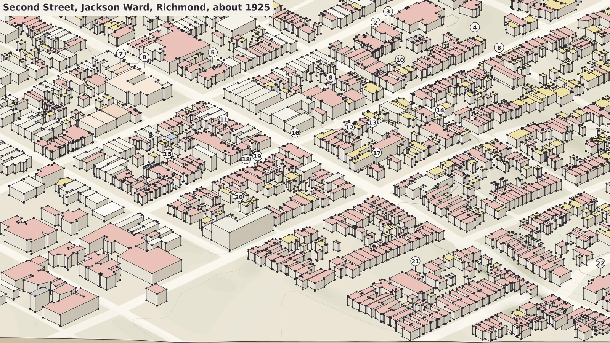
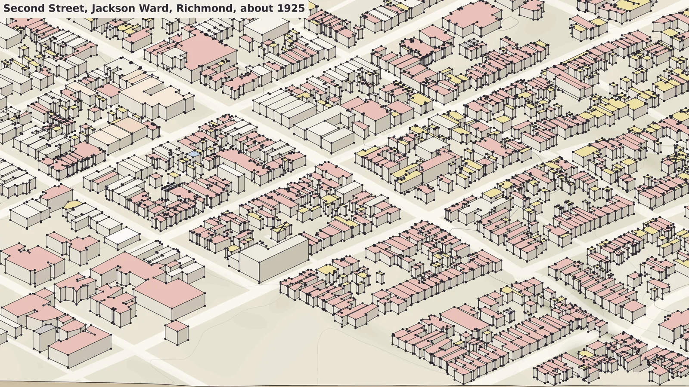
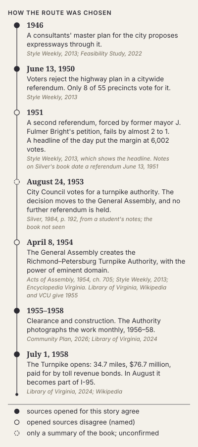
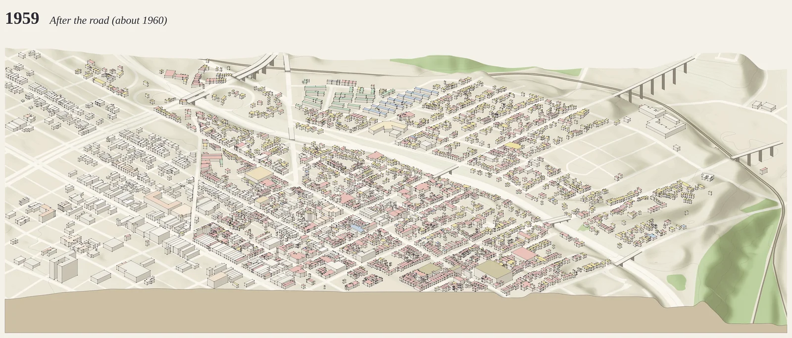
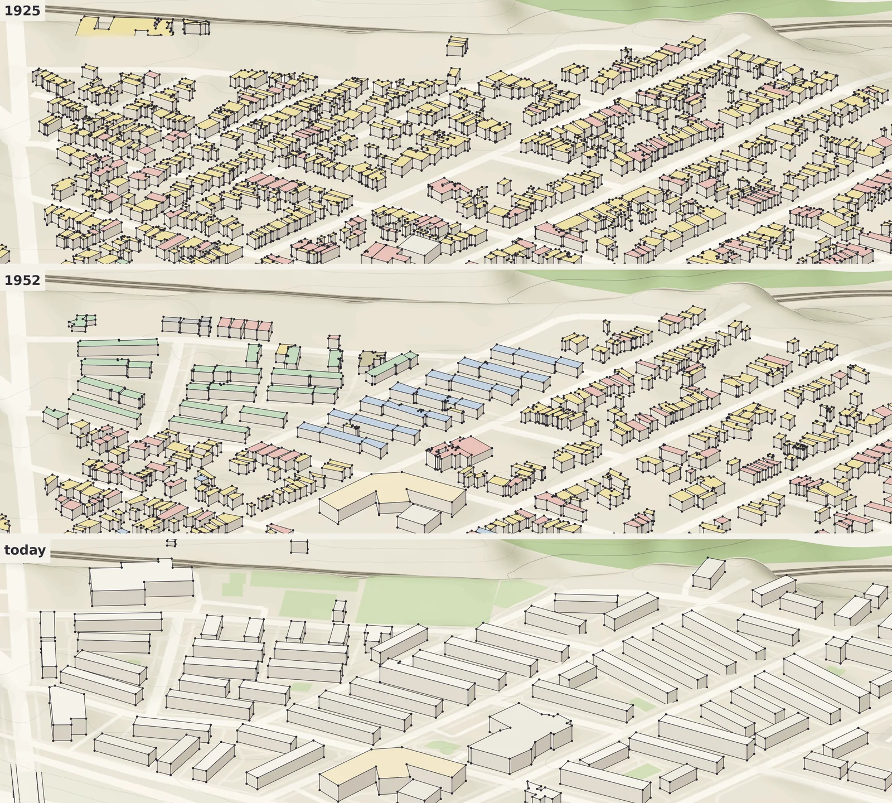
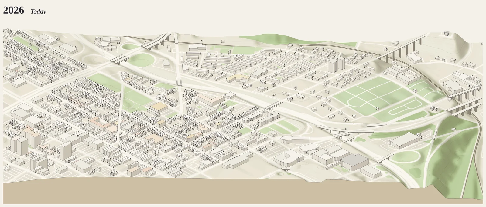
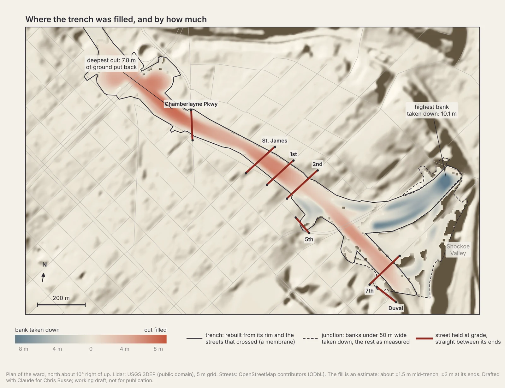
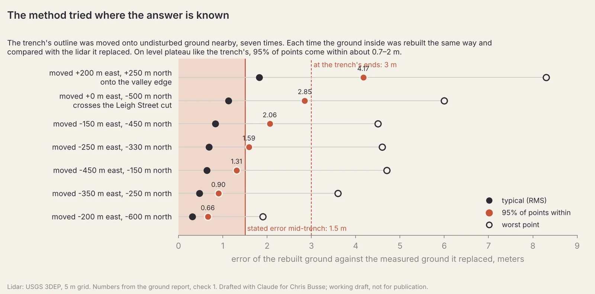
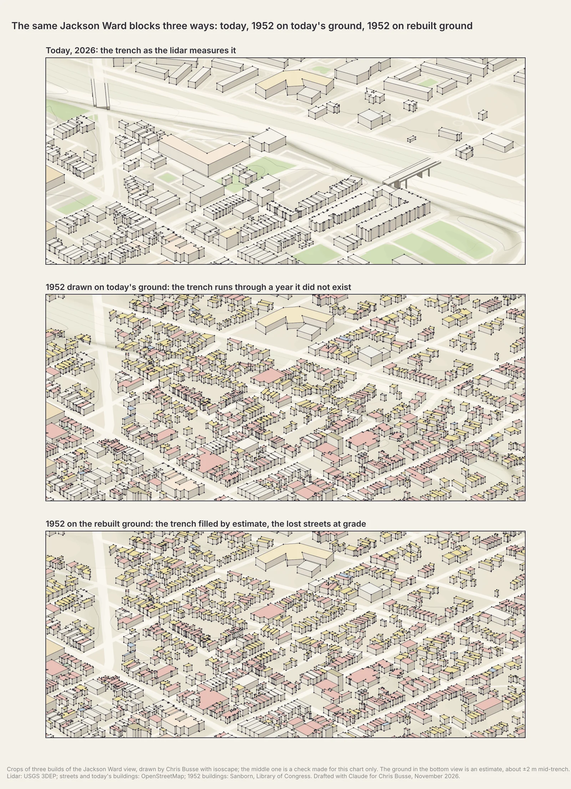

# Jackson Ward, Richmond, VA, before I-95, block by block

> **About this page.** Chris Busse, a Richmond artist, made this page with Claude. It is drawn
> from the Sanborn fire-insurance maps of 1925 and 1952 at the Library of Congress,
> OpenStreetMap, City of Richmond assessor records and U.S. Geological Survey elevation data. Its
> facts were checked against the sources listed below in November 2026. Corrections are welcome
> through the [contact page](#/about/contact), and changes will be dated
> [here](#corrections-and-changes).

Between 1955 and 1958 the Richmond–Petersburg Turnpike Authority, which the General Assembly
created in 1954, built its toll road through Jackson Ward, then the center of Black business,
church and civic life in Richmond [[Acts of Assembly 1954](#sources); [Community Plan
2026](#sources), timeline]. The road now carries I-95 and, through the ward, I-64 as well
[[Feasibility Study 2022](#sources), §1.4.3]. It runs in a trench up to about 8 m deep. The last
Sanborn edition before the road, the 1925 survey as corrected and reissued in 1952, shows the
blocks the trench went through building by building, and the 1925 edition shows them a
generation earlier. Chris Busse has drawn those blocks with isoscape, the drawing tool he built
with Claude, on an estimate of the ground as it stood before the trench, so the same frame can be
seen about 1925, in 1952, about a year after the road opened, and today. The page goes in order of
time and ends with [how we know](#how-we-know) what each picture shows, how sure it is, and where
it may be wrong.

This page draws buildings and ground from maps. It does not show people, and it cannot say who
lived in a house or what the ward meant to them. That is for the ward's families, churches and
institutions to tell; [Who keeps the ward's history](#who-keeps-the-wards-history) points to
some of them.

## Where this is, and how to read the pictures

The Sanborn Map Company drew American towns for fire insurers, building by building, on large
numbered sheets bound in volumes. Colors on the sheets give each building's material (brick in
pink, wood frame in yellow), letters and numbers give its use and stories, and between editions
the company pasted correction slips over the sheets to keep them current [[LoC, Sanborn
collection](#sources)].

::: figure wide

A plan of the ward, north near the top: where I-95 runs today (red) over the buildings on the 1952 Sanborn sheets in their printed colors, over today's streets and buildings (gray). The round Coliseum is at lower right. *How this was made:* drawn in code from the same files as the maps: the 1952 outlines, today's
OpenStreetMap buildings and streets, and the count's two polygons (see
[How many buildings stood in the highway's path](#how-many-buildings-stood-in-the-highways-path)).
Today's buildings show where blocks were rebuilt after the road.
:::

The large pictures below are drawn from the south, looking north, as if from a low airplane.
In them the highway runs from upper left to lower right. Broad Street is the near edge, Belvidere
Street the left edge, and the railroad and Gilpin Court lie along the far edge. Second Street, the
ward's main street, runs up from the near edge a little right of center.

Jackson Ward, as the city's 2022 feasibility study describes it, takes in two other communities,
Navy Hill and Apostle Town [[Feasibility Study 2022](#sources), §1.4.2]. Navy Hill lay roughly
north of Leigh Street between 3rd and 10th Streets and had become a majority-Black neighborhood
in the early twentieth century, Harry Kollatz Jr. writes [[Kollatz 2019](#sources)]; the eastern
part of the frame, and of the highway's path, runs through it. Apostle Town, on the ward's north
edge, was cleared in 1941 for the Gilpin Court public housing
(see [Gilpin Court](#gilpin-court-public-housing-built-over-apostle-town)).

## Jackson Ward in 1925, from the Sanborn survey of that year

::: figure wide

Jackson Ward about 1925, seen from the south, from Belvidere Street to 7th Street and from Broad Street to the railroad. Frame houses are yellow, brick pink. Hatched blocks at upper right are where no building was traced; only buildings standing today are drawn there. *How this was made:* traced from the 1925 Sanborn sheets, with buildings standing today that the city dates to 1925 or before. The ground inside today's trench is the same estimate as in 1952. See [Tracing the Sanborn sheets](#tracing-the-sanborn-sheets).
:::

The 1925 volume's sheets carry marks dated early 1925, most of them March. Its title page bears
the Library of Congress's receipt stamp of May 16, 1925, and the table on its key map where later
corrections would be listed is blank. So it shows the ward as first surveyed for that edition
[[LoC, Sanborn 1925 vol. 3](#sources)]. On these sheets most buildings north of Leigh Street are
frame. Tracing the sheets in code found 3,907 outlines, 2,317 of them colored as frame
[[1925 notes](#tracing-the-sanborn-sheets)].

Jackson Ward was made a city ward in 1871, drawn to take in a majority of Richmond's Black
population [[Community Plan 2026](#sources)]. The city's 2022 study says the ward system
concentrated Black voting power in one of the city's six wards [[Feasibility Study
2022](#sources), §1.4.2]; the community plan's timeline says the lines were drawn to dilute Black
voting power [[Community Plan 2026](#sources), timeline]. It was a political ward until 1905
[[Wikipedia, Jackson Ward](#sources), citing the National Register nomination].

Its institutions were old by 1925. Among them were Ebenezer Baptist Church; Sixth Mount Zion,
organized by John Jasper in 1867 and in the ward from 1869; John Mitchell Jr.'s *Richmond Planet*
(1884); the True Reformers' savings bank (1888, the first Black-owned bank chartered in the
United States); the Mechanics' Bank, which Mitchell chartered in 1902; and Maggie L. Walker's St.
Luke Penny Savings Bank (1903) [[Community Plan 2026](#sources); [Feasibility Study
2022](#sources), §1.4]. The Hippodrome on Second Street opened about 1914, the National Park
Service says [[NPS, Hippodrome](#sources)].

Sources differ on two of those dates. Ebenezer's own history dates its first steps to 1856 and
its first building to 1858; the community plan gives 1858 and the feasibility study 1855
[[Ebenezer Baptist Church](#sources)]. For the Hippodrome, the community plan gives 1914 in its
timeline and 1913 in its text, as the feasibility study does [[Community Plan 2026](#sources);
[Feasibility Study 2022](#sources), §1.4.1].

Second Street was known as Black Wall Street by 1903, the National Park Service says
[[NPS, Black Wall Street](#sources)], and the Historic Jackson Ward Association writes that the
ward was nicknamed the Harlem of the South [[HJWA, History](#sources)].

It was also a neighborhood hemmed in by law. In April 1911, according to Michael Q. Rogers's
reading notes on Christopher Silver's history of the city, City Council passed a residential
segregation ordinance drawn block by block; the notes say it did not bar Black residence
outright but began to stop Black neighborhoods from expanding [[Silver 1984](#sources), via
Rogers's notes].

The city's 2022 feasibility study says that on the "redlining" maps of the 1930s, maps that
graded neighborhoods for mortgage lending, every Black neighborhood in Richmond was marked
undesirable, and that their residents were "barred" from financing for housing and businesses
[[Feasibility Study 2022](#sources), §1.4.2]. On the Home Owners' Loan Corporation's 1937 map of
Richmond, much of the ward north of Leigh Street lies in an area graded D and colored red
[[Mapping Inequality, Richmond 1937](#sources), area D1]. [Redlining in Richmond, VA](redlining.md) draws that map on the ground it graded.

By the 1930s more than 8,000 Black Richmonders lived and worked in the ward, the 2022 study says,
citing a 1994 University of Richmond master's thesis by M. E. Taylor [[Feasibility Study
2022](#sources), §1.4.1].

::: figure

Second Street about 1925, from Broad Street at the near edge to past Leigh Street. The 22 numbers are keyed in the table below. *How this was made:* a close crop of the 1925 view, numbered where the 1925 sheets print a name
or use beside a building that is drawn here (`tools/sanborn/jw/named1925.csv`). Numbers run
from the top of the picture down. South of Clay Street the buildings come from the older
volume 1 tracing, which names none. See [Tracing the Sanborn sheets](#tracing-the-sanborn-sheets).

| # | As the sheet prints it | Stories (as printed) | Sheet |
|---|---|---|---|
| 1 | Corby Baking Company, Plant C | 3 | 306 |
| 2 | St. Joseph's R.C. Church (Colored) | not printed | 308 |
| 3 | Rectory | 2 | 308 |
| 4 | Peoples Bible Institute (Colored) | not printed | 307 |
| 5 | Sharon Baptist Church (Colored) | not printed | 306 |
| 6 | Undertaker | 2 | 307 |
| 7 | Leigh St. Holiness Church (Colored) | 1-1/2 | 306 |
| 8 | Booker Washington School (Colored); fireproof part "built in 1923" | 3 | 306 |
| 9 | True Reformers Hall: Colored hall & meeting rooms 2nd & 3rd, printing 1st | 3 | 308 |
| 10 | Bank | not printed | 308 |
| 11 | Hippodrome Theatre (Colored) | 1-2 | 308 |
| 12 | Otira Apartments | 3 | 308 |
| 13 | Undertaking parlors 1st, meeting halls 2nd & 3rd | 3 | 308 |
| 14 | 3rd St. Bethel A.M.E. Church (Colored) | not printed | 308 |
| 15 | Moving Pictures (Colored); lobby | 1-1/2 | 308 |
| 16 | Miller Hotel (Colored): stores, hotel entrance, dining room | 3 | 308 |
| 17 | Y.M.C.A. (Colored) | 2 | 308 |
| 18 | Offices | not printed | 308 |
| 19 | Bank | not printed | 308 |
| 20 | Bank | 3-4 | 308 |
| 21 | Miller & Rhoads Private Garage | not printed | 309 |
| 22 | Leigh St. Memorial M.E. Church | not printed | 309 |
:::

The "Sheet" column gives the page of the Sanborn volume each name is printed on. Names are as
printed; "(Colored)" is the sheet's own word.

The bank at 212–216 East Clay (20) is the building the Mechanics Savings Bank put up in 1909 and
opened in 1910; the bank failed in 1922, and the Southern Aid Society bought the building in 1930
[[NPS, 212 East Clay Street](#sources)]. The National Park Service shows True Reformers Hall (9)
as a three-story building on Second Street [[NPS, Black Wall Street](#sources)]. The sheet does
not name the other two banks (10, 19).

## 1952: the last Sanborn edition before the road

::: figure wide

Jackson Ward in 1952, the same frame. Hatched blocks at upper right, in Navy Hill and along the rail land, are where no building was traced from the sheets; only buildings standing today are drawn there, and the picture should not be read as showing those blocks empty. *How this was made:* buildings north of Leigh Street from the 1952 Sanborn volume 3, south of
it from the 1924–25 and 1950–52 volume 1 tracings (Second Street from Broad to Clay traced
again for this story), and buildings standing today that the city dates to 1952 or before, on
ground rebuilt by estimate where the trench is now (about ±2 m in its middle). Streets
that ran where the trench is now are read off the sheets. See
[The ground before the trench](#the-ground-before-the-trench) and [Tracing the Sanborn sheets](#tracing-the-sanborn-sheets).
:::

::: compare wide
 about 1925
 1952

The same frame about 1925 (left of the divider) and in 1952 (right). Drag the divider, or move it with the arrow keys. Most blocks change little; in 1952 Gilpin Court's long buildings stand where Apostle Town's frame houses were.
:::

The 1952 volume is the 1925 volume 3 as corrected by the publisher and reissued, with "Copyright
1952" on every sheet and a new index dated September 1951 [[LoC, Sanborn 1952 vol.
3](#sources); [trace notes](#tracing-the-sanborn-sheets)]. A union list of Sanborn holdings
records a 1943 revision of the same volume between the two [[Berkeley Union
List](#sources)]. Matched sheet by sheet, the 1925 and 1952 printings agree to about 0.1 m on the
ground wherever both draw a line, so most of the 1952 drawing is the 1925 survey. The corrections
draw what was built later, such as Gilpin Court and the Armstrong High School annex of 1938. An
outline the publisher did not redraw may show its block as surveyed in 1925.

On the 15 sheets traced for this story there are 2,875 building outlines of 12 m² or more.
Reading the sheets gave 103 names and uses printed beside them: churches, schools, lodges,
theaters, a Y.M.C.A., ice plants, laundries and warehouses. The sheets print "(Colored)" beside
the names of Black institutions, and this page keeps the sheet's own word where it quotes a name.

The city's 2022 study says redlining in the 1930s left Jackson Ward, Navy Hill and Apostle Town
overcrowded and underfunded [[Feasibility Study 2022](#sources), §1.4.2]. The ward was also
where Black Richmond banked, worshipped, went to school and to the movies. The 1952 sheets show
the dense rows of frame houses in the north blocks and the brick churches and halls along Leigh
and Second Streets.

## Second Street, the ward's main street, 1925 and 1952

::: figure

Second Street in 1952, from Broad Street at the near edge to past Leigh Street. The 31 numbers are keyed in the table below. *How this was made:* a close crop of the 1952 view, numbered where the 1952 sheets print a name
or use beside a building that is drawn here (`tools/sanborn/jw/named.csv`). Numbers run from
the top of the picture down; a marker stands over the top of its roof. South of Clay Street
the buildings come from volume 1 sheets 2 and 3, fitted again and traced for this story, which
were not read for names. See [Tracing the Sanborn sheets](#tracing-the-sanborn-sheets).

| # | As the sheet prints it | Stories (as printed) | Sheet |
|---|---|---|---|
| 1 | Furniture storage warehouse; loading shed; furniture repair | not printed | 306 |
| 2 | St. Joseph's R.C. Church (Colored) | not printed | 308 |
| 3 | Sharon Baptist Church (Colored) | 1-2 | 306 |
| 4 | Undertaker | 2 | 307 |
| 5 | Auto repair | not printed | 306 |
| 6 | Storage house (vacant) | 4 | 308 |
| 7 | Colored hall & meeting rooms 2nd & 3rd; club; store | 3 | 308 |
| 8 | Filling station; auto repair | not printed | 308 |
| 9 | Apartments | 2 | 308 |
| 10 | Store; hall 2nd | 2 | 308 |
| 11 | Restaurant; hall 2nd (Colored) | 3 | 307 |
| 12 | Stores; upholstering & repair; tire repair | not printed | 306 |
| 13 | Hippodrome Theatre (Colored), movies | 1-2 | 308 |
| 14 | Leigh St. Y.M.C.A. (Colored) | 3 | 308 |
| 15 | Auto & casket storage | 2 | 308 |
| 16 | Storage | not printed | 308 |
| 17 | Third St. Bethel A.M.E. Church (Colored) | not printed | 308 |
| 18 | Moving pictures (Colored); restaurant; lobby; store | 1-2 | 308 |
| 19 | Restaurant | 2 | 308 |
| 20 | Rest. (restaurant); "Fl. abv. 1st" | 3 | 308 |
| 21 | Stores; hotel entrance; dining room | 3 | 308 |
| 22 | Restaurant; store | not printed | 308 |
| 23 | Restaurant; hotel | 2 | 308 |
| 24 | Offices | 2 | 308 |
| 25 | Stores; office; Southern Aid Society of Va. (Colored), office building; stores; nos. 212-216 E. Clay | 4 | 308 |
| 26 | Apartments | 2 | 308 |
| 27 | Offices | 2 | 308 |
| 28 | Miller & Rhoads furniture warehouse; garage 1st, upholstering 2nd, furniture repair 3rd ("fireproof construction built 1936"; "built 1941") | not printed | 309 |
| 29 | Elks Home, Williams Lodge (Colored) | not printed | 309 |
| 30 | Miller & Rhoads furniture storage | 2 | 309 |
| 31 | Leigh St. M.E. Church | not printed | 309 |
:::

No. 21, at the corner of 2nd and Leigh, is the 1925 sheet's Miller Hotel. Neverett A. Eggleston
Sr. leased it in 1939, bought it in 1942 and renamed it the Hotel Eggleston; it was demolished in
2009 after a partial collapse [[UVA, Green Book project](#sources)].

::: compare
 about 1925
 1952

Second Street about 1925 (left of the divider) and in 1952 (right), the same blocks.
:::

Second Street, "the Deuce," was the ward's main commercial street [[Community Plan
2026](#sources)]. Between the two tables, the sheets show it changing in use more than in form.
True Reformers Hall (1925 no. 9) is a "colored hall" with a club and a store in 1952 (no. 7).
The Miller Hotel's entrance and dining room are still printed (16, then 21). The bank building at
212–216 East Clay is the Southern Aid Society's office building (20, then 25). Miller & Rhoads'
private garage of 1925 has become a furniture warehouse built in 1936 and 1941 (21, then 28).

On sheet 308 of the 1952 volume, between Clay and Jackson Streets, the sheet names the
Hippodrome Theatre, a second moving-picture house, the Leigh Street Y.M.C.A., Third Street
Bethel A.M.E. and St. Joseph's churches, restaurants, stores, offices and a "colored hall &
meeting rooms" [[trace notes](#tracing-the-sanborn-sheets)]. It also names the Elks' Capitol City
Lodge, which is not numbered in the close view. The Hippodrome closed in 1967 [[Community Plan
2026](#sources)].

The label "Southern Aid Society of Va." on sheet 308 is printed under the frontage numbers 212,
214 and 216 of one 4-story office building on East Clay Street (25). The National Park Service
says the Society bought the former Mechanics Savings Bank building at 212 East Clay in 1930 and
added two wings when it became the Society's headquarters [[NPS, 212 East Clay
Street](#sources)]. The building stands today, so it is drawn from today's map.

## How the Turnpike came to run through Jackson Ward

::: figure

The Turnpike through the ward, 1946 to 1958, each date with its sources. A solid dot means the sources opened for this page agree, a ring that they disagree, and a dashed ring that the date rests on another writer's reading of a book not seen here.
:::

Harland Bartholomew and Associates' master plan for the city, made in 1946 for the City Planning
Commission [[Encyclopedia Virginia, 1946 plan](#sources)], proposed expressways through it,
Style Weekly says [[Style Weekly 2013](#sources)]. Wikipedia, citing Campbell, names another
consulting firm, R. Stuart Royer and Associates, as proposing a turnpike that year [[Campbell
2012](#sources), p. 154, via Wikipedia]. The plan called the housing of "the dense Negro areas north of
Broad Street" very bad [[Encyclopedia Virginia, 1946 plan](#sources)].

Richmond's voters said no to a downtown expressway twice. In the first referendum, on June 13,
1950, only 8 of 55 precincts voted for it [[Style Weekly 2013](#sources)]. A second, forced in
1951 by a petition of former mayor J. Fulmer Bright, failed in November by almost 2 to 1; a
newspaper headline of the day put the margin at 6,002 votes [[Style Weekly 2013](#sources);
[Rogers 2011](#sources)]. The Style Weekly article and the 2011 University of Richmond thesis
cited here are by the same writer, Michael Q. Rogers, whose reading notes on Silver's book date a
referendum to June 13, 1951; his thesis puts that date in 1950.

On August 24, 1953, City Council voted 6 to 1 to concur in a consultant's report on toll roads
for the Richmond–Petersburg area, Rogers writes from the Council's records [[Rogers
2011](#sources)]. Silver, as Rogers quotes him, writes that the vote moved the decision to the
General Assembly, prevented another referendum and set aside a petition of 400 signatures, and
that local officials cited the cost of buying industrial land against cheap residential land
[[Silver 1984](#sources), p. 192, as quoted by Rogers 2011; the book itself has not been seen].

The General Assembly created the Richmond–Petersburg Turnpike Authority by an act approved on
April 8, 1954. The act gave the Authority the power of eminent domain, left the road's location to
the Authority subject to the State Highway Commission's approval, and put its powers beyond the
supervision of any city [[Acts of Assembly 1954](#sources), §§ 33-255.28, 33-255.29, 33-255.42].
The act provides for no vote of the people. The Library of Virginia, Wikipedia and VCU Libraries
give 1955 for the Authority's creation [[LVA 2024](#sources); [Wikipedia, Turnpike](#sources);
[VCU Libraries](#sources)].

Wikipedia, citing Benjamin Campbell's history, says the Authority announced four months after
its creation that the road would be built through Jackson Ward, and that the consultants' first
report held that destroying housing "offers no serious obstacle to a highway location"
[[Campbell 2012](#sources), p. 154, via Wikipedia]. The city's 2022 feasibility study says that
city officials decided the best route through downtown was through the middle of Jackson Ward; it
gives no source for that sentence [[Feasibility Study 2022](#sources), §1.4.3]. Which other
routes were studied is not known to us yet.

Sixth Mount Zion Baptist Church stood at the edge of the path. It was spared in 1956: the
state's register nomination says it was allowed to stand because of its historical significance,
credits its pastor, Dr. Augustus Walter Brown Sr., with saving it, and notes that the interstate
swings around it [[DHR 127-0472](#sources)]. Wikipedia, citing Campbell, says the road was
rerouted slightly [[Campbell 2012](#sources), via Wikipedia].

Clearance and construction ran from 1955 to 1958 [[Community Plan 2026](#sources), timeline],
and the Authority photographed the work every month from 1956 to 1958 [[LVA 2024](#sources)].
The road opened on July 1, 1958: 34.7 miles from Dinwiddie County to Henrico County, built for
$76.7 million with toll revenue bonds [[LVA 2024](#sources)]. In August 1958 it became part of
I-95 [[Wikipedia, Turnpike](#sources)]. It was the only part of Virginia's I-95 not built with
federal money [[Richmond Family Magazine 2022](#sources)]. Tolls ended in 1992
[[Wikipedia, Turnpike](#sources)].

## How many buildings stood in the highway's path

::: figure wide

The 1952 view with every building inside today's I-95 footprint picked out: darker for today's paved roadway and ramps, lighter for the corridor of 15 m either side. *How this was made:* the 1952 view, with exactly the buildings the count lists picked out, by the polygons in
[The count's polygon and rule](#the-counts-polygon-and-rule).
:::

How much was destroyed for the road has been counted many ways, and the counts disagree. They
cover different areas (the ward, the ward and Navy Hill, or the whole 34.7-mile road), and they
count different things (people, families, homes, structures). This page reports them side by
side and does not choose among them.

| Figure | What it covers | Source |
|---|---|---|
| about 7,000 people, about 10% of Black Richmonders | the Turnpike, 1955–57 | [Silver 1984](#sources), via Rogers's notes |
| more than 1,000 homes and businesses; 7,000 residents; 390 acres; 10% of Black Richmonders by 1958 | across the city | [Feasibility Study 2022](#sources), citing Kollatz 2013 |
| 1,900 Black families, about 10% of the city's Black population, and 300 more facing the loss of their homes | "Turnpike and related construction," by 1957 | *Richmond Times-Dispatch*, 1957, per [Encyclopedia Virginia](#sources) |
| 1,900 families | "for four-lane highway through the neighborhood in 1957" (the item's own words) | [LVA Document Bank](#sources) |
| more than 7,000 people (900 families, 90% of them Black); 700 homes and businesses in Jackson Ward; 34 streets rerouted | 1955–57 | [Grant application 2022](#sources) |
| more than 700 homes, churches and businesses | Jackson Ward | [Richmond Family Magazine 2022](#sources) |
| 1,000 homes; 31 streets blocked | Jackson Ward | [Campbell 2012](#sources), p. 154, via Wikipedia |
| over 1,000 homes | Jackson Ward and Navy Hill | [VCU Libraries](#sources) |
| more than 1,000 residents and business owners | Jackson Ward | [LVA, House to Highway](#sources) |
| over 1,000 families | the Turnpike | [Richmond Free Press 2024](#sources) |
| about 1,000 structures; 7,000 residents | the I-95 clearing | [VCIJ 2024](#sources) |
| thousands of Black residents displaced; hundreds of homes destroyed | 1955–58 | [Community Plan 2026](#sources), timeline |

This story adds one more number, of a different kind: **buildings on the 1952 Sanborn sheets
within today's highway footprint**. There are **216** in the polygon of today's paved
roadway and ramps, and **447** in the corridor of that pavement plus 15 m on each side.
These are outlines on a map. Outlines under 12 m² (privies and the smallest sheds) are not
counted, and an apartment house counts once. The number does not count homes, families or
people. The polygon is today's footprint, standing in for the 1958 right-of-way (the strip of
land the road was given), which we have not seen.

The number is approximate, and its edge matters. Moved 5 m in or out, the polygon gives
134 to 300 buildings in the paved polygon and 366 to
515 in the corridor; counting every outline the polygon touches gives 284
and 513. About a tenth of each polygon (10% of the paved and
11% of the corridor), the ramp loop between 7th and 8th Streets, lies beyond the
traced sheets, and buildings there are not counted. How it was made is in [The count's polygon
and rule](#the-counts-polygon-and-rule).

By the letters on the sheets, 299 of the 447 are dwellings or flats (270
dwellings, among them duplexes and apartment houses, and 29 flats), 54 are private
garages and 28 are stores. The 6 church outlines include three pieces of
one church, St. Beulah Holiness Church, and the one school is the Navy Hill School, "built 1867"
on the sheet. Some outlines are parts of one building: 103 of the 447 are under
30 m².

East of about 3rd Street, north of Leigh, the corridor runs through Navy Hill. The count covers
the highway's path from the Belvidere Street ramps to the line of 8th Street only, not the rest
of the route through Navy Hill and downtown that several of the published figures include. An
outline may hold several households, and the land taken in 1958 ran wider than today's pavement.
So the number is a floor for buildings on this stretch and cannot check the figures above.
Counting the street numbers the sheets print on each building would give dwelling units, which
is the next step.

## The streets the highway cut

::: figure wide

1952: the 31 stretches of street and alley the trench cut (red), with today's corridor outlined. *How this was made:* seven stretches join a street's two surviving ends straight across the
trench, as the U.S. Geological Survey's 1934 map shows them running through. The other 24 are read off the 1952
sheets: each street's center line, placed by the sheet's fit, kept where no street runs today
and where at least 20 m of it, and at least 40% of that, lies in the corridor. See
[The ground before the trench](#the-ground-before-the-trench) and [Tracing the Sanborn sheets](#tracing-the-sanborn-sheets).
:::

::: figure wide

Today: the same corridor, with the bridges that now carry the surviving streets over the trench (red).
:::

Seven streets that ran through at street level now end at the trench or cross it on a bridge:
Chamberlayne Parkway, St. James, 1st, 2nd, Duval, 5th and 7th.

Inside the corridor the 1952 sheets print 24 more stretches of 22 streets and alleys, 2,275 m in
all, where no street runs today [[LoC, Sanborn 1952 vol. 3](#sources)]. Among them are:

- Moore, Gilmer, Munford, Shooks, Calhoun and West Baker Streets;
- St. Paul and St. John Streets;
- North 3rd, 4th, 5th and 6th Streets, and East and West Duval Streets;
- a stretch of Brook Road;
- Cave, Paradise, Cottage and Gilbert Alleys.

The pictures draw 31 stretches in all. Published counts of the streets cut run to 31
[[Campbell 2012](#sources), via Wikipedia] and 34 [[Grant application 2022](#sources)]; they
count whole streets over other areas, so they and our 31 stretches measure different things.

## Only what was cleared for the highway

::: figure wide

Only what was cleared for the Turnpike: the 447 buildings on the 1952 Sanborn sheets inside today's corridor, 299 of them dwellings or flats, drawn alone with their streets and ground. The Richmond–Petersburg Turnpike Authority, given the power of eminent domain in 1954, built its toll road here in 1955–58 [[Acts of Assembly 1954](#sources); [Community Plan 2026](#sources), timeline]. *How this was made:* the 1952 view cut to the corridor polygon (today's roadway and ramps plus
15 m each side) and drawn alone, with the ground's cut edge as the slab's sides. 216 of the
buildings lie in the paved polygon. The streets are those of 1952, and the ground is the
estimate rebuilt before the trench. The edge is today's footprint, standing in for the 1958
right-of-way. At its east end the island stops where the traced 1952 sheets stop, at about 7th
Street: the ramp loop beyond was not traced, so it is left off.
:::

## 1959, about a year after the road opened

::: figure wide

Jackson Ward in 1959, about a year after the road opened. **Approximate.** *How this was made:* the 1952 view, less every traced building with a point inside the
corridor, on today's ground. The road, its ramps and bridges are drawn as they are today. Buildings
cleared outside that corridor still stand here, and later clearances are not yet dated
building by building. Gilpin Court's 1957 addition is drawn only where the city's records date
its buildings to 1957 or before. Hatched blocks at upper right are where no building was traced.
See [Measured, inferred, unknown](#measured-inferred-unknown).
:::

The picture is labeled approximate because its edges are. The corridor polygon is today's
footprint plus 15 m, and the 1958 right-of-way has not been seen. Gilpin Court was enlarged in
1957 to house families the Turnpike displaced [[Encyclopedia Virginia](#sources)]. Urban renewal
in 1976–78 took down about 150 more homes in Jackson Ward, the community plan's timeline says
[[Community Plan 2026](#sources), timeline]. The Coliseum was later built on cleared blocks of
Navy Hill [[Kollatz 2019](#sources)]; a photograph shows it under construction on December 30,
1968 [[WVTF 2016](#sources)]. On November 19, 2026, it still stood, and the city was aiming to
demolish it by the end of 2027 [[WWBT, November 2026](#sources)].

In 1957 the Turnpike Authority and the city took by eminent domain a cottage built in 1793 by
Abraham Peyton Skipwith, who had bought his freedom [[LVA, House to Highway](#sources); [Axios,
April 2026](#sources)]. Its owners then were a Black family who had held it since about 1900,
the Library of Virginia says, and the Richmond Free Press calls them its last Black homeowners
[[LVA, House to Highway](#sources); [Richmond Free Press 2024](#sources)]. The cottage was sold
for about $25 and moved to Goochland County [[LVA, House to Highway](#sources); [Axios, April
2026](#sources)].

The JXN Project, founded by the sisters Enjoli and Sesha Moon, rebuilt the cottage in Jackson
Ward as a reconstruction of the original. It opened on Bates Street in April 2026 with the JXN
Haus, the project's headquarters [[The Richmonder, April 2026](#sources); [Richmond Magazine, May
2026](#sources)].

## Gilpin Court: public housing built over Apostle Town

Gilpin Court came first. On January 16, 1941, City Council passed the ordinance that began
clearing Apostle Town, a section of Jackson Ward [[LVA 2025](#sources)]. Encyclopedia Virginia
says the name came from its streets, St. Stephen, St. James, St. Peter, St. John and St. Paul
[[Encyclopedia Virginia](#sources)]; of those, only St. Peter is on the 1925 sheet of the project
site, which also names Cabell, Tyler, Hickory, Calhoun and Tazewell, so Apostle Town as named
reached beyond the site [[LoC, Sanborn 1925 vol. 3](#sources)].

The Richmond Housing Authority, which the city set up in 1940, built the project with a federal
allotment from the U.S. Housing Authority [[Feasibility Study 2022](#sources), §1.4.2]. Charles
Gilpin, the actor the project is named for, a pillar of Richmond's Black society, had lived at
200 Charity Street; his house was among those torn down [[LVA 2025](#sources)]. The project was
dedicated on April 28, 1943, with 301 units [[LVA 2025](#sources)]. Encyclopedia Virginia gives
300 units and 250 families displaced, with less than four months to move; Campbell, via
Wikipedia, gives 297 units replacing 200 houses [[Encyclopedia Virginia](#sources); [Campbell
2012](#sources), p. 152].

Few of the people the clearance moved came back. The city's 2022 study says many of the 200 homes
were owned by whites and occupied by Black families, that only 25 applications came from
families who had lived on the site, and that in wartime Black defense workers had preference, so
that 153 of the 301 units went to higher-income defense workers [[Feasibility Study
2022](#sources), §1.4.2]. At the dedication, the Library of Virginia writes, 85 units were
occupied by Black families [[LVA 2025](#sources)].

Additions in 1957 and 1970 added 482 units [[Feasibility Study 2022](#sources), §1.4.4]. The
study and the community plan give the finished project, with Fay Towers of 1971, as 781 units on
about 38 acres, two fewer than 301 and 482 make [[Community Plan 2026](#sources)]. The Turnpike
left Gilpin Court and the rest of North Jackson Ward cut off from South Jackson Ward and from the
rest of the city [[Encyclopedia Virginia](#sources)].

::: figure

Apostle Town about 1925 (top), Gilpin Court in 1952 (middle), and today (bottom). Gilpin Court is drawn in the 1952 sheet's own colors, green and blue, though the sheet labels its buildings brick-faced. *How this was made:* the same close crop of the 1925, 1952 and today views. In 1925, where
Apostle Town's streets differ from today's, they are drawn as sheet 318 prints them: Cabell and Tyler Streets, and Hickory Street on its old
line, read off the sheet and drawn until 1941; Gilpin Court's own streets and paths are drawn
from 1941 [[LoC, Sanborn 1925 vol. 3](#sources); [LVA 2025](#sources)]. The sources give about
200 houses; the 119 buildings here are the 1925 outlines on the project site that the 1952 sheets
no longer show, taken to have gone in 1941, when the clearance began. Whether any went earlier is
not known. Sheet 318 rests on one control point (8.5 m off), so the whole block may sit several
meters from where it stood.
:::

People live in Gilpin Court today, and it is drawn here as homes. In July 2026 a draft agreement
between the city and the Richmond Redevelopment and Housing Authority called for one-for-one
replacement of all 781 units and expected the redevelopment to take at least ten years [[Gilpin
Court MOU 2026](#sources)]. The housing authority had filed plans for a first phase of 56 units in
two buildings, to be built before any demolition [[Axios, July 2026](#sources); [The Richmonder,
July 2026](#sources)]. The agreement was expected to be signed by September 1, 2026; whether it
was, we could not confirm by November 22, 2026. Residents' groups, the Gilpin Court Tenant Council
and Gilpin Informed Residents, are named in the city's community plan [[Community Plan
2026](#sources)]. This page takes no position on the plan.

## Jackson Ward today, and the proposed cap over I-95

::: figure wide

Jackson Ward today: the trench crosses the ward, Gilpin Court lies north of it, and bridges carry some of the old streets across. *How this was made:* drawn from OpenStreetMap (the open, volunteer-made world map) and USGS lidar (laser measurement of the ground from aircraft), as every isoscape view is. See
[How it's made](how-its-made.md).
:::

::: compare wide
 1952
 today

The same frame in 1952 (left of the divider) and today (right). *How this was made:* the 1952
and today views on this page, drawn in one frame so they line up; inside today's trench the 1952
view stands on ground rebuilt by estimate. See [The ground before the trench](#the-ground-before-the-trench).
:::

Jackson Ward was listed on the Virginia Landmarks Register on April 20, 1976 and the National
Register on July 30, 1976, and became a National Historic Landmark on June 2, 1978. The state's
record notes that "redevelopment and expressway construction have reduced its size"
[[DHR 127-0237](#sources)].

::: figure

The six areas over I-95 that the 2022 feasibility study tested for a cap, a park or deck built over the highway: four found feasible, between Chamberlayne Parkway and 1st Street, and two not. *How this was made:* each area is drawn between the cross streets the study names for it; the
widths are ours. Approximate.
:::

A cap or lid over the highway is being studied. The 2022 feasibility study, by the state's Office
of Intermodal Planning and Investment, the Virginia Department of Transportation (VDOT) and the
city, found it would be "technically possible" to build a bridge or lid in a study area that ran
from the Belvidere Street bridge to the North 1st Street bridge. It found four of its six areas
feasible, from Chamberlayne Parkway to North 1st Street [[Feasibility Study 2022](#sources),
§3.2.4; [Fact sheet 2023](#sources)].

On February 28, 2023, the U.S. Department of Transportation announced a $1.35 million planning
grant to the city [[City of Richmond](#sources)]. City Council accepted it on September 23, 2024
[[Ord. 2024-206](#sources)], and the city then aimed to hire a consultant by early 2025
[[VPM 2024](#sources)]. Federal records show the whole grant obligated under an agreement signed
September 26, 2024, which runs to March 30, 2028 [[USAspending](#sources)]. The community plan,
edited in July 2026, still lists securing federal funds and "hire a consultant team" as next
steps [[Community Plan 2026](#sources)]. Whether a consultant has been hired we could not find.

People in and around the ward hold a range of views on the cap. As reported by Elizabeth
McGowan for the Virginia Center for Investigative Journalism in July 2024 [[VCIJ
2024](#sources)]:

- **For it:** businessman David Lambert calls the cap's intent excellent and sees a chance for economic revival, though he asks how it will make money.
- **For it, with conditions:** VCU instructor and urban planner Jim Smither sees a park over the highway as an asset if it comes with an acknowledgment of past harms, and says the conversation must start with reparations. City Councilor Ann-Frances Lambert is not opposed but says the city must first address what happened, and supports action on reparations; she told VPM the city "displaced one of the most robust African American
  communities" [[VPM 2024](#sources)].
- **Against or doubtful:** civil rights activist and local historian Gary Flowers calls it the wrong priority and argues that the city should turn down the grant and spend on Black culture, commerce and education. Benjamin Ross, church historian at Sixth Mount Zion Baptist
  Church, asked "reconnect to what?" and said a cap would dilute the church's preservation story by hiding the visible evidence of what happened.

These views date from July 2024. This page takes no position on the cap. The study area is
outlined; no design is drawn.

## How we know

Every picture above is drawn by Chris Busse with isoscape, the tool he draws with, built with
Claude. The tracing, the ground and the count were done in code, with Claude, under his
direction (see the [artist statement](artist-statement.md)). This section says how each was
made, how far off it may be, and what would make it better.

### The ground before the trench

Today's ground comes from USGS lidar, resampled to a 5 m grid. Under the highway it shows the
trench: about 80–100 m wide and 3 to 6.5 m deep under the old cross streets, and up to about
8 m deep between Brook Road and Chamberlayne Parkway. No survey of the ground inside the trench
before 1955 could be found online, so the 1952 views use an estimate.

::: figure

Where the estimate fills the trench (red, deeper toward dark red) and where ramp banks are taken down (blue), with the outlines of each method and the seven streets held at street level.
:::

The estimate is a membrane, like a rubber sheet stretched across the trench and pinned to the
measured ground at its edge: each point inside takes the average of its neighbors. The seven
streets that crossed at street level are held straight between their surviving ends; holding
them moves the rebuilt ground by about 6 cm on average (root mean square) and 58 cm at most,
because the ground there is nearly level. Around the I-95/I-64 junction, from about 7th Street
east, where the ramps stand on the edge of the Shockoe Valley (the valley east of the ward), the
lidar is kept and only banks narrower than 50 m are taken down. As this ground is drawn, the most
put back in the trench is 7.8 m, between Brook Road and Chamberlayne Parkway, and the most taken
away is 10.1 m, where a ramp's bank stands inside the trench's outline at the junction.

::: figure

Ground height along St. Peter, North 1st and North 5th Streets across the trench, and along the trench's center line with the 1934 survey's check points. The band is the stated error, wider toward the ends.
:::

The street profiles show the cut under three streets that once crossed: about 5.7 m under St.
Peter Street, 6.2 m under 1st Street and 5.3 m under 5th Street, as this ground is drawn. The
error is put at **about ±2 m (95% of points) in the middle of the trench**, the worst of five
trials on level plateau, and **3 to 4 m or more at its ends**, toward Belvidere Street and toward
7th Street. Near 7th and Duval Streets the 1934 survey shows a small ravine the method cannot
rebuild, and there the sheet differs by at least 3.5 m. Relief smaller than the trench is wide,
such as a knoll or a dip, is lost everywhere.

Two checks support those numbers.

::: figure

Seven trials of the ground estimate on undisturbed ground.
:::

**Testing the estimate where the answer is known.** The trench's outline was moved onto
undisturbed ground nearby seven times, and the ground inside rebuilt and compared with the lidar
it replaced. On level plateau like the trench's, 95% of points came within 0.66–2.06 m in the
five trials. Where the outline crossed the Leigh Street cut or a valley edge, it did worse (2.85
and 4.17 m).

::: figure

The U.S. Geological Survey's 1934 map under the trench's outline, with the check points along its center line (P1 lies beyond the frame).
:::

**The 1934 survey.** The USGS Richmond sheet, surveyed in 1933–34 with contours every 10 feet,
shows the streets running through before the road. At the seven points in the trench's middle
where it can be read (P4 to P10), the rebuilt ground falls in the 10-foot band the sheet shows, or
within 0.8 m of it. That shows the estimate is not far off there; it cannot show it is closer
than the band, so it does not narrow the error below about 2 m. At P11, near 7th Street, the
sheet shows a ravine head and differs by at least 3.5 m. At P1–P3 and P12 its levels could not
be read.

::: compare wide
 today (lidar)
 rebuilt (estimate)

The ground alone, lit from the northwest: today with the trench (left of the divider), and rebuilt by estimate with the trench filled (right).
:::

::: figure

The same blocks three ways: today; 1952 drawn on today's ground, with the trench showing; 1952 on the ground rebuilt by estimate.
:::

The three-way view shows why the estimate matters. Drawn on today's ground, the 1952 streets
dip into a trench that did not exist. On the rebuilt ground they cross level.

What might replace the estimate with a survey: the Turnpike Authority's records at the Library of
Virginia (Accession 40941), open to researchers who visit [[LVA 2024](#sources)], if they hold
plan-and-profile sheets (engineers' drawings of the ground along the road) showing the ground
before construction, or VDOT's own plans; and a 1922 survey at 1:2,400 by R. H. Randall & Co.,
catalogued as "Topography area surrounding city of Richmond" (Library of Virginia, G3884.R5C2
1922 .R53), if it covers the ward [[LVA map guide](#sources)]. None of these has been seen for
this story, and we found none online.

### Tracing the Sanborn sheets

The 1952 buildings come from 15 sheets of the Sanborn map of Richmond, volume 3, as reissued in
1952 (sheets 304–312, 315, 317–320 and 326), at the Library of Congress
[[LoC, Sanborn 1952 vol. 3](#sources)]. Each sheet was fitted to today's street corners, and its
building outlines were traced in code, then checked against the sheet.

::: figure

Sheet 308 of the 1952 volume, Second Street from Clay to Jackson, with the seven street corners used to fit it (control points) and how far each misses after the fit.
:::

After the fit, each corner lands a little off. On 14 of the 15 sheets the mean miss is 1.1–3.6 m,
and the worst single corner is 6.7 m, at St. James and Duval on sheet 326. A building may sit a few
meters from where it stood, less than a house's width; no block was seen pushed across a
street. Sheet 318, which draws Gilpin Court, has only one usable corner and was turned and
shifted to fit the Gilpin Court buildings standing today (8.5 m).

::: figure

How far each street corner misses after the fit, on all 15 sheets, with each sheet's mean.
:::

Colors on the sheets give each building's material: pink for brick, yellow for frame. The 1952
printing leaves many frame houses uncolored; those are taken to be frame, an inference checked
on one sheet against the 1925 printing.

Stories and uses were read off the sheets for the buildings counted in the corridor and those near
Second Street, 479 in all (stories for 164 of them). A building is drawn 3.6 m a story where its
stories were read, and two stories high where they were not. Of the 447 counted in the
corridor, the letters read on 403 include 270 dwellings (houses, duplexes and
apartment houses), 54 private garages, 29 flats, 28 stores,
6 church outlines and a school. A dwelling may hold one household or several.

Second Street from Broad to Clay is on volume 1 of the 1950–52 printing. Its sheets 2 and 3 were
fitted again to street corners read off them (misses of 0.5–2.9 m) and traced, adding 198
outlines the earlier tracing had missed there.

Busy outlines were simplified before drawing: corners closer than 1 m to a straight run were
dropped and near-rectangles squared, with no wall moved more than 1 m. The counts are made from
the outlines as traced.

**1925.** The 15 sheets of the 1925 volume 3 were matched to their 1952 reissues feature by
feature (1,300 to 3,500 matches a sheet; the median mismatch is about 0.1 m on the ground) and
placed by the 1952 fits, so their positions carry the same few meters of error. In 1925 every
building is colored, and the tracer reads the colored fills [[LoC, Sanborn 1925
vol. 3](#sources)]. That tracer splits more porches and frame fronts into outlines of their own
than the 1952 one did, so the two tracings read the sheets differently. By the same rule (a point
inside an outline of 12 m² or more), the 1925 tracing finds 244 outlines in the paved polygon and
506 in the corridor, against 216 and 447 in 1952. The difference is not a count of
buildings lost between 1925 and 1952, and this page does not use it as one.

### The count's polygon and rule

::: figure

The count's two polygons along the highway, turned to run across the page, with the 1952 outlines inside each and the count by sheet.
:::

The polygon is built from today's OpenStreetMap ways of the Turnpike and its ramps, each widened
to its lanes at 3.65 m plus 3 m shoulders, with the gaps between carriageways closed. It runs
from the Belvidere Street ramps to the line of 8th Street, and leaves out I-64 east of the
junction, built later. The traced 1952 sheets stop at about 7th Street, so the ramp loop between
7th and 8th Streets (10% of the paved polygon, 11% of the corridor)
is counted as having no buildings. The corridor adds 15 m on each side for the cut slopes and
walls.

A building counts when a point inside its outline falls in the polygon. Using the outline's
center instead gives 211 and 449. Outlines under 12 m² are not
counted: the map draws nothing that small (12 m² is the smallest building the region draws), and
counting them would give a number the pictures cannot show. They are privies and sheds under
about 3.5 m on a side. One outline on sheet 317, the box of the sheet's correction table, is not
a building and is left out. The counts are 216 and 447, from one file,
`tools/sanborn/jw/counts.json`, which `count.py` also fills with the ranges given above; the count
picture, the plan and the island draw the same buildings, from the list the count writes.

What the number cannot say: the 1958 right-of-way may differ from today's footprint, the ramps of
1958 were not today's ramps, and an outline the publisher did not redraw may show its block as
surveyed in 1925, so a building gone at any time from 1925 to 1955 may still be on the sheet. The
tracer splits some row houses at every party wall and merges others, and misses some small
buildings.

### Measured, inferred, unknown

| | What | How we know it |
|---|---|---|
| **Measured** | Today's ground | USGS lidar, a 5 m grid; a few centimeters on open ground |
| **Measured** | Each 1952 outline, its position and printed color; the 103 names and uses | Read off the sheets; placed to within a few meters (above) |
| **Measured** | The 1934 survey's streets and contours | USGS, 10-foot contours; placed by its own projection and a shift of about 15 m |
| **Inferred** | The ground inside the trench before 1955 | The membrane estimate: about ±2 m mid-trench, 3 to 4 m or more at its ends |
| **Measured** | 24 stretches of street inside the corridor; Apostle Town's 1925 streets | Read off the 1952 and 1925 sheets and placed by their fits |
| **Measured** | Uses and stories of 479 buildings | Read off the 1952 sheets, as printed |
| **Inferred** | The seven lost street stretches | Straight joins between surviving ends, which the 1934 sheet shows running through |
| **Inferred** | When Apostle Town's buildings went | 1941, when the clearance began, for every one the 1952 sheets no longer show |
| **Inferred** | Uncolored outlines are frame buildings; heights where stories were not read | Checked on one sheet; two stories assumed |
| **Inferred** | Which buildings the road took | A point inside each outline, tested against today's footprint; 134–300 and 366–515 with the edge moved 5 m |
| **Unknown** | The 1958 right-of-way | Library of Virginia, Accession 40941, not yet seen |
| **Unknown** | When each 1952 outline was last surveyed (1925 to 1951); what changed before 1955; when each later loss happened | Not yet dated building by building |
| **Unknown** | Dwelling units in the corridor | The street numbers printed on each building, not yet counted |
| **Unknown** | Uses and stories outside the corridor and Second Street; most stories inside it | Not yet read; needs the full-size scans |
| **Unknown** | Which routes were studied, 1946–54 | Silver's book and the Authority's papers, not yet seen |

### Sources and rights

| Source | Used for | Rights |
|---|---|---|
| Sanborn Fire Insurance Map, Richmond, 1952, vol. 3, and 1950–52, vol. 1, Library of Congress | 1952 buildings and streets | Public domain; credit Library of Congress, Geography and Map Division, Sanborn Maps Collection |
| Sanborn Fire Insurance Map, Richmond, 1925, vol. 3, Library of Congress | 1925 buildings and Apostle Town's streets | Public domain (published 1925); same credit |
| USGS Richmond, Va., 1:24,000, surveyed 1933–34 | The check on the rebuilt ground | Public domain (federal work) |
| USGS 3D Elevation Program lidar | Today's ground | Public domain |
| OpenStreetMap | Today's streets, buildings and highway | ODbL; © OpenStreetMap contributors |
| City of Richmond, year built (assessor) | Dating buildings standing today | City open data |
| Reconnect Jackson Ward feasibility study, 2022 | The study areas, facts on the cap | Public document; facts cited, no images copied |
| Books, articles and archives listed below | Facts, each cited | Cited and paraphrased; short quotations only |

## Who keeps the ward's history

The ward's history is kept by its own people and institutions, among them the
[Historic Jackson Ward Association](https://www.hjwa.org/), the [Black History Museum & Cultural
Center of Virginia](https://blackhistorymuseum.org/), the [JXN Project](https://www.thejxnproject.org/),
the [Maggie L. Walker National Historic Site](https://www.nps.gov/mawa/), Sixth Mount Zion Baptist
Church, Ebenezer Baptist Church, the Gilpin Court Tenant Council and Gilpin Informed Residents.
This page does not draw on their collections, apart from Ebenezer's published church history;
readers should go to them.

This page uses published work listed under [Sources](#sources). Among it are the Library of
Virginia and the JXN Project's exhibition *House to Highway*, which closed on February 28, 2026
[[LVA, House to Highway](#sources)]; the Library of Virginia's archivists; the National Park
Service; and writers including LaToya Gray-Sparks, Elizabeth McGowan, Michael Q. Rogers, Kelley
Libby, Ashley Craig and Harry Kollatz Jr. Christopher Silver's and Benjamin Campbell's books are
known here only through others' readings, Kollatz's 2013 article only as the feasibility study
cites it, and M. E. Taylor's 1994 thesis only as the study and the plan cite it.

## Sources

Opened while the page was drafted and checked, on the date given.

- **Acts of Assembly 1954**: Virginia Acts of Assembly, 1954, chapter 705, approved April 8, 1954 (Code §§ 33-255.27 to 33-255.42), as transcribed by the University of Virginia's Modeling Jim Crow project. Opened November 18 and 22, 2026. [modelingjimcrow.virginia.edu/node/72717](https://modelingjimcrow.virginia.edu/node/72717)
- **Axios, April 2026**: "Skipwith-Roper Cottage homecoming," Axios Richmond, April 17, 2026. Opened November 22, 2026. [axios.com](https://www.axios.com/local/richmond/2026/04/17/jackson-ward-skipwith-roper-cottage-homecoming)
- **Axios, July 2026**: "Gilpin Court redevelopment moves ahead after yearslong fight," Axios Richmond, July 9, 2026. Opened November 18, 2026. [axios.com](https://www.axios.com/local/richmond/2026/07/09/whats-happening-with-gilpin-court-richmond)
- **Berkeley Union List**: University of California, Berkeley, Earth Sciences & Map Library, Union List of Sanborn & Other Fire Insurance Maps, Virginia (Richmond v. 3: 1925; 1943 revision). Opened November 22, 2026. [lib.berkeley.edu](https://www.lib.berkeley.edu/EART/sanbul_VA_P.html)
- **Campbell 2012**: Benjamin Campbell, *Richmond's Unhealed History* (Brandylane, 2012), pp. 152, 154, as cited by Wikipedia, "Jackson Ward." The book has not been seen. [en.wikipedia.org/wiki/Jackson_Ward](https://en.wikipedia.org/wiki/Jackson_Ward)
- **City of Richmond**: Reconnect Jackson Ward page. Opened November 18, 2026. [rva.gov](https://www.rva.gov/planning-development-review/reconnect-jackson-ward)
- **City of Richmond, centerlines**: City of Richmond, street centerlines (GIS layer), the records for N 5th St and Maggie L Walker Pl. Opened November 23, 2026. [services1.arcgis.com](https://services1.arcgis.com/k3vhq11XkBNeeOfM/ArcGIS/rest/services/Centerlines/FeatureServer/32)
- **Community Plan 2026**: City of Richmond, Jackson Ward Community Plan, edited July 2026. Opened November 18 and 22, 2026. [rva.gov (PDF)](https://rva.gov/sites/default/files/2026-07/20260716_Jackson%20Ward%20Community%20Plan_editedJuly2026.pdf)
- **DHR 127-0237**: Virginia Department of Historic Resources, Jackson Ward Historic District. Opened November 18, 2026. [dhr.virginia.gov](https://www.dhr.virginia.gov/historic-registers/127-0237/)
- **DHR 127-0472**: Virginia Department of Historic Resources, Sixth Mount Zion Baptist Church, register page and National Register nomination (1996). Opened November 22, 2026. [dhr.virginia.gov](https://www.dhr.virginia.gov/historic-registers/127-0472/); [nomination (PDF)](https://www.dhr.virginia.gov/wp-content/uploads/2018/04/127-0472_Sixth_Mount_Zion_Church_1996_Final_Nomination.pdf)
- **Ebenezer Baptist Church**: "Church History." Opened November 18, 2026. [ebenezerrva.org](https://www.ebenezerrva.org/church-history)
- **Encyclopedia Virginia**: LaToya Gray-Sparks, "Urban Renewal in Richmond" (2024, updated 2025). Opened November 18, 2026. [encyclopediavirginia.org](https://encyclopediavirginia.org/entries/urban-renewal-in-richmond/)
- **Encyclopedia Virginia, 1946 plan**: Primary document, *A Master Plan for the Physical Development of the City* (Harland Bartholomew and Associates for the City Planning Commission, 1946). Opened November 22, 2026. [encyclopediavirginia.org](https://encyclopediavirginia.org/primary-documents/a-master-plan-for-the-physical-development-of-the-city-1946/)
- **Fact sheet 2023**: City of Richmond, Reconnect Jackson Ward fact sheet. Opened November 18, 2026. [rva.gov (PDF)](https://rva.gov/sites/default/files/2024-11/RJW-FactSheetv3_12_2023.pdf)
- **Feasibility Study 2022**: OIPI, VDOT and City of Richmond, Reconnect Jackson Ward Feasibility Study, September 2022. Its §1.4.3 cites Harry Kollatz Jr., "The Curve Around the Station," *Richmond Magazine*, 2013, and its §§1.4.1–1.4.2 cite M. E. Taylor, *The African American Community of Richmond, Virginia: 1950–1956* (University of Richmond master's thesis, 1994); neither has been seen. Opened November 18 and 22, 2026. [rva.gov (PDF)](https://www.rva.gov/sites/default/files/2024-11/RJW_FS_Report_2022-09-30v5-FINAL.pdf)
- **Gilpin Court MOU 2026**: City of Richmond and RRHA, Joint Gilpin Transformation Working Group Memorandum of Understanding, draft published July 2026 (unsigned). Opened November 18, 2026. [rva.gov (PDF)](https://rva.gov/sites/default/files/2026-07/Gilpin%20Court%20MOU%20RRHA%20COR_final%20AATF.pdf)
- **Grant application 2022**: City of Richmond, Reconnecting Communities Pilot grant application, October 2022. Opened November 18, 2026. [rva.gov (PDF)](https://www.rva.gov/sites/default/files/2024-11/UPC114874_RJW_GrantApplicationCombined_2022-10-27.pdf)
- **HJWA, History**: Historic Jackson Ward Association, "History." Opened November 22, 2026. [hjwa.org](https://www.hjwa.org/?p=4084)
- **Kollatz 2019**: Harry Kollatz Jr., "The Original Navy Hill," *Richmond Magazine*, December 29, 2019. Opened November 22, 2026. [richmondmagazine.com](https://richmondmagazine.com/news/sunday-story/the-original-navy-hill/)
- **LoC, Sanborn collection**: Library of Congress, Sanborn Maps, "About this Collection." Opened November 22, 2026. [loc.gov](https://www.loc.gov/collections/sanborn-maps/about-this-collection/)
- **LoC, Sanborn 1925 vol. 3**: Library of Congress, Sanborn Fire Insurance Map from Richmond, Independent Cities, Virginia, 1924–1925, vol. 3, 1925. Opened November 18, 2026. [loc.gov](https://www.loc.gov/item/sanborn09064_008/)
- **LoC, Sanborn 1952 vol. 3**: Library of Congress, Sanborn Fire Insurance Map from Richmond, vol. 3, 1925, republished 1952; its title page reads "Republished 1952 – revised to date." Opened November 18, 2026 (on November 22 the site returned a bot check). [loc.gov](https://www.loc.gov/item/sanborn09064_018/)
- **LVA 2024**: Renee Savits, Richmond–Petersburg Turnpike Authority records, Accession 40941, *The UncommonWealth*, Library of Virginia, October 9, 2024. Opened November 18, 2026. [uncommonwealth.lva.virginia.gov](https://uncommonwealth.lva.virginia.gov/?p=42248)
- **LVA 2025**: Ashley Craig, "A Brief History of Public Housing in the City of Richmond," *The UncommonWealth*, November 17, 2025. Opened November 18 and 22, 2026. [uncommonwealth.lva.virginia.gov](https://uncommonwealth.lva.virginia.gov/blog/2025/11/17/a-brief-history-of-public-housing-in-the-city-of-richmond)
- **LVA map guide**: Library of Virginia, "Richmond Maps: Topographic Maps" research guide. Opened November 18, 2026. [lva-virginia.libguides.com](https://lva-virginia.libguides.com/richmond-maps/topographic-maps)
- **LVA Document Bank**: Library of Virginia, "Urban Renewal in Virginia." Opened November 18, 2026. [lva.virginia.gov](https://www.lva.virginia.gov/collections/educator-resources/dbva/items/show/300)
- **LVA, House to Highway**: Library of Virginia and the JXN Project, *House to Highway: Reclaiming a Community History*, on view July 14, 2025, to February 28, 2026. Opened November 18 and 22, 2026. [lva.virginia.gov](https://www.lva.virginia.gov/events/exhibitions/house-to-highway)
- **Mapping Inequality, Richmond 1937**: University of Richmond, Digital Scholarship Lab, *Mapping Inequality: Redlining in New Deal America*, Richmond, Va., 1937 (the Home Owners' Loan Corporation's map, area D1). Opened November 22, 2026. [dsl.richmond.edu](https://dsl.richmond.edu/panorama/redlining/map/VA/Richmond/context)
- **NBI, Belvidere Street**: National Bridge Inventory records, as published by BridgeLookup: Belvidere Street over Interstate-95 (structure 21392) and southbound Belvidere Street over Brook Road and the CSX railway (structure 21386), each built in 1958. Opened November 23, 2026. [bridgelookup.com (21392)](https://bridgelookup.com/bridge/582628), [bridgelookup.com (21386)](https://bridgelookup.com/bridge/582625)
- **NPS, 212 East Clay Street**: National Park Service, "212 East Clay Street." Opened November 18, 2026. [nps.gov](https://www.nps.gov/places/212-east-clay-street.htm)
- **NPS, Hippodrome**: National Park Service, "The Hippodrome Theater and W. L. Taylor Mansion." Opened November 18, 2026. [nps.gov](https://www.nps.gov/places/the-hippodrome-theater-and-w-l-taylor-mansion.htm)
- **NPS, Black Wall Street**: National Park Service, "Jackson Ward and its Black Wall Street." Opened November 18 and 22, 2026. [nps.gov](https://www.nps.gov/articles/000/jackson-ward-and-its-black-wall-street.htm)
- **Ord. 2024-206**: City of Richmond, Ord. No. 2024-206, accepting $1,350,000 from the U.S. Department of Transportation for the Reconnect Jackson Ward project, adopted September 23, 2024 (Legistar's data record; its public page could not be opened from here). Opened November 18 and 22, 2026. [webapi.legistar.com](https://webapi.legistar.com/v1/richmondva/matters/37259)
- **Richmond Family Magazine 2022**: "Destroying a community to build a road," March 1, 2022. Opened November 18, 2026. [richmondfamilymagazine.com](https://richmondfamilymagazine.com/article/destroying-a-community-to-build-a-road)
- **Richmond Free Press 2024**: "JXN Project and Library of Virginia unveil Jackson Ward's hidden history," September 12, 2024. Opened November 18 and 22, 2026. [richmondfreepress.com](https://m.richmondfreepress.com/news/2024/sep/12/jxn-project-and-library-of-virginia-unveil-jackson-wards-hidden-history)
- **Richmond Magazine, May 2026**: Scott Bass, "Nice Shot" photo feature on the JXN Haus and Skipwith-Roper Cottage, *Richmond Magazine*, May 20, 2026. Opened November 22, 2026. [richmondmagazine.com](https://richmondmagazine.com/news/richmond-history/nice-shot-jxn-haus-skipwith-roper-cottage/)
- **Rogers 2011**: Michael Q. Rogers, "Remembering the Controversy of the Richmond-Petersburg Turnpike: Politics, Rhetoric and Visions of Progress," University of Richmond thesis, spring 2011, posted by *Highways and Hallowed Halls*. Opened November 22, 2026. [highwaysandhallowedhalls.com (PDF)](https://highwaysandhallowedhalls.com/wp-content/uploads/2014/01/thesis-final-copy-8-31-2011.pdf)
- **Silver 1984**: Christopher Silver, *Twentieth-Century Richmond: Planning, Politics, and Race* (1984), as quoted in Rogers 2011 and summarized in reading notes posted by *Highways and Hallowed Halls*. The notes repeat the thesis's wording and are taken to be Rogers's. The book has not been seen. Notes opened November 18 and 22, 2026. [notes (PDF)](https://highwaysandhallowedhalls.com/wp-content/uploads/2022/08/twentieth-century-richmond-silver-1984.pdf)
- **Style Weekly 2013**: Michael Rogers, "The Voter Detour," *Style Weekly*, December 24, 2013. Opened November 18, 2026. [styleweekly.com](https://www.styleweekly.com/?p=43492)
- **The Richmonder, April 2026**: Victoria A. Ifatusin, "JXN Project unveils rebuilt 'founding father' home, highlighting Black history in Richmond," April 19, 2026. Opened November 22, 2026. [richmonder.org](https://www.richmonder.org/jxn-project-unveils-rebuilt-founding-father-home-highlighting-black-history-in-richmond/)
- **The Richmonder, July 2026**: Sarah Vogelsong, "Traditional or modern? Housing authority asks residents to weigh in on new Gilpin Court's first phase," July 8, 2026, updated July 31, 2026. Opened November 22, 2026. [richmonder.org](https://www.richmonder.org/traditional-or-modern-housing-authority-asks-residents-to-weigh-in-on-new-gilpin-courts-first-phase/)
- **USAspending**: Federal award 693JJ32440347, Federal Highway Administration to the City of Richmond, $1,350,000 obligated, signed September 26, 2024. Opened November 18, 2026. [usaspending.gov](https://www.usaspending.gov/award/ASST_NON_693JJ32440347_069)
- **UVA, Green Book project**: University of Virginia, "Miller's Hotel / Hotel Eggleston." Opened November 22, 2026. [community.village.virginia.edu](https://community.village.virginia.edu/greenbooks/node/4017)
- **VCIJ 2024**: Elizabeth McGowan, "In Richmond, a struggle over the future of a 'Harlem of the South,'" Virginia Center for Investigative Journalism at WHRO, July 16, 2024. Opened November 18 and 22, 2026. [vcij.org](https://vcij.org/stories/in-richmond-a-struggle-over-the-future-of-a-harlem-of-the-south)
- **VCU Libraries**: "Interstate Highways," MCV aerial photography exhibit. Opened November 18, 2026. [gallery.library.vcu.edu](https://gallery.library.vcu.edu/exhibits/show/mcv-aerial-photography/interstate-highways)
- **VPM 2024**: Keyris Manzanares, VPM News, September 25, 2024. Opened November 18, 2026. [vpm.org](https://www.vpm.org/news/2024-09-25/richmond-city-council-reconnect-jackson-ward-ann-frances-lambert)
- **WVTF 2016**: Kelley Libby, "When a highway and a coliseum cut through a community," April 14, 2016. Opened November 18, 2026. [wvtf.org](https://www.wvtf.org/post/when-highway-and-coliseum-cut-through-community)
- **WWBT, November 2026**: Madison McNamee, "When will the Richmond Coliseum be demolished?," 12 On Your Side, November 19, 2026. Opened November 22, 2026. [12onyourside.com](https://www.12onyourside.com/2026/11/19/when-will-richmond-coliseum-be-demolished/)
- **Wikipedia, Jackson Ward**: "Jackson Ward." Opened November 18 and 22, 2026. [en.wikipedia.org](https://en.wikipedia.org/wiki/Jackson_Ward)
- **Wikipedia, Turnpike**: "Richmond–Petersburg Turnpike." Opened November 18, 2026. [en.wikipedia.org](https://en.wikipedia.org/wiki/Richmond%E2%80%93Petersburg_Turnpike)
- **USGS 1934**: Richmond, Va., 1:24,000, surveyed 1933–34. [prd-tnm.s3.amazonaws.com (GeoTIFF)](https://prd-tnm.s3.amazonaws.com/StagedProducts/Maps/HistoricalTopo/GeoTIFF/VA/VA_Richmond_186500_1934_24000_geo.tif)

## How this page was made

The text was drafted by Claude for Chris Busse from sources opened while drafting, then checked
against them in November 2026. The maps are drawn by Chris with isoscape; the charts are drawn in
code from the same data as the maps (`tools/stories/jackson-ward/`). See the
[artist statement](artist-statement.md) for how Chris works with the tool. Nothing on this page
is for sale.

## Corrections and changes

- **November 22, 2026.** The stated error of the rebuilt ground was widened to about ±2 m
  mid-trench and 3 to 4 m or more at its ends, from ±1.5 m and ±3 m, to match the page's own
  checks. The count now gives how far it moves with the polygon's edge and how much of the
  polygon lies beyond the traced sheets. The 1952 volume is described as the 1925 survey corrected
  and reissued. The route section now gives what the 1954 act provides and attributes the choice
  of route to each source that names it. The island's east end is at about 7th Street, not 8th.
- **November 23, 2026.** The 1925 and 1952 pictures no longer draw Chamberlayne Avenue's two
  curved bridges over Brook Road and the railroad, or the avenue's run from Leigh Street to them
  across the Turnpike's line. That road is the Belvidere Street extension, whose bridges the
  National Bridge Inventory dates to 1958 [[NBI, Belvidere Street](#sources)]; the 1952 sheets
  show houses and a coal yard where it runs [[LoC, Sanborn 1952 vol. 3](#sources)]. The
  pictures corrected are the 1925 and 1952 views, the count and lost-streets pictures, the island
  and the link preview. The list of streets the trench cut no longer says 5th Street is now
  Maggie L. Walker Place. 5th Street keeps its name and crosses the trench on a bridge, and
  Maggie L. Walker Place is a separate short street south of the trench
  [[City of Richmond, centerlines](#sources)].
