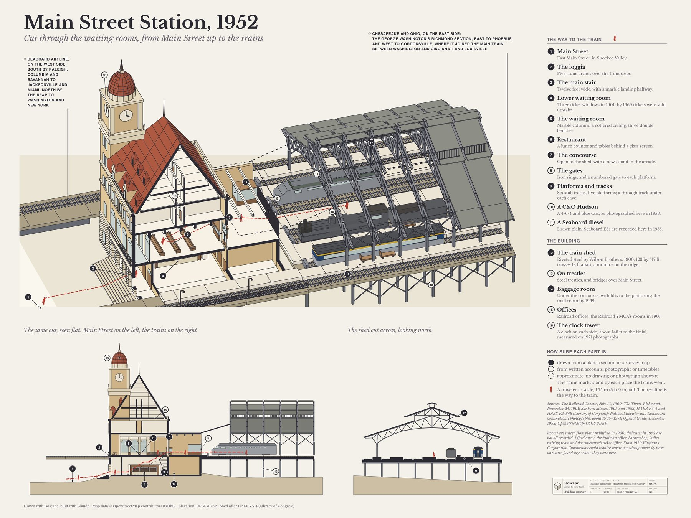

# Main Street Station, about 1952: the cutaway

*Building cutaway · Plate MSS·01*

Main Street Station opened in November 1901; the Seaboard Air Line's trains used its west side and the Chesapeake and Ohio's its east. This drawing cuts it through its waiting rooms, from Main Street up the main stair to the waiting room and across the concourse to the trains under the shed, as it stood about 1952. The east side is lifted away down to its ground floor, so its rooms read as a plan, and beneath it the same cut is drawn flat, with the traveler's way from the street to the train dashed in red. Beside the flat section, the train shed is cut across, looking north.

## The way to the train

### 1. Main Street

East Main Street, in Shockoe Valley.

*How sure: drawn from a plan, a section or a survey map.*

### 2. The loggia

Five stone arches over the front steps.

*How sure: drawn from a plan, a section or a survey map.*

### 3. The main stair

Twelve feet wide, with a marble landing halfway.

*How sure: drawn from a plan, a section or a survey map.*

### 4. Lower waiting room

Three ticket windows in 1901; by 1969 tickets were sold upstairs.

*How sure: drawn from a plan, a section or a survey map.*

### 5. The waiting room

Marble columns, a coffered ceiling, three double benches.

*How sure: drawn from a plan, a section or a survey map.*

### 6. Restaurant

A lunch counter and tables behind a glass screen.

*How sure: drawn from a plan, a section or a survey map.*

### 7. The concourse

Open to the shed, with a news stand in the arcade.

*How sure: drawn from a plan, a section or a survey map.*

### 8. The gates

Iron rings, and a numbered gate to each platform.

*How sure: from written accounts, photographs or timetables.*

### 9. Platforms and tracks

Six stub tracks, five platforms; a through track under each eave.

*How sure: drawn from a plan, a section or a survey map.*

### 10. A C&O Hudson

A 4-6-4 and blue cars, as photographed here in 1953.

*How sure: from written accounts, photographs or timetables.*

### 11. A Seaboard diesel

Drawn plain. Seaboard E8s are recorded here in 1955.

*How sure: approximate; no drawing or photograph shows it.*

## The building

### 12. The train shed

Riveted steel by Wilson Brothers, 1900, 123 by 517 ft: trusses 18 ft apart, a monitor on the ridge.

*How sure: drawn from a plan, a section or a survey map.*

### 13. On trestles

Steel trestles, and bridges over Main Street.

*How sure: from written accounts, photographs or timetables.*

### 14. Baggage room

Under the concourse, with lifts to the platforms; the mail room by 1969.

*How sure: drawn from a plan, a section or a survey map.*

### 15. Offices

Railroad offices; the Railroad YMCA’s rooms in 1901.

*How sure: from written accounts, photographs or timetables.*

### 16. The clock tower

A clock on each side; about 148 ft to the finial, measured on 1971 photographs.

*How sure: from written accounts, photographs or timetables.*

## How sure each part is

Every part of the drawing says how it is known, and each numbered badge shows it:

- **Solid:** drawn from a plan, a section or a survey map.
- **Ring:** from written accounts, photographs or timetables.
- **Dashed ring:** approximate; no drawing or photograph shows it.

The same marks stand by each place the trains went.

The small red figures are travelers drawn to scale, 1.75 m (5 ft 9 in) tall; their height is a convention, not a claim from a source. The red line is the way from the street to the train.

## Where the trains went

- Chesapeake and Ohio, on the east side: the George Washington's Richmond section, east to Phoebus, and west to Gordonsville, where it joined the main train between Washington and Cincinnati and Louisville. *(From written accounts, photographs or timetables. Sources: Wikipedia, George Washington (train): a section divided from the main train at Gordonsville and operated through Richmond to Phoebus; The Railroad Gazette, July 13, 1900, site plan; Sanborn atlas, 1952 (which side each railroad used).)*
- Seaboard Air Line, on the west side: south by Raleigh, Columbia and Savannah to Jacksonville and Miami; north by the RF&P to Washington and New York. *(From written accounts, photographs or timetables. Sources: Official Guide, December 1952: the Orange Blossom Special, as transcribed by streamlinerschedules.com; The Railroad Gazette, July 13, 1900, site plan; Sanborn atlas, 1952; SEABOARD lettered on the west trestle in Detroit Publishing photographs.)*

## Sources

The Railroad Gazette, July 13, 1900; The Times, Richmond, November 24, 1901; Sanborn atlases, 1905 and 1952; HAER VA-4 and HABS VA-848 (Library of Congress); National Register and Landmark nominations; photographs, about 1905–1971; Official Guide, December 1952; OpenStreetMap; USGS 3DEP.

Rooms are traced from plans published in 1900; their uses in 1952 are not all recorded. Lifted away: the Pullman office, barber shop, ladies’ retiring room and the concourse’s ticket office. From 1920 Virginia’s Corporation Commission could require separate waiting rooms by race; no source found says where they were here.

## How it was drawn

The station is a model made of parts. The rooms of the two public floors are traced from the Entrance Floor and Main Floor plans printed in The Railroad Gazette of July 13, 1900, fitted to OpenStreetMap's outline of the head house, and the floor levels come from its section. The roof's ridge and the clock tower's stages are measured on Historic American Buildings Survey photographs of 1971 (VA-848-10 to -12) against the 102-foot front. The train shed is traced node by node from the cross section in HAER VA-4 (sheet 3). The model is cut along one vertical plane through the two waiting rooms. Every face the cut opens is drawn solid in ink; on the side lifted away, everything up to 1.5 m above the ground floor stays, so the ground floor reads as a plan. The flat section below is the same plane seen square and level, with the building drawn 35 m deep behind it, and beside it the shed is cut across 1.2 m south of a truss. Chris Busse drew it with isoscape, the open-source tool he built with Claude.

More in [How it's made](how-its-made.md#cutaways).

---

*This page was drafted with Claude, Anthropic's AI (Claude Opus 5.5), from the sheet and its sources. More on how we work in the [artist statement](artist-statement.md).*
