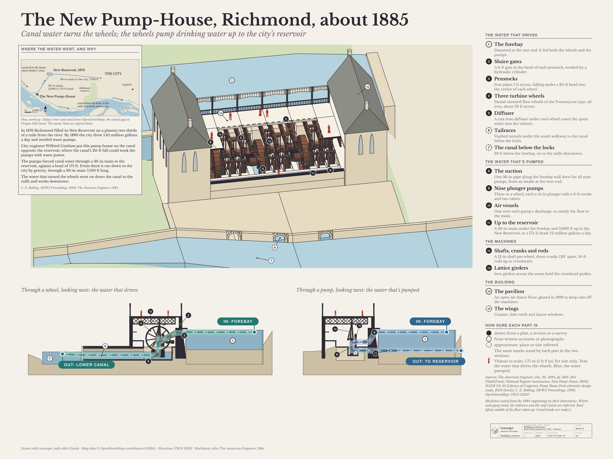

# The New Pump-House, Richmond, about 1885: the cutaway

*Building cutaway · Plate BPPH·01*

This drawing cuts Richmond's New Pump-House open to its machine room as it worked about 1885. Canal water from the forebay fell through three turbine wheels, and each wheel drove three plunger pumps that forced drinking water up to the New Reservoir. The roof is lifted and the middle of the pavilion floor is taken up, so the wheels, shafts and pumps show from above. Beneath it, two flat cuts across the building, looking west, follow the water: through a wheel, in teal, the water that drives the wheels; through a pump, in blue, the water pumped. A small map at the top left shows where the water went.

## Where the water went, and why

In 1876 Richmond filled its New Reservoir on a plateau two-thirds of a mile from the river. By 1880 the city drew 5.85 million gallons a day and needed more pumps.

City engineer Wilfred Cutshaw put this pump house on the canal opposite the reservoir, where the canal’s 20-ft fall could work the pumps with water power.

The pumps forced canal water through a 30-in main to the reservoir, against a head of 175 ft. From there it ran down to the city by gravity, through a 30-in main 7,100 ft long.

The water that turned the wheels went on down the canal to the mills and works downtown.

*Sources: C. E. Bolling, AWWA Proceedings, 1900; The American Engineer, 1884.*

## The water that drives

### 1. The forebay

Dammed at the east end. It fed both the wheels and the pumps.

*How sure: from written accounts or photographs.*

### 2. Sluice gates

A 6-ft gate at the head of each penstock, worked by a hydraulic cylinder.

*How sure: drawn from a plan, a section or a survey.*

### 3. Penstocks

Iron pipes 5 ft across, falling under a 20-ft head into the center of each wheel.

*How sure: drawn from a plan, a section or a survey.*

### 4. Three turbine wheels

Partial outward-flow wheels of the Fourneyron type, all iron, about 23 ft across.

*How sure: drawn from a plan, a section or a survey.*

### 5. Diffuser

A cast-iron diffuser under each wheel eased the spent water into the tailrace.

*How sure: drawn from a plan, a section or a survey.*

### 6. Tailraces

Vaulted tunnels under the south walkway to the canal below the locks.

*How sure: approximate; place or size inferred.*

### 7. The canal below the locks

20 ft below the forebay, on to the mills downtown.

*How sure: approximate; place or size inferred.*

## The water that’s pumped

### 8. The suction

One 36-in pipe along the forebay wall drew for all nine pumps, from an intake at the west end.

*How sure: drawn from a plan, a section or a survey.*

### 9. Nine plunger pumps

Three to a wheel, each a 14-in plunger with a 6-ft stroke and two valves.

*How sure: drawn from a plan, a section or a survey.*

### 10. Air vessels

One over each pump’s discharge, to steady the flow in the main.

*How sure: drawn from a plan, a section or a survey.*

### 11. Up to the reservoir

A 30-in main under the forebay and 3,600 ft up to the New Reservoir, at a 175-ft head: 12 million gallons a day.

*How sure: drawn from a plan, a section or a survey.*

## The machines

### 12. Shafts, cranks and rods

A 12-in shaft per wheel, three cranks 120° apart, 16-ft rods up to crossheads.

*How sure: drawn from a plan, a section or a survey.*

### 13. Lattice girders

Iron girders across the room held the crosshead guides.

*How sure: drawn from a plan, a section or a survey.*

## The building

### 14. The pavilion

An open-air dance floor; glazed in 1899 to keep rain off the machines.

*How sure: from written accounts or photographs.*

### 15. The wings

Granite, slate roofs and lancet windows.

*How sure: approximate; place or size inferred.*

## How sure each part is

Every part of the drawing says how it is known, and each numbered badge shows it:

- **Solid:** drawn from a plan, a section or a survey.
- **Ring:** from written accounts or photographs.
- **Dashed ring:** approximate; place or size inferred.

The same marks stand by each part in the two sections.

The small red figures are visitors on the pavilion floor, drawn to scale at 1.75 m (5 ft 9 in) tall; their height is a convention for size only. Teal marks the water that drives the wheels, and blue the water pumped.

## Sources

The American Engineer, Dec. 26, 1884, pp. 260–261 (HathiTrust); National Register nomination, New Pump-House, 2002; HAER VA-34 (Library of Congress); Pump House Park schematic design study, 2019 (levels); C. E. Bolling, AWWA Proceedings, 1900; OpenStreetMap; USGS 3DEP.

Machines scaled from the 1884 engravings by their dimensions. Where each gang stood, the tailraces and the roof’s pitch are inferred. Roof lifted, middle of the floor taken up. Canal banks are today’s.

## How it was drawn

The pump house is a model made of parts. Its outline is OpenStreetMap's, and its floor levels come from the 2019 schematic design study for Pump House Park. The roof's eaves and ridges are estimated from the Historic American Engineering Record's photographs (HAER VA-34), so the roof's pitch is inferred. The machines are scaled by their stated dimensions from the engravings and text in The American Engineer of December 26, 1884: the 5-ft penstocks, the wheels, the 12-in shafts with three cranks 120° apart, the 16-ft rods, the nine pumps and their air vessels. Where each gang stood along the room is inferred, the gangs set evenly along the central block, and so are the tailraces, one vaulted tunnel to each wheel. The banks and beds of the forebay and of the canal below the locks are today's lidar (USGS 3DEP), with the water set at levels inferred for 1885. The model is cut along one vertical plane down the length of the machine room: the south side is taken away down to 1.5 m above the machine-room floor, the roof is lifted and the middle of the pavilion floor taken up. The two flat sections are vertical cuts across the building, through the middle wheel and through one of its pumps, drawn square and level, with the water's ways drawn as bands of water. The small map is drawn from a cached OpenStreetMap extract, with the mains' lines approximate. Chris Busse drew it with isoscape, the open-source tool he built with Claude.

More in [How it's made](how-its-made.md#cutaways).

---

*This page was drafted with Claude, Anthropic's AI (Claude Opus 5.5), from the sheet and its sources. More on how we work in the [artist statement](artist-statement.md).*
