# Redlining in Richmond: the 1937 federal mortgage map, drawn on the ground it graded

> **Working draft (d1), for review.** This page is not listed on the site and asks search
> engines not to index it. Nobody outside has reviewed it, and none of the people or
> institutions whose work it rests on has been asked about it, so their names here imply no
> endorsement. The numbers, pictures and wording may change. Drafted with Claude for Chris
> Busse, November 22, 2026.

In 1937 a federal agency, the Home Owners' Loan Corporation, graded every residential area of
Richmond from A, "Best", to D, "Hazardous", and colored them green, blue, yellow and red on a
city map. Chris Busse has drawn that map with isoscape on the ground it graded: the grades tinted
on the city's terrain, the buildings that stood in 1937 at their true size, and the same ground
today with the highways and housing projects built across it since. The page starts with what
the map was, walks through one A area and one D area form by form, then shows the whole city,
the twelve D areas one by one, and what was built on them up to 1977.

Whether the map itself caused what came after is argued among historians and economists. This
page sets out the question and each side's evidence in
[Did the 1937 map cause what followed?](#did-the-1937-map-cause-what-followed-three-readings)
and does not choose between them. The pictures show buildings and ground. They cannot say what
these places meant to the people who lived in them; that knowledge belongs to the neighborhoods
and the institutions listed under [Whose work this rests on](#whose-work-this-rests-on).

## What the 1937 map was: a short guide for readers new to it

### The Home Owners' Loan Corporation and why Congress made it

In the Great Depression many families could not keep up their mortgage payments and were losing
their homes. Congress created the Home Owners' Loan Corporation (the HOLC) in the Home Owners'
Loan Act, signed on June 13, 1933, to refinance the mortgages of home owners in distress
[[Harriss 1951](#sources); [Rose 2022](#sources)]. Between August 1933 and June 1936 it made over
one million refinancing loans, 1,017,821 in its own count, for $3.1 billion, and then made no new
ones [[Harriss 1951](#sources)]. By an estimate from the Federal Reserve Bank of Chicago, it had already made 90% of its loans before
its mapping project began in 1935 [[Rose 2022](#sources)].

### The city survey and its four grades

From late 1935 to 1940 the HOLC surveyed the residential areas of 239 American cities and drew
a color-coded map of each, its "residential security maps" [[FRED 2021](#sources);
[NARA RG 195](#sources)]. Each area got one of four grades. The names are the HOLC's own:

| Grade | The HOLC's name | Color on the map | What the grade was meant to say |
|---|---|---|---|
| A | "Best" | green | values expected to rise or hold high |
| B | "Still Desirable" | blue | values expected to hold |
| C | "Definitely Declining" | yellow | values expected to fall |
| D | "Hazardous" | red | old housing, or near nuisances such as industry |

The last column follows the St. Louis Fed's summary [[FRED 2021](#sources)]. Richmond's map,
"City of Richmond, Virginia and Environs", is dated April 3, 1937, and is held by the National
Archives in the records of the Federal Home Loan Bank Board, Record Group 195
[[FRASER, Richmond](#sources); [NARA RG 195](#sources)]. It grades 7 areas A, 15 B,
14 C and 12 D [[numbers](#how-we-know)], the same count the University of Richmond's
Digital Scholarship Lab gives in *Mapping Inequality*, the project that digitized and published
these maps for the whole country [[Mapping Inequality](#sources)].

### The area descriptions: one printed form for each area

For every area the surveyors filled in a printed form, an "area description". Its fields ask for
the terrain, what made the area more or less desirable, the residents' occupations and family
incomes, the share of foreign-born and of Black residents, house types, ages and repair, prices
and rents, how many homes were lived in by their owners, and how much mortgage money lenders
would advance [[HOLC area descriptions](#sources)]. Richmond's 48 forms are transcribed by the
Digital Scholarship Lab. Economists who have studied the maps describe the forms as recording
how local real estate professionals judged lending risk [[Fishback et al. 2023](#sources)].

The forms record race throughout, and Richmond's use it to judge places and houses. The form for
C7, on the north side, faults its area for lying too near D2. The form for D11.5, Blackwell,
rated the condition of its houses by the race of the people who would live in them. Its repair
field reads, in the form's own words: "Bad for whites; Fair for darkies"
[[FRASER, Richmond area descriptions](#sources), p. 47, field 6d]. It is quoted here once, so the reader can see the
standard the forms applied; elsewhere this page paraphrases.

### Where the word "redlining" comes from

The St. Louis Fed writes that the word comes from the red the maps used for the lowest grade,
and that it also names discriminatory practices in lending [[FRED 2021](#sources)]. In Chicago
from about 1969, John McKnight and colleagues at Northwestern University investigated the
practice of banks systematically denying mortgages by neighborhood, work that helped lay the
ground for the Home Mortgage Disclosure Act and the Community Reinvestment Act
[[Northwestern IPR 2024](#sources)]. In this page "redlining" names the word's history.
What the HOLC map did is the subject of [the dispute below](#did-the-1937-map-cause-what-followed-three-readings).

## Richmond's own racial lines before the map, 1871 to 1929

Richmond drew its lines long before 1937. In 1871 the city's wards were redrawn to pack as many
Black voters as possible into one ward, Jackson Ward [[LVA timeline](#sources)]. From 1888
electric streetcars opened suburbs that covenants kept white [[LVA timeline](#sources)]. In April
1911 City Council adopted a residential segregation ordinance, which Encyclopedia Virginia
describes as requiring "strict domiciliary segregation", and in 1912 the General Assembly let
every Virginia city do the same [[LVA timeline](#sources); [Gray-Sparks](#sources)]. The Supreme
Court struck such ordinances down in *Buchanan v. Warley* in 1917. Richmond then passed a new one
tied to the state's Racial Integrity Act: Encyclopedia Virginia dates it 1924 and the Library of
Virginia 1929, and both say a federal appeals court struck it down, in 1929 by Encyclopedia
Virginia's account [[Gray-Sparks](#sources); [LVA timeline](#sources)]. Racial covenants stayed
enforceable until *Shelley v. Kraemer* in 1948 [[LVA timeline](#sources)].

## One A area and one D area, form by form: Windsor Farms (A5) and Jackson Ward (D1)

Before the whole city, here are two areas the HOLC graded at opposite ends: A5, Windsor Farms,
in the West End above the James, and D1, Jackson Ward with Apostle Town and Navy Hill, north of
downtown.

### A5, Windsor Farms: what the form recorded, and the ground

T. C. Williams, a tobacconist, founded Windsor Farms in 1926 on a 444-acre tract above the river,
laid out by the planner John Nolen as an English village around a green
[[TCLF, Windsor Farms](#sources)]. Eleven years later the HOLC form for A5 recorded rolling
ground, hilly toward the river; residents it described in its highest terms; family incomes of $7,500 and
up; every home lived in by its owner; brick houses on 100-foot lots up to estates of 10 and 15
acres, two to eight years old, in excellent repair; and mortgage money for buying a home as
good. Under
favorable influences it wrote: "Most desirable area in or about Richmond"
[[HOLC area description A5](#sources)].

::: compare wide
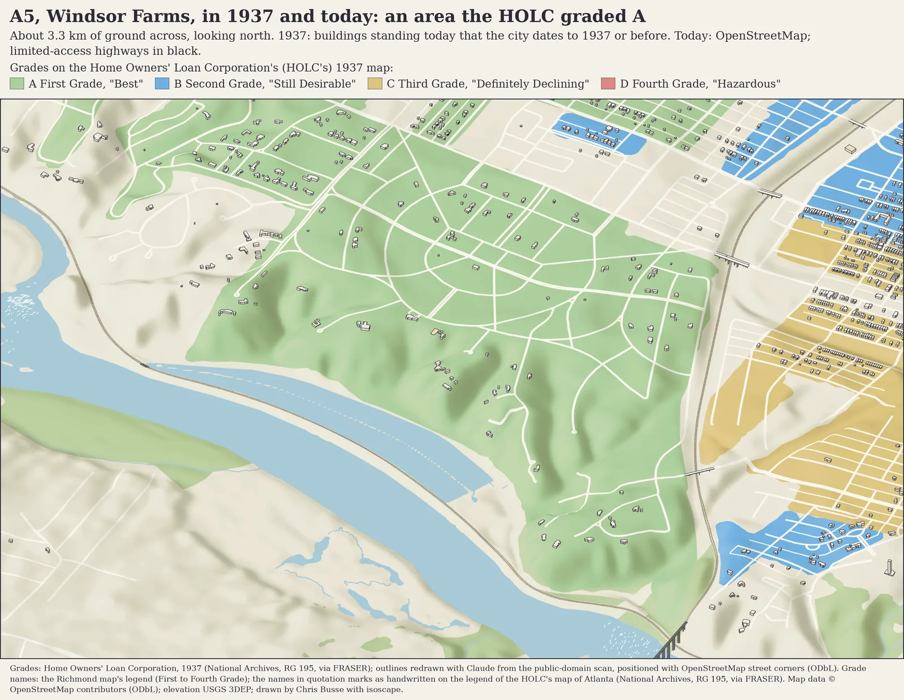 1937
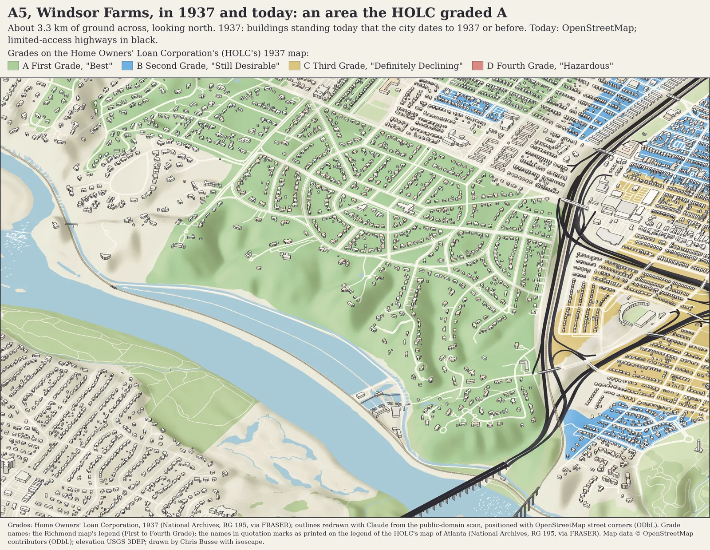 today

A5, Windsor Farms, graded A by the Home Owners' Loan Corporation (HOLC) in 1937, as it stood then
(left of the divider) and today (right); drag the divider, or move it with the arrow keys. In
1937 the curving streets were laid out and the houses still few: of today's 561 parcels
the city dates here, 15% were built by 1937 and 78% between 1938 and 1977
[[City of Richmond parcels](#sources)]. *How this was made:* the grade outlines redrawn with Claude from the National Archives scan of the 1937 map and positioned with OpenStreetMap street corners (see How we know); for 1937, buildings standing today that the city
dates to 1937 or before; today, OpenStreetMap's buildings and streets; the ground from 2010s
lidar, three times exaggerated. Working draft.
:::

### D1, Jackson Ward, Apostle Town and Navy Hill: what the form recorded, and the ground

D1 is drawn in several pieces north of downtown, from Jackson Ward through Apostle Town to Navy
Hill. Its form recorded rolling ground; a population 95% Black;
family incomes of $350 to $750 a year; one home in five lived in by its owner; single houses, 40%
brick and 60% frame, forty years old and more, in poor to very poor repair; and mortgage money
at 60% of appraisal. It wrote that the population was falling "because of demolition to save
taxes" [[HOLC area description D1](#sources)].

::: compare wide
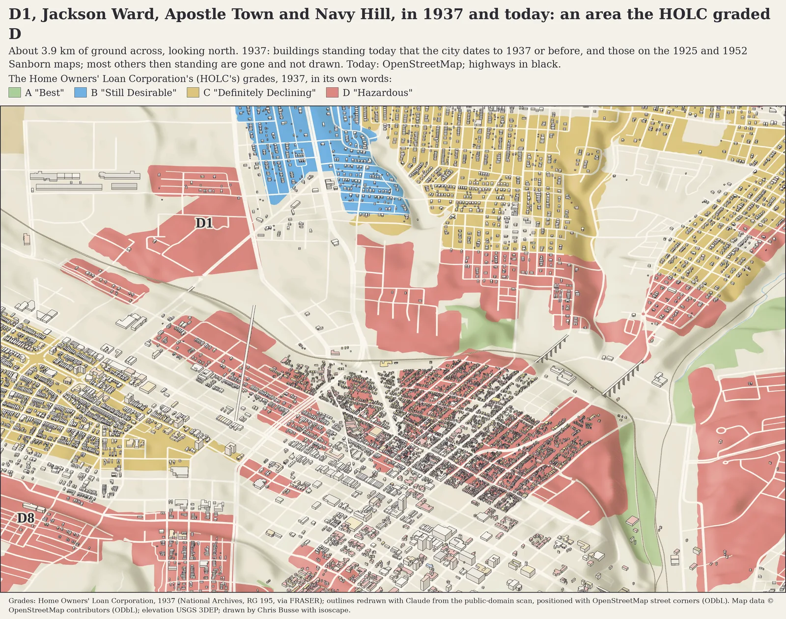 1937
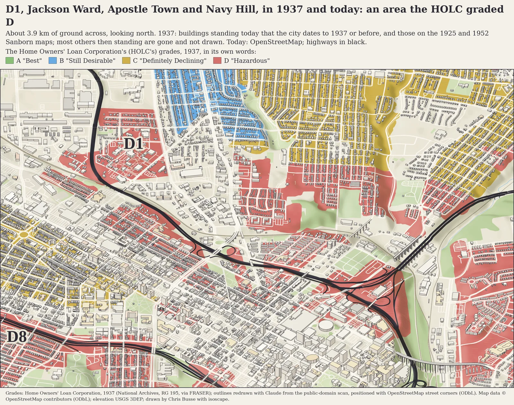 today

D1, Jackson Ward, Apostle Town and Navy Hill, graded D by the HOLC in 1937, as it stood then
(left) and today (right). The Turnpike, now I-95 and I-64, runs 5.9 km of carriageway
through D1 [[measured here](#how-we-know)]. In 1937 the blocks the Sanborn fire-insurance maps
cover are dense; elsewhere only buildings that still stand are drawn, so D1 looks emptier than it
was (see [How we know](#how-we-know)). *How this was made:* as the A5 figure, with Jackson Ward's
buildings from the 1925 and 1952 Sanborn maps and its ground before the Turnpike's trench, as the
[Jackson Ward story](jackson-ward.md) drew them. Working draft.
:::

After 1937 the Richmond housing authority cleared Apostle Town and dedicated Gilpin Court there
on April 28, 1943; a newspaper report of the day counted 301 units, Encyclopedia Virginia 300,
and Encyclopedia Virginia says 250 Black families were displaced [[Craig 2025](#sources);
[Gray-Sparks](#sources)]. From 1955 the Richmond–Petersburg Turnpike was cut through the ward
[[Jackson Ward story](jackson-ward.md)];
by 1957 the *Richmond Times-Dispatch* estimated that about 1,900 Black families, about 10% of the
city's Black population, had been displaced by it and related work [[Gray-Sparks](#sources)].
VCU's medical campus now covers most of Navy Hill [[Gray-Sparks](#sources)]. The
[Jackson Ward story](jackson-ward.md) follows the Turnpike block by block.

::: figure wide
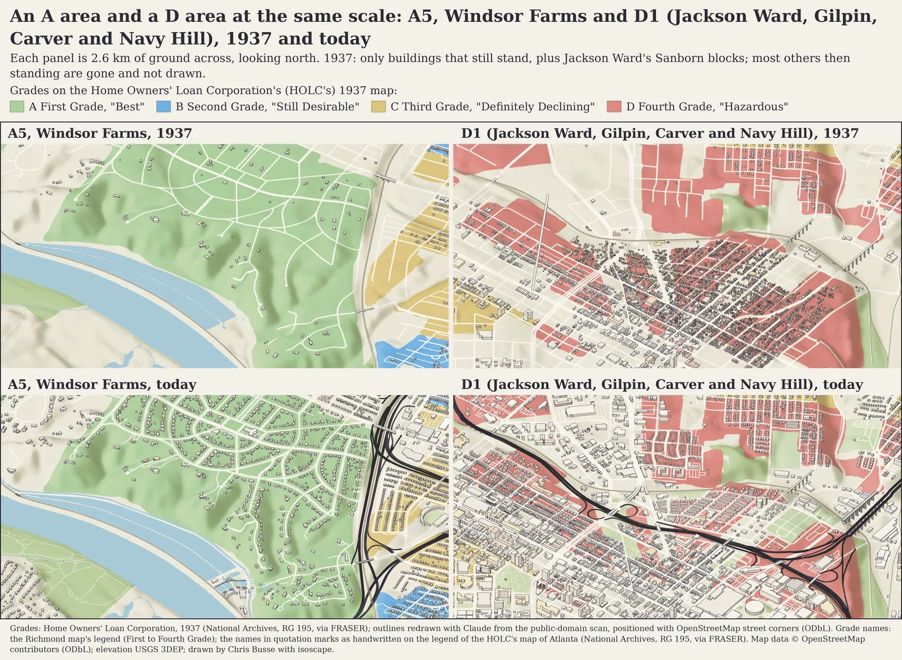

The same two areas side by side at one scale, 2.6 km of ground across each panel: A5 on the
left, D1 on the right, 1937 above and today below. The difference in lot size reads at a glance:
the form's 100-foot lots and estates in A5, and D1's single houses on narrow lots. *How this was
made:* as the two figures above. Working draft.
:::

## The whole city in 1937: the four grades on Richmond's terrain

::: figure wide

Richmond in 1937, seen from the south, with the grades the Home Owners' Loan Corporation gave
each residential area tinted on the ground; the twelve D areas are labeled. Untinted land was not
graded: downtown, industry, rail yards, parks and land outside the surveyed city. *How this was
made:* the grade outlines redrawn with Claude from the National Archives scan of the 1937 map and positioned with OpenStreetMap street corners (see How we know); buildings
standing today that the city dates to 1937 or before, and in Jackson Ward those on the 1925 and
1952 Sanborn maps; the ground from 2010s lidar, three times exaggerated. Most buildings of 1937
that are gone are missing, so the picture undercounts the densest and most cleared areas most
(see [How we know](#how-we-know)). Working draft.
:::

Measured on the lidar, the D land lies lowest. Half of it is below 47 m above sea level,
against 57 m for C, 61 m for A and 62 m for B, and a tenth of it is below
27 m. It is no steeper than B or C land:
about 6% of D, 6% of C and 5% of B is steeper than 10 degrees. The
steepest graded land is A: 16% of it is steeper than 10 degrees [[measured here](#how-we-know)]. One D area, D9,
was vacant land the form expected to become a D area once built
[[HOLC area description D9](#sources)].

::: figure
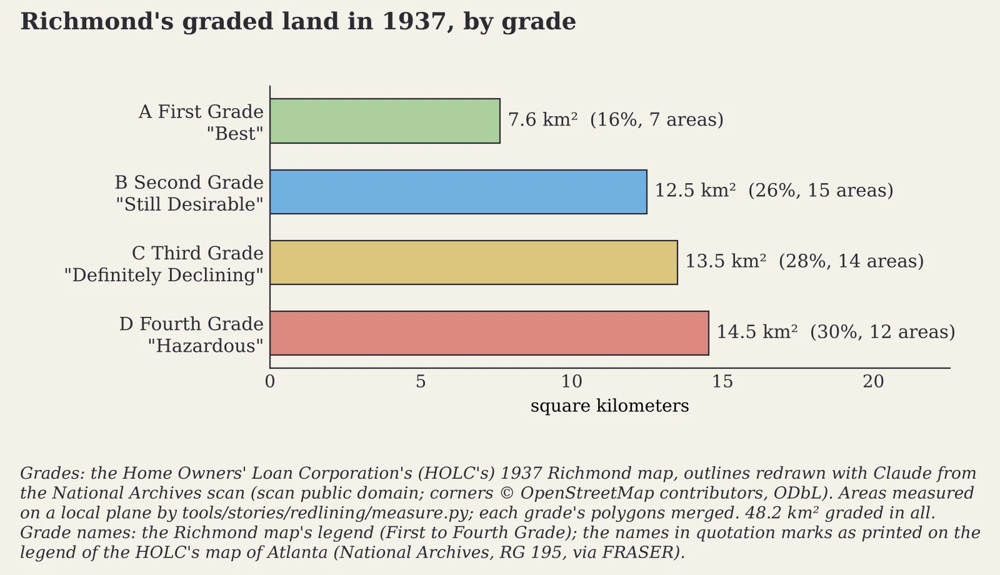

Richmond's graded land in 1937 by grade, measured from the redrawn outlines. D was 30% of
the graded land, the largest of the four grades by area. *How this was made:* each grade's
outlines merged and measured on a local plane by `measure.py`; see [How we know](#how-we-know).
:::

## What was built and cleared on graded land, 1941 to 1977

::: compare wide
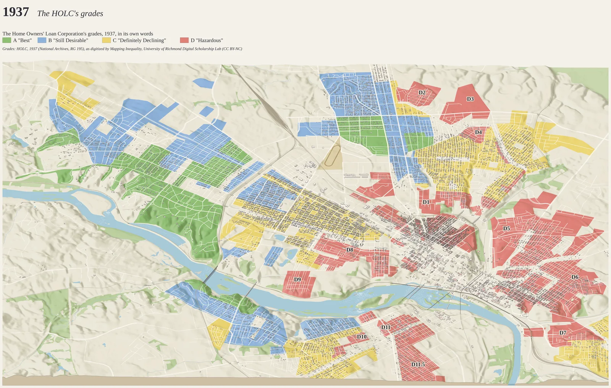 1937
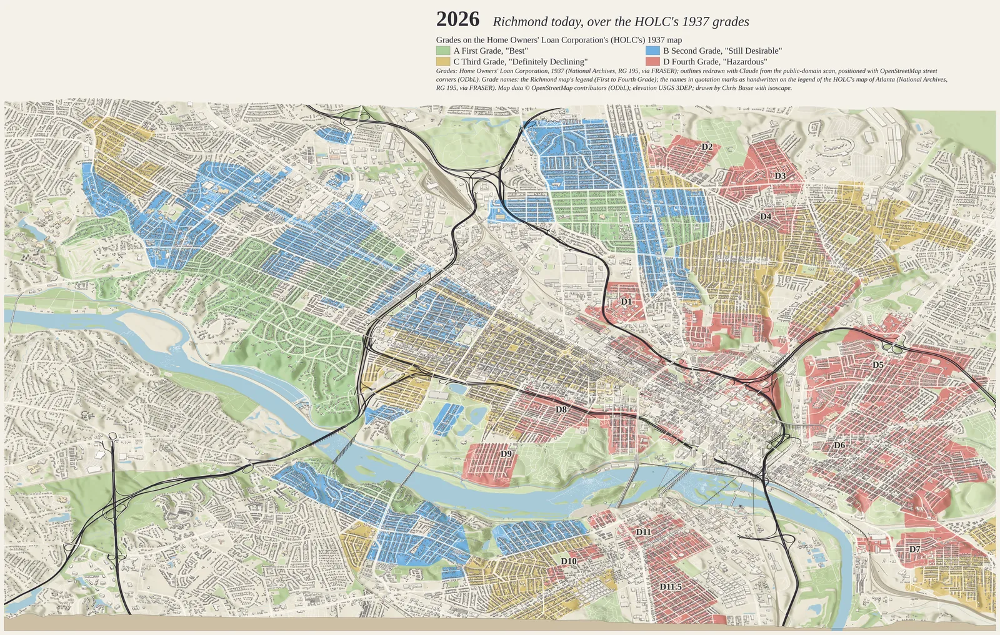 today

The whole frame in 1937 (left of the divider) and today (right), with the 1937 grades under
both. Today's limited-access highways are drawn in black. *How this was made:* as the 1937 figure;
today, OpenStreetMap's buildings and streets, with its roads tagged `motorway` and
`motorway_link` in black. Working draft.
:::

In the decades after the map, public housing, highways and urban renewal went to graded land,
and much of it to D land. The Library of Virginia writes that most of the city's federal public
housing was built in neighborhoods the HOLC had graded D [[LVA timeline](#sources)]. Each project
below is placed by its sources; the D area is from this page's drawing.

- **Gilpin Court, D1, 1943**, on cleared Apostle Town [[Craig 2025](#sources);
  [Gray-Sparks](#sources)].
- **The Richmond–Petersburg Turnpike, D1, 1955 to 1958**, now I-95 and I-64; about 1,900 Black
  families displaced by 1957 by the *Times-Dispatch*'s estimate [[Gray-Sparks](#sources)].
- **Fairfield and Whitcomb Courts, 1958**, built partly for families the highway displaced
  [[Gray-Sparks](#sources)]. Neither is placed on the drawing in this draft.
- **Mosby Court, D5, 1962**: the 17th Street renewal cleared 150 acres of Shockoe Valley and
  displaced 1,300 mostly Black residents, many of whom moved to Mosby Court, in what Encyclopedia
  Virginia calls "an isolated, previously redlined neighborhood" [[Gray-Sparks](#sources)]. HUD's
  record gives its address as 1909 Accommodation Street [[HUD via ProPublica](#sources)], and the
  whole of Accommodation Street lies inside D5 [[measured here](#how-we-know)].
- **Fulton, D7, 1967 to the late 1980s**: a 1967 study called Fulton Bottom, about 850 homes on
  200 acres, a slum; the 1970 renewal plan would displace about 785 households, nearly 3,000
  people; the last homes on Denny Street came down in the late 1980s [[Gray-Sparks](#sources)].
- **Blackwell, D11.5, 1970**: the housing authority built 464 scattered-site public housing units
  in the neighborhood [[Eshleman 2018](#sources)].
- **Randolph and the Downtown Expressway, D8, 1973**: HUD approved the 380-acre Randolph project;
  its planning study expected about 1,800 families and individuals to be displaced
  [[Gray-Sparks](#sources)]. The Library of Virginia writes that the expressway cut the Randolph
  and Oregon Hill neighborhoods in half [[LVA timeline](#sources)].

::: figure wide
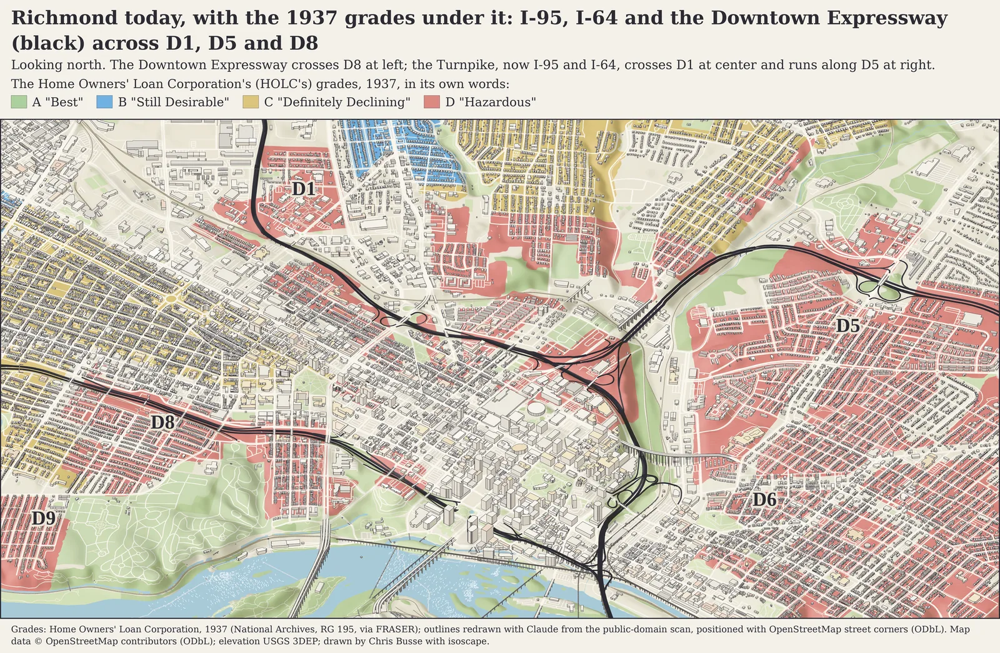

D1, D5 and D8 today, with the interstates and the Downtown Expressway in black over the 1937
grades. *How this was made:* as the "today" figure above, cropped. Working draft.
:::

::: figure
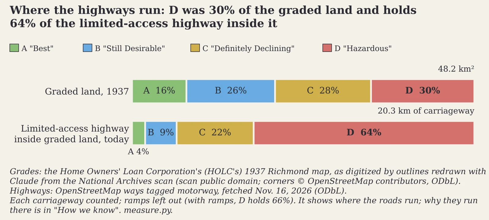

Of the 20.3 km of limited-access carriageway inside the 1937 graded areas, 64% lies in D
areas, which were 30% of the graded land. *How this was made:* OpenStreetMap's roads tagged
`motorway`, each carriageway counted, cut by each grade's outlines; see
[How we know](#how-we-know).
:::

Inside D land the highway runs through three numbered areas, D1 (5.9 km), D8 (3.3 km)
and D5 (3.3 km), and for 0.6 km through D pieces the map leaves unnumbered. Most of the region's limited-access mileage lies outside the 1937 graded areas
altogether: 20.3 of the 113 km in the drawn area [[measured here](#how-we-know)]. The
chart shows where the roads run. The routes were chosen by the Turnpike Authority, the city and
the state, and the [Jackson Ward story](jackson-ward.md#how-the-route-was-chosen) follows how the
Turnpike's was chosen.

::: figure

Richmond's lines from 1871 to 1977: the city's own ordinances, the HOLC's map, and what was built
and cleared on graded land after it. A solid disc marks a date that the sources opened for this
story agree on; a ring marks one where they disagree, with each named. *How this was made:* drawn
in code from the dates in `timeline.ts`, each with its source.
:::

## The twelve D areas, one by one

The HOLC graded twelve Richmond areas D. Each figure below shows one of them today, with the 1937
grades under it, and says what the 1937 form recorded (paraphrased) and what stands on that
ground now. The names are this page's, chosen so a reader today can find each place. The 1937
form has no name field; four of the twelve D forms carry a typed heading with a place name, which
each figure gives, and the rest are named from the streets and landmarks inside the outline. Click any picture to open it large; there the arrow
keys step from one area to the next, and **All figures** shows every figure on the page as a grid.

::: figure
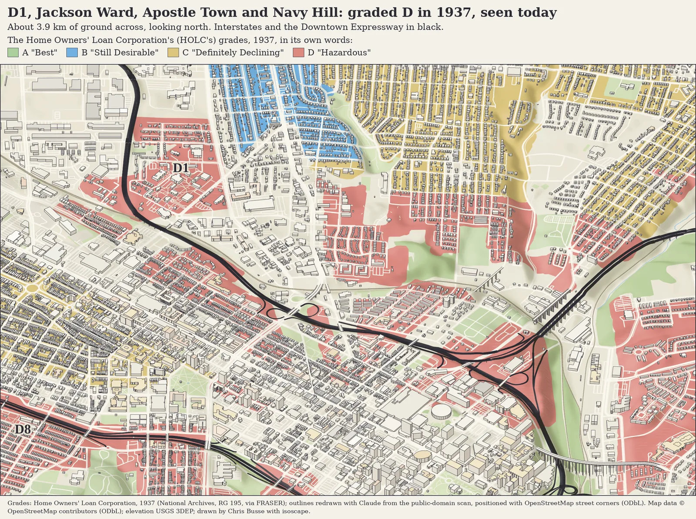

**D1, Jackson Ward, Apostle Town and Navy Hill.** *What the 1937 form recorded:* The form recorded a population 95% Black, family incomes of $350 to $750 a year, one home in five lived in by its owner, and single houses forty years old or more in poor to very poor repair. It wrote that the population was falling "because of demolition to save taxes." [[HOLC area descriptions](#sources)] *What stands there now:* The Richmond–Petersburg Turnpike, now I-95 and I-64, runs 5.9 km of carriageway through it. Gilpin Court was dedicated on cleared Apostle Town land in 1943, and VCU's medical campus now covers most of Navy Hill. The Jackson Ward story follows the Turnpike block by block. [[measured here](#how-we-know); [Craig 2025](#sources); [Gray-Sparks](#sources)] *How this was made:* today's OpenStreetMap buildings and streets on 2010s lidar, with the grade outlines redrawn with Claude from the National Archives scan of the 1937 map and positioned with OpenStreetMap street corners (see How we know) tinted under them. Working draft.
:::

::: figure
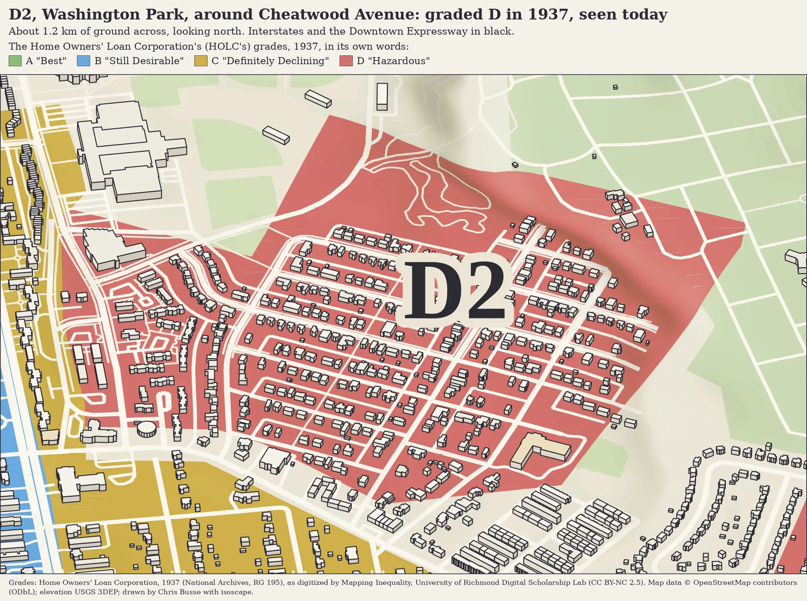

**D2, Washington Park, around Cheatwood Avenue.** *What the 1937 form recorded:* The form recorded a population entirely Black, flat ground, frame single houses, family incomes of $350 to $750, and half the homes lived in by their owners. The form for C7, which borders it, faults C7 for lying too near D2. [[HOLC area descriptions](#sources)] *What stands there now:* Most of what stands is newer than the map: of the 302 parcels the city dates here, 72% were built between 1938 and 1977. First Baptist Church of Washington Park stands inside the outline. [[City of Richmond parcels](#sources); [OpenStreetMap](#sources)] *How this was made:* today's OpenStreetMap buildings and streets on 2010s lidar, with the grade outlines redrawn with Claude from the National Archives scan of the 1937 map and positioned with OpenStreetMap street corners (see How we know) tinted under them. Working draft.
:::

::: figure
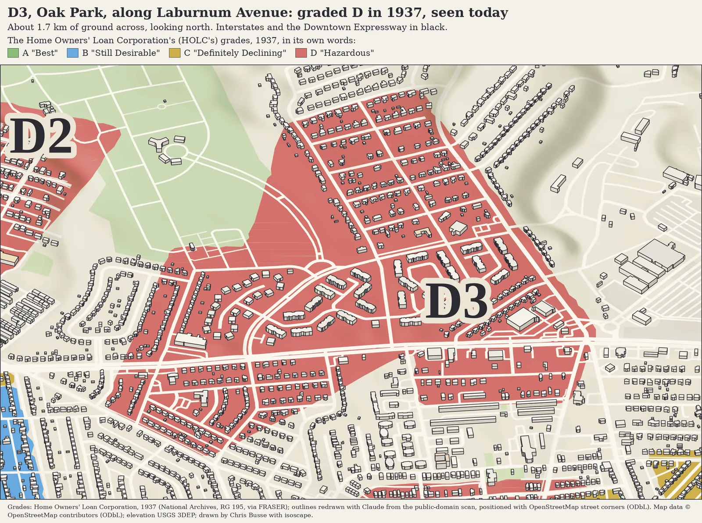

**D3, Oak Park, along Laburnum Avenue.** *What the 1937 form recorded:* The form called the area "mostly woods and bushes," with practically no homes, and recorded the few families there as Black. [[HOLC area descriptions](#sources)] *What stands there now:* The woods are built over: OpenStreetMap maps 700 buildings inside the outline, with shops along Laburnum Avenue. The city's year-built parcels date only 27 of them, so when they were built is not measured here. [[OpenStreetMap](#sources); [City of Richmond parcels](#sources)] *How this was made:* today's OpenStreetMap buildings and streets on 2010s lidar, with the grade outlines redrawn with Claude from the National Archives scan of the 1937 map and positioned with OpenStreetMap street corners (see How we know) tinted under them. Working draft.
:::

::: figure
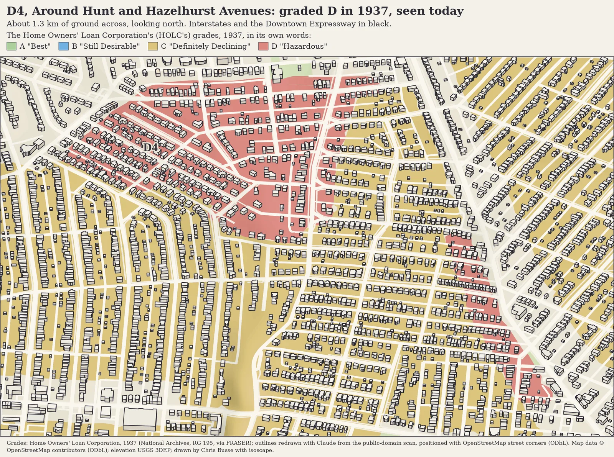

**D4, Around Hunt and Hazelhurst Avenues.** *What the 1937 form recorded:* The form gave D4 the same description as Oak Park, D3, and recorded a population entirely Black, frame single houses, half the homes lived in by their owners, and mortgage money at 60% of appraisal. [[HOLC area descriptions](#sources)] *What stands there now:* Of the 307 parcels the city dates here, 45% were built by 1937 and 48% between 1938 and 1977. Providence Park lies inside the outline. [[City of Richmond parcels](#sources); [OpenStreetMap](#sources)] *How this was made:* today's OpenStreetMap buildings and streets on 2010s lidar, with the grade outlines redrawn with Claude from the National Archives scan of the 1937 map and positioned with OpenStreetMap street corners (see How we know) tinted under them. Working draft.
:::

::: figure
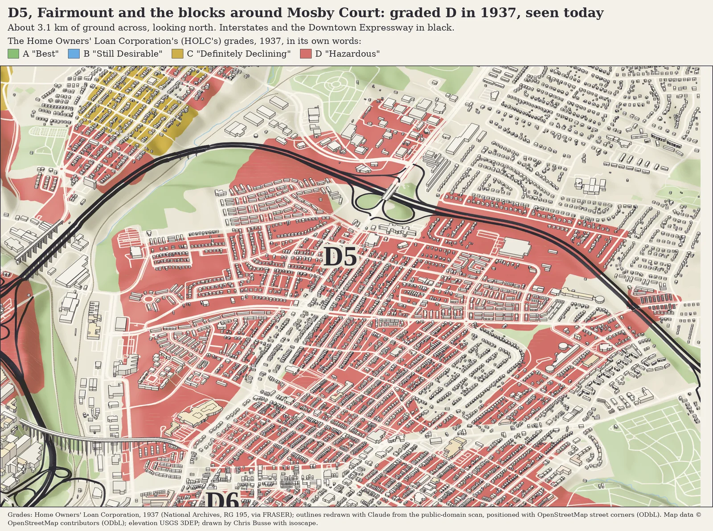

**D5, Fairmount and the blocks around Mosby Court.** *What the 1937 form recorded:* The form recorded a population 75% Black and growing, frame single houses about fifteen years old in fair repair, one home in three lived in by its owner, and mortgage money at 40% of appraisal. [[HOLC area descriptions](#sources)] *What stands there now:* Interstate 64 runs 3.3 km of carriageway through it. Mosby Court, which opened in 1962 for many of the 1,300 people the 17th Street renewal displaced, stands inside it, with the city jail beside it. [[measured here](#how-we-know); [Gray-Sparks](#sources); [HUD via ProPublica](#sources); [OpenStreetMap](#sources)] *How this was made:* today's OpenStreetMap buildings and streets on 2010s lidar, with the grade outlines redrawn with Claude from the National Archives scan of the 1937 map and positioned with OpenStreetMap street corners (see How we know) tinted under them. Working draft.
:::

::: figure
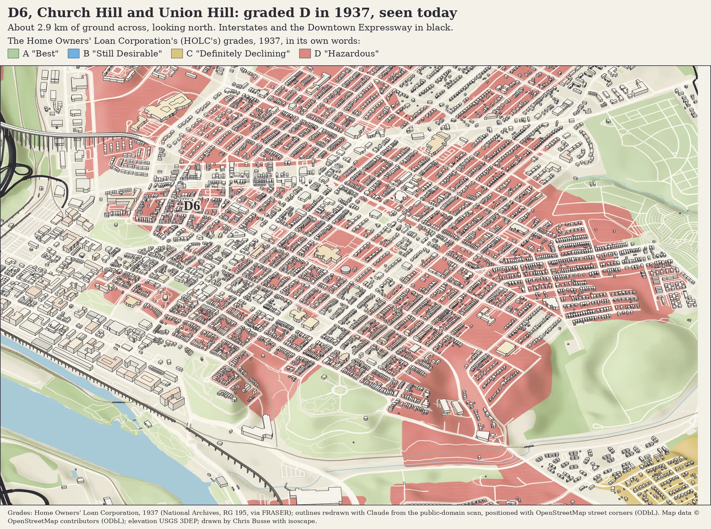

**D6, Church Hill and Union Hill.** *What the 1937 form recorded:* The form is headed Church Hill, bounded by Venable Street, Nine Mile Road, Oakwood Cemetery, the Southern Railway, the river and 17th Street. It recorded a population 80% Black "and increasing," flats and single frame houses about forty years old in fair repair, one home in three lived in by its owner, and mortgage money at 50% of appraisal. [[HOLC area descriptions](#sources)] *What stands there now:* More of 1937 stands here than in any other D area: 68% of the 2,953 parcels the city dates here were built by 1937. Many of the houses are marked in OpenStreetMap as historic. [[City of Richmond parcels](#sources); [OpenStreetMap](#sources)] *How this was made:* today's OpenStreetMap buildings and streets on 2010s lidar, with the grade outlines redrawn with Claude from the National Archives scan of the 1937 map and positioned with OpenStreetMap street corners (see How we know) tinted under them. Working draft.
:::

::: figure
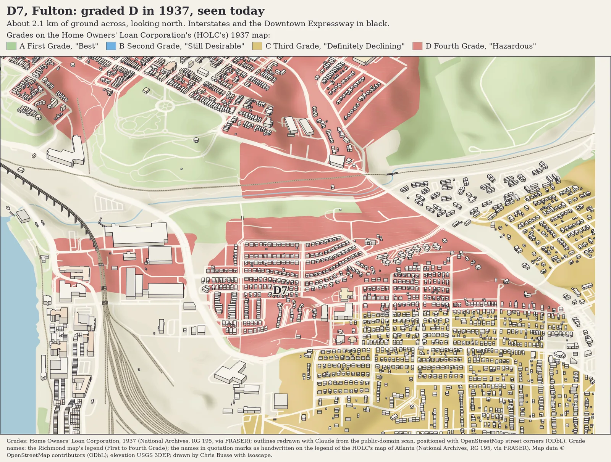

**D7, Fulton.** *What the 1937 form recorded:* The form is headed Fulton, bounded by Nicholson Street, National Cemetery Road and Williamsburg Avenue. It recorded a population 80% Black, single frame houses about fifty years old in bad repair, one home in four lived in by its owner, and no mortgage money at all. [[HOLC area descriptions](#sources)] *What stands there now:* A 1967 study called Fulton Bottom, about 850 homes, a slum; the 1970 renewal plan would displace about 785 households, and the last homes on Denny Street came down in the late 1980s. Only 9% of the parcels the city dates here were built by 1937. Historic Fulton Memorial Park stands on the ground. [[Gray-Sparks](#sources); [City of Richmond parcels](#sources); [OpenStreetMap](#sources)] *How this was made:* today's OpenStreetMap buildings and streets on 2010s lidar, with the grade outlines redrawn with Claude from the National Archives scan of the 1937 map and positioned with OpenStreetMap street corners (see How we know) tinted under them. Working draft.
:::

::: figure
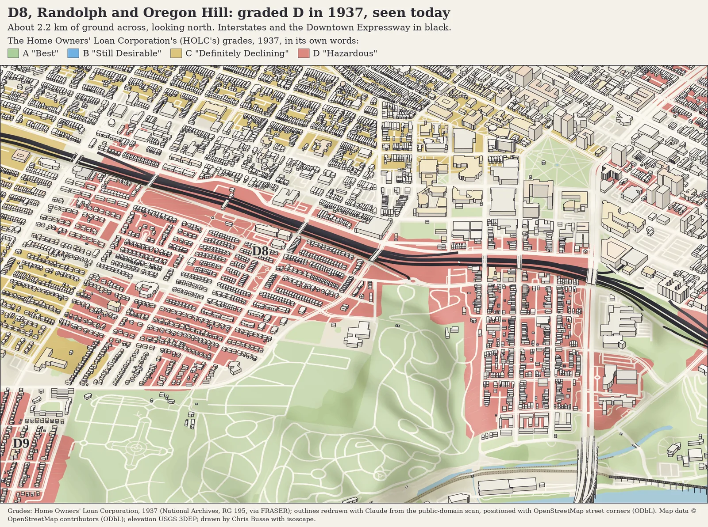

**D8, Randolph and Oregon Hill.** *What the 1937 form recorded:* The form recorded a population 95% Black, brick flats and frame single and double houses about 25 years old in fair repair, and one home in four lived in by its owner. It wrote that Black families pushed out of D1 were moving into D8's oldest houses, displacing white tenants. [[HOLC area descriptions](#sources)] *What stands there now:* HUD approved the 380-acre Randolph project in 1973; its planning study expected about 1,800 families and individuals to be displaced, for the Downtown Expressway. The Library of Virginia writes that the expressway cut Randolph and Oregon Hill in half. It runs 3.3 km of carriageway through D8. [[Gray-Sparks](#sources); [LVA timeline](#sources); [measured here](#how-we-know)] *How this was made:* today's OpenStreetMap buildings and streets on 2010s lidar, with the grade outlines redrawn with Claude from the National Archives scan of the 1937 map and positioned with OpenStreetMap street corners (see How we know) tinted under them. Working draft.
:::

::: figure
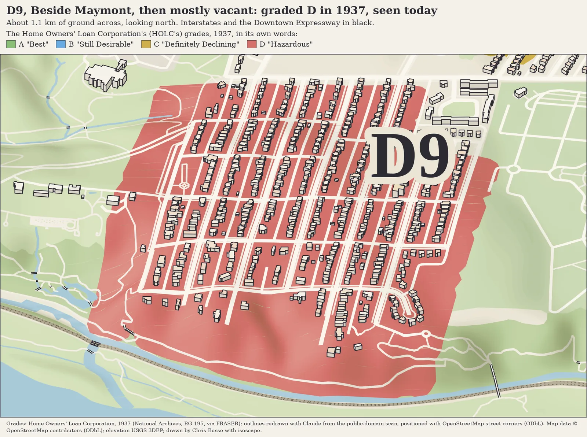

**D9, Riverview, beside Maymont.** *What the 1937 form recorded:* The form is headed Riverview. It recorded vacant land, "practically undeveloped and inaccessible," and expected it to become a D area once built. [[HOLC area descriptions](#sources)] *What stands there now:* It was built after the map: 95% of the 384 parcels the city dates here are from 1938 to 1977. Riverview Community Park lies inside the outline. [[City of Richmond parcels](#sources); [OpenStreetMap](#sources)] *How this was made:* today's OpenStreetMap buildings and streets on 2010s lidar, with the grade outlines redrawn with Claude from the National Archives scan of the 1937 map and positioned with OpenStreetMap street corners (see How we know) tinted under them. Working draft.
:::

::: figure
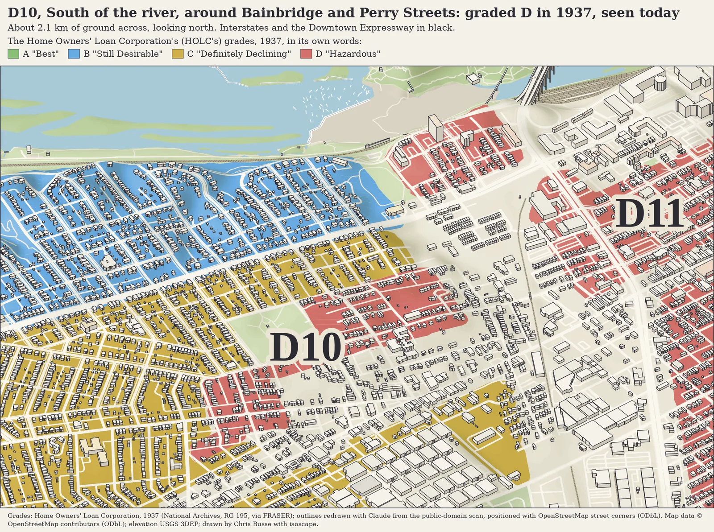

**D10, South of the river, around Bainbridge and Perry Streets.** *What the 1937 form recorded:* The form recorded a population 95% Black, family incomes of $500 to $750, frame single houses about 25 years old in poor repair, and two homes in five lived in by their owners. [[HOLC area descriptions](#sources)] *What stands there now:* Of the 232 parcels the city dates here, 56% were built by 1937. A Boys and Girls Club and the Fonticello Food Forest stand inside the outline. [[City of Richmond parcels](#sources); [OpenStreetMap](#sources)] *How this was made:* today's OpenStreetMap buildings and streets on 2010s lidar, with the grade outlines redrawn with Claude from the National Archives scan of the 1937 map and positioned with OpenStreetMap street corners (see How we know) tinted under them. Working draft.
:::

::: figure
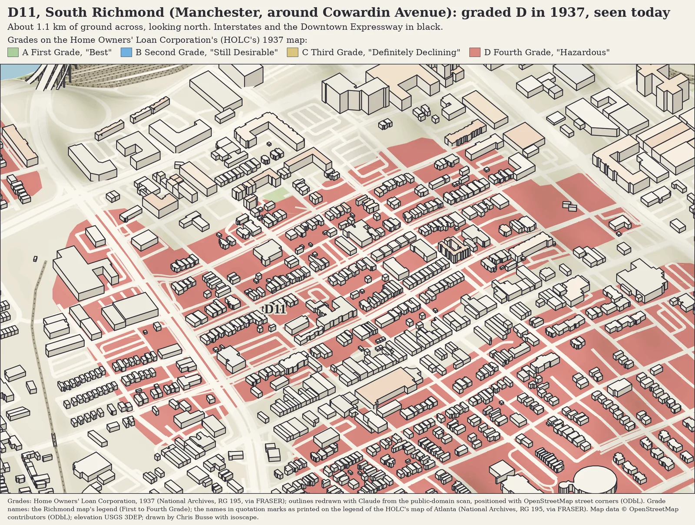

**D11, Manchester, around Cowardin Avenue.** *What the 1937 form recorded:* The only D area recorded as white; the form is headed South Richmond. It gave its people as "Laboring Whites," with family incomes of $1,500 to $1,800, the highest recorded for any D area, frame and brick houses about twenty years old in fair repair, three homes in five lived in by their owners, and mortgage money at 60% of appraisal. [[HOLC area descriptions](#sources)] *What stands there now:* Of the 238 parcels the city dates here, 36% were built in 2000 or later, the largest share of any D area. Sacred Heart Catholic Church and the Hull Street post office stand inside the outline. [[City of Richmond parcels](#sources); [OpenStreetMap](#sources)] *How this was made:* today's OpenStreetMap buildings and streets on 2010s lidar, with the grade outlines redrawn with Claude from the National Archives scan of the 1937 map and positioned with OpenStreetMap street corners (see How we know) tinted under them. Working draft.
:::

::: figure
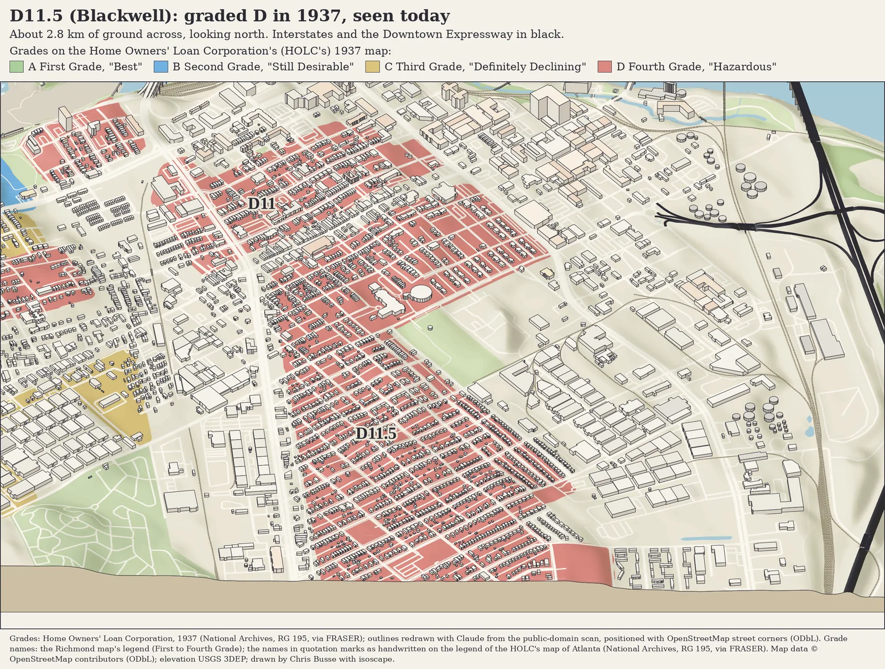

**D11.5, Blackwell.** *What the 1937 form recorded:* The form recorded a population 95% Black, family incomes of $500 to $750, frame single houses about 25 years old, about a third of the homes (35%) lived in by their owners, and mortgage money at 35 to 40% of appraisal. [[HOLC area descriptions](#sources)] *What stands there now:* In 1970 the housing authority built 464 scattered-site public housing units here; the neighborhood took its name from James Heyward Blackwell. Of the 1,194 parcels the city dates, 41% were built between 1938 and 1977. [[Eshleman 2018](#sources); [City of Richmond parcels](#sources)] *How this was made:* today's OpenStreetMap buildings and streets on 2010s lidar, with the grade outlines redrawn with Claude from the National Archives scan of the 1937 map and positioned with OpenStreetMap street corners (see How we know) tinted under them. Working draft.
:::

## Did the 1937 map cause what followed? Three readings

The plain question is this. Did the map cause later harm by steering money away from the areas
it marked red? Or did it record a city already divided, whose later history had other causes?
Researchers have read the same maps in both ways, and in Richmond the city's own laws and plans
are part of the record either way. This page does not choose between the readings. Each is set
out below in its authors' terms.

- **The maps had lasting effects.** Daniel Aaronson, Daniel Hartley and Bhashkar Mazumder compare
  neighborhoods on either side of the maps' grade boundaries, nationally, and find that the maps
  "led to reduced home ownership rates, house values, and rents and increased racial segregation
  in later decades", which they attribute to reduced access to credit and the disinvestment that
  followed [[Aaronson et al. 2021](#sources)].
- **The maps recorded disadvantage that was already there.** Price Fishback, Jessica LaVoice,
  Allison Shertzer and Randall Walsh find that the maps show how real estate professionals
  judged lending risk by race, income and housing quality, and that racial bias in drawing the
  maps explains at most 4 to 20 percent of the concentration of Black households in D zones; they
  attribute most of it to earlier decades of disadvantage and discrimination
  [[Fishback et al. 2023](#sources)].
- **The other federal agency drew its own lines first.** Price Fishback, Jonathan Rose, Kenneth
  Snowden and Thomas Storrs find that the Federal Housing Administration refused to insure
  mortgages in low-income urban neighborhoods from its start, before the HOLC maps, while the
  HOLC lent broadly in those neighborhoods and to Black homeowners; they conclude the HOLC maps
  had little effect on either agency's lending [[Fishback et al. 2022](#sources);
  [Rose 2022](#sources)].
- **Richmond's own instruments.** The local histories record the city's own lines before and
  after the map: the 1871 wards, the 1911 and later ordinances, covenants until 1948, Harland
  Bartholomew's 1946 plan, which called the city's Black neighborhoods slums, the siting of
  public housing, the Turnpike, renewal, and the 1970 annexation
  [[LVA timeline](#sources); [Gray-Sparks](#sources)]. The Library of Virginia's timeline itself
  reads the grades as leading to disinvestment in Black neighborhoods that persists today
  [[LVA timeline](#sources)].

The forms themselves record what lenders were advancing in 1937 in their mortgage-funds field: 60%
of appraisal in D1 and D4, 40% in D5, 35 to 40% in D11.5, none in D7, and good in A5
[[HOLC area descriptions](#sources)]. Whether the HOLC or the FHA lent in Richmond's own D areas
after 1937 has not been measured for this page.

## What the drawing adds to a flat map

Readers who know the 1937 maps have seen them flat, as colored shapes on a street map. Drawn on
the ground, three things show that a flat map leaves out.

- **The ground under the grades.** The grades are draped on 2010s lidar, three times
  exaggerated, and measured on it: the D land lies lowest, and the A land is the steepest.
- **The buildings of 1937 at their true size.** Lot sizes and density read directly, as in the
  Windsor Farms and Jackson Ward figures. Where the Sanborn maps were traced, Jackson Ward is
  drawn building by building as it stood.
- **The highways measured against the grades.** The interstates and the Downtown Expressway are
  drawn over the grades and measured inside them, area by area.

The method and its gaps are set out next.

## How we know

- **The grades.** The outlines were redrawn in code, with Claude, from the National Archives'
  public-domain scan of the 1937 map (Record Group 195, via FRASER): each tint on the scan was
  traced, each area named from its printed label, and the whole placed on today's city by 33
  street corners that stood in 1937, matched to OpenStreetMap, with an affine fit whose error
  is about 12 m in the middle of the map and up to about 24 m at its edges
  [[FRASER, Richmond](#sources); `tools/holc/`]. Compared with Mapping Inequality's
  digitization, the two sets agree closely: grade by grade their land overlaps by 92 to 94%, D
  is 30% of graded land in this set and 30% in theirs, and the highway share in D is the
  same to within a point [[Mapping Inequality](#sources)]. The map numbers 48 areas and leaves a few
  small tinted pieces unnumbered; here they keep their grade and belong to no numbered area, so
  they count in the totals by grade and in no area's own figures (`unnumbered.json`). A5 and A3
  share one green field whose printed dividing line has gaps; the line between them here is the
  redraw's estimate and is approximate. The story is built from one set
  named in a single place (`tools/stories/redlining/outlines.py`) and can be rebuilt from either.
- **The names of the areas** are this page's, chosen to orient a reader today. The 1937 form
  has no name field. Four D forms carry a typed heading with a place name (D6 Church Hill, D7
  Fulton, D9 Riverview, D11 South Richmond), and the D4 form names D3 as Oak Park; the other
  names are placed from the streets, churches and parks inside each outline today
  (OpenStreetMap).
- **The forms' words** were read on the National Archives scan (FRASER, `ad_RichmondVA.pdf`, one
  page per area in grade order). Every quotation on this page was checked there, on November 22,
  2026. The scan corrected two of the Lab's transcribed figures used here: D2's family incomes
  ($350 to $750) and D11.5's share of owner-occupied homes (35%).
- **Buildings of 1937.** A 1937 picture draws the buildings standing today that the city's
  assessor dates to 1937 or before, plus, in Jackson Ward, the buildings on the 1925 and 1952
  Sanborn maps. Buildings since lost elsewhere are missing. This survivorship undercount is
  largest where most was cleared, which is in D. Where the 1952 sheets were traced, only
  13% of their 3,158 outlines stand today.

::: figure
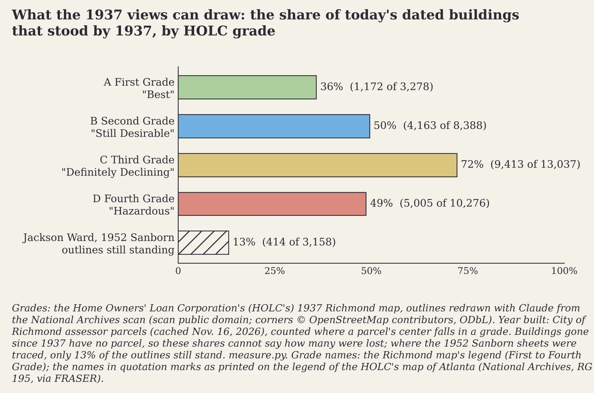

What the 1937 pictures can draw, by grade: the share of today's dated buildings that stood by
1937, beside the traced check in Jackson Ward. *How this was made:* the city's year-built parcels,
each counted in the grade its center falls in, by `measure.py`. The shares say nothing of how
many buildings were lost, which is why the Jackson Ward bar is shown beside them.
:::

- **Elevation and slope by grade** are read from the same 5 m lidar grid at every node inside
  each grade's outlines (`measure.py`); the grid is today's ground, so the highways' cuts are in
  it.
- **Areas and lengths** are measured by `tools/stories/redlining/measure.py` on a local plane.
  Each grade's land is its outlines merged. Highway length is OpenStreetMap's `motorway` ways,
  each carriageway counted, ramps left out; with ramps, D holds 66%.
- **What stands now** in each D area comes from OpenStreetMap as fetched on November 16, 2026,
  and from the city's year-built parcels. In D3 the parcels date only a few of the buildings, so
  their years are not given there.
- **The frame** holds all of A and B, 99% of D and 92% of C; the east ends of C13 and C14
  and the south tip of D11.5 fall outside it.
- **The ground** is 2010s lidar, three times exaggerated. In Jackson Ward the Turnpike's trench is
  filled for 1937 by the estimate the [Jackson Ward story](jackson-ward.md) made.
- **The grade colors** are the HOLC's green, blue, yellow and red, softened; every picture carries
  a key with the four grade names, so the colors never have to be read alone.

## After 1977

*This story ends in 1977. A later addendum, "1977 to today", may follow here; it is not part of
this draft.*

## Glossary

- **HOLC**: the Home Owners' Loan Corporation, a federal agency created in 1933 to refinance home
  mortgages in default.
- **FHA**: the Federal Housing Administration, the federal agency that insured mortgages made by
  private lenders.
- **Residential security map**: the HOLC's color-coded map of a city's residential areas, made
  between 1935 and 1940.
- **Grade**: the HOLC's rating of an area, A "Best", B "Still Desirable", C "Definitely
  Declining" or D "Hazardous".
- **Area description**: the printed form the surveyors filled in for each graded area.
- **Redlining**: from the red of the D grade; the word for lenders' refusing credit by
  neighborhood.
- **Covenant**: a clause in a deed restricting who may buy or live in a house.
- **Urban renewal**: federally funded clearance and rebuilding of areas a city declared
  blighted.
- **Sanborn map**: a fire-insurance map drawn building by building, used here for Jackson Ward.

## Whose work this rests on

The 1937 maps were digitized and published, here in Richmond, by the University of Richmond's
Digital Scholarship Lab for *Mapping Inequality* (Robert K. Nelson, LaDale Winling and others).
This page's outlines were redrawn from the National Archives scan, and the Lab's digitization was
used to check them; its transcriptions of the area descriptions were consulted throughout. The
map and forms are in the National Archives. The
story of Richmond's segregation and urban renewal has been told by LaToya Gray-Sparks in
Encyclopedia Virginia, by the Library of Virginia's *Mapping Inequality* exhibition and Ashley
Craig's history of public housing, and by many others, among them John V. Moeser, Julian Maxwell
Hayter, the Science Museum of Virginia, HOME and VCU, whose work this draft has not drawn on
directly. Nothing here is taken from their visual work. None of these people or institutions was
involved in this draft, and none has reviewed it. Before publication the draft goes to the Lab and
to people in the neighborhoods it shows.

## Sources

Opened while drafting, on the date given.

- **Mapping Inequality**: Nelson, Robert K., LaDale Winling, et al. "Mapping Inequality: Redlining
  in New Deal America." Edited by Robert K. Nelson. *American Panorama: An Atlas of United States
  History*, 2023. https://dsl.richmond.edu/panorama/redlining. Its spatial data (CC BY-NC 2.5,
  https://creativecommons.org/licenses/by-nc/2.5/), downloaded November 21, 2026, was used only to
  check the redrawn outlines and is not drawn on this page.
- **HOLC area descriptions** (A5, C7, D1 to D11.5): the 1937 Richmond forms as transcribed by
  the Digital Scholarship Lab, https://github.com/americanpanorama/HOLC_Area_Description_Data
  (form 19370203), downloaded November 21, 2026. Every quotation and figure used here was
  checked on the scan (see the next entry).
- **FRASER, Richmond area descriptions**: the 1937 Richmond area descriptions, National
  Archives RG 195, via FRASER, https://fraser.stlouisfed.org/files/docs/historical/maps/redline_nara/ad_RichmondVA.pdf;
  every form quoted or paraphrased here read on the scan November 22, 2026 (A5 page 5, C7 page
  29, D1 to D11 pages 37 to 46 and 48, D11.5 page 47).
- **FRASER, Richmond**: "City of Richmond, Virginia and Environs", Home Owners' Loan Corporation,
  April 3, 1937, National Archives RG 195, via FRASER, Federal Reserve Bank of St. Louis,
  https://fraser.stlouisfed.org/archival/6751/item/619201 (opened November 22, 2026); the scan the
  outlines were redrawn from, https://fraser.stlouisfed.org/files/docs/historical/maps/redline_nara/rg195_holc_Richmond_VA.pdf
  (fetched November 22, 2026; public domain).
- **NARA RG 195**: National Archives, Guide to Federal Records, Records of the Federal Home Loan
  Bank Board, RG 195, https://www.archives.gov/research/guide-fed-records/groups/195.html (opened
  November 22, 2026). Public domain.
- **Harriss 1951**: C. Lowell Harriss, *History and Policies of the Home Owners' Loan
  Corporation*, National Bureau of Economic Research, 1951, chapter 2, "Original Lending
  Activities", https://www.nber.org/chapters/c3207.pdf (opened November 22, 2026).
- **Northwestern IPR 2024**: "Remembering John McKnight, Community Development Pioneer
  (1931–2024)", Institute for Policy Research, Northwestern University, November 15, 2024,
  https://www.ipr.northwestern.edu/news/2024/remembering-john-mcknight.html (opened November 22,
  2026).
- **HUD via ProPublica**: HUD's property record for Mosby Ct (VA007000008), as published by
  ProPublica, https://projects.propublica.org/hud/properties/VA007000008 (opened November 22,
  2026), for its address.
- **Rose 2022**: Jonathan Rose, "Revisiting How Two Federal Housing Agencies Propagated Redlining
  in the 1930s", Federal Reserve Bank of Chicago, April 2022,
  https://www.chicagofed.org/research/content-areas/mobility/policy-brief-federal-housing-programs-redlining
  (opened November 22, 2026).
- **FRED 2021**: "Residential segregation and redlining", FRED Blog, Federal Reserve Bank of St.
  Louis, September 9, 2021, https://fred.stlouisfed.org/blog/2021/09/residential-segregation-and-redlining
  (opened November 22, 2026).
- **Aaronson et al. 2021**: Daniel Aaronson, Daniel Hartley and Bhashkar Mazumder, "The Effects
  of the 1930s HOLC 'Redlining' Maps", *American Economic Journal: Economic Policy* 13(4):
  355–392, 2021, https://doi.org/10.1257/pol.20190414; abstract opened at
  https://ideas.repec.org/a/aea/aejpol/v13y2021i4p355-92.html, November 22, 2026.
- **Fishback et al. 2023**: Price V. Fishback, Jessica LaVoice, Allison Shertzer and Randall
  Walsh, "The HOLC Maps: How Race and Poverty Influenced Real Estate Professionals' Evaluation of
  Lending Risk in the 1930s", *Journal of Economic History* 83(4): 1019–1056, 2023,
  https://doi.org/10.1017/S0022050723000475; abstract opened at
  https://www.nber.org/papers/w28146 (NBER Working Paper 28146), November 22, 2026.
- **Fishback et al. 2022**: Price V. Fishback, Jonathan Rose, Kenneth A. Snowden and Thomas
  Storrs, "New Evidence on Redlining by Federal Housing Programs in the 1930s", NBER Working
  Paper 29244, September 2021, https://www.nber.org/papers/w29244, published in the *Journal of
  Urban Economics*, 2022, https://doi.org/10.1016/j.jue.2022.103462; abstract opened on
  November 22, 2026.
- **LVA timeline**: Library of Virginia, "Mapping Inequality timeline",
  https://www.lva.virginia.gov/events/exhibitions/online/oe/exhibits/show/mapping-inequality/mapping-inequality-timeline
  (opened November 22, 2026).
- **Gray-Sparks**: LaToya Gray-Sparks, "Urban Renewal in Richmond", Encyclopedia Virginia,
  September 19, 2024, last updated November 7, 2025,
  https://encyclopediavirginia.org/entries/urban-renewal-in-richmond/ (opened November 22, 2026).
- **Craig 2025**: Ashley Craig, "A Brief History of Public Housing in the City of Richmond",
  *UncommonWealth*, Library of Virginia, November 17, 2025,
  https://uncommonwealth.lva.virginia.gov/blog/2025/11/17/a-brief-history-of-public-housing-in-the-city-of-richmond
  (opened November 22, 2026).
- **Eshleman 2018**: Tina Eshleman, "House of Blackwell", *Richmond Magazine*, August 23, 2018,
  https://richmondmagazine.com/news/features/house-of-blackwell/ (opened November 22, 2026).
- **TCLF, Windsor Farms**: The Cultural Landscape Foundation, "Windsor Farms",
  https://www.tclf.org/landscapes/windsor-farms (opened November 22, 2026).
- **City of Richmond parcels**: the city's Year_of_Construction parcels, cached November 16, 2026;
  year only, no owner fields.
- **OpenStreetMap**: map data © OpenStreetMap contributors (ODbL), fetched November 16, 2026.
- Elevation: USGS 3D Elevation Program (public domain). Sanborn maps: Library of Congress.

## How this page was made

The text was drafted by Claude for Chris Busse, from sources opened while drafting, and every
claim is listed in a fact check against them. The maps are drawn by Chris with isoscape, the tool
he draws with, built with Claude; the tinting, measures and charts were done in code from the
same data as the maps (`tools/stories/redlining/`). See the
[artist statement](artist-statement.md) for how Chris works with the tool. Nothing here is for
sale.
