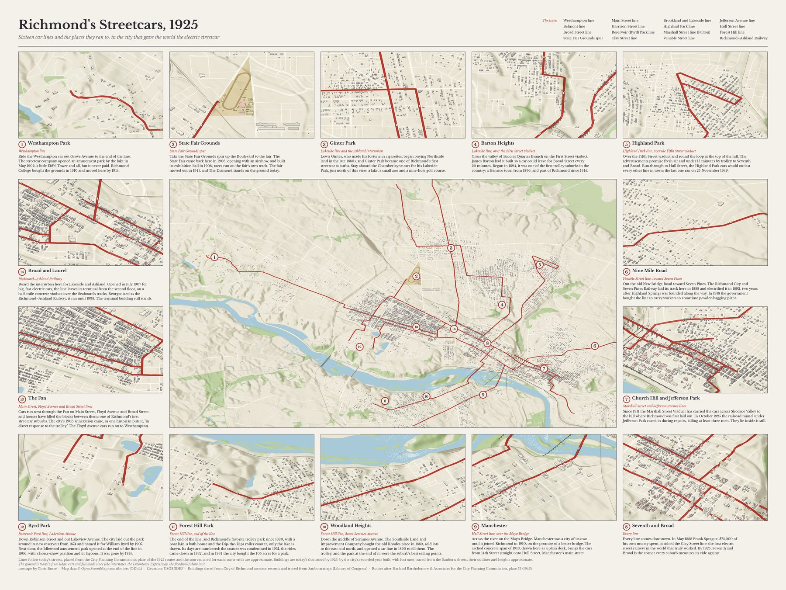

# Richmond's streetcars, 1925

By May 1888 Frank Sprague's electric cars were running on Richmond's hills, the first big electric street railway that worked, and the city grew out along the lines. This map draws the system as it stood in 1925: sixteen car lines over the buildings then standing, with fourteen places the cars ran to framed around it, from the suburbs they made to the trolley parks at the ends of the line.

[Open the map](https://busse.github.io/isoscape/#richmond-streetcars:1925) to pan and zoom, or jump to a stop below. Prints of the whole set, the map alone and each stop are in the [shop](https://chrisbusse.com/collections/richmond-streetcars-1925).

## The stops

### 1. Westhampton Park

*Westhampton line*

Ride the Westhampton car out Grove Avenue to the end of the line. The streetcar company opened an amusement park by the lake in May 1902, a little Eiffel Tower and all, but it never paid. Richmond College bought the grounds in 1910 and moved here by 1914.

[See it on the map](https://busse.github.io/isoscape/#richmond-streetcars:1925@-2388,-666,6) · Sources: [1](https://magazine.richmond.edu/article/-/25779) [2](https://libguides.richmond.edu/GamblesMillProject)

### 2. State Fair Grounds

*Boulevard spur*

Take the Boulevard spur north to the Fair Grounds. The State Fair came back here in 1906, opening with an airshow, and built its exhibition hall in 1908; races run on the fair's own track. The fair moved out in 1941, and The Diamond stands on the ground today.

[See it on the map](https://busse.github.io/isoscape/#richmond-streetcars:1925@311,-412,6) · Sources: [1](https://richmondfamilymagazine.com/community/history/how-and-where-the-state-fair-started/) [2](https://en.wikipedia.org/wiki/Richmond_Arena) [3](https://www.purethunderracing.com/?p=6184) [4](https://urbanscalerichmondvirginia.blogspot.com/2014/12/a-brief-history-of-sports-complex-in.html)

### 3. Ginter Park

*Lakeside line and the Ashland interurban*

Lewis Ginter, who made his fortune in cigarettes, began buying Northside land in the late 1880s, and Ginter Park became one of Richmond's first streetcar suburbs. Stay aboard the Chamberlayne cars for his Lakeside Park, just north of this view: a lake, a small zoo and a nine-hole golf course.

[See it on the map](https://busse.github.io/isoscape/#richmond-streetcars:1925@777,-791,6) · Sources: [1](https://www.lewisginter.org/visit/about/history/major-lewis-ginter/) [2](https://magazine.vcu.edu/2025-winter/a-streetcar-undesired/)

### 4. Barton Heights

*Lakeside line, over the First Street viaduct*

Cross Bacon's Quarter Branch on the First Street viaduct. James Barton had it built so a car could leave for Broad Street every 20 minutes. Begun in 1894, it was one of the first trolley suburbs in the country: a Henrico town from 1896, and part of Richmond since 1914.

[See it on the map](https://busse.github.io/isoscape/#richmond-streetcars:1925@1456,-31,6) · Sources: [1](https://richmondmagazine.com/news/richmond-history/barton%20heights%20the%20valentine%20community%20conversations/) [2](https://www.dhr.virginia.gov/historic-registers/127-0816/) [3](https://www.dhr.virginia.gov/?p=16934)

### 5. Highland Park

*Highland Park line, over the Fifth Street viaduct*

Over the Fifth Street viaduct and round the loop at the top of the hill. The advertisements promise fresh air and under 15 minutes by trolley to Seventh and Broad. Run through to Hull Street, the Highland Park cars would outlast every other line in town: the last one ran on 25 November 1949.

[See it on the map](https://busse.github.io/isoscape/#richmond-streetcars:1925@1961,-565,6) · Sources: [1](https://blog.richmond.edu/walkingrichmond/2017/04/26/disconnected) [2](https://richmondmagazine.com/news/richmond-history/richmond-trolley-system/) [3](https://npgallery.nps.gov/NRHP/GetAsset/NRHP/64500796_text)

### 6. Nine Mile Road

*Venable Street line, toward Seven Pines*

Out the old New Bridge Road toward Seven Pines. The Richmond City and Seven Pines Railway laid its track here in 1888 and electrified it in 1892, two years after Highland Springs was founded along the way. In 1918 the government bought the line to carry workers to a wartime powder-bagging plant.

[See it on the map](https://busse.github.io/isoscape/#richmond-streetcars:1925@2698,520,6) · Sources: [1](https://henrico.us/locations/nine-mile-road/) [2](https://modelingjimcrow.virginia.edu/node/91936)

### 7. Church Hill and Jefferson Park

*Marshall Street and Jefferson Avenue lines*

Since 1911 the Marshall Street Viaduct has carried the cars across Shockoe Valley to the hill where Richmond was first laid out. In October 1925 the railroad tunnel under Jefferson Park caved in during repairs, killing at least three men. They lie inside it still.

[See it on the map](https://busse.github.io/isoscape/#richmond-streetcars:1925@2019,826,6) · Sources: [1](https://www.wikipedia.org/wiki/Church_Hill,_Richmond,_Virginia) [2](https://gallery.library.vcu.edu/exhibits/show/mcv-aerial-photography/shockoe-valley-viaducts) [3](https://freepages.rootsweb.com/~howardlake/history/amusement12/jeffersonrichmondva.html) [4](https://www.atlasobscura.com/places/church-hill-tunnel)

### 8. Seventh and Broad

*Every line*

Every line comes downtown. In May 1888 Frank Sprague, $75,000 of his own money spent, finished the Clay Street line: the first electric street railway in the world that truly worked. By 1925, Seventh and Broad is the corner every suburb measures its ride against.

[See it on the map](https://busse.github.io/isoscape/#richmond-streetcars:1925@1262,484,6) · Sources: [1](https://magazine.vcu.edu/2025-winter/a-streetcar-undesired/) [2](https://blog.richmond.edu/walkingrichmond/2017/04/26/disconnected) [3](https://www.americanheritage.com/gems-symmetry-and-convenience)

### 9. Manchester

*Hull Street line, over the Mayo Bridge*

Across the river on the Mayo Bridge. Manchester was a city of its own until it joined Richmond in 1910, on the promise of a better bridge. The arched concrete span of 1913 brings the cars from 14th Street straight onto Hull Street, Manchester's main street of shops, restaurants and theaters.

[See it on the map](https://busse.github.io/isoscape/#richmond-streetcars:1925@1204,1168,6) · Sources: [1](https://architecturerichmond.com/?p=3761) [2](https://richmondmagazine.com/news/richmond-history/manchester-history/) [3](https://www.dhr.virginia.gov/historic-registers/127-0859/)

### 10. Woodland Heights

*Forest Hill line, down Semmes Avenue*

Down the middle of Semmes Avenue. The Southside Land and Improvement Company bought the old Rhodes place in 1889, sold lots to the east and north, and opened a car line in 1890 to fill them. The trolley, and the park at the end of it, were the suburb's best selling points.

[See it on the map](https://busse.github.io/isoscape/#richmond-streetcars:1925@446,1190,6) · Sources: [1](https://rvanews.com/?p=20228) [2](https://tclf.org/forest-hill-park-va) [3](https://sah-archipedia.org/node/1321)

### 11. Forest Hill Park

*Forest Hill line, end of the line*

The end of the line, and Richmond's favorite trolley park since 1890: a boat lake, a bath house and the Dip-the-Dips roller coaster. Its days are numbered. The coaster was condemned in 1931, the rides came down in 1932, and in 1934 the city bought the 105 acres for a public park.

[See it on the map](https://busse.github.io/isoscape/#richmond-streetcars:1925@-109,1264,6) · Sources: [1](https://tclf.org/forest-hill-park-va) [2](https://richmondfamilymagazine.com/community/history/richmonds-original-theme-park/) [3](https://www.hmdb.org/m.asp?m=28854) [4](https://npgallery.nps.gov/NRHP/GetAsset/NRHP/64500796_text)

### 12. Byrd Park

*Reservoir Park line, Lakeview Avenue*

Down Robinson Street and out Lakeview Avenue. The city laid out the park around its new reservoir from 1874 and named it for William Byrd by 1907. Next door, the Idlewood amusement park opened at the end of the line in 1906, with a horse-show pavilion and lit lagoons. It was gone by 1914.

[See it on the map](https://busse.github.io/isoscape/#richmond-streetcars:1925@-446,529,6) · Sources: [1](https://www.tclf.org/landscapes/byrd-park) [2](https://www.dalebrumfield.net/single-post/2014/05/03/part-7-live-fast-die-hard-richmond-s-idlewood-amusement-park) [3](https://en.wikipedia.org/wiki/Byrd_Park)

### 13. The Fan

*Main Street, Floyd Avenue and Broad Street lines*

Cars run west through the Fan on Main Street, Floyd Avenue and Broad Street, and houses have filled the blocks between them: one of Richmond's first streetcar suburbs. The city's 1906 annexation came, as one historian puts it, "in direct response to the trolley." The Floyd Avenue cars run on to Westhampton.

[See it on the map](https://busse.github.io/isoscape/#richmond-streetcars:1925@311,270,6) · Sources: [1](https://magazine.vcu.edu/2025-winter/a-streetcar-undesired/) [2](https://dhr.virginia.gov/VLR_to_transfer/PDFNoms/127-6064_Three_Chopt_Road_HD_2012_NR_FINAL.pdf)

### 14. Broad and Laurel

*Richmond–Ashland Railway*

Board the interurban here for Lakeside and Ashland. Opened in July 1907 for big, fast electric cars, the line crosses Bacon's Quarter Branch on a half-mile concrete trestle. Reorganized as the Richmond–Ashland Railway, it ran until 1938. The terminal building still stands.

[See it on the map](https://busse.github.io/isoscape/#richmond-streetcars:1925@815,295,6) · Sources: [1](https://pantographblog.blogspot.com/2009/08/richmond-and-chesapeake-bay-railway.html) [2](https://american-rails.com/vgainterstrethsy.html)

## The lines

Each line follows the streets its sources name, placed on today's streets. Where a source is silent, the ends are approximate.

| Line | Route | Ran |
|---|---|---|
| Westhampton line | Floyd Avenue – Grove Avenue – Westhampton | 1901–1947 |
| Belmont line | Broad Street – Sheppard Street – Cary Street – Belmont Avenue | 1895–1949 |
| Broad Street line | Broad Street, Sheppard Street to Church Hill | 1888–1949 |
| State Fair Grounds spur | Boulevard north to the Fair Grounds | 1906–1941 |
| Main Street line | Main Street, Robinson Street to Shockoe | 1888–1949 |
| Harrison Street line | Harrison Street, Main to Broad | 1890–1949 |
| Reservoir (Byrd) Park line | Robinson Street – Lakeview Avenue | 1895–1949 |
| Clay Street line | Clay Street | 1888–1949 |
| Brookland and Lakeside line | 1st Street – North Avenue – Brookland Park – Chamberlayne – Laburnum – Hermitage Road | 1891–1949 |
| Highland Park line | 5th Street – Northside Viaduct – Highland Park loop | 1893–1949 |
| Marshall Street line (Fulton) | Marshall Street Viaduct – Church Hill – Fulton | 1911–1949 |
| Venable Street line | 17th Street – Venable Street – 25th Street – Nine Mile Road | 1888–1949 |
| Jefferson Avenue line | 21st Street – Jefferson Avenue | 1890–1949 |
| Hull Street line | 14th Street – Mayo Bridge – Hull Street | 1888–1949 |
| Forest Hill line | 7th Street – Free Bridge – Semmes Avenue – Forest Hill Avenue | 1890–1934 |
| Richmond–Ashland Railway | Broad and Laurel – Brook Road – Ashland | 1907–1938 |

## How it was drawn

The routes come from plate 53 of Harland Bartholomew & Associates' 1943 report to the City Planning Commission, *Early Transit Routes, 1888 & 1925*, with the details from the sources listed for each line. Buildings are the ones standing today that the city assessor dates to 1925 or before, plus those traced from Sanborn fire-insurance maps downtown; small streets are drawn only where a house of the year stood nearby. Henrico County keeps no such dates online, so the suburbs across the 1925 county line look emptier than they were. On the big map, lines and cars are drawn three times life size; on the single-stop prints, one and a half.

More in [How it's made](how-its-made.md#time).
