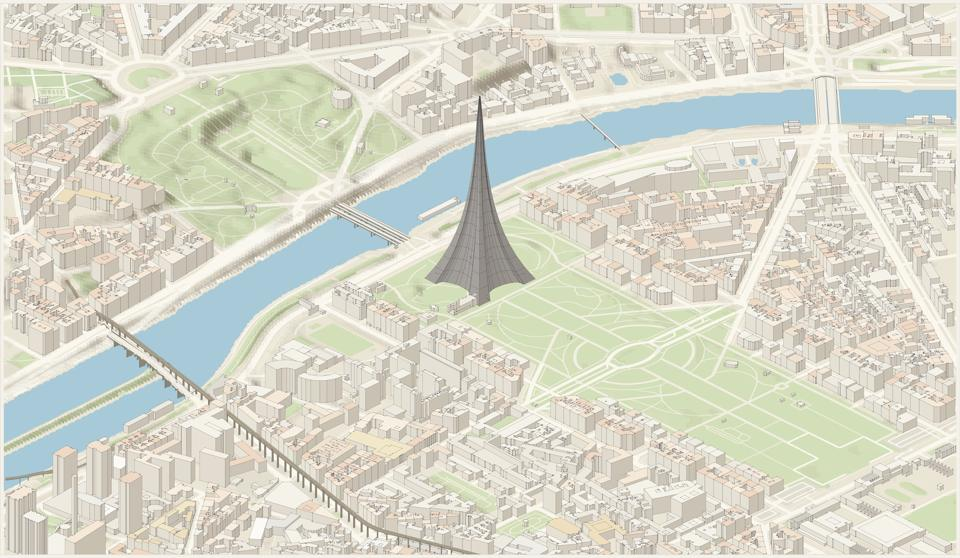
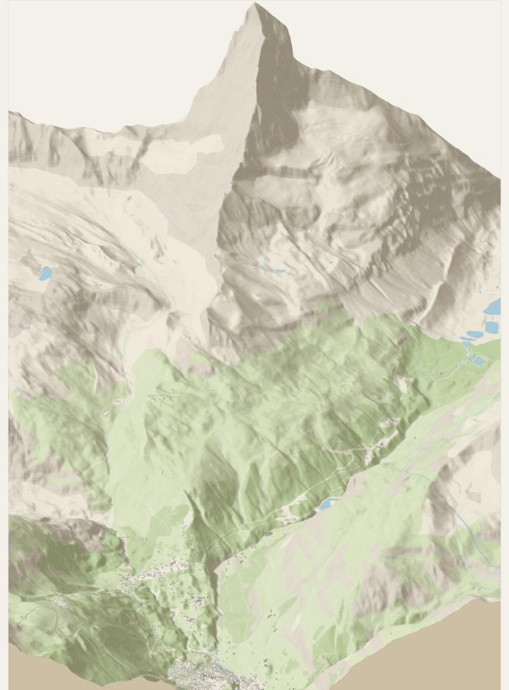
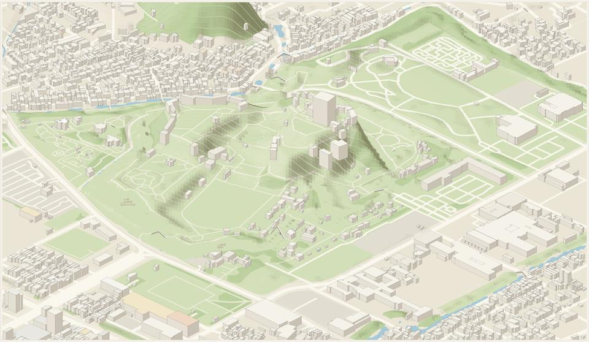
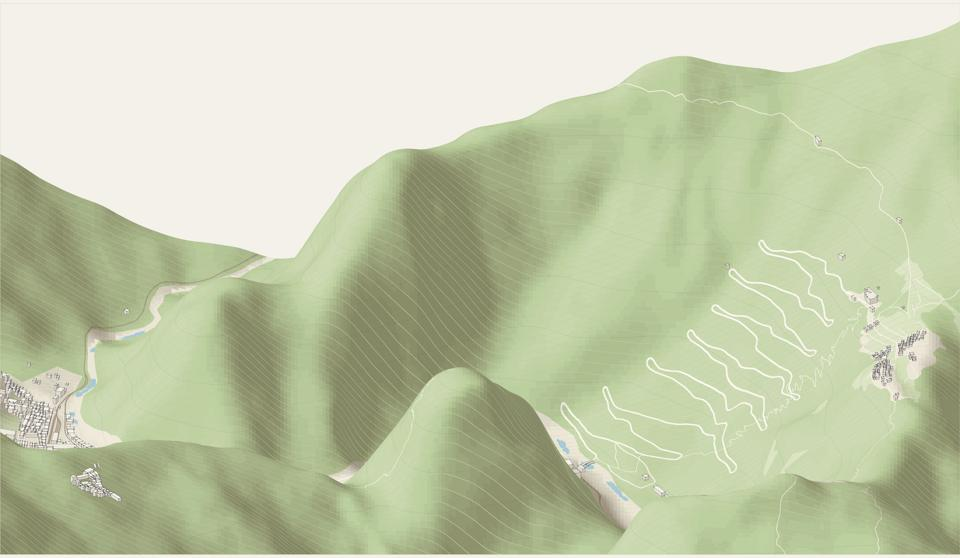
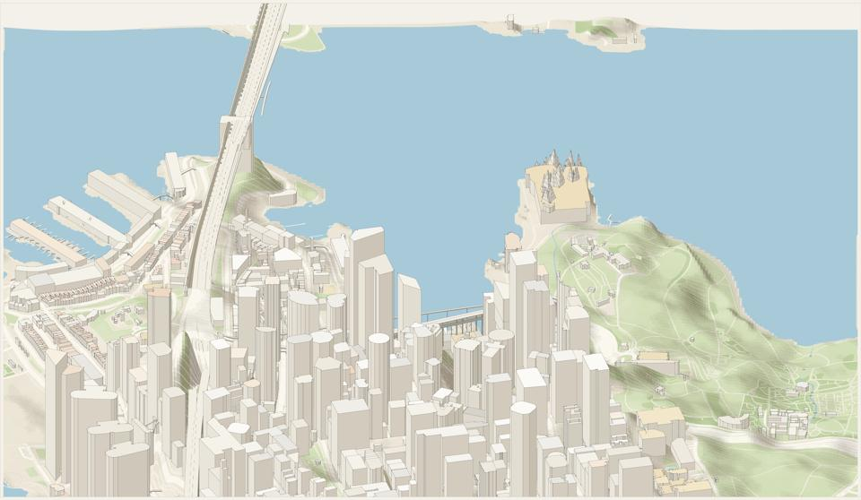

# Landmarks around the world

isoscape started with American data: buildings and roads from OpenStreetMap, and ground
heights from the US Geological Survey's lidar. OpenStreetMap covers the whole world, but USGS
elevation stops at the US border, so a map anywhere else used to come out flat.

These five landmarks show that isoscape can now draw anywhere. Each one takes its terrain
from a different open elevation dataset: three national mapping agencies, a European space
programme, and a worldwide open mosaic. The buildings still come from OpenStreetMap. Everything
after the download is the same code that draws Richmond and the fifty American landmarks.

| Landmark | Elevation data | Who publishes it | Ground detail |
|---|---|---|---|
| [Eiffel Tower, Paris](https://busse.github.io/isoscape/#lm-eiffel-tower) | RGE ALTI® | IGN, France's national mapping institute | 1 m, lidar-derived |
| [Matterhorn and Zermatt](https://busse.github.io/isoscape/#lm-matterhorn) | swissALTI3D, with Copernicus over the border | swisstopo, Switzerland's federal mapping office | 2 m, lidar |
| [Himeji Castle, Japan](https://busse.github.io/isoscape/#lm-himeji-castle) | Elevation tiles (標高タイル) | GSI, Japan's national survey | 5 m, lidar |
| [Machu Picchu, Peru](https://busse.github.io/isoscape/#lm-machu-picchu) | Copernicus DEM GLO-30 | European Space Agency / EU Copernicus | 30 m, radar from orbit |
| [Sydney Opera House and Harbour Bridge](https://busse.github.io/isoscape/#lm-sydney-opera-house) | Terrain Tiles | Mapzen/Tilezen on AWS Open Data | 30 m here (SRTM) |

Click a landmark's name to open its map, then drag to pan and scroll to zoom. Prints of all
five are in the [holiday shop](https://chrisbusse.com/collections/world-landmarks) through
December 31, 2026.

## Eiffel Tower, Paris

**[Open the map of the Eiffel Tower in the explorer →](https://busse.github.io/isoscape/#lm-eiffel-tower)**



**Data: [IGN RGE ALTI®](https://geoservices.ign.fr/rgealti)**, France's bare-earth model at
1 m. It is built from airborne lidar over cities, coasts and forests, and from matched aerial
photographs elsewhere. isoscape asks IGN's map server (the Géoplateforme) for exactly the box
it needs, as raw 32-bit heights. The Seine's quays and the slope up to the Trocadéro gardens
come straight from it.

OpenStreetMap tags the tower as an iron lattice (`tower:construction=lattice`). A solid box
would read as a skyscraper, so isoscape draws any lattice tower as a tapering spire on the
mapped footprint. Its width follows the Eiffel Tower's own curve: about half the base at the
first platform and a third at the second.

Licence: Licence Ouverte 2.0 (Etalab). Credit: *RGE ALTI® © IGN*.

## Matterhorn and Zermatt, Switzerland

**[Open the map of the Matterhorn and Zermatt in the explorer →](https://busse.github.io/isoscape/#lm-matterhorn)**



**Data: [swisstopo swissALTI3D](https://www.swisstopo.admin.ch/en/height-model-swissalti3d)**,
a lidar model of Switzerland published as one-kilometre squares at 2 m in the Swiss national
grid (LV95). isoscape finds the squares it needs in swisstopo's STAC catalogue, keeps the
newest survey of each, and converts every sample from Swiss coordinates using swisstopo's
published formulas.

The summit sits on the Italian border, and swissALTI3D stops there. The Italian side is
filled from Copernicus GLO-30 (see Machu Picchu). Each region can name a second source for
whatever the first leaves empty, so the mountain is whole.

Licence: swisstopo's terms for free geodata (OGD), commercial use included. Credit:
*swissALTI3D © Federal Office of Topography swisstopo*, plus the Copernicus notice.

## Himeji Castle, Japan

**[Open the map of Himeji Castle in the explorer →](https://busse.github.io/isoscape/#lm-himeji-castle)**



**Data: [GSI elevation tiles](https://maps.gsi.go.jp/development/ichiran.html)** from the
Geospatial Information Authority of Japan. They are map tiles with the height packed into
each pixel's colour, in hundredths of a metre. isoscape reads the 5 m lidar tiles first, then
5 m photogrammetry, and fills any gaps from the 10 m national model. It then reprojects from
the web map grid to its own.

The castle hill, the moats and the low ground of the city around them are all in the data.

Licence: GSI's content terms, compatible with CC BY 4.0. Credit: *GSI elevation tiles,
processed* (地理院タイル（標高タイル）を加工して作成).

## Machu Picchu, Peru

**[Open the map of Machu Picchu in the explorer →](https://busse.github.io/isoscape/#lm-machu-picchu)**



**Data: [Copernicus DEM GLO-30](https://dataspace.copernicus.eu/explore-data/data-collections/copernicus-contributing-missions/collections-description/COP-DEM)**,
a model of the whole planet at 30 m, made by the TanDEM-X radar satellites and released free
by the EU's Copernicus programme. It is published as one-degree squares of cloud-optimised
GeoTIFF on AWS. isoscape reads those files directly; its TIFF reader now handles their Deflate
compression and floating-point predictor.

This is a surface model, so forest canopy and roofs are part of the height. At 30 m it is too
coarse for streets, but in the Andes the terrain is the subject: the Urubamba gorge, the
switchback road up from Aguas Calientes, the citadel on its saddle, and the peaks around it.

Licence: free worldwide, commercial use included. Credit: *produced using Copernicus
WorldDEM-30 © DLR e.V. 2010-2014 and © Airbus Defence and Space GmbH 2014-2018 provided under
COPERNICUS by the European Union and ESA; all rights reserved*.

## Sydney Opera House and Harbour Bridge, Australia

**[Open the map of Sydney in the explorer →](https://busse.github.io/isoscape/#lm-sydney-opera-house)**



**Data: [Terrain Tiles](https://registry.opendata.aws/terrain-tiles/)**, an open worldwide
mosaic on AWS. Each place gets the best open model available there, in the
same web-map tiles as GSI with a different colour encoding. In Sydney that model is NASA's
SRTM radar survey at 30 m. Geoscience Australia's 5 m lidar would be sharper, but its web
service did not answer coverage requests when these maps were made.

OpenStreetMap maps the Opera House's sails as roof parts with no heights. isoscape draws a
curved roof shell with no height as a sail rising to a point, sized from its footprint, on
top of the podium. **The sail heights are an approximation**, not a survey.

Licence: open data from each underlying source. Credit: *Terrain Tiles (Mapzen/Tilezen);
SRTM courtesy of the U.S. Geological Survey; ETOPO1 courtesy of NOAA*.

## How it works

A region's file names its elevation source in its `terrain` section:

```json
"terrain": { "source": "swisstopo", "fillFrom": "copernicus", "demResolution": 4 }
```

The sources are `3dep` (the default), `ign`, `swisstopo`, `gsi`, `copernicus` and
`terrain-tiles`. `isoscape sources` lists each one with its coverage, credit and licence.
They fall into two kinds:

- **Cut to order** (USGS 3DEP, IGN): the server returns an image for any box, so isoscape
  asks for tiles that line up exactly with its own grid.
- **Fixed pieces** (GSI, Terrain Tiles, Copernicus, swisstopo): web-map tiles, one-degree
  squares or one-kilometre squares in a national grid. isoscape downloads the pieces covering
  the frame, then samples each point of its grid from them, converting to the piece's own
  coordinates.

Either way the result is the same: a grid of metres above sea level over the frame, cached in
`data/<region>/dem.bin.gz` with the source's name. Nothing after the fetch knows where the
heights came from, except the credits. The map's caption, the explorer's "How this view was
made" tab and the prints all name the right source. [How it's made](how-its-made.md#inputs)
covers the rest of the pipeline.

**Try it:** for a place outside the US, give your coding agent the
[Make your own](https://github.com/busse/isoscape#make-your-own) prompt and add "use the
elevation source for that country, or `copernicus`".
